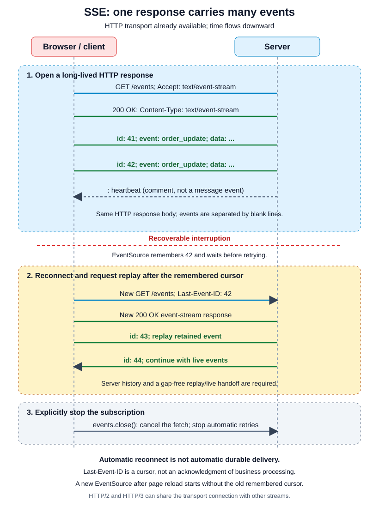

# Server-Sent Events (SSE)

Parent guide: [Networking & APIs](../../02-requests/index.md).
Related: [WebSocket](../websocket/index.md) for frequent two-way messages.

**Server-Sent Events** keeps an HTTP response open while the server writes
UTF-8 events to the client. UTF-8 is a standard encoding for text. A shopping app
can use it for order status, notifications, or progress updates. The channel is one-way, from server to
client; occasional commands can still use ordinary POST requests.

Use **polling**, repeatedly asking the server for the latest state, if updates
are rare and some delay is acceptable. Choose WebSocket
when both sides need frequent messages or binary payloads. Two-way application
behavior alone does not require a two-way channel.

For one successful update, the page opens `/events`, the order changes to
`shipped`, and the server writes an `order_update` event. The page reads that
event and changes the displayed status without starting another request.
First follow this path through the wire format and browser example; replay and
operating limits explain what to do when the connection no longer works normally.

## Connection lifecycle

[](assets/sse-lifecycle.svg)

The client starts with one GET. SSE works over HTTP/1.1, HTTP/2, and HTTP/3
without a protocol upgrade. On HTTP/1.1 the long-lived response occupies its
connection. HTTP/2 and HTTP/3 can carry it as one stream among others on a
shared connection.

## SSE wire format

The client requests an event stream:

```http
GET /events HTTP/1.1
Host: shop.example
Accept: text/event-stream
```

The server returns `200 OK`, then continues writing the body:

```http
HTTP/1.1 200 OK
Content-Type: text/event-stream
Cache-Control: no-cache

retry: 5000

id: 41
event: order_update
data: {"order_id":"o456","status":"shipped"}

: heartbeat

```

The body is UTF-8 text. A **blank line ends an event block**. Blocks without a
`data:` field, such as the heartbeat or retry setting, do not dispatch a message.
These excerpts omit HTTP transfer framing: SSE blocks do not have to align with
TCP packets, HTTP chunks, or HTTP/2 or HTTP/3 DATA frames.

| Field | Meaning |
| --- | --- |
| `data:` | Event payload; multiple data lines are joined with newlines |
| `event:` | Optional event name; without it the event type is `message` |
| `id:` | Resume cursor remembered by this EventSource instance |
| `retry:` | Reconnection delay in milliseconds; the browser can add backoff |
| `:` comment | Ignored as event data; useful as a heartbeat |

For binary payloads, use a separate download, encode the data with an explicit
size limit, or choose WebSocket. SSE's event body itself is text.

## SSE browser API

```javascript
const events = new EventSource("/events");

events.onopen = () => console.log("stream open");
events.onmessage = (event) => console.log("message", event.data);

events.addEventListener("order_update", (event) => {
  const update = JSON.parse(event.data);
  console.log(update.order_id, update.status);
});

events.onerror = () => {
  const message = events.readyState === EventSource.CLOSED
    ? "stream closed; inspect authentication or endpoint errors"
    : "stream interrupted; EventSource is reconnecting";
  console.log(message);
};

function stopEvents() {
  events.close();
}
```

Call `stopEvents()` when leaving the view, not immediately after opening the
stream. It cancels the request and stops automatic retries.

Native `EventSource` sends GET requests and cannot set arbitrary request headers.
Same-origin cookies are one authentication option. For cross-origin cookies,
construct it with `new EventSource(url, { withCredentials: true })`; the server
must allow the specific origin, not `*`, and send
`Access-Control-Allow-Credentials: true`. Cookie policies still apply.
If custom headers or POST are necessary, use a streaming fetch client and
implement parsing and reconnection, or use a suitable library.

Short-lived connection tickets are another option. Avoid long-lived secrets in
URLs because URLs can be recorded in logs.

## SSE reconnection and replay

For a recoverable interruption, the same EventSource waits and sends a new GET.
If it remembers a nonempty ID, that request includes `Last-Event-ID`. The initial
retry delay is browser-defined; a `retry:` field can change it.

The server can resume **only if it implements replay and retains the required
history**. Use an ordered log shared by the serving instances, or another design
that makes the same history available after a reconnect. Synchronize the
replay-to-live handoff so no event falls into a gap.

A **cursor** identifies a position in that history. If the browser remembers
event `41`, the server can replay retained events `42` onward. The handoff must
also include events arriving while replay runs, before switching to new live events.

If a cursor is older than the retention window, define an explicit recovery
policy. For example, a named `reset` event can ask the client to obtain a fresh
snapshot and resume from a defined cursor. Do not silently skip missing history.
A **snapshot** is the current state, such as the order's latest status, rather
than every event that led to it.

**Last-Event-ID is not a business acknowledgment.** The browser remembering an ID
does not prove the application saved or acted on that event. A replay policy can
repeat events, so make handling harmless when repeated or deduplicate by stable
event IDs. SSE alone guarantees neither at-least-once business processing nor
exactly-once effects.

A page reload creates a new EventSource without the old cursor. Resume across
reloads needs application-managed persistence and a server-supported mechanism,
such as a validated `after` query parameter. Business-critical processing may
also need an explicit checkpoint or acknowledgment protocol.

The final response must be `200` with `Content-Type: text/event-stream`. A
different status or media type fails the EventSource connection rather than
providing ordinary automatic retries. `204 No Content` tells the browser to stop.
HTTP redirects can be followed before that final response. Test the terminal
failure and authentication paths instead of assuming every error reconnects.

## Operate an event stream

- **Flush promptly:** disable proxy response buffering; configure compression
  to flush or disable it. Otherwise events can accumulate instead of reaching
  the page as they happen.
- **Keep idle paths alive:** send comments such as `: heartbeat` below the
  shortest idle timeout. A 15-second interval is an example, not a guarantee.
  Heartbeats cannot prevent deploys, maximum lifetimes, or network failures.
- **Bound resources:** cap subscriptions per user, event sizes, and outgoing
  queues. HTTP/1.1 streams compete under browser per-host connection limits;
  HTTP/2 and HTTP/3 still have concurrent-stream limits.
- **Handle slow consumers explicitly:** close and replay, or coalesce updates
  (combine them into one newer update)
  only when their semantics allow replacement. Never silently discard critical
  events merely to reduce memory use.
- **Authorize access:** authenticate connection establishment, authorize every
  subscription, validate cursor scope, and define termination on expiry or
  revocation. A cursor is not permission to read another user's events.
- **Recover across instances:** a shared bus can reach clients connected
  elsewhere, but transient pub/sub is not automatically a durable replay log.

## Document the event contract

State the URL, authentication, event names, payload fields, ordering scope,
retention window, resume cursor, reset behavior, size/rate limits, heartbeat,
and termination policy. Explain whether an acknowledgment or checkpoint exists
and what it proves.

For example, `order_update` carries `order_id` and `status`; the contract must
also define which statuses are valid and how duplicate or out-of-order updates
are handled. Clients may ignore unknown optional notifications if the contract
allows it. Changing a field's units or meaning can break clients just as in an
ordinary HTTP API.

Before shipping, test a recoverable disconnect, an expired cursor, a page reload,
authentication expiry, and a slow consumer. Verify the replay/live boundary
under concurrent writes rather than testing only a quiet stream.

## References and related reading

- [WHATWG Server-sent events](https://html.spec.whatwg.org/multipage/server-sent-events.html)
- [WebSocket](../websocket/index.md)
- [Parent comparison of polling, SSE, and WebSocket](../../02-requests/index.md#real-time-updates-sse-and-websocket)
- [Parent API contract guidance](../../02-requests/index.md#define-the-api-contract)
