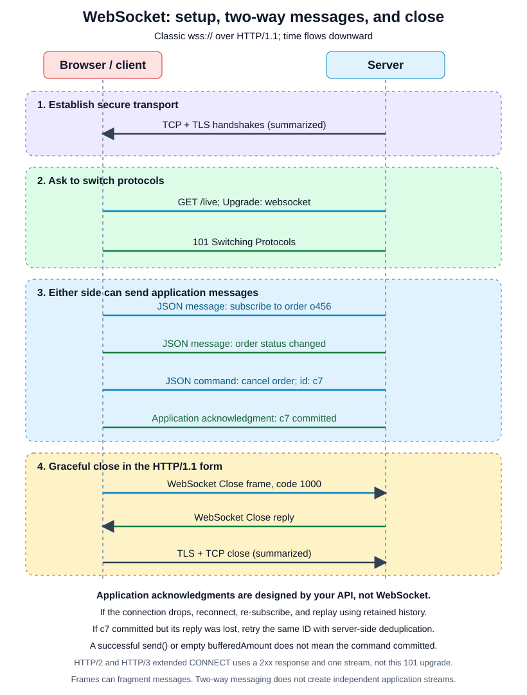

# WebSocket

Parent guide: [Networking & APIs](../../02-requests/index.md).
Related: [Server-Sent Events (SSE)](../sse/index.md) for one-way notifications.

**WebSocket** is a long-lived message channel where both sides can send without
waiting for a matching request. Messages may be text or binary. It fits chat,
shared editing, games, or other frequent two-way traffic. Use `wss://` outside
local development so communication is protected.

For occasional server updates, polling may be enough. For low-delay one-way
notifications, SSE plus ordinary POST commands can be simpler. Neither a
WebSocket nor SSE automatically proves that the application processed a message.

## Connection lifecycle

[](assets/websocket-lifecycle.svg)

## WebSocket handshake

The diagram shows classic WebSocket over HTTP/1.1. For `wss://`, TCP and TLS are
established first, then the client asks to upgrade:

```http
GET /live HTTP/1.1
Host: shop.example
Upgrade: websocket
Connection: Upgrade
Sec-WebSocket-Key: dGhlIHNhbXBsZSBub25jZQ==
Sec-WebSocket-Version: 13
Origin: https://shop.example
```

The server accepts with:

```http
HTTP/1.1 101 Switching Protocols
Upgrade: websocket
Connection: Upgrade
Sec-WebSocket-Accept: s3pPLMBiTxaQ9kYGzzhZRbK+xOo=
```

`Sec-WebSocket-Key` is a random client value. The accept header is computed by
appending a protocol-defined constant, hashing with SHA-1, and base64-encoding.
It demonstrates that the server understood the handshake; it is **not user
authentication or encryption**. TLS provides communication protection, and the
application separately authenticates and authorizes the user.

After this `101`, the HTTP/1.1 connection carries WebSocket frames, not ordinary
HTTP messages. `Origin` identifies the initiating browser page, while an optional
`Sec-WebSocket-Protocol` lets the peers select an application subprotocol such
as `chat.v1`.

## WebSocket frames and browser API

A message can use one frame or several fragments. Text frames carry UTF-8;
binary frames carry bytes. Client frames are masked with a random key as required
by the protocol. Masking protects intermediaries; it is not encryption.

Ping and Pong are protocol control frames. Browsers automatically answer Ping,
but browser JavaScript cannot directly send protocol Ping frames. An application
that needs its own heartbeat can define a small JSON message instead.

This example's application protocol uses JSON text:

```javascript
const socket = new WebSocket("wss://shop.example/live");

socket.onopen = () => {
  socket.send(JSON.stringify({ type: "subscribe", order_id: "o456" }));
};

socket.onmessage = (event) => {
  const message = JSON.parse(event.data);
  console.log(message.type, message);
};

socket.onerror = () => console.log("connection error");
socket.onclose = (event) => console.log("closed", event.code, event.reason);

function disconnect() {
  socket.close(1000, "done");
}
```

Call `disconnect()` when leaving the view. Sending while `readyState` is
CONNECTING throws; send after the open event. `bufferedAmount` reports outgoing
queued bytes, not whether the receiver processed a message. Bound outgoing
queues and incoming work: the browser API has no automatic inbound backpressure.
It also cannot set arbitrary request headers and does not reconnect for you.

**Duplex is not multiplexing.** A WebSocket supports simultaneous communication
in both directions, but topic labels in JSON do not create independent
HTTP/2-style streams. Messages in each direction still use one ordered channel.

## WebSocket over HTTP/2 and HTTP/3

These versions do not use the HTTP/1.1 Upgrade mechanism. **Extended CONNECT**
with `:protocol = websocket` establishes a WebSocket on one HTTP stream. It needs
the peer's advertised capability and a successful `2xx` response, not `101`.
WebSocket frames then travel inside that stream while other streams can continue.

Support must work across the browser, proxy, gateway, and server. Loading a page
with HTTP/2 or HTTP/3 does not prove its WebSocket uses that version. A separate
HTTP/1.1 connection is still possible.

## WebSocket close and recovery

A clean close exchanges Close control frames. Common codes include `1000`
(normal), `1001` (going away), `1008` (policy violation), and `1011` (server error).
In the HTTP/1.1 form the transport then closes. With extended CONNECT, the
WebSocket's HTTP stream ends, not necessarily the shared transport connection.

A network drop may have no close handshake. The application must reconnect with
bounded exponential backoff and jitter, re-subscribe, and re-sync missed events.
It must also decide when authentication failure or a policy close should stop retries.

Within a live channel, messages retain their send order in each direction.
Classic WebSocket relies on TCP; HTTP/3 extended CONNECT uses ordered delivery
within one QUIC stream. Neither provides business-level replay or processing
acknowledgments.

If `send()` succeeds and the connection then drops, the command's outcome can be
uncertain. Give commands stable IDs, enforce duplicate prevention on the server,
and define application acknowledgments: received, validated, or committed are
different promises.

```json
{"type":"order.cancel","id":"c7","payload":{"order_id":"o456"}}
```

```json
{"type":"order.status","reply_to":"c7","payload":{"order_id":"o456","status":"cancelled"}}
```

If command `c7` committed but its reply was lost, retry the same ID and input
under a server-enforced deduplication contract. Return the recorded result instead
of cancelling twice. Scope IDs to the caller and operation, reject reuse with
different input, and document retention and in-flight behavior. Once deduplication
records expire, retrying may execute again; provide a status lookup for uncertain
outcomes.

For notifications, retain ordered event history and use a replay cursor with a
gap-free replay/live handoff. Define an explicit snapshot/reset path when the
cursor expires. A new socket does not preserve old subscriptions or cursors
automatically. Replayed messages may repeat, so deduplicate or make their handling
harmless when repeated. Transport delivery, replay, and committed business effects
are separate guarantees.

## Operate a message channel

- **Configure the path:** every relevant proxy or gateway must support HTTP/1.1
  Upgrade or the negotiated extended CONNECT form.
- **Detect dead peers:** use protocol Ping/Pong where available or an application
  heartbeat. Choose intervals below the shortest idle timeout. Heartbeats cannot
  prevent maximum connection lifetimes, deploys, or network failures.
- **Bound resources:** cap channels per user, message sizes and rates, incoming
  work, and outgoing queues. Close or throttle slow consumers under an explicit
  recovery policy; never silently drop critical messages to save memory.
- **Authenticate and authorize:** check every subscription and action, not only
  the initial connection. Define how credential expiry or revoked access ends a
  channel.
- **Validate browser Origin:** WebSocket does not use CORS as a connection barrier.
  Browsers may send eligible cookies on requests initiated from another page.
  Check Origin against an allow-list to prevent cross-site WebSocket hijacking,
  but do not use Origin as identity: non-browser clients can forge it.
- **Define credential handling:** cookies, short-lived tickets, or an authenticated
  first message need an explicit policy. Unauthenticated channels must not receive
  private data or execute commands. Avoid long-lived secrets in logged URLs.
- **Route across instances:** a shared bus can reach users connected elsewhere.
  Transient pub/sub is not automatically a durable replay log; keep the history
  and committed results needed by the recovery contract.

## Document the message contract

State the URL, authentication, message types, payload fields, ordering scope,
retention window, cursor/reset behavior, size/rate limits, heartbeat, close policy,
and acknowledgment meanings. If using a subprotocol, document its version too.
Clarify which replies mean received, validated, or committed.

Clients can ignore unknown optional notifications if the contract allows it.
Unknown commands or mandatory protocol messages need an error or version policy.
Changing an existing field's units or meaning can break clients just as in an
ordinary HTTP API.

Before shipping, test a disconnect after a command commits but before its reply,
duplicate commands, expired replay cursors, revoked access, slow consumers, and
reconnect storms. Verify recovery through the real proxy path, not just directly
against the application server.

## References and related reading

- [WebSocket protocol](https://www.rfc-editor.org/rfc/rfc6455.html)
- [WebSocket over HTTP/2](https://www.rfc-editor.org/rfc/rfc8441.html)
- [WebSocket over HTTP/3](https://www.rfc-editor.org/rfc/rfc9220.html)
- [Server-Sent Events (SSE)](../sse/index.md)
- [Parent realtime comparison](../../02-requests/index.md#real-time-updates-sse-and-websocket)
- [Parent guidance on uncertain outcomes and idempotency](../../02-requests/index.md#handle-timeouts)
