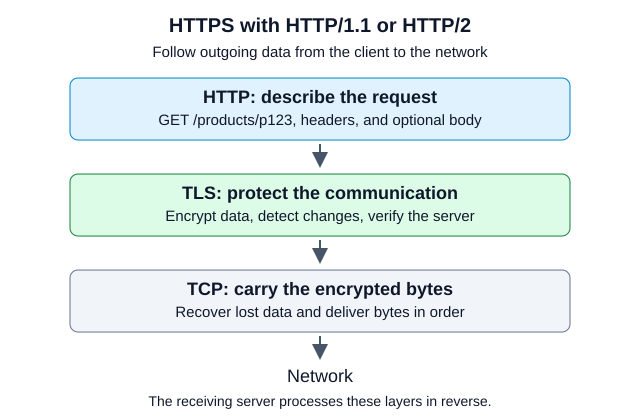
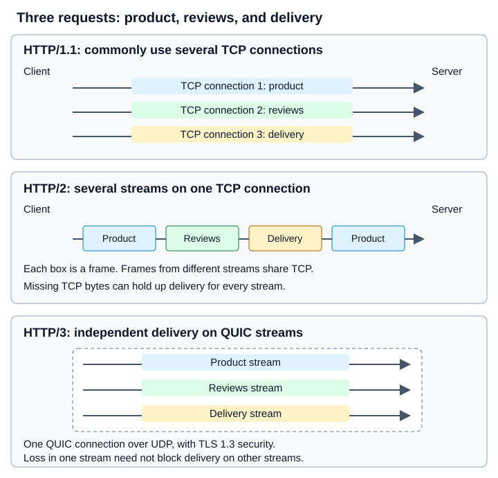

# Networking & APIs

Networking carries requests and responses between a client and a service. An
**API (application programming interface)** defines what the client can ask the
service to do, what input it must send, and what the service returns. Clients need
this agreement to handle successful requests, errors, and missing responses.

Previous: [define the shop's requirements](01-thinking.md).

## What is HTTP?

**HTTP (Hypertext Transfer Protocol)** defines how a client asks a server to do
something and how the server responds. A client might be a browser, a mobile
app, or another backend service.

Suppose the shopping app needs the details of product `p123`. It sends this
request to the shop's backend:

```http
GET /products/p123 HTTP/1.1
Host: shop.example
Accept: application/json
```

`GET` asks to read data. `/products/p123` identifies the product. The `Host`
header identifies the website, and `Accept` tells the server that the client
wants JSON.

If the product exists, the backend can return:

```http
HTTP/1.1 200 OK
Content-Type: application/json

{"id":"p123","name":"Notebook","price_minor":500,"currency":"USD"}
```

`200 OK` means the request succeeded. `Content-Type` describes the response
body's format. The body contains the product data. These examples leave out
some headers to focus on the message.

HTTP defines **methods**, such as `GET` and `POST`; **headers**, such as
`Accept` and `Authorization`; **status codes**, such as `200` and `404`; and how
messages carry **bodies**, such as JSON or an image.

The `HTTP/1.1` in the example is the HTTP protocol version, not a version of the
shop's API. A path such as `/api/v2/products` is an API naming choice and does
not tell you which HTTP version carries the request.

## How are HTTP, TCP, and HTTPS different?

HTTP describes the messages, but something still has to carry them across the
network.

**TCP (Transmission Control Protocol)** delivers bytes reliably and in order.
If some data is lost, TCP retransmits it. If the connection fails and delivery
cannot complete, the application must handle that failure. TCP does not encrypt
the data, and it does not know what a product or an order is.

With plain HTTP over TCP, someone who can intercept the traffic may read or
change it. Sending a password this way can expose it.

**HTTPS is HTTP protected by TLS (Transport Layer Security).** TLS encrypts the
messages and protects them from changes in transit. It also lets the client
check the server's identity using a certificate. The browser checks that the
certificate covers the requested hostname and comes from a trusted issuer.

| Part | Job |
| --- | --- |
| HTTP | Defines what a request and response mean |
| TCP | Carries bytes reliably and in order, without encrypting them |
| TLS | Encrypts communication, detects changes, and authenticates the server |
| HTTPS | Uses HTTP with TLS protection |

[](assets/https-layers.svg)

For HTTP/1.1 and HTTP/2 over HTTPS, data passes through these layers on its way
out of the client:

```text
HTTP message or frames --> TLS encryption --> TCP --> Network
```

The receiving side reverses the process before the backend handles the HTTP
request. **HTTPS is about protecting communication; the HTTP version is about
how that communication is carried out.**

HTTPS does not prove that a website is honest or that its backend is secure.
It also does not give a signed-in customer permission to read another
customer's orders. The application must check those permissions.

## What changes between HTTP/1.1, HTTP/2, and HTTP/3?

All three versions still use methods, headers, status codes, and bodies.
The main difference here is how they send messages and share a connection
when several requests are in progress.

[](assets/http-versions.svg)

### HTTP/1.1: reuse connections, but responses must stay in order

Imagine the app needs a product, its reviews, and delivery options.
HTTP/1.1 can reuse a TCP connection, so it does not need a new connection for
every request.

But it cannot mix pieces of different responses on that connection. Clients
commonly use several connections when they need requests to progress at the
same time:

```text
App -- TCP connection 1: product request --> Server
App -- TCP connection 2: reviews request --> Server
App -- TCP connection 3: delivery request -> Server
```

HTTP/1.1 also supports **pipelining**, which sends another request before the
previous response finishes. Responses must still arrive in request order, so a
slow first response delays later ones. This is called **head-of-line blocking**:
work at the front holds up work behind it. Pipelining is rarely used in browsers.

### HTTP/2: let several requests share one TCP connection

HTTP/2 splits messages into small binary pieces called **frames**. Each request
and its response use a **stream**, a separately identified exchange on the
connection. Frames from different streams can be mixed together during transfer.
The receiver uses the stream identifiers to put them back together.

This is called **multiplexing**. A slow product response does not have to finish
before the server can send a reviews response.

```text
One TCP connection:
  Product stream:   [frame]          [frame]
  Reviews stream:          [frame]          [frame]
  Delivery stream:                [frame]
```

HTTP/2 also compresses headers using a format called **HPACK**, which reduces
the bytes needed for repeated headers.

There is still a limit: all streams share TCP's ordered delivery. If data is
lost, TCP holds back later bytes until the missing bytes arrive. Those later
bytes may belong to other streams. This is **TCP head-of-line blocking**.
HTTP/2 removes the HTTP/1.1 response-order restriction, but not this TCP restriction.

### HTTP/3: use QUIC so loss need not hold up every stream

HTTP/3 uses **QUIC** instead of TCP. QUIC runs over
**UDP (User Datagram Protocol)**. UDP alone does not guarantee delivery or order;
QUIC adds reliable delivery within streams, loss recovery, and congestion control,
which adjusts the sending rate to network conditions.

QUIC also integrates TLS 1.3 security into its connection setup. HTTP/3 does
not send unprotected HTTP just because it uses UDP.

Suppose product data is lost, but reviews data arrives. With HTTP/2, TCP may
hold back the reviews data while it recovers the missing bytes. With HTTP/3,
QUIC can deliver the reviews data without waiting for the missing product data.
Data within the affected stream must still wait for its missing pieces.

Streams still share the connection's network capacity and congestion control.
A packet can also contain data for more than one stream. HTTP/3 avoids TCP's
cross-stream delivery blocking; it does not make every stream immune to loss
or all other delays.

QUIC can also reduce connection setup time, especially when resuming a previous
connection. HTTP/3 is not always faster: results depend on the network, the
implementation, and the requests.

### Compare the versions

| Feature | HTTP/1.1 | HTTP/2 | HTTP/3 |
| --- | --- | --- | --- |
| Message format | Text-based start line and headers; body may be binary | Binary frames | Binary frames |
| Transport | TCP | TCP | QUIC over UDP |
| Concurrent exchanges on one connection | No multiplexing; pipelined responses stay ordered | Multiplexed streams | Multiplexed streams |
| Header compression | No built-in general header compression | HPACK | QPACK |
| Loss and delivery | Missing TCP bytes delay later bytes | Missing TCP bytes can delay all streams | Missing stream data need not delay delivery on other streams |
| Security | Can use TLS for HTTPS | Browsers normally use TLS | QUIC integrates TLS 1.3 |

For HTTPS, the layers are:

```text
HTTP/1.1: HTTP messages --> TLS --> TCP --> Network
HTTP/2:   HTTP frames   --> TLS --> TCP --> Network
HTTP/3:   HTTP frames   --> QUIC with TLS 1.3 --> UDP --> Network
```

HTTP/1.1 and HTTP/2 can also run without TLS in some environments. HTTP/3 uses
QUIC's built-in security. There is no standard HTTP/1.2 version between
HTTP/1.1 and HTTP/2.

### What does this mean for a backend service?

The browser may use HTTP/3 to reach an API gateway or load balancer, while that
gateway uses HTTP/2 or HTTP/1.1 to reach your backend. These are separate
connections. Enabling HTTP/3 at the public entry point does not automatically
change the connection to the application.

Check which versions each hop supports and where TLS ends. If the gateway
decrypts a request, protecting the gateway-to-backend connection requires its
own TLS configuration.

Your API can still expose the same `GET /products/p123` operation across these
versions. The version does not change your stock rules, permissions, or checks
for duplicate orders.

## Trace the journey

To request `https://shop.example/products/p123`, the browser first finds the
network address for `shop.example`. It uses **DNS (Domain Name System)** to look
up that address. If it has a saved, unexpired answer, it can reuse it. DNS finds
the address, not the product. If the address changes, a saved answer may still
point to the old address until it expires.

```text
Client -- DNS lookup --> DNS server --> address
Client == secure connection ==> Reverse proxy --> App --> Database
Client <--- response ----------- Reverse proxy <-- App <-- result
```

For HTTPS using HTTP/1.1 or HTTP/2, the browser opens a **TCP (Transmission Control
Protocol)** connection. TCP delivers bytes reliably and in order. The browser and
server then set up **TLS (Transport Layer Security)** to encrypt the connection.
The browser checks that the server's certificate covers the requested hostname
and comes from a trusted issuer. This checks the server's identity; it does not
give the user permission to read an order.

The browser sends the HTTP request over the protected connection. In this design,
a **reverse proxy** receives it before the application. The proxy is a server
that forwards requests to the appropriate application instance. It can also reject
oversized requests and handle TLS for the application. If the proxy decrypts the
request, the proxy-to-application connection needs its own encryption configuration.

The application checks who the caller is (**authentication**) and what the caller
may access (**authorization**). It checks the input, asks the database for the
product, and returns the result through the proxy. If the application or database
fails, the request can fail even when the proxy is running.

For HTTP/3, the browser sets up a secure QUIC connection instead of the TCP and
TLS sequence above.

If an existing connection is still usable, the client can send another request
without repeating DNS lookup and connection setup. HTTP/2 and HTTP/3 also let
several requests share a connection at the same time.

## Budget latency

**Latency** is the time an operation takes between a stated start and finish.
Here, the client measures from starting the DNS lookup to receiving the complete
response, excluding drawing the page. Assume no saved DNS answer or existing
connection, sequential stages, and no retries. The table assigns each part of the
elapsed time to one stage so that no time is counted twice.

| Stage | Time |
| --- | --- |
| DNS | 20 ms |
| TCP and TLS setup | 60 ms |
| Request transit and proxy/app work, excluding database | 20 ms |
| Database | 40 ms |
| Response transfer | 10 ms |
| **Total** | **150 ms** |

The client waits `20 + 60 + 20 + 40 + 10 = 150 ms`. With a saved DNS answer and
an open connection, the same model gives `20 + 40 + 10 = 70 ms`. These are example
times, not fixed costs; network distance, congestion, and response size change them.

To describe many requests, measure the complete request's **p95 latency**: 95% of
the measured requests finish at or below that time. Do not add stage p95 values
to calculate it. The slowest DNS lookups and the slowest database calls may belong
to different requests. Record timings for each request to find where it waits.
If an application timing already includes a database call, do not add that
database time again.

## Define the API contract

An **API contract** states which paths and methods clients can use, who may call
them, which fields to send, and what the service returns. The examples use
**JSON (JavaScript Object Notation)**, a text format for objects, lists, and values.
The contract must explain what those fields mean and which values are allowed.

The client sends `GET` to read product `p123`. The service finds it and returns
`200 OK` with its data. `Accept` states the response format the client wants;
`Content-Type` states a body's format. These HTTP/1.1 excerpts omit some headers,
including authentication and body-length headers:

```http
GET /products/p123 HTTP/1.1
Host: shop.example
Accept: application/json

HTTP/1.1 200 OK
Content-Type: application/json

{"id":"p123","name":"Notebook","price_minor":500,"currency":"USD"}
```

Here, `price_minor: 500` means USD 5.00. The service stores money as an integer
number of minor units to avoid binary floating-point rounding. The currency
determines the size of a minor unit. A `GET` request must not create an order or
charge a card; HTTP defines it as a safe read operation.

To create an order, the client sends `POST /orders` with the product and quantity.
The service checks the request, calculates the total from its own prices, and
saves the order. If it succeeds, it returns `201 Created`. The `Location` header
gives the path of the new order:

```http
POST /orders HTTP/1.1
Host: shop.example
Content-Type: application/json
Idempotency-Key: order-attempt-7f82

{"items":[{"product_id":"p123","quantity":2}]}

HTTP/1.1 201 Created
Location: /orders/o456
Content-Type: application/json

{"id":"o456","status":"created","total_minor":1000,"currency":"USD"}
```

Assume the user is signed in, stock is available, and no tax or shipping applies.
The service checks permissions, limits the item count and request size, and checks
that quantities are positive integers. If a check fails, it rejects the request
instead of saving the order. Valid JSON can still contain an invalid quantity.

The client sends `Idempotency-Key` so the service can recognize another attempt at
the same order. The service must implement the duplicate-request checks described
below; adding this header alone does not prevent duplicate orders.

The contract tells the client how to handle each error:

| Status | Meaning | Client response |
| --- | --- | --- |
| `400` | The input is invalid | Fix the input before sending it again |
| `401` | The request lacks valid authentication | Sign in or refresh credentials |
| `403` | The caller lacks permission | Do not repeat the same request unchanged |
| `404` | The resource was not found | Check the path and resource ID |
| `409` | The request conflicts with current state | Read the current state and resolve the conflict |
| `429` | The client has sent too many requests | Wait before trying again |
| `503` | The service is temporarily unavailable | Retry only if safe and enough time remains |

The service returns a stable error code for the client to check and a request ID
for finding the matching service logs. For example:
`{"error":{"code":"INVALID_QUANTITY","message":"quantity must be positive"},"request_id":"r123"}`.
The service should not return stack traces or database details. If revealing that
a resource exists would expose private information, it may return `404` instead
of `403`; the API contract should explain that policy.

## Handle timeouts

A client sets a **timeout** to limit how long it waits for an operation or phase.
It sets a **deadline** for the latest acceptable finish of the whole operation.
The service gives database and service calls only part of the remaining time,
leaving time to send its response. Giving every call a fresh full timeout can
exceed the client's deadline: three sequential 2-second waits can consume
6 seconds before retry delays.

!!! warning "Timeout ≠ rollback"
    If the client stops waiting, it does not know whether the service saved the
    order. The request may not have arrived, the service may still be working,
    or the service may have saved the order before the response was lost.
    A cancellation request may not stop the work and cannot undo a completed
    order or payment.

The client retries only failures that may clear and operations it can safely
repeat. It limits the number of attempts and stops when there is not enough time
left before the deadline. **Exponential backoff** increases the wait between
attempts; **jitter** adds a random variation so clients do not all retry together.
If the service sends `Retry-After`, the client waits as directed or stops if the
wait would exceed its deadline. Even a read retry adds work, so the client and
service should not both make independent chains of retries.

For writes, [idempotency](05-async.md) means repeated attempts produce no extra
business effect. The client uses the same key and input when it retries an order.
The service associates the key with that user and operation, records the input,
and allows only one attempt to create the order. For a local database change, it
saves the key, result, and order in one transaction, which saves all of them or
none of them. If the same request arrives again, the service returns the saved
result. If the client reuses the key with different input, the service rejects it.

The contract must say what the service returns while the first attempt is still
running and how long it keeps keys. If a key expires, another attempt may create
another order. A payment through another service needs that service's duplicate
checks too; a local database transaction cannot cover the remote payment.
The contract should provide a status lookup for uncertain outcomes. The client
checks status instead of sending a new key and risking a duplicate.

## Bound lists and evolve contracts

The client requests a small page of orders instead of the entire list:
`GET /orders?limit=20&after=opaque-cursor`. The service enforces a maximum page
size and returns a **cursor**, a value that identifies where the next page should
start. The client sends that value unchanged to get the next page.

The service sorts the orders consistently, for example by `(created_at, id)`,
using the ID to order entries with the same creation time. It checks that the
cursor matches the filters and user scope, and checks the user's permission on
every request. Possessing a cursor does not grant access to another user's orders.
If orders change between requests, later pages may change too. A cursor alone
does not provide a snapshot, which is a fixed view of the list at one point in time.

Old and new clients may use the service during the same deployment. If the service
adds an optional response field, old clients can keep working if they ignore
unknown fields. If it renames a field or changes its units or meaning, it can
break those clients. The contract must explain how clients should handle additions
and when they need to move to a new version.

## Exercise

1. The client has a saved DNS answer and an open connection. Using the table,
   how long does the request take? Can you add stage p95 values to find request p95?
2. The client sends `POST /orders` and stops waiting after one second. What are
   three possible outcomes? What must the client keep unchanged if it retries?
3. A user sends a cursor from another user's order list. What should the service
   check before it returns any orders?
4. A product response and a reviews response share one connection. Why can lost
   product data delay the reviews response with HTTP/2? What changes with HTTP/3?
5. A browser uses HTTP/3 to reach a gateway. Does this prove that the gateway uses
   HTTP/3 or encryption when it calls the backend?

??? success "Answer guidance"
    1. The request takes `20 + 40 + 10 = 70 ms` under the stated assumptions.
       Measure complete requests to find their p95; the stage p95 values may
       describe different requests.
    2. The request never arrived, the service is still working, or the service
       saved the order but the response was lost. The client keeps the same key
       and input and retries only within the key's lifetime and remaining time.
       If necessary, it checks status instead. It does not assume the order failed.
    3. The service checks that the cursor matches the user's scope and that the
       user may read the returned orders. TLS protects the connection; it does
       not give the user permission to read another user's data.
    4. TCP delivers bytes in order, so missing bytes can hold back later bytes
       from either HTTP/2 stream. QUIC can deliver received data on another
       stream without waiting for the affected stream's missing data. Shared
       congestion control and other dependencies can still cause delays.
    5. No. The gateway-to-backend call uses a separate connection. Check its
       HTTP version and TLS configuration independently.

[Next: Storage →](03-storage.md)
