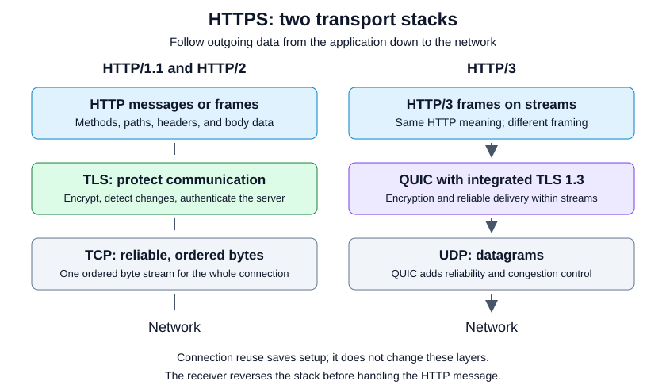
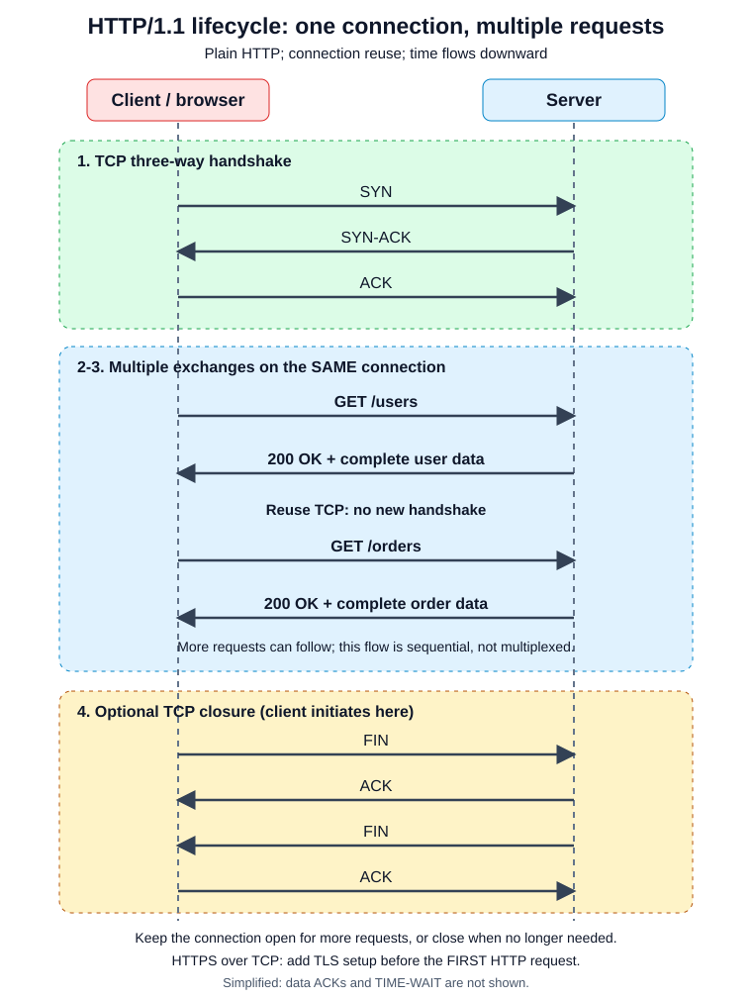
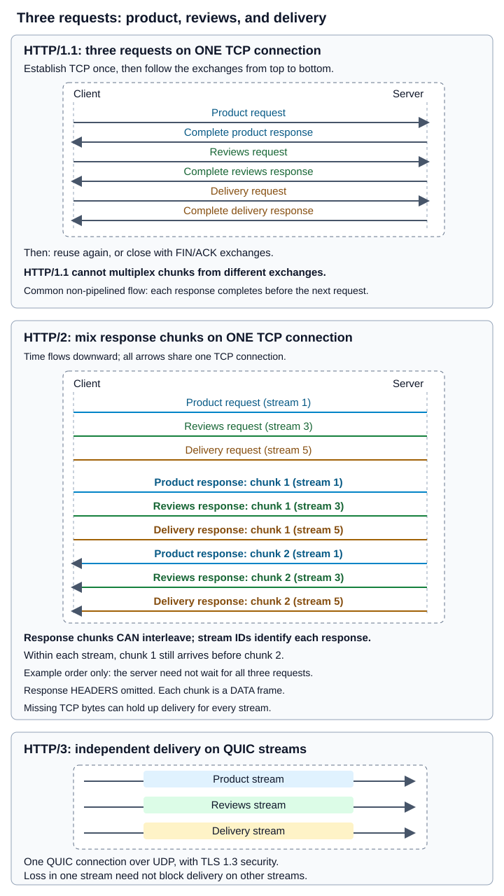
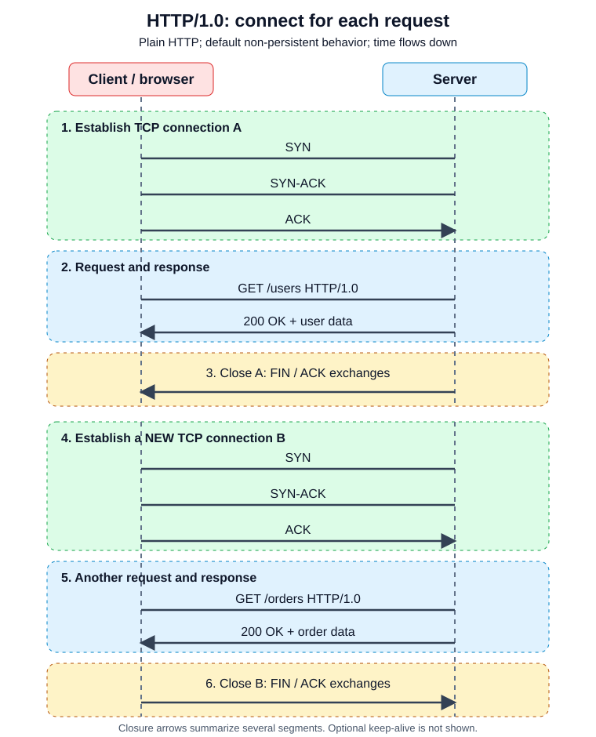
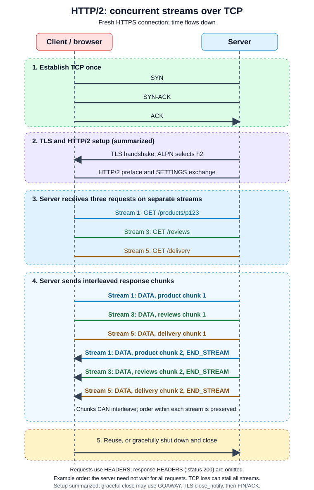
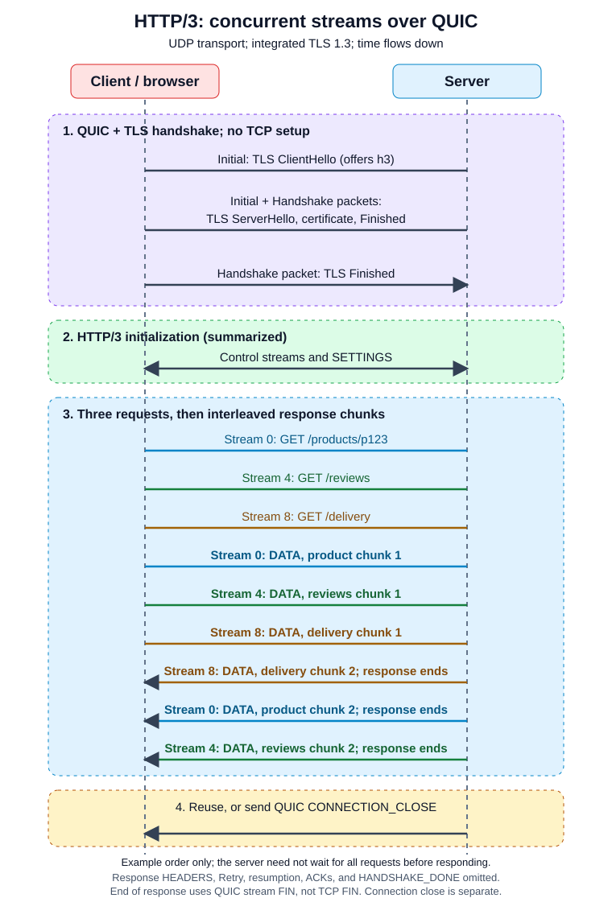
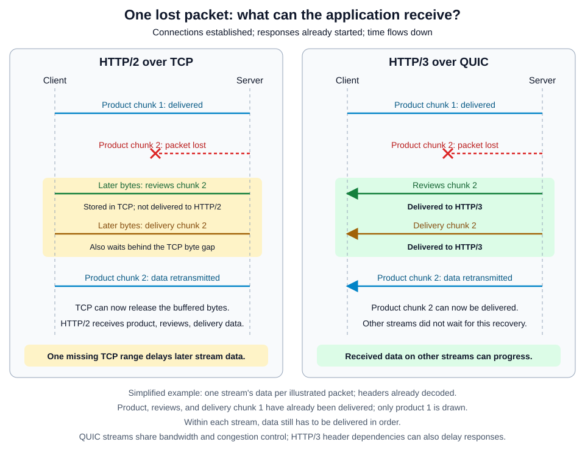
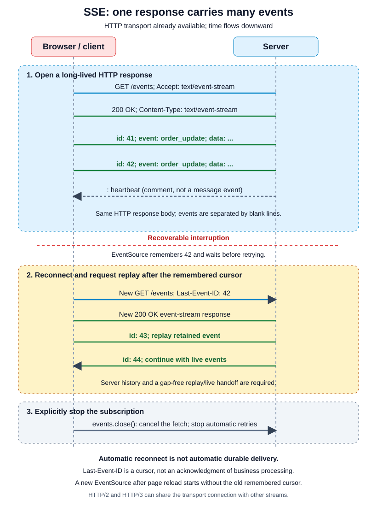
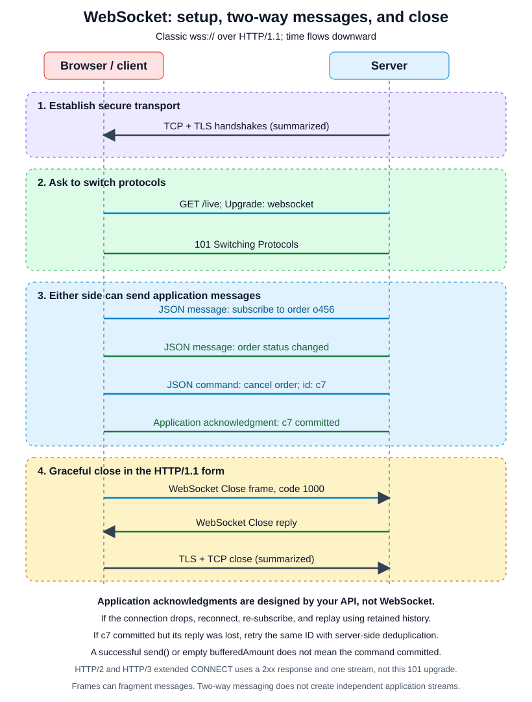

# Networking & APIs

Networking carries requests and responses between a client and a service. An
**API (application programming interface)** defines what the client can ask the
service to do, what input it must send, and what the service returns. Clients need
this agreement to handle successful requests, errors, and missing responses.

Previous: [define the shop's requirements](../01-thinking.md).

Follow a shopping request from transport setup to an API response, then choose
how to deliver updates after that response. This is one continuous guide:

| What you want to understand | Start here |
| --- | --- |
| Requests, encryption, and connection reuse | [HTTP and transport](#what-is-http) |
| Contracts, errors, and safe retries | [API design](#define-the-api-contract) |
| Polling, one-way events, and two-way messages | [Realtime choices](#real-time-updates-sse-and-websocket) |

This guide and every diagram it uses live together in this page's folder.

For standalone protocol guides, open the child documents:
[Server-Sent Events (SSE)](../02-requests-realtime/sse/index.md) and
[WebSocket](../02-requests-realtime/websocket/index.md).
The complete walkthrough below still includes both protocols.

## What is HTTP?

**HTTP (Hypertext Transfer Protocol)** defines how a client asks a server to do
something and how the server responds. A client might be a browser, a mobile
app, or another backend service.

Suppose the shopping app needs the details of product `p123`. It sends this
request to the shop's backend:

```http
GET /products/p123 HTTP/1.1
Host: shop.example
Accept: application/json
```

`GET` asks to read data. `/products/p123` identifies the product. The `Host`
header identifies the website, and `Accept` tells the server that the client
wants JSON.

If the product exists, the backend can return:

```http
HTTP/1.1 200 OK
Content-Type: application/json

{"id":"p123","name":"Notebook","price_minor":500,"currency":"USD"}
```

`200 OK` means the request succeeded. `Content-Type` describes the response
body's format. The body contains the product data. These examples leave out
some headers to focus on the message.

HTTP defines **methods**, such as `GET` and `POST`; **headers**, such as
`Accept` and `Authorization`; **status codes**, such as `200` and `404`; and how
messages carry **bodies**, such as JSON or an image.

The `HTTP/1.1` in the example is the HTTP protocol version, not a version of the
shop's API. A path such as `/api/v2/products` is an API naming choice and does
not tell you which HTTP version carries the request.

## How are HTTP, TCP, and HTTPS different?

HTTP describes the messages, but something still has to carry them across the
network.

**TCP (Transmission Control Protocol)** delivers bytes reliably and in order.
If some data is lost, TCP retransmits it. If the connection fails and delivery
cannot complete, the application must handle that failure. TCP does not encrypt
the data, and it does not know what a product or an order is.

With plain HTTP over TCP, someone who can intercept the traffic may read or
change it. Sending a password this way can expose it.

**HTTPS is HTTP protected by TLS (Transport Layer Security).** TLS encrypts the
messages and protects them from changes in transit. It also lets the client
check the server's identity using a certificate. The browser checks that the
certificate covers the requested hostname and comes from a trusted issuer.

| Part | Job |
| --- | --- |
| HTTP | Defines what a request and response mean |
| TCP | Carries bytes reliably and in order, without encrypting them |
| TLS | Encrypts communication, detects changes, and authenticates the server |
| HTTPS | Uses HTTP with TLS protection |

[](assets/https-layers.svg)

For HTTP/1.1 and HTTP/2 over HTTPS, data passes through these layers on its way
out of the client:

```text
HTTP message or frames --> TLS encryption --> TCP --> Network
```

For HTTP/3, the stack is different:

```text
HTTP/3 frames --> QUIC with TLS 1.3 --> UDP --> Network
```

**HTTPS is about protecting communication; the HTTP version is about how that
communication is carried out.** The receiving side reverses the layers before the
backend handles the HTTP request.

HTTPS does not prove that a website is honest or that its backend is secure.
It also does not give a signed-in customer permission to read another
customer's orders. The application must check those permissions.

## HTTP lifecycle: from connection setup to closure

The diagram follows a browser sending `GET /users` and then `GET /orders` over
the **same plain HTTP/1.1 connection**. Time runs from top to bottom. The TCP
handshake happens once, and later requests reuse the connection.

[](assets/http-lifecycle.svg)

### 1. Establish TCP with a three-way handshake

Before sending the HTTP request, the browser and server establish a TCP
connection:

1. **SYN:** the browser asks to start a connection and sends its initial TCP
   sequence number.
2. **SYN-ACK:** the server acknowledges the browser's sequence number and sends
   its own initial sequence number.
3. **ACK:** the browser acknowledges the server's sequence number. Both sides
   can now use the established connection.

Sequence numbers let TCP track which bytes arrived and which need retransmission.
The handshake establishes transport state; it does not send an HTTP request or
encrypt the connection.

### 2. Send the HTTP request

The browser sends a request for the `/users` resource over the connection:

```http
GET /users HTTP/1.1
Host: api.example
Accept: application/json
```

TCP carries the request bytes to the server. An HTTP message can span several
TCP segments; each arrow in the diagram represents the complete message, not one
packet.

### 3. Receive the HTTP response

If the request succeeds, the server sends `200 OK` and the response data:

```http
HTTP/1.1 200 OK
Content-Type: application/json
Content-Length: 12

{"users":[]}
```

The response body contains an empty list of users. TCP carries the bytes back to
the browser, which reads the HTTP status, headers, and body.

### 4. Reuse or close the connection

**HTTP/1.1 connections are persistent by default.** The browser can send another
request over the same connection without repeating the TCP handshake. A
completed response does not itself close TCP. Persistent does not mean permanent:
either endpoint can close the connection, for example after an idle timeout.
A `Connection: close` header signals that the connection will not be reused
after the current response.

If the connection will not be kept open, one side starts a graceful close. The
diagram shows the browser starting it:

1. The browser sends **FIN** to say it has no more bytes to send.
2. The server sends **ACK** to acknowledge that FIN.
3. When the server has no more bytes to send, it sends its own **FIN**.
4. The browser sends **ACK** to acknowledge the server's FIN.

Either side can start the close, and the server can combine its ACK and FIN into
one segment. In this example the browser enters **TIME-WAIT** after the final ACK
to handle delayed segments and retransmitted FINs. Both sides can enter
TIME-WAIT if they initiate closure at the same time.

For **HTTPS over HTTP/1.1 or HTTP/2**, a TLS handshake runs after TCP setup and
before the first HTTP request. Reusing an
established secure connection avoids repeating both handshakes. HTTP/3 uses QUIC
with integrated TLS instead of this TCP lifecycle.

## What changes between HTTP/1.1, HTTP/2, and HTTP/3?

All versions still use methods, headers, status codes, and bodies. The main
difference is how they send messages and share a connection when several
requests are in progress.

**Connection reuse and multiplexing are different.** Reuse means sending later
requests over an already established connection. Multiplexing means allowing
multiple request/response exchanges to progress concurrently on that connection.
HTTP/1.1 supports reuse but not multiplexing. HTTP/2 and HTTP/3 support both.

Keep three questions separate: **Can I reuse the connection? Can exchanges
progress concurrently on it? Is the communication encrypted?** HTTP/1.1 can
reuse a connection without multiplexing. HTTP/1.1 and HTTP/2 can use HTTPS;
HTTP/3 always uses QUIC's integrated TLS security.

The picture below compares all of them on the same job: fetch a product, its
reviews, and its delivery options.

[](assets/http-versions.svg)

The HTTP/1.1 panel follows **one TCP connection**: establish it once, request the
product and receive its complete response, then do the same for reviews and
delivery. The connection can remain open for more requests or close afterward.
**Chunks from different HTTP/1.1 exchanges cannot be multiplexed.** HTTP/2 and
HTTP/3 add that ability using separate streams.

Time runs from top to bottom in the lifecycle diagrams below. Colors identify
exchanges, not different connections. HTTP/1.x examples use plain HTTP to
isolate connection reuse; the HTTP/2 example uses HTTPS, as browsers normally do.
An HTTP message or frame is not necessarily one network packet.

The diagrams in the next subsections use some protocol words. Here is what they
mean:

| Term | Meaning |
| --- | --- |
| **Stream** | One numbered request/response conversation inside a connection (HTTP/2, HTTP/3) |
| **Frame** | A small labelled piece of a message; `DATA` frames carry body bytes, `HEADERS` frames carry status and headers |
| **Chunk** | An informal name here for body data in a DATA frame, not HTTP/1.1 chunked transfer encoding |
| **HPACK / QPACK** | Header compression formats for HTTP/2 and HTTP/3 |
| **ALPN** | Application-Layer Protocol Negotiation: client and server agree on the HTTP version during the TLS handshake |
| **GOAWAY** | HTTP/2 shutdown notice whose last-stream ID helps identify requests the sender might have processed |
| **QUIC** | A transport built on UDP that adds reliable streams, loss recovery, and congestion control |
| **CONNECTION_CLOSE** | QUIC message that ends a connection (QUIC has no TCP FIN) |

### HTTP/1.0: normally open a connection for each request

[](assets/http-1-0-lifecycle.svg)

The browser opens a TCP connection and sends `GET /users`. After returning
`200 OK` with the user data, the server normally closes the connection.
Fetching `/orders` then requires another connection and another TCP handshake.

Some HTTP/1.0 implementations support an optional keep-alive extension, but
persistent connections are not the default. The diagram shows the usual
non-persistent flow. Its closure arrows summarize multiple FIN/ACK exchanges,
not single TCP segments.

### HTTP/1.1: reuse connections, without multiplexing

The lifecycle diagram earlier already shows this version: one handshake, then
`GET /users` and `GET /orders` on the same connection, with the second request
waiting for the first response to finish.

```text
Establish TCP once
  -> product request  -> complete product response
  -> reviews request  -> complete reviews response
  -> delivery request -> complete delivery response
  -> reuse again, or close the connection
```

If the browser wants exchanges to progress in parallel, it commonly opens
several TCP connections to the same server (the second row of panel A), because
HTTP/1.1 cannot interleave response bodies on one connection. That is a separate
option, not a requirement for reuse, and each of those connections can also be
reused.

HTTP/1.1 also supports **pipelining**, which sends another request before the
previous response finishes. Responses must still arrive in request order, so a
slow first response delays later ones. This is called **head-of-line blocking**:
work at the front holds up work behind it. Browsers rarely use pipelining.

### HTTP/2: let several requests share one TCP connection

[](assets/http-2-lifecycle.svg)

During TLS setup the client and server select HTTP/2 using ALPN. The browser
then sends the product, reviews, and delivery requests on streams 1, 3, and 5
without waiting for any response. The server's response pieces arrive
interleaved. This is one possible order, not a rule: the server does not have to
wait for all requests, and responses can finish in a different order from their
requests. Each response still starts with a `HEADERS` frame carrying its status;
the diagram omits those to emphasize the `DATA` frames.

HTTP/2 splits messages into small binary **frames**. Each request and its
response use a **stream**, and frames from different streams can be mixed on the
connection. The receiver uses stream identifiers to reassemble them. This is
**multiplexing**: a slow product response does not have to finish before the
server sends reviews. Within each stream, the pieces stay in order.

Product chunk 2 must follow product chunk 1; it does not have to follow the
complete reviews response. "Mixed" does not mean scrambled response data.
Client-initiated HTTP/2 streams use odd identifiers, which is why the diagram
uses 1, 3, and 5. Completing a stream does not close the connection.

```text
One TCP connection:
  Product stream:   [frame]          [frame]
  Reviews stream:          [frame]          [frame]
  Delivery stream:                [frame]
```

HTTP/2 also compresses headers with **HPACK**, which reduces the bytes needed
for repeated headers.

There is still a limit: all streams share TCP's ordered delivery. If data is
lost, TCP holds back later bytes until the missing bytes arrive, and those later
bytes may belong to other streams. This is **TCP head-of-line blocking**.
HTTP/2 removes the HTTP/1.1
response-order restriction, but not this TCP restriction.

### HTTP/3: use QUIC so loss need not hold up every stream

[](assets/http-3-lifecycle.svg)

The diagram shows a simplified fresh QUIC handshake, without resumption or a
server Retry. TLS handshake messages travel inside QUIC packets, so there is no
separate TCP handshake. Requests use separate bidirectional streams, shown as
streams 0, 4, and 8. These identifiers follow QUIC's numbering for
client-initiated bidirectional streams. The diagram uses the same three requests
as HTTP/2 so the transport change is easier to compare. Responses need not
finish in request order. After the responses the connection can stay open, or
an endpoint can close it with `CONNECTION_CLOSE`. There are no TCP FIN/ACK
exchanges.

HTTP/3 uses **QUIC** instead of TCP. QUIC runs over **UDP (User Datagram
Protocol)**. UDP alone does not guarantee delivery or order; QUIC adds reliable
delivery within streams, loss recovery, and congestion control, which adjusts
the sending rate to network conditions. QUIC also builds TLS 1.3 into its
connection setup, so HTTP/3 never sends unprotected HTTP just because it uses UDP.

QUIC can also reduce connection setup time, especially when resuming a previous
connection. HTTP/3 is not always faster: results depend on the network, the
implementation, and the requests.

### What happens if a packet is lost?

Suppose the connection is already established and all three responses have
started. The packet carrying product chunk 2 is lost, but packets with reviews
and delivery data reach the client.

[](assets/http-loss-comparison.svg)

With **HTTP/2**, TCP stores later bytes but cannot deliver them to TLS and HTTP/2
until the missing bytes arrive. Even data from unrelated streams waits behind
that gap. Already delivered data is not taken back, and the server does not
have to stop computing responses.

With **HTTP/3**, QUIC can deliver received reviews and delivery data without
waiting for product recovery. Later product data still waits for the missing
piece because order must be preserved within that stream.

This example isolates transport delivery: response headers are already decoded,
and each illustrated packet carries data from just one stream. Real packets can
carry frames from several streams. Streams also share network capacity and
congestion control, and QPACK header dependencies can delay particular responses.
**HTTP/3 removes TCP's cross-stream delivery blocking, not every possible delay.**

### Compare the versions

| Feature | HTTP/1.0 | HTTP/1.1 | HTTP/2 | HTTP/3 |
| --- | --- | --- | --- | --- |
| Message format | Text start line and headers; body may be binary | Text start line and headers; body may be binary | Binary frames | Binary frames |
| Transport | TCP | TCP | TCP | QUIC over UDP |
| Fresh HTTPS setup | TCP, then TLS | TCP, then TLS | TCP, then TLS with ALPN | QUIC with integrated TLS 1.3 |
| Connection reuse | Not persistent by default; optional keep-alive extension | Persistent by default | Persistent, with streams | Persistent, with streams |
| Concurrent exchanges on one connection | No multiplexing | No multiplexing; pipelined responses stay ordered | Multiplexed streams | Multiplexed streams |
| Header compression | None built in | None built in | HPACK | QPACK |
| Loss and delivery | Missing TCP bytes delay later bytes | Missing TCP bytes delay later bytes | Missing TCP bytes can delay all streams | Missing stream data need not delay other streams |
| Security | Can use TLS for HTTPS | Can use TLS for HTTPS | Browsers normally use TLS | QUIC integrates TLS 1.3 |

For HTTPS, the layers are:

```text
HTTP/1.1: HTTP messages --> TLS --> TCP --> Network
HTTP/2:   HTTP frames   --> TLS --> TCP --> Network
HTTP/3:   HTTP frames   --> QUIC with TLS 1.3 --> UDP --> Network
```

HTTP/1.1 and HTTP/2 can also run without TLS in some environments. HTTP/3 always
uses QUIC's built-in security. There is no standard HTTP/1.2 between HTTP/1.1 and
HTTP/2.

## HTTP versions and your backend

### What does this mean for a backend service?

The browser may use HTTP/3 to reach an API gateway or load balancer, while that
gateway uses HTTP/2 or HTTP/1.1 to reach your backend. These are separate
connections. Enabling HTTP/3 at the public entry point does not automatically
change the connection to the application.

Check which versions each hop supports and where TLS ends. If the gateway
decrypts a request, protecting the gateway-to-backend connection requires its
own TLS configuration.

Your API can still expose the same `GET /products/p123` operation across all
versions. The version does not change your stock rules, permissions, or checks
for duplicate orders.

## Trace the journey

To request `https://shop.example/products/p123`, the browser first finds the
network address for `shop.example`. It uses **DNS (Domain Name System)** to look
up that address. If it has a saved, unexpired answer, it can reuse it. DNS finds
the address, not the product. If the address changes, a saved answer may still
point to the old address until it expires.

```text
Client -- DNS lookup --> DNS server --> address
Client == secure connection ==> Reverse proxy --> App --> Database
Client <--- response ----------- Reverse proxy <-- App <-- result
```

For a new HTTPS connection using HTTP/1.1 or HTTP/2, the browser first
establishes TCP. The browser and server then set up TLS to protect the
connection. The browser checks that the server's certificate covers the requested
hostname and comes from a trusted issuer. This checks the server's identity; it
does not give the user permission to read an order. For HTTP/3, the browser sets
up a secure QUIC connection instead of the TCP and TLS sequence.

The browser sends the HTTP request over the protected connection. In this design,
a **reverse proxy** receives it before the application. The proxy is a server
that forwards requests to the appropriate application instance. It can also
reject oversized requests and handle TLS for the application. If the proxy
decrypts the request, the proxy-to-application connection needs its own
encryption configuration.

The application checks who the caller is (**authentication**) and what the caller
may access (**authorization**). It checks the input, asks the database for the
product, and returns the result through the proxy. If the application or database
fails, the request can fail even when the proxy is running.

If an existing connection is still usable, the client can send another request
without repeating DNS lookup and connection setup. This includes HTTP/1.1:
connection reuse is not unique to HTTP/2 or HTTP/3.
Those newer versions also let several request/response exchanges progress
concurrently on one connection.

## Budget latency

**Latency** is the time an operation takes between a stated start and finish.
Here, the client measures from starting the DNS lookup to receiving the complete
response, excluding drawing the page. Assume no saved DNS answer or existing
connection, sequential stages, and no retries. The table assigns each part of the
elapsed time to one stage so that no time is counted twice.

| Stage | Time |
| --- | --- |
| DNS | 20 ms |
| TCP and TLS setup | 60 ms |
| Request transit and proxy/app work, excluding database | 20 ms |
| Database | 40 ms |
| Response transfer | 10 ms |
| **Total** | **150 ms** |

The client waits `20 + 60 + 20 + 40 + 10 = 150 ms`. With a saved DNS answer and
an open connection, the DNS and setup stages drop out and the same model gives
`20 + 40 + 10 = 70 ms`. These are example times, not fixed costs; network
distance, congestion, and response size change them.

To describe many requests, measure the complete request's **p95 latency**: 95% of
the measured requests finish at or below that time. Do not add stage p95 values
to calculate it. The slowest DNS lookups and the slowest database calls may belong
to different requests. Record timings for each request to find where it waits.
If an application timing already includes a database call, do not add that
database time again.

## Define the API contract

An **API contract** states which paths and methods clients can use, who may call
them, which fields to send, and what the service returns. The examples use
**JSON (JavaScript Object Notation)**, a text format for objects, lists, and
values. The contract must explain what those fields mean and which values are
allowed.

The client sends `GET` to read product `p123`. The service finds it and returns
`200 OK` with its data. `Accept` states the response format the client wants;
`Content-Type` states a body's format. These HTTP/1.1 excerpts omit some headers,
including authentication and body-length headers:

```http
GET /products/p123 HTTP/1.1
Host: shop.example
Accept: application/json

HTTP/1.1 200 OK
Content-Type: application/json

{"id":"p123","name":"Notebook","price_minor":500,"currency":"USD"}
```

Here, `price_minor: 500` means USD 5.00. The service stores money as an integer
number of minor units to avoid binary floating-point rounding. The currency
determines the size of a minor unit.

### Methods: safe does not mean the same thing as idempotent

Methods differ in what a client may safely assume. A **safe** method does not
request a state-changing effect; incidental logging can still occur. An
**idempotent** method has the same intended effect when the same request is sent
once or repeatedly. Its response status or body can differ on a retry.
These properties help decide what a client may retry:

| Method | Safe? | Idempotent? | Retrying after a failure |
| --- | --- | --- | --- |
| `GET` / `HEAD` | Yes | Yes | Retry transient failures within the deadline and attempt limit |
| `PUT` | No | Yes | Repeat the same replacement request, including any preconditions |
| `DELETE` | No | Yes | Repeat the same deletion; the later status may differ |
| `POST` | No | Not guaranteed | Require server-enforced duplicate prevention or a conclusive status result |
| `PATCH` | No | Not guaranteed | Only if the contract makes it idempotent |

A `GET` request must not create an order or charge a card. A repeated `DELETE`
can return `404` after first returning `204` while still being idempotent: the
intended effect remains that the resource is absent. Invalid input needs
correction, not an automatic retry, and even safe retries add load.

### Create an order

To create an order, the client sends `POST /orders` with the product and quantity.
The service checks the request, calculates the total from its own prices, and
saves the order. If it succeeds, it returns `201 Created`. The `Location` header
gives the path of the new order:

```http
POST /orders HTTP/1.1
Host: shop.example
Content-Type: application/json
Idempotency-Key: order-attempt-7f82

{"items":[{"product_id":"p123","quantity":2}]}

HTTP/1.1 201 Created
Location: /orders/o456
Content-Type: application/json

{"id":"o456","status":"created","total_minor":1000,"currency":"USD"}
```

Assume the user is signed in, stock is available, and no tax or shipping applies.
The service checks permissions, limits the item count and request size, and checks
that quantities are positive integers. If a check fails, it rejects the request
instead of saving the order. Valid JSON can still contain an invalid quantity.

The client sends `Idempotency-Key` so the service can recognize another attempt at
the same order. The service must implement the duplicate-request checks described
below; adding this header alone does not prevent duplicate orders.

### Define error handling

The example contract below tells the client how to handle each error.
Codes such as `409` for an attempt still running and `422` for a reused
idempotency key with different input are this API's policy, not universal rules.
A status lookup only makes retrying safe if it establishes that the new attempt
will not duplicate work.

| Status | Meaning | Client response |
| --- | --- | --- |
| `400` | The request is malformed (for example, invalid JSON) | Fix the request before sending it again |
| `401` | The request lacks valid authentication | Sign in or refresh credentials |
| `403` | The caller lacks permission | Do not repeat the same request unchanged |
| `404` | The resource was not found | Check the path and resource ID |
| `409` | The request conflicts with current state, such as a first attempt still running | Read the current state and resolve the conflict |
| `413` | The request body is too large | Send a smaller body |
| `415` | The body format is not supported | Use a supported `Content-Type` |
| `422` | The JSON is well-formed but breaks a rule, such as a quantity of zero, or a reused idempotency key with different input | Fix the input; do not retry unchanged |
| `429` | The client has sent too many requests | Wait before trying again |
| `500` | The service failed unexpectedly | Retry only if the operation is safe to repeat |
| `502` / `504` | A gateway got a bad reply or no timely reply from the backend; the work may or may not have finished | Retry only if safe; otherwise check status |
| `503` | The service is temporarily unavailable | Retry only if safe and enough time remains |

The service returns a stable error code for the client to check and a request ID
for finding the matching service logs. For example, with status `422`:
`{"error":{"code":"INVALID_QUANTITY","message":"quantity must be positive"},"request_id":"r123"}`.
The service should not return stack traces or database details. If revealing that
a resource exists would expose private information, it may return `404` instead
of `403`; the API contract should explain that policy.

## Handle timeouts

A client sets a **timeout** to limit how long it waits for an operation or phase.
It sets a **deadline** for the latest acceptable finish of the whole operation.
The service gives database and service calls only part of the remaining time,
leaving time to send its response. Giving every call a fresh full timeout can
exceed the client's deadline: three sequential 2-second waits can consume
6 seconds before retry delays.

!!! warning "Timeout ≠ rollback"
    If the client stops waiting, it does not know whether the service saved the
    order. The request may not have arrived, the service may still be working,
    or the service may have saved the order before the response was lost.
    A cancellation request may not stop the work and cannot undo a completed
    order or payment.

The client retries only failures that may clear and operations it can safely
repeat (see the method table above). It limits the number of attempts and stops
when there is not enough time left before the deadline. **Exponential backoff**
increases the wait between attempts; **jitter** adds a random variation so
clients do not all retry together. If the service sends `Retry-After`, the client
waits as directed or stops if the wait would exceed its deadline. Even a read
retry adds work, so the client and service should not both make independent
chains of retries.

For writes, [idempotency](../05-async.md) means repeated attempts produce no extra
business effect. The client uses the same key and input when it retries an order.
The service associates the key with that user and operation, records the input,
and allows only one attempt to create the order. For a local database change, it
saves the key, result, and order in one transaction, which saves all of them or
none of them. If the same request arrives again, the service returns the saved
result. If the client reuses the key with different input, the service rejects it
with `422`.

The contract must say what the service returns while the first attempt is still
running (for example `409`) and how long it keeps keys. If a key expires, another
attempt may create another order. A payment through another service needs that
service's duplicate checks too; a local database transaction cannot cover the
remote payment. The contract should provide a status lookup for uncertain
outcomes. The client checks status instead of sending a new key and risking a
duplicate.

## Bound lists and evolve contracts

The client requests a small page of orders instead of the entire list:
`GET /orders?limit=20&after=opaque-cursor`. The service enforces a maximum page
size and returns a **cursor**, a value that identifies where the next page should
start. The client sends that value unchanged to get the next page.

The service sorts the orders consistently, for example by `(created_at, id)`,
using the ID to order entries with the same creation time. It checks that the
cursor matches the filters and user scope, and checks the user's permission on
every request. Possessing a cursor does not grant access to another user's orders.
If orders change between requests, later pages may change too. A cursor alone
does not provide a snapshot, which is a fixed view of the list at one point in time.

Old and new clients may use the service during the same deployment. If the service
adds an optional response field, old clients can keep working if they ignore
unknown fields. If it renames a field or changes its units or meaning, it can
break those clients. The contract must explain how clients should handle additions
and when they need to move to a new version.

## Real-time updates: SSE and WebSocket

After returning an order response, the server may have more news, such as
"your order shipped". The client can check for changes or subscribe to updates.
Choose the communication pattern separately from the HTTP version.

| | Polling | SSE | WebSocket |
| --- | --- | --- | --- |
| Direction | Client asks for each check | Server sends events to the client | Both sides send messages |
| Setup | Repeated ordinary requests | One GET with a long-lived HTTP response | HTTP/1.1 Upgrade, or extended CONNECT over HTTP/2 or HTTP/3 |
| Data | Anything the endpoint supports | UTF-8 text events | Text or binary messages |
| Recovery | Retry failed checks; use a cursor if missed events matter | EventSource retries recoverable drops; the server must implement replay | Application implements reconnect, subscriptions, replay, and acknowledgments |
| HTTP/2 and HTTP/3 | Supported | Supported as an HTTP stream | Requires extended CONNECT support on the relevant hops |
| Resources | One request per check | One long-lived response per subscription | One long-lived channel per session, on a connection or HTTP stream |

Use **polling** when updates are rare and some delay is acceptable. Use
**[SSE](#server-sent-events-sse)** for one-way notifications, order status, or
progress updates. Use **[WebSocket](#websocket)** when both sides send frequent
messages, such as chat, shared editing, or games.

An application can receive SSE events and send occasional commands with normal
POST requests. Two-way application behavior alone does not require WebSocket.
Similarly, multiplexing HTTP requests does not turn them into a WebSocket channel.

Neither channel proves that the application processed an event or command.
Keep three different things separate: **transport delivery, replay after a
disconnect, and committed business effects**.

## Server-Sent Events (SSE)

Dedicated child guide: [Server-Sent Events (SSE)](../02-requests-realtime/sse/index.md).

**SSE** is an HTTP response that remains open while the server writes events
to it. The client starts it with one GET. The event channel is one-way, from
server to client, but other requests can continue independently.

[](assets/sse-lifecycle.svg)

SSE works over HTTP/1.1, HTTP/2, and HTTP/3 without a protocol upgrade. On
HTTP/1.1 the long-lived response occupies its connection. HTTP/2 and HTTP/3
can carry it as one stream among others on a shared connection.

### SSE wire format

The client requests an event stream:

```http
GET /events HTTP/1.1
Host: shop.example
Accept: text/event-stream
```

The server returns `200 OK`, then continues writing the body:

```http
HTTP/1.1 200 OK
Content-Type: text/event-stream
Cache-Control: no-cache

retry: 5000

id: 41
event: order_update
data: {"order_id":"o456","status":"shipped"}

: heartbeat

```

The body is UTF-8 text. A **blank line ends an event block**. Blocks without a
`data:` field, such as the heartbeat or retry setting, do not dispatch a message.
These excerpts omit HTTP transfer framing: SSE blocks do not have to align with
TCP packets, HTTP chunks, or HTTP/2 or HTTP/3 DATA frames.

| Field | Meaning |
| --- | --- |
| `data:` | Event payload; multiple data lines are joined with newlines |
| `event:` | Optional event name; without it the event type is `message` |
| `id:` | Resume cursor remembered by this EventSource instance |
| `retry:` | Reconnection delay in milliseconds; the browser can add backoff |
| `:` comment | Ignored as event data; useful as a heartbeat |

For binary payloads, use a separate download, encode the data with an explicit
size limit, or choose WebSocket. SSE's event body itself is text.

### SSE browser API

```javascript
const events = new EventSource("/events");

events.onopen = () => console.log("stream open");
events.onmessage = (event) => console.log("message", event.data);

events.addEventListener("order_update", (event) => {
  const update = JSON.parse(event.data);
  console.log(update.order_id, update.status);
});

events.onerror = () => {
  const message = events.readyState === EventSource.CLOSED
    ? "stream closed; inspect authentication or endpoint errors"
    : "stream interrupted; EventSource is reconnecting";
  console.log(message);
};

function stopEvents() {
  events.close();
}
```

Call `stopEvents()` when leaving the view, not immediately after opening the
stream. It cancels the request and stops automatic retries.

Native `EventSource` sends GET requests and cannot set arbitrary request headers.
Same-origin cookies are one authentication option. Across origins, a credentialed
request needs the specific allowed origin, not `*`, plus
`Access-Control-Allow-Credentials: true`; cookie policies still apply.
If custom headers or POST are necessary, use a streaming fetch client and
implement parsing and reconnection, or use a suitable library.

Short-lived connection tickets are another option. Avoid long-lived secrets in
URLs because URLs can be recorded in logs.

### SSE reconnection and replay

For a recoverable interruption, the same EventSource waits and sends a new GET.
If it remembers a nonempty ID, that request includes `Last-Event-ID`. The initial
retry delay is browser-defined; a `retry:` field can change it.

The server can resume **only if it implements replay and retains the required
history**. Use an ordered log shared by the serving instances, or another design
that makes the same history available after a reconnect. Synchronize the
replay-to-live handoff so no event falls into a gap.

If a cursor is older than the retention window, define an explicit recovery
policy. For example, a named `reset` event can ask the client to obtain a fresh
snapshot and resume from a defined cursor. Do not silently skip missing history.

**Last-Event-ID is not a business acknowledgment.** The browser remembering an ID
does not prove the application saved or acted on that event. A replay policy can
repeat events, so make handling harmless when repeated or deduplicate by stable
event IDs. SSE alone guarantees neither at-least-once business processing nor
exactly-once effects.

A page reload creates a new EventSource without the old cursor. Resume across
reloads needs application-managed persistence and a server-supported mechanism,
such as a validated `after` query parameter. Business-critical processing may
also need an explicit checkpoint or acknowledgment protocol.

The final response must be `200` with `Content-Type: text/event-stream`. A
different status or media type fails the EventSource connection rather than
providing ordinary automatic retries. `204 No Content` tells the browser to stop.
HTTP redirects can be followed before that final response. Test the terminal
failure and authentication paths instead of assuming every error reconnects.

## WebSocket

Dedicated child guide: [WebSocket](../02-requests-realtime/websocket/index.md).

**WebSocket** is a long-lived message channel where both sides can send without
waiting for a matching request. Messages may be text or binary. Use `wss://`
outside local development so communication is protected.

[](assets/websocket-lifecycle.svg)

### WebSocket handshake

The diagram shows classic WebSocket over HTTP/1.1. For `wss://`, TCP and TLS are
established first, then the client asks to upgrade:

```http
GET /live HTTP/1.1
Host: shop.example
Upgrade: websocket
Connection: Upgrade
Sec-WebSocket-Key: dGhlIHNhbXBsZSBub25jZQ==
Sec-WebSocket-Version: 13
Origin: https://shop.example
```

The server accepts with:

```http
HTTP/1.1 101 Switching Protocols
Upgrade: websocket
Connection: Upgrade
Sec-WebSocket-Accept: s3pPLMBiTxaQ9kYGzzhZRbK+xOo=
```

`Sec-WebSocket-Key` is a random client value. The accept header is computed by
appending a protocol-defined constant, hashing with SHA-1, and base64-encoding.
It demonstrates that the server understood the handshake; it is **not user
authentication or encryption**. TLS provides communication protection, and the
application separately authenticates and authorizes the user.

After this `101`, the HTTP/1.1 connection carries WebSocket frames, not ordinary
HTTP messages. `Origin` identifies the initiating browser page, while an optional
`Sec-WebSocket-Protocol` lets the peers select an application subprotocol such
as `chat.v1`.

### WebSocket frames and browser API

A message can use one frame or several fragments. Text frames carry UTF-8;
binary frames carry bytes. Client frames are masked with a random key as required
by the protocol. Masking protects intermediaries; it is not encryption.

Ping and Pong are protocol control frames. Browsers automatically answer Ping,
but browser JavaScript cannot directly send protocol Ping frames. An application
that needs its own heartbeat can define a small JSON message instead.

This example's application protocol uses JSON text:

```javascript
const socket = new WebSocket("wss://shop.example/live");

socket.onopen = () => {
  socket.send(JSON.stringify({ type: "subscribe", order_id: "o456" }));
};

socket.onmessage = (event) => {
  const message = JSON.parse(event.data);
  console.log(message.type, message);
};

socket.onerror = () => console.log("connection error");
socket.onclose = (event) => console.log("closed", event.code, event.reason);

function disconnect() {
  socket.close(1000, "done");
}
```

Call `disconnect()` when leaving the view. Sending while `readyState` is
CONNECTING throws; send after the open event. `bufferedAmount` reports outgoing
queued bytes, not whether the receiver processed a message. Bound outgoing
queues and incoming work: the browser API has no automatic inbound backpressure.
It also cannot set arbitrary request headers and does not reconnect for you.

**Duplex is not multiplexing.** A WebSocket supports simultaneous communication
in both directions, but topic labels in JSON do not create independent
HTTP/2-style streams. Messages in each direction still use one ordered channel.

### WebSocket over HTTP/2 and HTTP/3

These versions do not use the HTTP/1.1 Upgrade mechanism. **Extended CONNECT**
with `:protocol = websocket` establishes a WebSocket on one HTTP stream. It needs
the peer's advertised capability and a successful `2xx` response, not `101`.
WebSocket frames then travel inside that stream while other streams can continue.

Support must work across the browser, proxy, gateway, and server. Loading a page
with HTTP/2 or HTTP/3 does not prove its WebSocket uses that version. A separate
HTTP/1.1 connection is still possible.

### WebSocket close and recovery

A clean close exchanges Close control frames. Common codes include `1000`
(normal), `1001` (going away), `1008` (policy violation), and `1011` (server error).
In the HTTP/1.1 form the transport then closes. With extended CONNECT, the
WebSocket's HTTP stream ends, not necessarily the shared transport connection.

A network drop may have no close handshake. The application must reconnect with
bounded exponential backoff and jitter, re-subscribe, and re-sync missed events.
It must also decide when authentication failure or a policy close should stop retries.

Within a live channel, messages retain their send order in each direction.
Classic WebSocket relies on TCP; HTTP/3 extended CONNECT uses ordered delivery
within one QUIC stream. Neither provides business-level replay or processing
acknowledgments.

If `send()` succeeds and the connection then drops, the command's outcome can be
uncertain. Give commands stable IDs, enforce duplicate prevention on the server,
and define application acknowledgments: received, validated, or committed are
different promises.

```json
{"type":"order.cancel","id":"c7","payload":{"order_id":"o456"}}
```

```json
{"type":"order.status","reply_to":"c7","payload":{"order_id":"o456","status":"cancelled"}}
```

If command `c7` committed but its reply was lost, retry the same ID under a
server-enforced deduplication contract. Return the recorded result instead of
cancelling twice. For notifications, use retained event history and a replay
cursor; a new socket does not preserve old subscriptions or cursors automatically.

## Operate long-lived channels

The same business rules apply whether an order action arrives over HTTP or a
WebSocket. A transport choice does not grant access or prevent duplicate effects.

| Concern | SSE | WebSocket |
| --- | --- | --- |
| Proxy behavior | Disable response buffering; flush promptly; configure compression to flush or disable it | Support HTTP/1.1 Upgrade or the negotiated extended CONNECT form |
| Heartbeat | A comment such as `: heartbeat` | Protocol Ping/Pong or an application heartbeat |
| Recoverable drop | EventSource retries; server implements cursor replay | Application reconnects, re-subscribes, and replays |
| Browser cross-origin behavior | CORS applies; credentialed requests need explicit origin and credential permission | Check Origin against an allow-list; WebSocket does not use CORS as a connection barrier |
| Slow consumer | Bound queues; close and replay, or explicitly coalesce replaceable updates | Bound queues and messages; close or throttle a slow channel |

Choose heartbeat intervals below the shortest idle timeout on the path.
Intervals such as 15 seconds are examples, not guarantees. Heartbeats do not
prevent maximum connection lifetimes, deploys, network changes, or server restarts.

Each subscription consumes memory and protocol state. HTTP/1.1 SSE often competes
with other requests under a browser's per-host connection limit; HTTP/2 and
HTTP/3 share connections but still limit concurrent streams. Cap channels per user
and bound payload sizes, incoming work, and outgoing queues. Never silently drop
critical events just to reduce memory use.

Authenticate on connection establishment, authorize every subscription and action,
and define how expiry or revoked access terminates a channel. Browsers can send
eligible cookies on WebSocket requests from another page. Validate Origin to
prevent cross-site WebSocket hijacking, but do not treat Origin as identity:
non-browser clients can forge it. Cookies, short-lived tickets, or an authenticated
first message need an explicit policy; unauthenticated channels must not receive
private data or execute commands.

An instance must be able to reach users connected elsewhere, often through a shared
bus. A transient pub/sub bus is not automatically a durable replay log. Keep the
history and committed results required by the promised recovery behavior.

### Document the event and message contract

State the URL, authentication, event or message types, payload fields, ordering,
retention window, resume cursor, reset behavior, size/rate limits, heartbeat,
close policy, and acknowledgment meanings. If using a WebSocket subprotocol,
document its version too.

Clients can ignore unknown optional notifications if the contract allows it.
Unknown commands or mandatory protocol messages need an error or version policy.
Changing an existing field's units or meaning can break clients just as it can in
an ordinary HTTP API.

## Exercise

These are conceptual exercises; no server or cloud account is required. Explain
the protocol behavior and the application responsibility separately, then compare
your answer with the guidance.

1. The client has a saved DNS answer and an open connection. Using the table,
   how long does the request take? Can you add stage p95 values to find request p95?
2. The client sends `POST /orders` and stops waiting after one second. What are
   three possible outcomes? What must the client keep unchanged if it retries?
3. A user sends a cursor from another user's order list. What should the service
   check before it returns any orders?
4. A product response and a reviews response share one connection. Why can lost
   product data delay the reviews response with HTTP/2? What changes with HTTP/3?
5. A browser uses HTTP/3 to reach a gateway. Does this prove that the gateway uses
   HTTP/3 or encryption when it calls the backend?
6. A browser keeps three HTTP/1.1 TCP connections open to the same server. Does
   this contradict connection reuse? How is this different from HTTP/2 multiplexing?
7. A `GET /products/p123` request times out, and so does a `POST /orders` request
   without an idempotency key. Which can the client simply retry, and why?
8. Order status must be pushed to the page, and the page never sends anything back
   on that channel. Which of polling, SSE, and WebSocket fits best, and why?
9. An EventSource reconnects with `Last-Event-ID: 42`. What must the server retain?
   Does that ID prove the client committed event 42 to its database?
10. A WebSocket command committed, but its reply was lost during a disconnect.
    What must the retry preserve, and what must the server do?
11. A page loaded over HTTP/2 establishes a WebSocket with `101`. Which transport
    did that handshake use? What status would extended CONNECT use instead?
12. A stream was quiet for two minutes and then stopped. Which failures can a
    heartbeat prevent, and which require reconnect, replay, or re-synchronization?

??? success "Answer guidance"
    1. The request takes `20 + 40 + 10 = 70 ms` under the stated assumptions.
       Measure complete requests to find their p95; the stage p95 values may
       describe different requests.
    2. The request never arrived, the service is still working, or the service
       saved the order but the response was lost. The client keeps the same key
       and input and retries only within the key's lifetime and remaining time.
       If necessary, it checks status instead. It does not assume the order failed.
    3. The service checks that the cursor matches the user's scope and that the
       user may read the returned orders. TLS protects the connection; it does
       not give the user permission to read another user's data.
    4. TCP delivers bytes in order, so missing bytes can hold back later bytes
       from either HTTP/2 stream. QUIC can deliver received data on another
       stream without waiting for the affected stream's missing data. Shared
       congestion control and other dependencies can still cause delays.
    5. No. The gateway-to-backend call uses a separate connection. Check its
       HTTP version and TLS configuration independently.
    6. No. Each TCP connection can be reused for later requests. Several connections
       allow parallel work without HTTP/1.1 multiplexing. HTTP/2 instead allows
       frames from concurrent exchanges to share a single TCP connection.
    7. `GET` is safe and idempotent, so retrying it is fine within the deadline.
       `POST` is not idempotent: the first attempt may have created the order, so
       a blind retry could create a duplicate. The client needs an idempotency key
       or a status check first.
    8. SSE fits one-way updates with low delay; replay after a recoverable
       disconnect requires server-side event history, not just EventSource.
       WebSocket also works but adds a two-way protocol the page does not need;
       polling is still reasonable when updates are rare and delay is acceptable.
    9. Retain ordered events after the cursor and implement a gap-free replay/live
       handoff. The cursor is not a processing acknowledgment; a reload also does
       not preserve the old EventSource cursor automatically.
    10. Preserve the same command ID and input. The server must recognize the
        duplicate and return the committed result instead of executing it again.
    11. `101` identifies the HTTP/1.1 upgrade form, regardless of how the page
        loaded. HTTP/2 or HTTP/3 extended CONNECT uses a successful `2xx`.
    12. Heartbeats can avoid idle timeouts. Deploys, maximum lifetimes, and network
        failures still need recovery. Replay needs retained history; an expired
        cursor may require a fresh snapshot under the API's reset policy.

## Reference

The examples simplify packet boundaries and setup details. For the protocol rules,
see [HTTP semantics](https://www.rfc-editor.org/rfc/rfc9110.html),
[HTTP/2](https://www.rfc-editor.org/rfc/rfc9113.html),
[HTTP/3](https://www.rfc-editor.org/rfc/rfc9114.html),
[QUIC](https://www.rfc-editor.org/rfc/rfc9000.html),
[WHATWG Server-sent events](https://html.spec.whatwg.org/multipage/server-sent-events.html),
[WebSocket](https://www.rfc-editor.org/rfc/rfc6455.html),
[WebSocket over HTTP/2](https://www.rfc-editor.org/rfc/rfc8441.html), and
[WebSocket over HTTP/3](https://www.rfc-editor.org/rfc/rfc9220.html).

[Next: Storage →](../03-storage.md)
