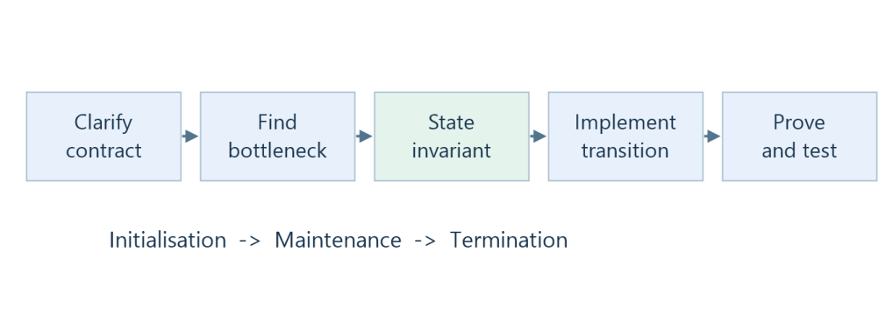

# 1. Problem Solving and Complexity Analysis

[Topic overview](topics/problem-solving.md) | [All topics](index.md) | [Revision](revision.md) | [Answer key](answers.md#solutions---chapter-1)

> Adapted from the supplied study-notes PDF, pages 17-20. Examples use [pseudocode](index.md#pseudocode-conventions). [Source notes](index.md#provenance-and-numbering).

Chapter goal: Count actual work, state a correctness invariant, distinguish recursive time/space, and derive optimisations from bottlenecks.

*Figure 1. A reusable interview reasoning pipeline and the three stages of an invariant proof.*

## 1.1 The problem-solving pipeline
### Clarify the contract
Before choosing a data structure, establish:

- Input size and value range; whether values may be negative, duplicated, null, or empty.

- Whether the input is sorted, rotated, mutable, or read-only.

- Whether the result needs one answer, all answers, a count, or only existence.

- Whether indices, values, nodes, or new objects must be returned.

- Overflow constraints and whether long is required.

- Expected time/space, if the interviewer has a target.

### Build examples deliberately
Use at least four categories:

- Typical input.

- Smallest legal input: empty, one element, one node.

- Boundary case: all equal, strictly increasing/decreasing, maximum value.

- Adversarial case: duplicates around a binary-search boundary, a cycle, a skewed tree, or negative values that break an assumed monotonic property.

### Move from brute force to the bottleneck
Do not jump to a memorized pattern. State the straightforward solution and identify its repeated work:

- Recomputing each subarray sum -&gt; prefix sum or sliding window.

- Searching previously seen complements -&gt; hash table.

- Moving or comparing the same range repeatedly -&gt; two pointers.

- Re-scanning candidates with a monotonic feasibility condition -&gt; binary search on answer.

- Recomputing subtree facts -&gt; return them through a recursive contract.

This makes the optimized solution explainable rather than magical.

## 1.2 Correctness through invariants
An invariant is a statement that is true before and after every iteration. Examples:

- Sliding window: the active window is exactly [left, right], and the frequency map represents exactly those elements.

- Binary search: every possible answer remains inside the current search interval.

- Reversal: prev is the fully reversed prefix; current is the first unprocessed node.

- BFS: nodes in the queue are discovered but not yet processed.

- BST inorder traversal: emitted values are nondecreasing; strictly increasing when duplicates are forbidden.

To reason formally:

1.  Initialization: true before the first step.

2.  Maintenance: the step preserves it.

3.  Termination: when the loop ends, the invariant implies the postcondition.

## 1.3 Time complexity
### Common growth rates
- O(1): array access, stack push/pop, hash lookup on average.

- O(log n): binary search; work decreases by a constant factor.

- O(n): one scan, even if two pointers each move up to n times.

- O(n log n): sorting, divide-and-conquer with log n levels and O(n) work per level.

- O(n^2): all pairs, expanding from every center in a string.

- O(2^n) / O(n!): subset/permutation search without sufficient pruning.

### Add versus multiply
- Sequential independent phases: O(n) + O(n log n) = O(n log n).

- Nested full loops: O(n) * O(n) = O(n^2).

- A nested-looking loop is not automatically quadratic. In a sliding window, right advances n times and left advances at most n times, so total movement is O(n).

### Amortized analysis
A single operation can be expensive while the sequence is cheap:

- Dynamic-array resizing occasionally copies O(n) elements, but repeated append is amortized O(1).

- In a monotonic stack, an element may trigger several pops, but every index is pushed once and popped once: total O(n).

### Recursion
For a binary tree visiting each node once: O(n) time. Stack space is O(h):

- Balanced tree: h = O(log n).

- Skewed tree: h = O(n).

Never report recursive space as always O(log n) unless balance is guaranteed.

## 1.4 Space complexity
Distinguish:

- Input storage versus auxiliary storage.

- Output storage versus working memory.

- Call stack versus explicit stack.

- Peak simultaneous memory versus total allocations over time.

An in-place array algorithm usually means O(1) auxiliary space, not that it performs no writes. A recursive tree algorithm is not O(1) space because its call stack stores frames.

## 1.5 Implementation discipline
- Use sufficiently wide integers for sums, products, and search bounds.

- Compute an integer midpoint as `left + (right - left) DIV 2`.

- Retrieve a map value and its presence together when the implementation supports it.

- Decide whether APIs mutate input and state that explicitly.

- Compare node identity when identity matters; do not compare only values.

- Use a mutable text builder or collect pieces before joining.

- Keep loop boundaries visually consistent: either inclusive or half-open.

- For recursion, define exactly what the method returns to its parent.

## 1.6 Pattern-recognition checklist
|**Signal in the problem**|**First pattern to test**|
|---|---|
|**Contiguous range sum, many range queries**|Prefix sum|
|**Contiguous range with dynamic validity**|Sliding window|
|**Pair in sorted data, ends moving inward**|Two pointers|
|**Previously seen complement/count/state**|Hashing|
|**Next greater/smaller element**|Monotonic stack|
|**Level-by-level or shortest unweighted path**|BFS|
|**Sorted or monotonic decision space**|Binary search|
|**Subtree result built from child results**|Tree DFS contract|
|**O(1) cache get/put plus eviction order**|Hash map + doubly linked list|

## Common mistakes
- Coding before agreeing on range semantics.

- Giving complexity only for the best-shaped tree.

- Calling two moving pointers O(n^2) because one loop is nested.

- Ignoring integer overflow.

- Optimizing before identifying the repeated work.

- Explaining steps without stating the invariant that makes them safe.

## Worked example and precision notes - Counting work, not syntax
Consider an outer variable i that starts at n and halves each time. If the inner loop performs i steps, total work is n + n/2 + n/4 + ... &lt; 2n, so time is Theta(n), not Theta(n log n). If the inner loop instead always performs n steps, time becomes Theta(n log n). The syntactic nesting is identical; the amount of repeated work is not.

Big O is an asymptotic upper bound; Omega is a lower bound; Theta is a matching upper and lower bound. They do not mean worst case, best case, and average case respectively. You can describe a worst-case runtime with Theta(n), or bound that same runtime loosely with O(n squared).

For two independent recursive calls on half-sized inputs, T(n)=2T(n/2)+O(1)=Theta(n), while the maximum simultaneous call-stack depth is Theta(log n). Time counts work across the whole recursion tree; stack space counts the active path, assuming child calls execute sequentially.

### Deriving Two Sum instead of memorising it
Brute force tests each pair in O(n squared) time and O(1) extra space. While scanning an unsorted array, store value -&gt; earlier index. For current x at i, look for target-x first, then record x. An index -&gt; value map does not give a direct lookup by complement. Looking up before inserting prevents using the current element twice.

With [2,7,11,15] and target 9, the first step records {2:0}; at index 1, complement 2 maps to index 0, so return (0,1). Duplicate values work: [3,3], target 6 returns distinct indices 0 and 1. Expected O(n) time, O(n) extra space.

### Backend bridge from the actual diagnostic
Two independent 100 ms I/O requests awaited sequentially take roughly 200 ms plus overhead. Start both asynchronous operations before awaiting their joint completion and their waits can overlap, giving roughly the slower request's duration plus overhead. This is concurrency, not proof of CPU parallelism. A Task is not automatically a dedicated thread; async I/O can wait without keeping a thread blocked. Actual timings depend on resource limits and contention. [R3]

Amortised analysis spreads the deterministic total cost of a sequence over its operations; it does not assume a probability distribution. Expected hash lookup, by contrast, relies on assumptions about key distribution/hash behaviour. A lower asymptotic bound alone does not settle an engineering trade-off: inspect n, memory overhead, mutation constraints, throughput, latency, and locality.

## Check Your Understanding - Chapter 1
### Q1.1

A loop moves right from 0 to n - 1; inside, left only increases and never resets. What is the total pointermovement complexity and why?

[Solution](answers.md#a11)

### Q1.2

Why is recursive DFS on a balanced tree O(log n) auxiliary space but O(n) on a skewed tree?

[Solution](answers.md#a12)

### Q1.3

State the three parts used to prove a loop invariant.

[Solution](answers.md#a13)

### Q1.4

If an algorithm sorts in O(n log n) and then scans in O(n), what is the final time complexity?

[Solution](answers.md#a14)

### Q1.5

Give two situations in which a 64-bit integer may be needed instead of a 32-bit integer.

[Solution](answers.md#a15)

## Additional practice - Chapter 1
New application exercises. Attempt these before consulting the final answer section.

### E1.1

A halving outer loop performs i inner iterations at each i=n,n/2,... . Derive a tight time bound and explain why multiplying n by log n is wrong.

[Solution](answers.md#e11)

### E1.2

For unsorted [3,3,4] and target 6, dry-run a one-pass Two Sum map. State its direction and why lookup precedes insertion.

[Solution](answers.md#e12)

---

[All coding chapters](index.md) | [Next chapter](02-arrays.md)
