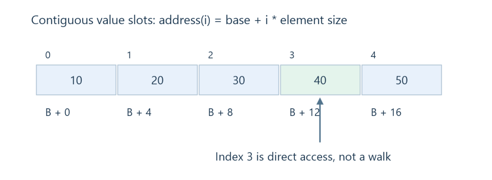

# 2. Arrays, Memory Model, Kadane, and In-Place Manipulation

[Topic overview](topics/arrays.md) | [All topics](index.md) | [Revision](revision.md) | [Answer key](answers.md#solutions---chapter-2)

> Adapted from the supplied study-notes PDF, pages 21-24. Examples use [pseudocode](index.md#pseudocode-conventions). [Source notes](index.md#provenance-and-numbering).

Chapter goal: Understand direct indexing and locality; derive Kadane; manipulate a logical output prefix in place.



*Figure 2. Value-array slots and direct address arithmetic. Object headers are omitted in this conceptual drawing.*

## 2.1 Array mental model
An array is a fixed-length, contiguous logical sequence with zero-based indexing. Its key power is direct addressing: the runtime can locate element i from the base plus an offset, making access O(1).

Implementation considerations:

- `a <- array(n, initial = 0)` creates an array with n zero-initialized slots.

- Assigning `b <- a` aliases the same array in this guide; use `copy(a)` for a separate container.

- For reference-type elements, the array stores references. The referenced objects live separately.

- A fixed array has a fixed length. A dynamic array manages a resizable backing array.

- A rectangular matrix and an array of independent rows may have different layouts. State which representation the problem uses.

### Locality and cache intuition
Sequential scans are efficient because neighboring elements are close in memory and CPU caches fetch blocks. Linked structures sacrifice locality for flexible pointer rewiring. Big-O may be equal while real performance differs.

## 2.2 Core operations
|**Operation**|**Array complexity**|**Reason**|
|---|---|---|
|**Read/write by index**|O(1)|Direct addressing|
|**Linear search**|O(n)|May inspect all elements|
|**Binary search (sorted)**|O(log n)|Halves candidate interval|
|**Insert/delete at end**|O(1) only if capacity/length permits|No shifting|
|**Insert/delete near front**|O(n)|Shift elements|
|**Copy**|O(n)|Every element/reference copied|

## 2.3 Subarray, subsequence, and subset
- Subarray: contiguous: [a[l], ..., a[r]].

- Subsequence: preserves relative order but may skip elements.

- Subset: order is irrelevant.

Sliding windows, prefix sums, and Kadane apply to contiguous ranges. Confusing these terms leads to the wrong pattern.

## 2.4 Kadane's algorithm
### Problem
Find the maximum sum of a non-empty contiguous subarray.

### Mental model
At each position, choose between:

1.  Start a new subarray at x.

2.  Extend the best subarray that must end at the previous position.

The local state is bestEndingHere; the global answer is bestSoFar.

### Recurrence and invariant
bestEndingHere = max(x, bestEndingHere + x).

After processing index i:

- bestEndingHere is the maximum sum of any non-empty subarray ending exactly at i.

- bestSoFar is the maximum over all endings seen so far.

```pseudocode
FUNCTION MaxSubarraySum(nums)
    REQUIRE length(nums) > 0
    ending <- nums[0]
    best <- nums[0]
    FOR i FROM 1 TO length(nums) - 1
        ending <- max(nums[i], ending + nums[i])
        best <- max(best, ending)
    RETURN best
```

Time O(n), auxiliary space O(1).

### All-negative trap
Initializing to 0 incorrectly allows the empty subarray and returns 0 for [-5, -2]. If a non-empty subarray is required, initialize from the first element.

### Recovering indices
Track a tentative start when starting fresh; when best improves, snapshot [candidateStart, i].

## 2.5 In-place array manipulation
“In place” means using constant auxiliary storage while overwriting/rearranging the input.

### Read/write pointer pattern
Use read to inspect every element and write to mark the next valid output position. Invariant: [0, write) already contains the compacted valid result.

Example: remove a target and return the new logical length.

```pseudocode
FUNCTION RemoveValue(nums, target)
    write <- 0
    FOR read FROM 0 TO length(nums) - 1
        IF nums[read] != target
            nums[write] <- nums[read]
            write <- write + 1
    RETURN write
```

Time O(n), space O(1). Elements after write - 1 are irrelevant unless the contract requires clearing them.

### Reverse a range
```pseudocode
FUNCTION Reverse(a, left, right)
    WHILE left < right
        SWAP a[left], a[right]
        left <- left + 1
        right <- right - 1
```

Useful for full reversal, rotating by reversals, and reorder-style operations.

### Cyclic replacement
For rotation without an extra array, each value moves to its destination and displaced values continue the cycle. This is correct but harder to implement; the three-reversal rotation is often safer:

1.  Normalize k %= n.

2.  Reverse all.

3.  Reverse [0, k - 1].

4.  Reverse [k, n - 1].

## 2.6 Pattern recognition
Use an array when index access and compact storage matter. Suspect in-place manipulation when the prompt says:

- “Modify the array without extra space.”

- “Return the new length; order may/may not matter.”

- “Move zeros/duplicates/invalid values.”

- “Rotate/reverse/partition.”

## Common mistakes
- Assuming assignment copies an array.

- Repeatedly removing the first dynamic-array element and hiding O(n) shifts.

- Kadane initialized to zero for a non-empty requirement.

- Returning the entire backing array instead of the valid prefix.

- Forgetting k %= n or handling n == 0 in rotation.

- Accidentally destroying input when the caller expects it preserved.

## Worked example and diagram guide - The array is an address calculation
For a conceptual int array at base address B, element i is found using B + i * sizeof(int), ignoring object headers. The index does not require walking through earlier elements. For reference-type arrays, the contiguous slots hold references, not necessarily the objects themselves.

For a rectangular row-major matrix, element [r,c] corresponds conceptually to offset r*columnCount+c. Traversing columns inside each row generally follows adjacent elements; visiting one column across all rows introduces larger strides. A jagged int[][] is an array of row references and each row is a separate array; do not transfer the single-block layout assumption to it.

### Kadane dry run: [-2,1,-3,4,-1,2,1,-5,4]
|**x**|**Best sum ending here**|**Best seen**|
|---|---|---|
|**-2**|-2|-2|
|**1**|1|1|
|**-3**|-2|1|
|**4**|4|4|
|**-1**|3|4|
|**2**|5|5|
|**1**|6|6|
|**-5**|1|6|
|**4**|5|6|

The answer is 6 from [4,-1,2,1]. "Ending here" is a constrained local answer; "best seen" may end earlier. This local/global distinction returns in tree maximum-path sum.

For compaction of [0,1,0,3,12], inspect each value and write nonzero values into the valid prefix: [1,3,12]. If the contract is "move zeros", additionally fill the remaining slots with zeros; if it is "remove target and return length", the suffix is unspecified. A fixed array cannot grow: end insertion is constant only into an unused slot of a logical array. A dynamic array manages capacity, so append is amortized constant time.

## Check Your Understanding - Chapter 2
### Q2.1

What is the difference between int[] b = a; and int[] b = (int[])a.Clone();?

[Solution](answers.md#a21)

### Q2.2

State Kadane's invariant for bestEndingHere.

[Solution](answers.md#a22)

### Q2.3

Why does Kadane initialized with zero fail on all-negative input?

[Solution](answers.md#a23)

### Q2.4

In a read/write compaction algorithm, what does the range [0, write) represent?

[Solution](answers.md#a24)

### Q2.5

Why can an O(n) array scan outperform an O(n) linked-list scan in practice?

[Solution](answers.md#a25)

## Additional practice - Chapter 2
New application exercises. Attempt these before consulting the final answer section.

### E2.1

Dry-run nonempty Kadane on [-5,-2,-8]. Give the answer and local/global state after each value.

[Solution](answers.md#e21)

### E2.2

Rotate [1,2,3,4,5] right by 7 using three reversals. State the empty-array guard.

[Solution](answers.md#e22)

---

[All coding chapters](index.md) | [Previous chapter](01-problem-solving.md) | [Next chapter](03-prefix-sums.md)
