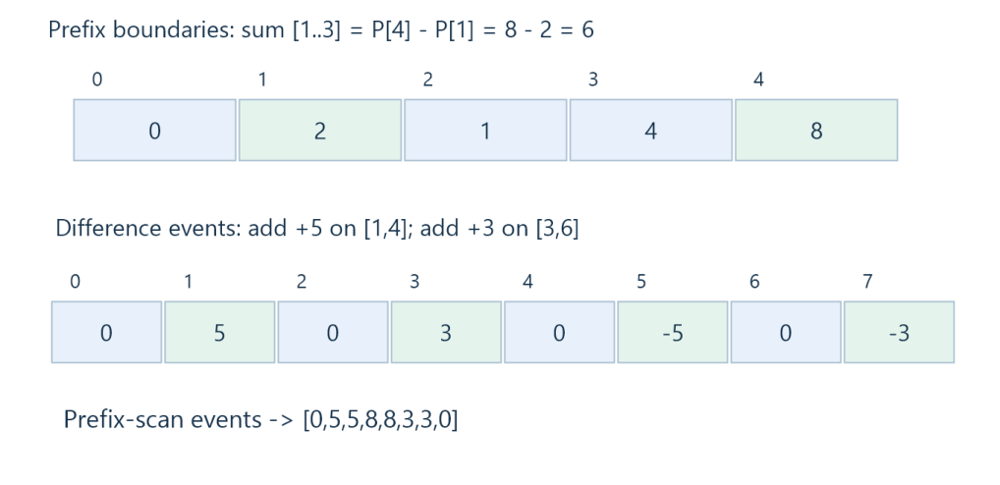

# 3. Prefix Sums, Hashing, and Difference Arrays

[Topic overview](topics/arrays.md) | [All topics](index.md) | [Revision](revision.md) | [Answer key](answers.md#solutions---chapter-3)

> Adapted from the supplied study-notes PDF, pages 25-28. Examples use [pseudocode](index.md#pseudocode-conventions). [Source notes](index.md#provenance-and-numbering).

Chapter goal: Use prefix boundaries for queries, prefix frequencies for interval counts, and difference events for batch updates.



*Figure 3. Prefix sums summarize history; difference-array boundaries turn range updates on and off.*

## 3.1 Prefix sums
### Mental model
Precompute cumulative history so a range query becomes a subtraction.

Use the half-open definition:

prefix[i] = sum of nums[0..i-1], so prefix[0] = 0 and length is n + 1.

Then:

sum(l..r inclusive) = prefix[r + 1] - prefix[l].

```pseudocode
FUNCTION BuildPrefix(nums)
    prefix <- array(length(nums) + 1, initial = 0)
    FOR i FROM 0 TO length(nums) - 1
        prefix[i + 1] <- prefix[i] + nums[i]
    RETURN prefix
```

Preprocessing O(n), each query O(1), space O(n).

### Why the leading zero helps
It eliminates a special case for ranges starting at index 0 and aligns index i with the first i elements.

### 2D prefix idea
For matrices, store the sum of the rectangle from origin to each coordinate. Rectangle queries use inclusionexclusion: add two large prefixes, subtract overlaps, add back the double-subtracted corner. Complexity is O(rows * cols) preprocessing and O(1) per rectangle query.

## 3.2 Prefix sum with hashing
### Count subarrays with sum k
Let running prefix at current index be P. A prior prefix Q creates a subarray sum k when:

P - Q = k, therefore Q = P - k.

Store frequencies of prior prefixes, not merely existence, because multiple starts can yield valid subarrays.

```pseudocode
FUNCTION CountSubarraysWithSum(nums, k)
    freq <- map containing (0 -> 1)
    prefix <- 0
    count <- 0
    FOR EACH x IN nums
        prefix <- prefix + x
        count <- count + freq.get(prefix - k, default = 0)
        freq[prefix] <- freq.get(prefix, default = 0) + 1
    RETURN count
```

Expected time O(n), space O(n).

### Critical order
Query prefix - k before inserting the current prefix. Otherwise, especially when k == 0, the current prefix can pair with itself and represent an empty subarray.

### Why sliding window is not enough with negatives
For positive numbers, expanding increases sum and shrinking decreases it. Negative numbers break that monotonic relationship. Prefix hashing does not require monotonicity.

### Longest subarray with sum k
Store the earliest index where each prefix occurred. If prefix - k was first seen at index j, length is i - j. Do not overwrite the earliest index, because it produces the longest candidate.

Initialize prefix 0 at virtual index -1.

### Other transformations
Many count problems reduce to prefix-state matching:

- Equal 0s and 1s: treat 0 as -1; equal counts become sum 0.

- Sum divisible by k: equal normalized remainders imply divisible difference.

- Parity/state masks: equal masks mean intervening counts have even parity.

If the implementation can return a negative remainder, normalize it as
`((value MOD k) + k) MOD k`, for positive k.

## 3.3 Difference arrays
### Mental model
Prefix sums answer many range queries. Difference arrays apply many range updates.

To add delta to every element in inclusive range [l, r]:

- diff[l] += delta

- if r + 1 &lt; n, diff[r + 1] -= delta

After all updates, prefix-sum diff to reconstruct final values.

```pseudocode
FUNCTION ApplyRangeAdds(n, updates)
    diff <- array(n + 1, initial = 0)
    FOR EACH (l, r, delta) IN updates
        REQUIRE 0 <= l <= r < n
        diff[l] <- diff[l] + delta
        diff[r + 1] <- diff[r + 1] - delta
    result <- array(n, initial = 0)
    running <- 0
    FOR i FROM 0 TO n - 1
        running <- running + diff[i]
        result[i] <- running
    RETURN result
```

For m updates: O(m + n) time instead of O(mn), with O(n) space.

### Existing initial array
Either build its difference representation first or apply updates to a zero delta array and add reconstructed deltas to the original values.

## 3.4 Unifying model
- Prefix sum converts point values -&gt; cumulative history and supports range queries.

- Difference array converts range updates -&gt; boundary events and reconstructs with a prefix sum.

- Prefix hashing asks: “Which earlier cumulative states would make the interval satisfy the target?”

## Common mistakes
- Mixing inclusive and half-open formulas.

- Forgetting seed freq[0] = 1 or earliest index 0 -&gt; -1.

- Storing only presence when the task asks for a count.

- Updating the map before querying.

- Using sliding window for arbitrary negative values.

- Missing the r + 1 boundary guard in a difference array.

- Using int when cumulative totals can overflow.

## Worked example and diagram guide - Prefixes are positions between values
With nums=[2,-1,3,4], prefix=[0,2,1,4,8]. Query indices [1,3] gives prefix[4]-prefix[1]=8-2=6. Think of prefix[i] as the boundary just before nums[i], not as the sum ending at element i.

For a 2D prefix P with one extra row and column, P[r+1,c+1]=a[r,c]+P[r,c+1]+P[r+1,c]-P[r,c]. Inclusive rectangle [r1..r2,c1..c2] equals P[r2+1,c2+1]-P[r1,c2+1]-P[r2+1,c1]+P[r1,c1]. Drawing overlapping rectangles explains the add-back corner.

### Counting zero-sum subarrays: [1,-1,1,-1]
Start with prefix 0 seen once. Query before recording the current prefix.

|**Index**|**Running prefix**|**Prior equal prefixes**|**Count so far**|**Frequency after**|
|---|---|---|---|---|
|||||**record**|
|**0**|1|0|0|1 -&gt; 1|
|**1**|0|1|1|0 -&gt; 2|
|**2**|1|1|2|1 -&gt; 2|

|**Index**|**Running prefix**|**Prior equal prefixes**|**Count so far**|**Frequency after**|
|---|---|---|---|---|
|||||**record**|
|**3**|0|2|4|0 -&gt; 3|

The four intervals are [0,1], [1,2], [2,3], and [0,3]. A set would lose repeated prefix occurrences.

### Difference arrays: start and stop events
Start with eight zeros. Add +5 to [1,4] and +3 to [3,6]. With a sentinel slot, diff becomes [0,5,0,3,0,-5,0,-3,0]. Scanning indices 0..7 produces [0,5,5,8,8,3,3,0]. The negative event is not subtracting from an already finished answer; it turns an update off from the next position onward.

For an existing array, either difference-encode it first or reconstruct a separate delta array and add the deltas to it. The sentinel at n may be stored but is not an output element. Batch updates are the key assumption; interleaved arbitrary updates and queries generally need another structure.

## Check Your Understanding - Chapter 3
### Q3.1

With prefix[i] defined as the sum of the first i elements, give the formula for inclusive range [l, r].

[Solution](answers.md#a31)

### Q3.2

Why is prefix sum 0 inserted with frequency 1 before scanning?

[Solution](answers.md#a32)

### Q3.3

Why must a count algorithm store prefix frequencies rather than a HashSet?

[Solution](answers.md#a33)

### Q3.4

For longest subarray with sum k, why should the earliest prefix index be preserved?

[Solution](answers.md#a34)

### Q3.5

What two boundary changes represent “add d to every position in [l, r]” in a difference array?

[Solution](answers.md#a35)

## Additional practice - Chapter 3
New application exercises. Attempt these before consulting the final answer section.

### E3.1

For [1,-1,1,-1], count all zero-sum contiguous subarrays with a prefix-frequency trace.

[Solution](answers.md#e31)

### E3.2

Apply +5 on [1,4] and +3 on [3,6] to eight zeros. Give the difference array including its sentinel and final output.

[Solution](answers.md#e32)

---

[All coding chapters](index.md) | [Previous chapter](02-arrays.md) | [Next chapter](04-two-pointers.md)
