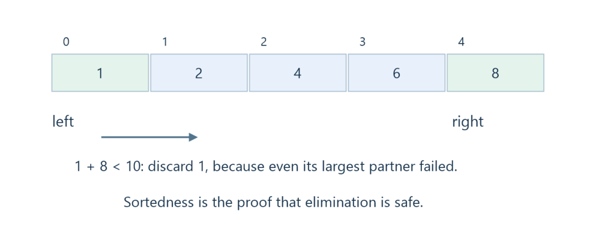

# 4. Two Pointers and Sliding Windows

[Topic overview](topics/arrays.md) | [All topics](index.md) | [Revision](revision.md) | [Answer key](answers.md#solutions---chapter-4)

> Adapted from the supplied study-notes PDF, pages 29-32. Examples use [pseudocode](index.md#pseudocode-conventions). [Source notes](index.md#provenance-and-numbering).

Chapter goal: Prove safe pointer movement and distinguish fixed, longest-valid, and minimum-valid windows.



*Figure 4. Opposite-end pointers eliminate a value only when sorted order makes the elimination safe.*

## 4.1 Two pointers: the broad idea
Two pointers exploit order, geometry, or a maintained region so that candidates can be eliminated without examining every pair.

### Major forms
1.  Opposite ends: sorted two-sum, palindrome checking, container-style problems.

2.  Same direction / fast-slow: compaction, deduplication, linked-list middle/cycle.

3.  Partition boundaries: maintain regions such as &lt; pivot, == pivot, &gt; pivot.

4.  Merged traversal: advance whichever sorted input has the smaller current item.

### Sorted two-sum invariant
For sorted a with left &lt; right:

- If a[left] + a[right] &lt; target, no pair using this left and a smaller/equal right can work, so increment left.

- If sum is too large, decrement right.

```pseudocode
FUNCTION TwoSumSorted(a, target)
    left <- 0
    right <- length(a) - 1
    WHILE left < right
        sum <- a[left] + a[right]
        IF sum = target
            RETURN (left, right)
        IF sum < target
            left <- left + 1
        ELSE
            right <- right - 1
    RETURN null
```

Time O(n), space O(1). The proof depends on sorted order.

## 4.2 Fixed-size sliding window
### Recognition
- “Every contiguous subarray/substring of length k.”

- Maximum/minimum/average/count for a fixed length.

### Invariant
Before evaluating, the window contains exactly k current elements. Add the entering element and remove the leaving element rather than recomputing.

```pseudocode
FUNCTION MaxFixedWindowSum(a, k)
    REQUIRE 1 <= k <= length(a)
    sum <- SUM of a[0 .. k - 1]
    best <- sum
    FOR right FROM k TO length(a) - 1
        sum <- sum + a[right] - a[right - k]
        best <- max(best, sum)
    RETURN best
```

Time O(n), space O(1) unless richer state is needed.

## 4.3 Variable-size sliding window
### Recognition
Look for a contiguous range and an incremental validity rule:

- Longest substring with at most k distinct characters.

- Shortest subarray with sum at least target when values are positive.

- Longest segment with no duplicates.

**Canonical “longest valid” template**

```pseudocode
left <- 0
best <- 0
FOR right FROM 0 TO n - 1
    Add(item[right])
    WHILE NOT IsValid()
        Remove(item[left])
        left <- left + 1
    best <- max(best, right - left + 1)
```

Invariant after the while: the current window is valid. Since each pointer advances at most n times, time is O(n) plus state-operation cost.

### Longest substring without repeating characters
Frequency-map version:

```pseudocode
FUNCTION LongestUniqueSubstring(s)
    freq <- empty map
    left <- 0
    best <- 0
    FOR right FROM 0 TO length(s) - 1
        c <- s[right]
        freq[c] <- freq.get(c, default = 0) + 1
        WHILE freq[c] > 1
            outgoing <- s[left]
            left <- left + 1
            freq[outgoing] <- freq[outgoing] - 1
        best <- max(best, right - left + 1)
    RETURN best
```

An optimized last-seen map can jump left to max(left, last[c] + 1). The max is essential: left must never move backward.

**“Minimum valid” template**

Expand until valid, then shrink while still valid and update the minimum during shrinking.

```pseudocode
left <- 0
best <- INFINITY
FOR right FROM 0 TO n - 1
    Add(a[right])
    WHILE IsValid()
        best <- min(best, right - left + 1)
        Remove(a[left])
        left <- left + 1
RETURN null IF best = INFINITY ELSE best
```

## 4.4 When sliding window does not apply
The validity must evolve predictably when endpoints move. For a positive-number sum window, adding increases sum and removing decreases sum. With arbitrary negative values, this monotonicity disappears; use prefix sums, prefix hashing, or another structure.

## 4.5 Two pointers versus sliding window
All sliding windows use two boundaries, but not all two-pointer algorithms are windows. A window maintains state about an entire contiguous region; opposite-end two-sum compares a candidate pair and eliminates ranges.

## Common mistakes
- Using two-sum pointer logic on unsorted data.

- Shrinking with if when multiple removals may be necessary; use while.

- Updating the answer before restoring validity in a longest-valid problem.

- Updating a minimum only after the loop has over-shrunk.

- Removing the wrong outgoing element or failing to decrement/delete its count.

- Moving left backward in the last-seen-index optimization.

- Applying positive-sum sliding window to negative numbers.

## Worked example and diagram guide - Safe elimination versus maintaining a region
For sorted [1,2,4,6,8] and target 10: 1+8 is too small, so discard 1; even its largest available partner failed. Then 2+8 equals 10. If a sum is too large, discard the right value because even its smallest available partner is too large. Sortedness is the proof, not an incidental convenience.

### Longest unique substring: "abba"
Using last-seen indices: at a, left=0 and best=1; at b, best=2; at the second b, move left to 2; at the final a, previous a was index 0, before the current window. Use left=max(left,last[a]+1), leaving left at 2. Moving it backward to 1 would create the invalid window "bba".

For longest valid windows, first shrink until valid, then score the current window. For minimum valid windows, score each valid state while shrinking, stopping only once invalid. These are different templates with different update positions.

### Why arbitrary negative sums break the usual sum window
For target at least 3 and [1,-1,3], the whole array reaches 3. Removing the first 1 makes sum 2, so the usual positive-number algorithm stops shrinking and misses the one-element [3]. Removing the next -1 would increase the sum again. The simple monotonic argument no longer holds.

For a fixed window of length k, adding the incoming element and subtracting the outgoing element gives a new sum in O(1). For variable windows, validity may require several removals, but each pointer still advances at most n times.

## Check Your Understanding - Chapter 4
### Q4.1

Why is it safe to increment left when a sorted two-sum candidate is too small?

[Solution](answers.md#a41)

### Q4.2

Why is a variable window usually O(n) even though it contains a nested while loop?

[Solution](answers.md#a42)

### Q4.3

In a longest-valid window, when should the answer be updated?

[Solution](answers.md#a43)

### Q4.4

In a minimum-valid window, why is the answer updated inside the shrinking loop?

[Solution](answers.md#a44)

### Q4.5

Give one precise reason a sum-based sliding window can fail when negative values are allowed.

[Solution](answers.md#a45)

## Additional practice - Chapter 4
New application exercises. Attempt these before consulting the final answer section.

### E4.1

Trace the longest unique substring of 'abba' with last-seen positions. Explain the max in the left update.

[Solution](answers.md#e41)

### E4.2

Find the minimum length positive-number subarray with sum at least 7 in [2,3,1,2,4,3]. Explain when scoring occurs.

[Solution](answers.md#e42)

---

[All coding chapters](index.md) | [Previous chapter](03-prefix-sums.md) | [Next chapter](05-strings.md)
