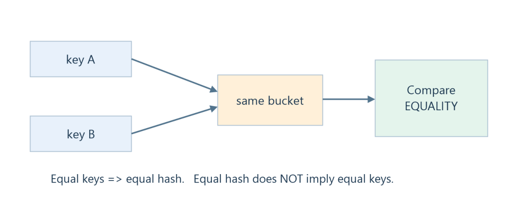

# 5. Strings, Hashing, Palindromes, and Hash Tables

[Topic overview](topics/strings.md) | [All topics](index.md) | [Revision](revision.md) | [Answer key](answers.md#solutions---chapter-5)

> Adapted from the supplied study-notes PDF, pages 33-36. Examples use [pseudocode](index.md#pseudocode-conventions). [Source notes](index.md#provenance-and-numbering).

Chapter goal: Use immutable strings and frequency signatures correctly; distinguish hash collisions, equality, and palindrome centers.



*Figure 5. Two keys can share a hash bucket. Equality, not the hash alone, decides whether the keys are the same.*

## 5.1 String representation and construction
Many languages expose immutable strings. Repeatedly appending to such a string
can copy the accumulated prefix and become quadratic. Use a mutable text builder
or collect pieces and join once when building a result incrementally.

Useful distinctions:

- A code unit is not necessarily a complete Unicode scalar value or user-perceived character.

- Most interview questions intentionally use ASCII letters/digits; state the assumption.

- Indexing is O(1) for the fixed-width symbol sequence assumed by these examples; other text representations may require decoding or preprocessing.

- Copying a substring costs time and output storage proportional to its length; a view may have a different contract.

- Specify ordinal comparison, case folding, and normalization instead of relying on an implicit locale.

## 5.2 Frequency counting and hashing patterns
### Dictionary and set roles
- A hash set answers existence/uniqueness queries.

- A hash map stores counts, last positions, mappings, and grouped state.

```pseudocode
count <- empty map
FOR EACH symbol IN s
    count[symbol] <- count.get(symbol, default = 0) + 1
```

When the alphabet is fixed and small, an array is faster and simpler:

```pseudocode
REQUIRE every symbol in s belongs to the lowercase English alphabet
freq <- array(26, initial = 0)
FOR EACH symbol IN s
    index <- alphabet position of symbol, starting at 0
    freq[index] <- freq[index] + 1
```

Only use this when lowercase English letters are guaranteed.

### Common string/hash problems
- Anagram: equal lengths and equal character counts.

- First unique character: count first, scan again for count 1.

- Group anagrams: key by normalized signature (sorted characters or frequency vector).

- Longest unique substring: sliding window + counts/last index.

- Pattern mapping: maintain both directions when a bijection is required.

## 5.3 Palindrome checking
A palindrome reads the same from both ends.

### Exact palindrome
```pseudocode
FUNCTION IsPalindrome(s)
    left <- 0
    right <- length(s) - 1
    WHILE left < right
        IF s[left] != s[right]
            RETURN false
        left <- left + 1
        right <- right - 1
    RETURN true
```

Time O(n), space O(1).

### Ignore punctuation and case
Move each pointer past irrelevant characters, then compare normalized characters. Be explicit about whether char.IsLetterOrDigit and char.ToLowerInvariant satisfy the contract.

Invariant: everything strictly outside [left, right] has already been matched successfully.

### At most one deletion
On the first mismatch, test either skipping the left character or skipping the right character. Only one branch point is needed; each helper check is linear, so total remains O(n).

## 5.4 Longest palindromic substring
### Expand around centers
Every palindrome has a center:

- Odd length: one character center (i, i).

- Even length: gap center (i, i + 1).

Expand while characters match; track the longest boundaries.

```pseudocode
FUNCTION LongestPalindrome(s)
    IF length(s) < 2
        RETURN s
    bestStart <- 0
    bestLength <- 1
    PROCEDURE Expand(left, right)
        WHILE left >= 0 AND right < length(s) AND s[left] = s[right]
            size <- right - left + 1
            IF size > bestLength
                bestStart <- left
                bestLength <- size
            left <- left - 1
            right <- right + 1
    FOR i FROM 0 TO length(s) - 1
        Expand(i, i)
        Expand(i, i + 1)
    RETURN slice(s, bestStart, bestStart + bestLength)
```

Time O(n^2), space O(1) excluding result. The dynamic-programming alternative also takes O(n^2) time but O(n^2) space. Manacher's algorithm is linear but is rarely the expected first interview solution unless required.

### Substring versus subsequence
Longest palindromic substring must be contiguous and fits center expansion. Longest palindromic subsequence is a different dynamic-programming problem.

## 5.5 Hash-table mechanics
A hash table uses:

1.  GetHashCode to select a bucket.

2.  Equality comparison to distinguish keys within collisions.

3.  Resizing/rehashing when load grows.

Average lookup/insert/delete is O(1) under a well-distributed hash and controlled load factor; worst case is O(n) if many keys collide.

### Correct key contract
If two keys are equal, they must have equal hash codes. A key's hash/equality-relevant fields must not change while it is stored. Mutable keys can become unreachable because lookup computes a different bucket after mutation.

For custom keys, prefer immutable records/value objects and consistent equality. Do not rely on dictionary enumeration order unless the API contract guarantees the behavior you need.

### Collision handling mental model
Conceptually, multiple keys can map to one bucket and are distinguished by equality. Implementations may use chains or other internal schemes. The interview-level point is: hashing narrows the search; equality confirms the key.

## Pattern recognition
Choose hashing when the question asks whether something was seen, how often it occurred, where it last occurred, or which prior state complements the current state. Choose a fixed array over a dictionary when the key domain is tiny and known.

## Common mistakes
- Repeated string concatenation in a loop.

- Sorting for an anagram when O(n) counting is straightforward and the alphabet is known.

- Forgetting an even center in longest palindrome.

- Returning length boundaries with an off-by-one error.

- Using mutable objects as dictionary keys.

- Claiming hash lookup is guaranteed O(1) rather than average O(1).

- Assuming char always equals a full Unicode character.

## Worked example and diagram guide - Hashing narrows; equality decides
Imagine two distinct strings entering the same conceptual bucket. A collision is not a duplicate: the table compares equality within the bucket to decide whether to update an existing entry or keep a different key. Equal keys must hash equally; equally hashed keys need not be equal.

Grouping anagrams can use sorted characters as a signature, costing O(L log L) per length-L word, or a count vector for a fixed alphabet, costing O(L + alphabetSize). Serialize a count vector with unambiguous separators; concatenating decimal counts without boundaries can create ambiguous keys.

### Two kinds of palindrome center
For "racecar", center (3,3) expands c -&gt; ece -&gt; aceca -&gt; racecar. For "abba", center (1,2) expands bb -&gt; abba. Testing only character centers misses even-length answers. For "abca" with at most one deletion, the first mismatch b/c leads to checking "aca" or "aba"; do not blindly discard both.

The pseudocode treats a string as an indexed sequence of symbols. The worked
examples use ASCII. For general Unicode, explicitly choose code units, scalar
values, or user-perceived graphemes and define normalization before applying
the algorithm. The source's UTF-16 examples are not a universal text contract.

Repeated concatenation of one character to a growing immutable string can copy
1+2+...+n characters. A mutable builder avoids repeatedly rebuilding that prefix.
Creating the final result still costs space proportional to its length.

## Check Your Understanding - Chapter 5
### Q5.1

Why can repeated string += inside a loop become O(n^2)?

[Solution](answers.md#a51)

### Q5.2

When is a 26-slot frequency array preferable to a map from symbol to count?

[Solution](answers.md#a52)

### Q5.3

Why must longest-palindrome center expansion test both (i, i) and (i, i + 1)?

[Solution](answers.md#a53)

### Q5.4

What consistency rule must Equals and GetHashCode satisfy?

[Solution](answers.md#a54)

### Q5.5

Why is mutating a dictionary key after insertion dangerous?

[Solution](answers.md#a55)

## Additional practice - Chapter 5
New application exercises. Attempt these before consulting the final answer section.

### E5.1

For 'cbbd', identify the necessary center and longest palindromic substring.

[Solution](answers.md#e51)

### E5.2

Two unequal custom keys have the same hash. Is this invalid? What breaks if an inserted key's hashrelevant field changes?

[Solution](answers.md#e52)

---

[All coding chapters](index.md) | [Previous chapter](04-two-pointers.md) | [Next chapter](06-linked-list-foundations.md)
