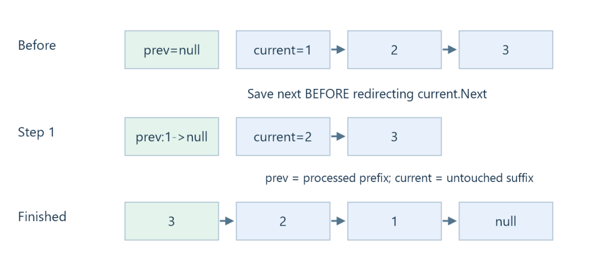

# 6. Linked List Basics, Reversal, and Cycles

[Topic overview](topics/linked-lists.md) | [All topics](index.md) | [Revision](revision.md) | [Answer key](answers.md#solutions---chapter-6)

> Adapted from the supplied study-notes PDF, pages 37-40. Examples use [pseudocode](index.md#pseudocode-conventions). [Source notes](index.md#provenance-and-numbering).

Chapter goal: Rewire safely; use identity; derive middle, nth-from-end, cycle detection, and cycle entry.



*Figure 6. Linked-list reversal preserves access to the unprocessed suffix before redirecting a Next reference.*

## 6.1 Linked-list mental model
A singly linked list is a chain of nodes. Each node stores a value and a reference to the next node.

```pseudocode
RECORD ListNode
    Val
    Next <- null

ListNode(value, next = null) creates a node with those fields.
Node comparisons use object identity, not equality of Val.
```

Properties:

- Access by position: O(n).

- Insert/delete after a known node: O(1).

- No contiguous locality and no backward movement in a singly linked list.

- Node identity matters. Equal values do not imply the same node.

A dummy/sentinel node is a stable predecessor placed before the real head. It removes special cases when the head may be inserted, deleted, or merged.

## 6.2 Iterative reversal
### State and invariant
- prev: head of the fully reversed processed prefix.

- current: first unprocessed node.

- next: saved remainder before rewiring.

```pseudocode
FUNCTION Reverse(head)
    prev <- null
    current <- head
    WHILE current != null
        next <- current.Next
        current.Next <- prev
        prev <- current
        current <- next
    RETURN prev
```

Time O(n), space O(1).

The most important operation is saving next before changing current.Next; otherwise the unprocessed list is lost.

### Recursive reversal
The recursive contract can be: reverse the list starting at head and return its new head. After recursively reversing the tail, set head.Next.Next = head and head.Next = null. Time O(n), stack O(n); iterative is safer for long lists.

## 6.3 Fast/slow pointer family
Fast/slow pointers encode relative rates.

### Find middle
Move slow one step and fast two. When fast reaches the end, slow is at the middle. For even length, initialization/condition determines whether the first or second middle is returned. State the desired convention.

### Nth node from end
Create a gap of n nodes:

1.  Advance fast n steps.

2.  Move slow and fast together until fast is null.

3.  slow is the nth node from the end.

For deletion, use a dummy and position slow at the predecessor.

```pseudocode
FUNCTION RemoveNthFromEnd(head, n)
    REQUIRE n > 0
    dummy <- ListNode(0, head)
    fast <- dummy
    slow <- dummy
    REPEAT n + 1 TIMES
        REQUIRE fast != null
        fast <- fast.Next
    WHILE fast != null
        fast <- fast.Next
        slow <- slow.Next
    slow.Next <- slow.Next.Next
    RETURN dummy.Next
```

The n + 1 gap between dummy-based pointers places slow immediately before the node to remove.

## 6.4 Cycle detection - Floyd's algorithm
### Detect existence
Move slow by one and fast by two. If they meet by reference, a cycle exists. If fast reaches null, no cycle.

```pseudocode
FUNCTION HasCycle(head)
    slow <- head
    fast <- head
    WHILE fast != null AND fast.Next != null
        slow <- slow.Next
        fast <- fast.Next.Next
        IF slow IS SAME NODE AS fast
            RETURN true
    RETURN false
```

Time O(n), space O(1).

### Find cycle entry
After the first meeting:

1.  Put one pointer at head.

2.  Keep the other at the meeting point.

3.  Move both one step at a time.

4.  Their next meeting is the cycle entry.

Mental proof: if distance from head to entry is a, and meeting geometry contributes whole cycle lengths, the remaining distance from meeting to entry is congruent to a modulo the cycle length. Equal-speed pointers therefore meet at entry.

```pseudocode
FUNCTION DetectCycleEntry(head)
    slow <- head
    fast <- head
    LOOP
        IF fast = null OR fast.Next = null
            RETURN null
        slow <- slow.Next
        fast <- fast.Next.Next
        IF slow IS SAME NODE AS fast
            BREAK
    slow <- head
    WHILE slow IS NOT SAME NODE AS fast
        slow <- slow.Next
        fast <- fast.Next
    RETURN slow
```

## Common mistakes
- Comparing node values instead of references.

- Losing the remainder during reversal.

- Dereferencing fast.Next.Next without a null guard.

- Not defining first-middle versus second-middle behavior.

- Getting the fast-pointer gap wrong for nth-from-end deletion.

- Running an ordinary traversal on a cyclic list without protection.

## Worked example and diagram guide - Rewiring without losing reachability
Reversing 1 -&gt; 2 -&gt; 3 -&gt; null begins with prev=null, current=1. Save next=2, redirect 1.Next to null, advance prev=1 and current=2. Next, save 3, redirect 2.Next to 1; finally redirect 3.Next to 2. The new head is prev=3, not the original head.

### Floyd's entry proof, with distances
Let a be the distance from head to cycle entry, b the distance along the cycle from entry to the meeting, and c the cycle length. Slow has travelled a+b; fast has travelled twice that distance. Their difference is a whole number of cycles, so a+b is congruent to 0 modulo c. Therefore a is congruent to -b modulo c. One pointer starting at head and one at the meeting, both moving one step, reach entry together after a steps.

The first meeting is not generally the entry. A comparison of equal values is not a meeting either: two different nodes containing 7 are still different nodes.

For nth-from-end deletion, distinguish a gap that lands on the target from a gap that lands on its predecessor. With dummy and an n+1 gap, slow stops before the target. Reject n&lt;=0 and n greater than length; ordinary list snippets assume acyclic input.

## Check Your Understanding - Chapter 6
### Q6.1

State the iterative linked-list reversal invariant.

[Solution](answers.md#a61)

### Q6.2

Why must current.Next be saved before rewiring during reversal?

[Solution](answers.md#a62)

### Q6.3

How does a dummy node simplify deleting the original head?

[Solution](answers.md#a63)

### Q6.4

What comparison must be used to detect that two pointers reached the same node?

[Solution](answers.md#a64)

### Q6.5

After Floyd's pointers meet inside a cycle, how is the entry found?

[Solution](answers.md#a65)

## Additional practice - Chapter 6
New application exercises. Attempt these before consulting the final answer section.

### E6.1

Reverse 1-&gt;2-&gt;3. List (prev,current) after each iteration and identify the saved reference.

[Solution](answers.md#e61)

### E6.2

A cycle begins a=3 steps from head and has length c=5. If the first meeting lies b=2 steps beyond entry, explain the reset method.

[Solution](answers.md#e62)

---

[All coding chapters](index.md) | [Previous chapter](05-strings.md) | [Next chapter](07-linked-list-patterns.md)
