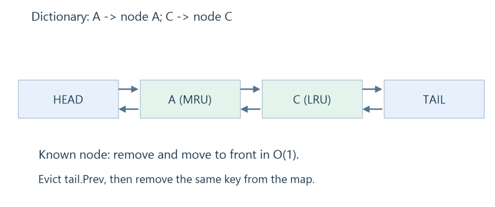

# 7. Linked List Patterns and LRU Cache

[Topic overview](topics/linked-lists.md) | [All topics](index.md) | [Revision](revision.md) | [Answer key](answers.md#solutions---chapter-7)

> Adapted from the supplied study-notes PDF, pages 41-45. Examples use [pseudocode](index.md#pseudocode-conventions). [Source notes](index.md#provenance-and-numbering).

Chapter goal: Combine list primitives for merge, intersection, palindrome/reorder, and a consistent O(1)-operation LRU.



*Figure 7. An LRU cache combines direct dictionary lookup with a doubly linked recency chain.*

## 7.1 Merge two sorted lists
Use a dummy tail. Repeatedly attach the smaller current node and advance that list. At the end, attach the remaining suffix.

```pseudocode
FUNCTION MergeSorted(a, b)
    REQUIRE both inputs are sorted, acyclic, and share no nodes
    dummy <- ListNode(0)
    tail <- dummy
    WHILE a != null AND b != null
        IF a.Val <= b.Val
            tail.Next <- a
            a <- a.Next
        ELSE
            tail.Next <- b
            b <- b.Next
        tail <- tail.Next
    tail.Next <- a IF a != null ELSE b
    RETURN dummy.Next
```

Time O(m + n), space O(1) when reusing nodes.

Invariant: the list after dummy is sorted and contains exactly all consumed nodes; tail is its final node.

## 7.2 Intersection of two lists
Intersection means shared node identity, not equal values. With acyclic lists, pointer switching aligns path lengths:

```pseudocode
FUNCTION GetIntersection(a, b)
    p <- a
    q <- b
    WHILE p IS NOT SAME NODE AS q
        p <- b IF p = null ELSE p.Next
        q <- a IF q = null ELSE q.Next
    RETURN p
```

Each pointer traverses lengthA + lengthB; they meet at the shared suffix or both become null. Time O(m + n), space O(1).

## 7.3 Linked-list palindrome
O(1)-space approach:

1.  Find the middle.

2.  Reverse the second half.

3.  Compare first half and reversed second half.

4.  Optionally reverse again to restore the input.

Be deliberate for odd length: the center does not need a partner. Time O(n), space O(1).

Restoration is important when callers expect a non-destructive predicate.

## 7.4 Reorder list
Target: L0 -&gt; Ln -&gt; L1 -&gt; Ln-1 -&gt; ....

Three phases:

1.  Find middle.

2.  Split and reverse the second half.

3.  Weave alternating nodes from the first and reversed second halves.

Invariant during weaving: the already-built prefix is in final order, and first/second point to untouched suffixes. Split before reversal (slow.Next = null) to prevent accidental cycles.

```pseudocode
PROCEDURE Reorder(head)
    IF head = null OR head.Next = null
        RETURN
    slow <- head
    fast <- head
    WHILE fast.Next != null AND fast.Next.Next != null
        slow <- slow.Next
        fast <- fast.Next.Next
    second <- slow.Next
    slow.Next <- null
    second <- Reverse(second)
    first <- head
    WHILE second != null
        firstNext <- first.Next
        secondNext <- second.Next
        first.Next <- second
        second.Next <- firstNext
        first <- firstNext
        second <- secondNext
```

Time O(n), space O(1).

## 7.5 LRU cache
### Required operations
- Get(key): return value and mark entry most recently used.

- Put(key, value): insert/update and mark most recent.

- If capacity is exceeded, evict least recently used.

- Expected O(1) per operation.

### Combined structures
- Dictionary: key -&gt; linked-list node, O(1) direct lookup.

- Doubly linked list: recency order, O(1) remove and insert when node is known.

- Sentinel head and tail: simplify boundaries.

- Most recent near head; least recent near tail.

A singly linked list is insufficient for O(1) arbitrary removal because finding a predecessor is O(n).

```pseudocode
DATA STRUCTURE LruCache(capacity)
    REQUIRE capacity > 0
    map <- empty map from key to node
    head, tail <- two sentinel nodes
    head.Next <- tail
    tail.Prev <- head

    FUNCTION Get(key)
        IF key NOT IN map
            RETURN -1
        node <- map[key]
        MoveToFront(node)
        RETURN node.Value

    PROCEDURE Put(key, value)
        IF key IN map
            node <- map[key]
            node.Value <- value
            MoveToFront(node)
            RETURN
        node <- new node containing Key = key, Value = value
        map[key] <- node
        AddAfterHead(node)
        IF size(map) > capacity
            lru <- tail.Prev
            Remove(lru)
            DELETE map[lru.Key]

    PROCEDURE MoveToFront(node)
        Remove(node)
        AddAfterHead(node)

    PROCEDURE Remove(node)
        node.Prev.Next <- node.Next
        node.Next.Prev <- node.Prev

    PROCEDURE AddAfterHead(node)
        node.Prev <- head
        node.Next <- head.Next
        head.Next.Prev <- node
        head.Next <- node
```

### LRU invariants
- Every real list node appears exactly once in the dictionary.

- Dictionary count equals number of real list nodes.

- head.Next is MRU; tail.Prev is LRU.

- Neighbor links are symmetric: if x.Next == y, then y.Prev == x.

For multithreaded use, compound operations need synchronization; thread safety is separate from algorithmic complexity.

## Common mistakes
- Copying values into new merge nodes when reuse is expected, or reusing when input preservation is expected.

- Treating equal-valued nodes as an intersection.

- Forgetting to restore a list after palindrome checking when required.

- Failing to split before reorder reversal, creating a cycle.

- LRU update changes the value but not recency.

- Evicting from the list but not the dictionary, or vice versa.

- Storing only values in the LRU dictionary instead of node references.

## Worked example and diagram guide - One structure is not always enough
Intersection example: A is 1 -&gt; 2 -&gt; shared7 -&gt; shared8, and B is 9 -&gt; shared7 -&gt; shared8. Pointer switching makes both pointers traverse both prefix lengths before aligning at shared7. If B instead contains newly allocated nodes with values 7 and 8, there is no intersection.

### Reordering an odd-length list
For 1 -&gt; 2 -&gt; 3 -&gt; 4 -&gt; 5, split into [1,2,3] and [4,5], reverse the second half to [5,4], then weave to [1,5,2,4,3]. Cutting the original middle link before weaving is essential to avoid carrying an old path into a cycle.

### LRU capacity 2: operations and recency
|**Operation**|**MRU -&gt; LRU**|**Return / eviction**|
|---|---|---|
|**Put(A,1)**|A|none|
|**Put(B,2)**|B,A|none|
|**Get(A)**|A,B|1|
|**Put(C,3)**|C,A|evict B|
|**Put(A,9)**|A,C|update existing key; no new node|
|**Get(B)**|A,C|miss|

The dictionary must store key -&gt; node, not merely key -&gt; value. Looking up the node is expected O(1); removing that known node from a doubly linked list is O(1). Together they provide direct lookup plus editable recency order. A queue alone does not support moving an arbitrary accessed entry efficiently.

The example cache's -1 miss value is an interview convention and can be ambiguous if -1 is a valid stored value. A production API can use TryGetValue(key,out value) instead. Concurrency, expiration, persistence, and distributed cache consistency are separate requirements, not secretly solved by this LRU implementation.

## Check Your Understanding - Chapter 7
### Q7.1

What invariant does the merge tail maintain?

[Solution](answers.md#a71)

### Q7.2

Why does pointer switching find linked-list intersection without explicit length calculation?

[Solution](answers.md#a72)

### Q7.3

List the three phases of reorder list.

[Solution](answers.md#a73)

### Q7.4

Why does an O(1) LRU cache require a doubly linked list rather than only a singly linked list?

[Solution](answers.md#a74)

### Q7.5

Name two consistency invariants between the LRU dictionary and list.

[Solution](answers.md#a75)

## Additional practice - Chapter 7
New application exercises. Attempt these before consulting the final answer section.

### E7.1

For capacity 2, run Put(A,1), Put(B,2), Get(A), Put(C,3), Put(A,9). Give recency order and eviction.

[Solution](answers.md#e71)

### E7.2

Reorder 1-&gt;2-&gt;3-&gt;4-&gt;5 and explain how you avoid a cycle.

[Solution](answers.md#e72)

---

[All coding chapters](index.md) | [Previous chapter](06-linked-list-foundations.md) | [Next chapter](08-stacks.md)
