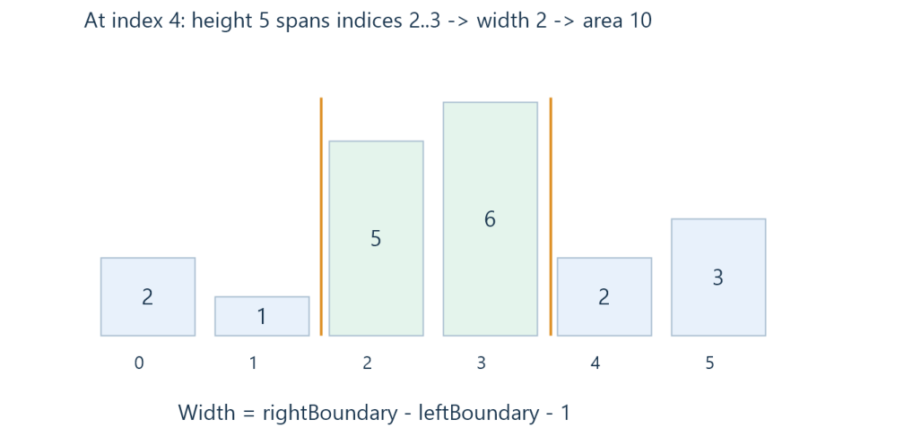

# 8. Stacks, Parsing, and Monotonic Stacks

[Topic overview](topics/stacks.md) | [All topics](index.md) | [Revision](revision.md) | [Answer key](answers.md#solutions---chapter-8)

> Adapted from the supplied study-notes PDF, pages 46-49. Examples use [pseudocode](index.md#pseudocode-conventions). [Source notes](index.md#provenance-and-numbering).

Chapter goal: Model unresolved work with a stack; handle equality policies; derive linear monotonic-stack algorithms.



*Figure 8. Histogram heights 5 and 6 can share a width-2 rectangle limited by height 5.*

## 8.1 Stack mental model
A stack is LIFO: the most recently pushed item is popped first. Its basic
operations are push, pop, peek, and an empty check.

Stacks naturally model:

- Nested structure and matching delimiters.

- Undo/backtracking state.

- Pending work whose answer depends on future input.

- Iterative DFS.

- Monotonic candidate sets.

Operations Push, Pop, and Peek are amortized O(1).

## 8.2 Valid parentheses
Push opening delimiters. On a closing delimiter, the top must contain its matching opener. The stack must be empty at the end.

```pseudocode
FUNCTION IsValidBrackets(s)
    REQUIRE s contains only bracket symbols
    closing <- map containing ('(' -> ')'), ('[' -> ']'), ('{' -> '}')
    expected <- empty stack
    FOR EACH c IN s
        IF c IN closing
            expected.push(closing[c])
        ELSE
            IF expected is empty OR expected.pop() != c
                RETURN false
    RETURN expected is empty
```

Time O(n), space O(n) worst case.

Invariant: the stack contains the closing delimiters required by currently unmatched openings, in the order they must appear.

## 8.3 Min stack
Support push, pop, top, and minimum in O(1).

### Two-stack design
- Main stack holds all values.

- Min stack holds the minimum associated with each depth, or pushes only new minima with duplicate handling.

The simplest robust version pushes min(value, currentMin) for every item, so both stacks have equal depth.

```pseudocode
DATA STRUCTURE MinStack
    values <- empty stack
    mins <- empty stack

    PROCEDURE Push(x)
        values.push(x)
        mins.push(x IF mins is empty ELSE min(x, mins.peek()))

    FUNCTION Pop()
        REQUIRE values is not empty
        mins.pop()
        RETURN values.pop()

    FUNCTION Top()
        REQUIRE values is not empty
        RETURN values.peek()

    FUNCTION GetMin()
        REQUIRE mins is not empty
        RETURN mins.peek()
```

Space O(n).

## 8.4 Monotonic stacks
A monotonic stack keeps candidates in increasing or decreasing order after weaker candidates are removed. Recognition phrases:

- Next greater/smaller element.

- Previous greater/smaller element.

- First future day meeting a condition.

- Contribution bounded by nearest smaller values.

- Histogram/rectangle boundaries.

### Why total time is linear
Each index is pushed once and popped at most once. Even if one iteration pops many indices, all pops across the algorithm total at most n: amortized O(n).

### Decide what the stack stores
Usually store indices, not values, when distance, position, or duplicate distinction matters. Values can be read as a[stack.Peek()].

## 8.5 Daily Temperatures
Need days until a warmer future temperature. Maintain indices of unresolved days in monotonically decreasing temperature order.

```pseudocode
FUNCTION DailyTemperatures(t)
    answer <- array(length(t), initial = 0)
    stack <- empty stack
    FOR i FROM 0 TO length(t) - 1
        WHILE stack is not empty AND t[i] > t[stack.peek()]
            j <- stack.pop()
            answer[j] <- i - j
        stack.push(i)
    RETURN answer
```

Invariant: stack indices are unresolved and their temperatures are nonincreasing from bottom to top. Time O(n), space O(n).

## 8.6 Largest rectangle in a histogram
### Mental model
When a shorter bar arrives, it reveals the right boundary for taller bars waiting in an increasing stack. For a popped height:

- Right boundary is current index i (exclusive).

- Left boundary is the new stack top after pop; the rectangle begins one position after it.

- Width is i - stack.Peek() - 1, or i if stack becomes empty.

Use a virtual trailing bar of height zero to flush remaining bars.

```pseudocode
FUNCTION LargestRectangle(heights)
    REQUIRE heights are nonnegative
    stack <- empty stack
    best <- 0
    FOR i FROM 0 TO length(heights)
        current <- 0 IF i = length(heights) ELSE heights[i]
        WHILE stack is not empty AND current < heights[stack.peek()]
            height <- heights[stack.pop()]
            leftSmaller <- -1 IF stack is empty ELSE stack.peek()
            width <- i - leftSmaller - 1
            best <- max(best, height * width)
        stack.push(i)
    RETURN best
```

Time O(n), space O(n).

Duplicate-height policies (&lt; versus &lt;=) can vary; keep the invariant and width formula consistent.

## Common mistakes
- Calling Pop/Peek on an empty stack.

- Returning true for brackets without checking the final stack is empty.

- Mishandling duplicate minima in an optimized min stack.

- Storing temperatures rather than indices for a distance question.

- Calling the monotonic-stack loop quadratic.

- Using width i - poppedIndex in the histogram; the correct left boundary depends on the new stack top.

- Forgetting to flush histogram bars at the end.

## Worked example and diagram guide - A stack of unresolved questions
For next greater element in [4,2,6,1,3,5], keep unresolved indices with nonincreasing values. When 6 arrives, pop 2 then 4 and answer both with 6. When 3 arrives, answer 1. When 5 arrives, answer 3. Values 6 and 5 remain unanswered. Answers by position are [6,6,none,3,5,none].

Equality policy matters. For "strictly greater", an equal new value must not resolve an earlier value. For "greater or equal", it may. Write the comparison from the question's contract rather than recalling a stack direction by name.

### Histogram [2,1,5,6,2,3]
At index 4 (height 2), popping height 6 at index 3 gives width 1 and area 6. Popping height 5 at index 2 leaves index 1 as the boundary: width=4-1-1=2 and area=10. The right boundary is the first disqualifying bar, not part of the rectangle. The new stack top supplies the left boundary.

With the shown strict-pop condition (&lt;), equal-height bars can remain stacked. A surviving boundary can have equal height, yielding a narrower candidate for that copy; the earlier equal copy eventually covers the full extent. With a &lt;= pop policy, describe a strictly-smaller boundary instead. Do not mix the proof for one equality policy with the implementation of the other.

Min-stack duplicate test: push 4,4; pop once; the remaining minimum must still be 4. The equal-depth twostack design handles this automatically.

## Check Your Understanding - Chapter 8
### Q8.1

What exactly does the stack represent in the valid-parentheses expected-closer implementation?

[Solution](answers.md#a81)

### Q8.2

How does the equal-depth two-stack MinStack handle duplicate minima?

[Solution](answers.md#a82)

### Q8.3

Why is a monotonic-stack algorithm generally O(n) despite nested loops?

[Solution](answers.md#a83)

### Q8.4

Why does Daily Temperatures store indices instead of only temperatures?

[Solution](answers.md#a84)

### Q8.5

After popping a histogram bar at index p, why is the left boundary determined by the new stack top rather than simply p - 1?

[Solution](answers.md#a85)

## Additional practice - Chapter 8
New application exercises. Attempt these before consulting the final answer section.

### E8.1

Compute Daily Temperatures for [73,74,75,71,69,72,76,73]. Why are indices necessary?

[Solution](answers.md#e81)

### E8.2

For histogram [2,1,5,6,2,3], compute the area from popping height 5 when index 4 arrives.

[Solution](answers.md#e82)

---

[All coding chapters](index.md) | [Previous chapter](07-linked-list-patterns.md) | [Next chapter](09-queues.md)
