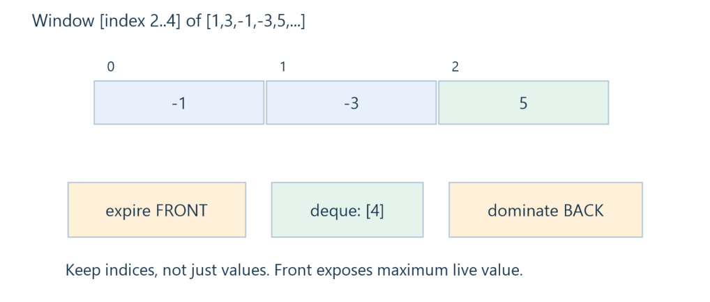

# 9. Queues, Deques, and Sliding-Window Maximum

[Topic overview](topics/queues.md) | [All topics](index.md) | [Revision](revision.md) | [Answer key](answers.md#solutions---chapter-9)

> Adapted from the supplied study-notes PDF, pages 50-53. Examples use [pseudocode](index.md#pseudocode-conventions). [Source notes](index.md#provenance-and-numbering).

Chapter goal: Maintain FIFO order and amortised transfers; use BFS and a dominance-based monotonic deque.



*Figure 9. A monotonic window deque expires old indices at the front and removes dominated candidates at the back.*

## 9.1 Queue mental model
A queue is FIFO: first enqueued, first dequeued. Its basic operations are:

- Enqueue(x) adds to back.

- Dequeue() removes from front.

- Peek() inspects front.

Queues model arrival order, level-order traversal, scheduling, and shortest paths in unweighted graphs.

## 9.2 Queue using two stacks
Use:

- input: receives new items.

- output: serves front items.

When output is empty, transfer all elements from input to output; the reversal creates FIFO order.

```pseudocode
DATA STRUCTURE MyQueue
    input <- empty stack
    output <- empty stack

    PROCEDURE Enqueue(item)
        input.push(item)

    FUNCTION Dequeue()
        MoveIfNeeded()
        REQUIRE output is not empty
        RETURN output.pop()

    FUNCTION Peek()
        MoveIfNeeded()
        REQUIRE output is not empty
        RETURN output.peek()

    FUNCTION Count()
        RETURN size(input) + size(output)

    PROCEDURE MoveIfNeeded()
        IF output is empty
            WHILE input is not empty
                output.push(input.pop())
```

Each item moves from input to output once, so operations are amortized O(1), though one operation can be O(n).

## 9.3 BFS
### Invariant
The queue contains discovered but not fully processed nodes. In ordinary unweighted BFS, nodes are dequeued in nondecreasing distance from the source.

```pseudocode
FUNCTION Distances(graph, source)
    REQUIRE source is a valid vertex
    dist <- array(length(graph), initial = -1)
    queue <- empty queue
    dist[source] <- 0
    queue.enqueue(source)
    WHILE queue is not empty
        node <- queue.dequeue()
        FOR EACH next IN graph[node]
            IF dist[next] = -1
                dist[next] <- dist[node] + 1
                queue.enqueue(next)
    RETURN dist
```

Mark visited when enqueuing, not when dequeuing, to avoid many duplicate queue entries.

For adjacency lists, time is O(V + E), space O(V).

### Level-order processing
Capture levelSize = queue.Count before a level and process exactly that many nodes. This separates levels and supports per-level aggregates.

### Multi-source BFS
Enqueue all sources at distance zero. The wavefront finds distance to the nearest source. Typical clues: nearest gate, nearest zero, infection spread, simultaneous starting points.

## 9.4 DFS versus BFS
|**Dimension**|**DFS**|**BFS**|
|---|---|---|
|**Frontier structure**|Call stack or explicit stack|Queue|
|**Exploration**|Deep before siblings|Layer by layer|
|**Unweighted shortest path**|Not guaranteed|Guaranteed with unit edges|
|**Natural uses**|Components, cycles, path|Levels, nearest/shortest, wave|
||enumeration, tree recursion|propagation|
|**Peak memory**|O(depth) in tree-like search|O(max frontier width)|

Both traverse a graph in O(V + E) with adjacency lists. On a tree, DFS recursion can overflow for a very deep chain; iterative traversal avoids call-stack limits.

## 9.5 Deque
A deque supports insertion and removal at both ends. A doubly linked list
provides constant-time end operations but allocates nodes and has weaker
locality. A resizable circular array can provide amortized constant-time end
operations with more compact storage.

Use a deque when the algorithm needs both oldest and newest candidates, especially monotonic windows or 0-1 BFS.

## 9.6 Sliding-window maximum
### Mental model
Maintain a deque of indices that are:

1.  Inside the current window.

2.  In decreasing value order.

3.  Undominated: any smaller value behind a newer larger value can never become maximum before the larger value expires.

```pseudocode
FUNCTION MaxSlidingWindow(nums, k)
    REQUIRE 1 <= k <= length(nums)
    result <- empty list
    deque <- empty deque of indices
    FOR i FROM 0 TO length(nums) - 1
        WHILE deque is not empty AND deque.front() <= i - k
            deque.removeFront()
        WHILE deque is not empty AND nums[deque.back()] <= nums[i]
            deque.removeBack()
        deque.addBack(i)
        IF i >= k - 1
            result.append(nums[deque.front()])
    RETURN result
```

Each index enters and leaves at most once: time O(n), deque space O(k), output O(n - k + 1).

## Common mistakes
- Transferring between queue stacks on every operation instead of only when output is empty.

- Calling amortized O(1) worst-case O(1) for every individual operation.

- Marking BFS nodes visited too late.

- Using DFS for a shortest unweighted path and assuming the first path is shortest.

- Storing values rather than indices in the sliding maximum, making expiration ambiguous.

- Expiring with the wrong boundary (index &lt;= i - k is outside).

- Removing from the wrong deque end.

## Worked example and diagram guide - Preserve age or preserve dominance
Queue with two stacks: after Enqueue(10), Enqueue(20), Enqueue(30), input contains [10,20,30] bottom-totop. On first dequeue, transfer to output [30,20,10], then pop 10. Enqueue(40) goes into input while output still serves 20 then 30. Transferring too early would put newer values ahead of older values.

### Sliding-window maximum [1,3,-1,-3,5,3,6,7], k=3
Window maxima are [3,3,5,5,6,7]. At incoming 5 (index 4), any earlier smaller surviving candidate can be removed from the back: 5 is both larger and newer, so it dominates those values for every future window in which they could survive. Expired indices leave the front. The deque front is always the maximum live candidate.

A priority queue is not FIFO. A monotonic deque for a fixed sliding window is also not a general-purpose heap: it exploits arrival order and expiration to get linear total time.

### BFS's shortest-path guarantee has a premise
In unweighted/unit-edge graphs, the first discovered distance is shortest because the queue processes distance d before d+1. It does not establish shortest total weight for arbitrary weighted edges. Marking visited at enqueue time prevents two parents from scheduling the same vertex again.

Graph traversal is discussed here only as the queue/DFS foundation present in the lessons. Dijkstra, graph topological sorting, and a complete graph-interview chapter are not asserted to be completed.

## Check Your Understanding - Chapter 9
### Q9.1

Why should the two-stack queue transfer only when the output stack is empty?

[Solution](answers.md#a91)

### Q9.2

What does the BFS queue contain at any moment?

[Solution](answers.md#a92)

### Q9.3

Why should BFS mark a node visited when it is enqueued?

[Solution](answers.md#a93)

### Q9.4

When is BFS preferable to DFS for path finding?

[Solution](answers.md#a94)

### Q9.5

State the three invariants of the deque in sliding-window maximum.

[Solution](answers.md#a95)

## Additional practice - Chapter 9
New application exercises. Attempt these before consulting the final answer section.

### E9.1

Trace Enqueue(10), Enqueue(20), Dequeue(), Enqueue(30), Dequeue(), Dequeue() using two stacks.

[Solution](answers.md#e91)

### E9.2

Find size-3 sliding maxima for [1,3,-1,-3,5,3,6,7], stating expiration and domination rules.

[Solution](answers.md#e92)

---

[All coding chapters](index.md) | [Previous chapter](08-stacks.md) | [Next chapter](10-binary-search.md)
