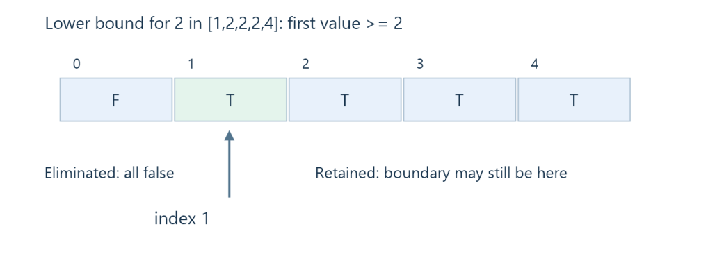

# 10. Binary Search

[Topic overview](topics/binary-search.md) | [All topics](index.md) | [Revision](revision.md) | [Answer key](answers.md#solutions---chapter-10)

> Adapted from the supplied study-notes PDF, pages 54-57. Examples use [pseudocode](index.md#pseudocode-conventions). [Source notes](index.md#provenance-and-numbering).

Chapter goal: Maintain an interval invariant; locate exact values or boundaries; prove feasibility monotonicity.



*Figure 10. Lower bound finds the first true position of a monotonic predicate.*

## 10.1 Binary-search mental model
Binary search is not merely “find a value in a sorted array.” It locates a boundary in a monotonic search space.

Every implementation needs:

- A search interval convention.

- A condition that discards part of the interval safely.

- Progress on every iteration.

- A postcondition explaining what the returned index means.

## 10.2 Exact search
Inclusive interval [left, right]:

```pseudocode
FUNCTION BinarySearch(a, target)
    left <- 0
    right <- length(a) - 1
    WHILE left <= right
        mid <- left + (right - left) DIV 2
        IF a[mid] = target
            RETURN mid
        IF a[mid] < target
            left <- mid + 1
        ELSE
            right <- mid - 1
    RETURN -1
```

Invariant: if the target exists and has not been returned, it is inside [left, right]. Time O(log n), space O(1).

## 10.3 Lower bound and upper bound
Use half-open interval [left, right) because the insertion position may equal n.

- Lower bound: first index with a[i] &gt;= target.

- Upper bound: first index with a[i] &gt; target.

```pseudocode
FUNCTION LowerBound(a, target)
    left <- 0
    right <- length(a)
    WHILE left < right
        mid <- left + (right - left) DIV 2
        IF a[mid] < target
            left <- mid + 1
        ELSE
            right <- mid
    RETURN left

FUNCTION UpperBound(a, target)
    left <- 0
    right <- length(a)
    WHILE left < right
        mid <- left + (right - left) DIV 2
        IF a[mid] <= target
            left <- mid + 1
        ELSE
            right <- mid
    RETURN left
```

Count of target is UpperBound - LowerBound. If lower bound is n or value differs, target is absent.

## 10.4 First true and last true
Many problems define a monotonic predicate:

false false false true true true

Find first true with a lower-bound-style search. Maintain right as a feasible candidate or use half-open boundaries with a conceptual sentinel.

For true true true false false, find last true symmetrically or find first false and subtract one.

Generic inclusive first-true template:

```pseudocode
FUNCTION FirstTrue(low, high, feasible)
    REQUIRE low <= high AND feasible(high)
    REQUIRE feasible changes only from false to true
    answer <- high
    WHILE low <= high
        mid <- low + (high - low) DIV 2
        IF feasible(mid)
            answer <- mid
            high <- mid - 1
        ELSE
            low <- mid + 1
    RETURN answer
```

Only use this when at least one feasible value in the range is guaranteed or handle “none” explicitly.

## 10.5 Search in rotated sorted array
With distinct values, at least one half is sorted.

1.  Determine whether [left, mid] is sorted using a[left] &lt;= a[mid].

2.  If target lies within that sorted half, keep it.

3.  Otherwise keep the other half.

```pseudocode
FUNCTION SearchRotated(a, target)
    REQUIRE a is a rotation of a strictly increasing array
    left <- 0
    right <- length(a) - 1
    WHILE left <= right
        mid <- left + (right - left) DIV 2
        IF a[mid] = target
            RETURN mid
        IF a[left] <= a[mid]
            IF a[left] <= target AND target < a[mid]
                right <- mid - 1
            ELSE
                left <- mid + 1
        ELSE
            IF a[mid] < target AND target <= a[right]
                left <- mid + 1
            ELSE
                right <- mid - 1
    RETURN -1
```

With duplicates such as [1,1,1,3,1], sorted-half detection can be ambiguous. Shrinking equal boundaries preserves correctness but worst-case time becomes O(n).

## 10.6 Find minimum in rotated sorted array
For distinct values, compare a[mid] with a[right]:

- If a[mid] &gt; a[right], minimum is strictly right of mid.

- Otherwise, minimum is at mid or left of it, so set right = mid.

```pseudocode
FUNCTION FindRotatedMin(a)
    REQUIRE a is nonempty and is a rotation of a strictly increasing array
    left <- 0
    right <- length(a) - 1
    WHILE left < right
        mid <- left + (right - left) DIV 2
        IF a[mid] > a[right]
            left <- mid + 1
        ELSE
            right <- mid
    RETURN a[left]
```

Time O(log n) for distinct values.

## 10.7 Binary search on answer
### Recognition
The answer is a number, and checking whether a candidate works is easier than constructing the optimal answer directly. Typical wording:

- Minimum capacity/speed/time needed.

- Maximum minimum distance.

- Smallest threshold that allows at most k groups.

### Required ingredients
1.  Numeric low and high bounds containing the answer.

2.  A monotonic feasible(x).

3.  Decide first feasible (minimize) or last feasible (maximize).

4.  Prove feasibility monotonicity.

5.  Use long if sums/products can overflow.

Example: minimum ship capacity within days:

- Lower bound: maximum single weight.

- Upper bound: total weight.

- feasible(capacity) greedily counts days.

- If capacity works, every larger capacity works: false...true.

If feasibility is O(n) and answer range size is R, total time is O(n log R).

## Common mistakes
- Mixing [left, right] updates with [left, right) loop conditions.

- Setting left = mid or right = mid without ensuring progress.

- Confusing lower bound (&gt;=) with upper bound (&gt;).

- Accessing the lower-bound index without checking if it equals n.

- Using rotated-array logic with duplicates without handling ambiguity.

- Binary-searching an answer without proving the predicate is monotonic.

- Choosing bounds that do not include every possible answer.

## Worked example and diagram guide - Search for the transition
For [1,2,2,2,4] and target 2, lower bound is index 1, upper bound is index 4, and the count is 4-1=3. A bound is an index, not the value stored at that index. If all values are smaller than the target, both bounds return n, a legal insertion position that must not be indexed.

The predicate a[i]&gt;=2 changes from false to true at lower bound. For the half-open loop, if the predicate holds at mid, keep mid as a possible boundary with right=mid; otherwise left=mid+1. At termination left==right and every earlier index has been eliminated.

### Binary search on shipping capacity
Weights=[1,2,3,4,5], days=3. Capacity cannot be below 5 or above 15. A greedy feasibility check starts a new day before an item that would exceed capacity. Capacity 5 needs four days: [1,2],[3],[4],[5], so is false. Capacity 6 needs three: [1,2,3],[4],[5], so is true. Every larger capacity also works; first feasible is 6.

If one check scans n weights and capacity ranges across R integer values, runtime is O(n log R), not O(log n). The numerical answer range and input length are different quantities.

The generic FirstTrue snippet assumes a feasible value exists within a valid finite range and midpoint arithmetic does not overflow. For production code, specify a no-answer result or throw when the contract is violated. Distinct-value rotated search loses its guaranteed logarithmic bound when duplicates force one-ata-time boundary shrinking.

## Check Your Understanding - Chapter 10
### Q10.1

What invariant supports exact binary search on [left, right]?

[Solution](answers.md#a101)

### Q10.2

Distinguish lower bound from upper bound.

[Solution](answers.md#a102)

### Q10.3

Why does a half-open bound search use right = n?

[Solution](answers.md#a103)

### Q10.4

In finding a rotated minimum, why does a[mid] &gt; a[right] imply the minimum is right of mid?

[Solution](answers.md#a104)

### Q10.5

What must be proved before binary searching on an answer?

[Solution](answers.md#a105)

## Additional practice - Chapter 10
New application exercises. Attempt these before consulting the final answer section.

### E10.1

For [1,2,2,2,4], give lower/upper bounds for 2 and for 5. Are the returned results values or indices?

[Solution](answers.md#e101)

Solution

### E10.2

Use binary search on answer for weights [1,2,3,4,5] within 3 days. Prove monotonicity and give the minimum capacity.

[Solution](answers.md#e102)

---

[All coding chapters](index.md) | [Previous chapter](09-queues.md) | [Next chapter](11-tree-traversals.md)
