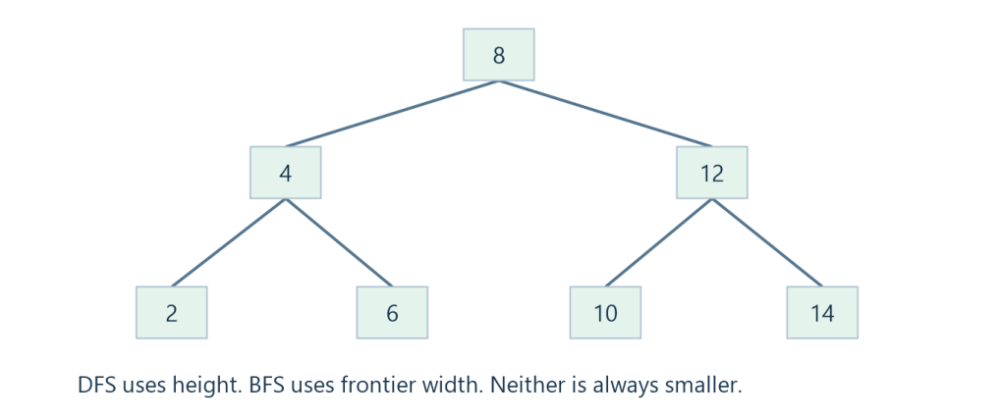

# 11. Binary Tree Contracts and Traversals

[Topic overview](topics/trees.md) | [All topics](index.md) | [Revision](revision.md) | [Answer key](answers.md#solutions---chapter-11)

> Adapted from the supplied study-notes PDF, pages 58-61. Examples use [pseudocode](index.md#pseudocode-conventions). [Source notes](index.md#provenance-and-numbering).

Chapter goal: Define recursive contracts, choose visit order, and distinguish height from width.



*Figure 11. The shared example tree for DFS orders, BFS levels, height, and width.*

## 11.1 Tree model and terminology
```pseudocode
RECORD TreeNode
    Val
    Left <- null
    Right <- null

TreeNode(value) creates a node with that value and no children.
```

- Root: top node.

- Leaf: no children.

- Depth: edges from root to node.

- Height: longest downward edge path from node to a leaf; some code uses node count instead. Define convention.

- Subtree: node plus all descendants.

- Binary tree: at most two children; it is not necessarily a BST.

## 11.2 Recursive contracts
For every recursive tree method, complete this sentence:

Solve(node) returns ______ for the subtree rooted at node.

Then define:

1.  Null/base result.

2.  Results requested from left and right.

3.  How they combine.

4.  Whether global/nonlocal state is required.

Examples:

- Height: returns subtree height.

- Balanced check: returns height or a failure sentinel.

- Path sum: parameter carries remaining target.

- Maximum path sum: returns best one-sided gain while updating a global two-sided answer.

This contract prevents accidental mixing of “answer for the subtree” with “value usable by the parent.”

## 11.3 Traversals
### Depth-first orders
- Preorder: node, left, right. Useful for copying/serialization and top-down state.

- Inorder: left, node, right. Sorted order for a valid BST.

- Postorder: left, right, node. Useful when parent depends on child results.

```pseudocode
PROCEDURE Inorder(node, output)
    IF node = null
        RETURN
    Inorder(node.Left, output)
    output.append(node.Val)
    Inorder(node.Right, output)
```

All visit n nodes: O(n) time and O(h) recursion stack.

### Iterative inorder
```pseudocode
FUNCTION InorderIterative(root)
    result <- empty list
    stack <- empty stack
    current <- root
    WHILE current != null OR stack is not empty
        WHILE current != null
            stack.push(current)
            current <- current.Left
        current <- stack.pop()
        result.append(current.Val)
        current <- current.Right
    RETURN result
```

Invariant: the stack contains suspended ancestor visits. On popping a node, its left subtree has been fully processed, while its own visit and right subtree remain.

### Iterative preorder
Push right before left because the stack is LIFO. Iterative postorder can use two stacks, a visited flag, or reverse of modified preorder; choose clarity over cleverness.

## 11.4 Tree BFS / level order
```pseudocode
FUNCTION LevelOrder(root)
    result <- empty list
    IF root = null
        RETURN result
    queue <- empty queue
    queue.enqueue(root)
    WHILE queue is not empty
        levelSize <- size(queue)
        level <- empty list
        REPEAT levelSize TIMES
            node <- queue.dequeue()
            level.append(node.Val)
            IF node.Left != null
                queue.enqueue(node.Left)
            IF node.Right != null
                queue.enqueue(node.Right)
        result.append(level)
    RETURN result
```

Time O(n), queue space O(w) where w is maximum width.

## 11.5 DFS versus BFS in trees
Choose DFS when:

- Results combine from subtrees.

- You need all root-to-leaf paths.

- Depth-first ordering is natural.

Choose BFS when:

- Levels matter.

- You need minimum depth or nearest node by edge count.

- You need per-level views or averages.

## 11.6 Passing state: by parameter, return value, or external variable
- Parameter: top-down context, such as current path or remaining sum.

- Return value: bottom-up summary needed by parent.

- External variable: best answer that may pass through any node and is not itself valid as a parent contribution.

Prefer local functions or explicit result types over mutable instance fields that may retain stale data across test cases.

## Common mistakes
- Omitting the null base case.

- Reporting recursive space as O(1).

- Using inorder as sorted output for a non-BST.

- Pushing left before right in iterative preorder and getting reversed order.

- Reading queue.Count repeatedly as the changing level size instead of snapshotting it.

- Returning a two-branch path to a parent when the parent can accept only one branch.

## Worked example and diagram guide - Traversal order is where the work happens
Use the illustrated tree rooted at 8, with left subtree 4(2,6) and right subtree 12(10,14).

|**Traversal**|**Visit order**|**What it naturally supports**|
|---|---|---|
|**Preorder**|8,4,2,6,12,10,14|Root before descendants; copying /<br>top-down context|
|**Inorder**|2,4,6,8,10,12,14|Sorted sequence only because this<br>example is a BST|
|**Postorder**|2,6,4,10,14,12,8|Child facts before parent; height /<br>balance|
|**BFS**|8,4,12,2,6,10,14|Levels and unweighted distance|

### Stack mechanics and the earlier complexity correction
Iterative preorder pushes right then left because the last pushed node is processed first. Recursive DFS uses O(h) active frames. A perfect tree can have O(log n) height and O(n) width: BFS may need linear queue space while recursive DFS needs only logarithmic stack space. A chain reverses that practical advantage for recursion.

An explicit DFS stack's space depends on exactly what it stores. A simple preorder stack on a one-child chain can contain O(1) pending nodes, even though recursive DFS has O(n) call frames. Do not claim every iterative stack has exactly the same occupancy as recursion; O(h) is an upper bound for the standard pending-sibling traversal.

In iterative inorder, the stack is a set of suspended ancestor visits. While descending, their left subtrees are not yet all finished. Only when a node is popped has its complete left subtree been processed. That timing makes the invariant precise.

## Check Your Understanding - Chapter 11
### Q11.1

What sentence should be completed before implementing a recursive tree solution?

[Solution](answers.md#a111)

### Q11.2

Which traversal naturally fits a parent result that depends on both child results?

[Solution](answers.md#a112)

### Q11.3

What does the iterative inorder stack represent?

[Solution](answers.md#a113)

### Q11.4

Why is level size captured before processing a BFS level?

[Solution](answers.md#a114)

### Q11.5

Give one example each of top-down parameter state, bottom-up return state, and an external/global best.

[Solution](answers.md#a115)

## Additional practice - Chapter 11
New application exercises. Attempt these before consulting the final answer section.

### E11.1

For tree 8 with children 4 and 12, and leaves 2,6,10,14, give all three DFS orders and BFS.

[Solution](answers.md#e111)

### E11.2

Compare recursive DFS and BFS space on a perfect tree and on a chain. Avoid asserting identical stack occupancy for every iterative DFS.

[Solution](answers.md#e112)

---

[All coding chapters](index.md) | [Previous chapter](10-binary-search.md) | [Next chapter](12-tree-paths.md)
