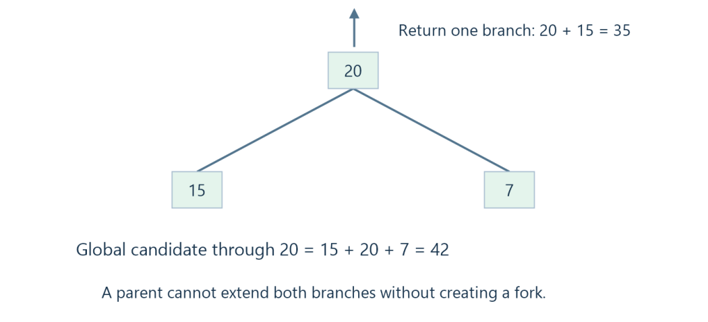

# 12. Tree Structure, LCA, and Paths

[Topic overview](topics/trees.md) | [All topics](index.md) | [Revision](revision.md) | [Answer key](answers.md#solutions---chapter-12)

> Adapted from the supplied study-notes PDF, pages 62-66. Examples use [pseudocode](index.md#pseudocode-conventions). [Source notes](index.md#provenance-and-numbering).

Chapter goal: Separate return values from global answers; handle structure, LCA, path constraints, and backtracking.



*Figure 12. Maximum path sum returns one branch upward while evaluating a two-sided path locally.*

## 12.1 Same tree
Two trees are the same when corresponding nodes have equal values and corresponding structures match.

```pseudocode
FUNCTION IsSame(a, b)
    IF a = null OR b = null
        RETURN a = null AND b = null
    RETURN a.Val = b.Val
        AND IsSame(a.Left, b.Left)
        AND IsSame(a.Right, b.Right)
```

Time O(n) over compared nodes; stack O(h).

## 12.2 Invert tree
Swap left and right recursively or iteratively. Contract: invert the subtree rooted at node and return its root.

```pseudocode
FUNCTION Invert(node)
    IF node = null
        RETURN null
    oldLeft <- node.Left
    node.Left <- Invert(node.Right)
    node.Right <- Invert(oldLeft)
    RETURN node
```

This mutates the input. If preservation is required, create new nodes.

## 12.3 Balanced binary tree
A tree is height-balanced if every node's left/right subtree heights differ by at most one.

Naive approach recomputes heights and can be O(n^2) on a skewed tree. Combine checking with height calculation:

- Return nonnegative height if balanced.

- Return -1 as a failure sentinel if unbalanced.

```pseudocode
FUNCTION IsBalanced(root)
    RETURN HeightOrFail(root) >= 0

FUNCTION HeightOrFail(node)
    IF node = null
        RETURN 0
    left <- HeightOrFail(node.Left)
    IF left < 0
        RETURN -1
    right <- HeightOrFail(node.Right)
    IF right < 0 OR abs(left - right) > 1
        RETURN -1
    RETURN 1 + max(left, right)
```

Time O(n), stack O(h).

## 12.4 Diameter
Diameter is the longest path between any two nodes; it may not pass through the root.

For each node:

- Parent-usable return: height of one downward branch.

- Candidate global diameter through node: leftHeight + rightHeight in edges.

```pseudocode
FUNCTION Diameter(root)
    best <- 0
    FUNCTION Height(node)
        IF node = null
            RETURN 0
        left <- Height(node.Left)
        right <- Height(node.Right)
        best <- max(best, left + right)
        RETURN 1 + max(left, right)
    Height(root)
    RETURN best
```

Time O(n), stack O(h). Clarify whether diameter is counted in edges or nodes.

## 12.5 Lowest common ancestor in a general binary tree
Assume both target nodes exist and identity matters.

Contract: return a target found in this subtree, or their LCA if both are found on different sides.

```pseudocode
FUNCTION Lca(root, p, q)
    PRECONDITION for the initial call: both target nodes are present
    IF root = null OR root IS SAME NODE AS p OR root IS SAME NODE AS q
        RETURN root
    left <- Lca(root.Left, p, q)
    right <- Lca(root.Right, p, q)
    IF left != null AND right != null
        RETURN root
    RETURN left IF left != null ELSE right
```

If targets may be absent, this implementation can return the one found. Add found-count information or verify existence.

## 12.6 Path sum variants
### Root-to-leaf existence
Subtract current value from the target and recurse. At a leaf, success requires remaining target equal to the leaf value (or zero after subtraction).

```pseudocode
FUNCTION HasPathSum(node, target)
    IF node = null
        RETURN false
    IF node.Left = null AND node.Right = null
        RETURN target = node.Val
    remaining <- target - node.Val
    RETURN HasPathSum(node.Left, remaining)
        OR HasPathSum(node.Right, remaining)
```

### Count downward paths with a sum
For paths that may start and end anywhere but move downward, use DFS prefix sums with a frequency map. Add current prefix, count prefix - target, recurse, then decrement current prefix during backtracking. The map must represent only prefixes on the current root-to-node path.

## 12.7 Backtracking root-to-leaf paths
Use one mutable path buffer:

1.  Choose: add current node.

2.  Explore children.

3.  Unchoose: remove the last node.

```pseudocode
FUNCTION RootToLeafPaths(root)
    result <- empty list
    path <- empty list
    PROCEDURE Dfs(node)
        IF node = null
            RETURN
        path.append(node.Val)
        IF node.Left = null AND node.Right = null
            result.append(copy(path))
        ELSE
            Dfs(node.Left)
            Dfs(node.Right)
        path.removeLast()
    Dfs(root)
    RETURN result
```

Copy the path when saving; otherwise every result entry may point to the same mutable list.

## 12.8 Maximum path sum
A path can start and end anywhere and cannot branch more than once.

At each node:

- Return to parent: best one-sided downward gain: node.Val + max(0, leftGain, rightGain).

- Global candidate through node: node.Val + max(0,leftGain) + max(0,rightGain).

```pseudocode
FUNCTION MaxPathSum(root)
    REQUIRE root != null
    best <- NEGATIVE_INFINITY
    FUNCTION Gain(node)
        IF node = null
            RETURN 0
        left <- max(0, Gain(node.Left))
        right <- max(0, Gain(node.Right))
        best <- max(best, node.Val + left + right)
        RETURN node.Val + max(left, right)
    Gain(root)
    RETURN best
```

Clamping child gains to zero means “do not include a harmful branch.” Initializing global best to zero would fail for an all-negative tree.

## Common mistakes
- Balanced-tree solution recomputes height at every node.

- Confusing height units and diameter units.

- LCA comparing values when nodes can share values.

- Assuming both LCA targets exist without stating it.

- Treating a non-leaf null child as a completed root-to-leaf path.

- Forgetting to undo path state after recursion.

- Saving the same mutable path object instead of a copy.

- Returning both branches from maximum path sum to a parent, creating an invalid fork.

- Initializing maximum path sum to zero for all-negative trees.

## Worked example and diagram guide - Return one thing; optimise another
With a node of value 10 and child heights 2 and 3, the node returns height 4 (node-count height) and contributes diameter candidate 5 edges. The longest path can pass through an internal node far below root; the global best must be updated at every node.

### Balanced means every node, not only the root
A root can have equal-height subtrees while a descendant is unbalanced. HeightOrFail returns either a real nonnegative height or -1, and each parent propagates -1 immediately. This avoids both missing deep violations and recomputing the same heights repeatedly.

### General-tree LCA's subtle return contract
For distinct target nodes p and q, a result can be a found target or an already resolved LCA. If a node itself equals p, returning that node is correct when q is below it. A descendant is allowed to be its own ancestor in the LCA definition. If one target is absent, the basic algorithm may return the target that exists; checking both exist is a separate requirement.

### Maximum path sum [-10,9,20,null,null,15,7]
Leaf gains are 9,15,7. At 20, the two-sided candidate is 20+15+7=42; the gain returned upward is 20+max(15,7)=35. At -10, candidate is -10+9+35=34, so best stays 42. Returning 42 to the parent would incorrectly allow a fork using both child branches plus the parent.

For all-negative [-3,-2,-5], the best nonempty path is -2, not zero. Clamping a child contribution to zero discards a harmful extension; it does not permit an empty global answer.

Backtracking path buffers are shared mutable state. Add on entry, copy at an accepted leaf, and remove on exit. For outputting P paths, total copying time and output size are proportional to the sum of their lengths; traversal alone being O(n) does not make the whole output-producing operation O(n).

## Check Your Understanding - Chapter 12
### Q12.1

How does the -1 sentinel make balanced-tree checking linear?

[Solution](answers.md#a121)

### Q12.2

For diameter, what is returned to the parent and what updates the global answer?

[Solution](answers.md#a122)

### Q12.3

In general-tree LCA, what does it mean when both recursive sides return non-null?

[Solution](answers.md#a123)

### Q12.4

Why must a mutable backtracking path be copied when added to results?

[Solution](answers.md#a124)

### Q12.5

Why can maximum path sum return only one child branch to its parent?

[Solution](answers.md#a125)

## Additional practice - Chapter 12
New application exercises. Attempt these before consulting the final answer section.

### E12.1

For [-10,9,20,null,null,15,7], give maximum path sum, gain returned by 20, and the reason they differ.

[Solution](answers.md#e121)

### E12.2

Explain two independent bugs in saving a shared path list at leaves but never removing values during unwinding.

[Solution](answers.md#e122)

---

[All coding chapters](index.md) | [Previous chapter](11-tree-traversals.md) | [Next chapter](13-tree-construction.md)
