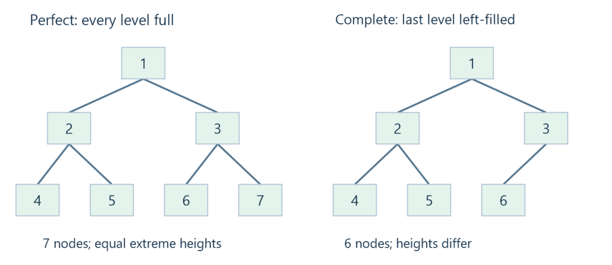

# 13. Tree Construction, Serialization, and Counting

[Topic overview](topics/trees.md) | [All topics](index.md) | [Revision](revision.md) | [Answer key](answers.md#solutions---chapter-13)

> Adapted from the supplied study-notes PDF, pages 67-70. Examples use [pseudocode](index.md#pseudocode-conventions). [Source notes](index.md#provenance-and-numbering).

Chapter goal: Reconstruct and encode structure; exploit completeness only under its stated guarantee.



*Figure 13. Perfect versus complete binary trees: the final complete-tree level may be partial.*

## 13.1 Construct from preorder and inorder
Assume values are unique.

- Preorder reveals the root first.

- Inorder divides values into left and right subtrees.

- A map from value to inorder index avoids repeated linear searches.

```pseudocode
FUNCTION BuildTree(preorder, inorder)
    REQUIRE traversals contain the same distinct values and describe one tree
    index <- map from each inorder value to its index
    pre <- 0
    FUNCTION Build(inLeft, inRight)
        IF inLeft > inRight
            RETURN null
        rootValue <- preorder[pre]
        pre <- pre + 1
        root <- TreeNode(rootValue)
        split <- index[rootValue]
        root.Left <- Build(inLeft, split - 1)
        root.Right <- Build(split + 1, inRight)
        RETURN root
    RETURN Build(0, length(inorder) - 1)
```

Time O(n), map plus recursion O(n). The recursion must build left before right because preorder consumes root-left-right.

For postorder + inorder, consume postorder from the end and build right before left.

Duplicates make traversal pairs ambiguous unless extra identity information or a defined policy is provided.

## 13.2 Serialization and deserialization
Serialization must preserve structure, not only values. Null markers are essential.

### Preorder format
Serialize as value,left-subtree,right-subtree with # for null. Example: 1,2,#,#,3,#,#.

```pseudocode
FUNCTION Serialize(root)
    tokens <- empty list
    PROCEDURE Dfs(node)
        IF node = null
            tokens.append("#")
            RETURN
        tokens.append(formatDecimal(node.Val))
        Dfs(node.Left)
        Dfs(node.Right)
    Dfs(root)
    RETURN join(tokens, ",")

FUNCTION Deserialize(data)
    tokens <- split(data, ",")
    i <- 0
    FUNCTION Build()
        REQUIRE i < length(tokens), otherwise ERROR "Unexpected end"
        token <- tokens[i]
        i <- i + 1
        IF token = "#"
            RETURN null
        node <- TreeNode(parseDecimalOrError(token))
        node.Left <- Build()
        node.Right <- Build()
        RETURN node
    root <- Build()
    REQUIRE i = length(tokens), otherwise ERROR "Extra tokens"
    RETURN root
```

Time O(n), space O(n) for tokens/output plus recursion O(h).

### BFS format
Level-order serialization can also preserve nulls. It may trim trailing null markers under a documented convention. Encoder and decoder must use exactly the same format.

### Robustness checklist
- Delimiter cannot be confused with numeric syntax.

- Null marker is unambiguous.

- Empty tree is represented.

- Malformed or extra tokens are handled.

- Parsing uses invariant culture where serialized data must be portable.

## 13.3 Count nodes in a complete binary tree
A complete tree has every level full except possibly the last, which is filled left to right.

### Exploit perfect subtrees
Measure the leftmost height and rightmost height.

- If equal, the subtree is perfect: node count is 2^h - 1 when h counts nodes on the path.

- Otherwise recursively count left and right.

```pseudocode
FUNCTION CountComplete(root)
    REQUIRE root describes a complete binary tree
    IF root = null
        RETURN 0
    FUNCTION LeftHeight(node)
        h <- 0
        WHILE node != null
            h <- h + 1
            node <- node.Left
        RETURN h
    FUNCTION RightHeight(node)
        h <- 0
        WHILE node != null
            h <- h + 1
            node <- node.Right
        RETURN h
    left <- LeftHeight(root)
    right <- RightHeight(root)
    IF left = right
        RETURN 2^left - 1
    RETURN 1 + CountComplete(root.Left) + CountComplete(root.Right)
```

Time is commonly O(log^2 n) for a complete tree: O(log n) height work over O(log n) recursion levels. Space O(log n).

The equal-extreme-height shortcut is valid because the tree is guaranteed complete. It is not valid for an arbitrary binary tree.

An alternative binary-searches the last level using root-to-leaf existence checks, also O(log^2 n).

## Common mistakes
- Repeatedly searching inorder and degrading construction to O(n^2).

- Building right before left while consuming preorder.

- Ignoring duplicate ambiguity.

- Serializing values without null markers.

- Decoder accepts extra/missing tokens silently.

- Mixing edge height and node height in 2^h - 1.

- Using 1 &lt;&lt; h with int overflow instead of 1L &lt;&lt; h.

- Applying complete-tree shortcuts to an arbitrary tree.

## Worked example and diagram guide - Structure must be encoded
Preorder=[8,4,2,6,12,10,14], inorder=[2,4,6,8,10,12,14]. First preorder value 8 is root; its inorder split leaves [2,4,6] on the left and [10,12,14] on the right. Consume preorder left subtree fully before the right subtree. Unique values and mutually consistent traversal inputs are preconditions of the compact construction snippet.

### Null markers make a grammar
Tree 5 with left child 3 (whose right child is 4) and right child 8 serializes as 5,3,#,4,#,#,8,#,#. Each value consumes a subtree root then recursively two children; # consumes one empty child slot. For n real nodes, this preorder format contains n+1 null tokens, for 2n+1 tokens total.

Serialization visits O(n) nodes and tokens; with fixed-width int values this is O(n) time/output. In a variablelength label model, measure the total encoded character length too. Parsing all tokens stores O(n) input working data in addition to O(h) recursive frames and the constructed output tree.

### Complete is different from perfect
Perfect means every level is full. Complete means the final level may be partial but is filled left-to-right. For a known-complete seven-node tree, equal extreme heights of 3 (in nodes) prove perfection and give 2^3-1=7. A

complete six-node tree has extreme heights 3 and 2, so recurse; do not simply use its largest height to return 7.

On a complete tree, at least one child subtree is perfect; the remaining incomplete branch continues. Summing height measurements across the incomplete branch gives h+(h-1)+...+1=O(h squared)=O(log squared n). Equal extreme heights alone do not prove perfection for an arbitrary tree.

The expression `2^h - 1` is mathematical exponentiation, not a language-specific
bitwise operator. A machine implementation must ensure the count and any
intermediate shift fit, or use arbitrary precision. The stated time bound
assumes counts fit the arithmetic model; arbitrary-precision work has an
additional bit-length cost.

## Check Your Understanding - Chapter 13
### Q13.1

Why does a value-to-inorder-index map improve traversal reconstruction?

[Solution](answers.md#a131)

### Q13.2

Why must preorder + inorder construction build the left subtree before the right?

[Solution](answers.md#a132)

### Q13.3

Why are null markers necessary in serialization?

[Solution](answers.md#a133)

### Q13.4

Under what guarantee does equal leftmost and rightmost height prove a subtree is perfect?

[Solution](answers.md#a134)

### Q13.5

Why is complete-tree counting with height shortcuts O(log^2 n)?

[Solution](answers.md#a135)

## Additional practice - Chapter 13
New application exercises. Attempt these before consulting the final answer section.

### E13.1

Serialize a tree 5 whose left child is 3 (right child 4) and right child is 8. Count real/null tokens.

[Solution](answers.md#e131)

### E13.2

Can equal leftmost/rightmost heights prove an arbitrary tree perfect? Explain the necessary precondition and count for a perfect node-height-3 subtree.

[Solution](answers.md#e132)

---

[All coding chapters](index.md) | [Previous chapter](12-tree-paths.md) | [Next chapter](14-binary-search-trees.md)
