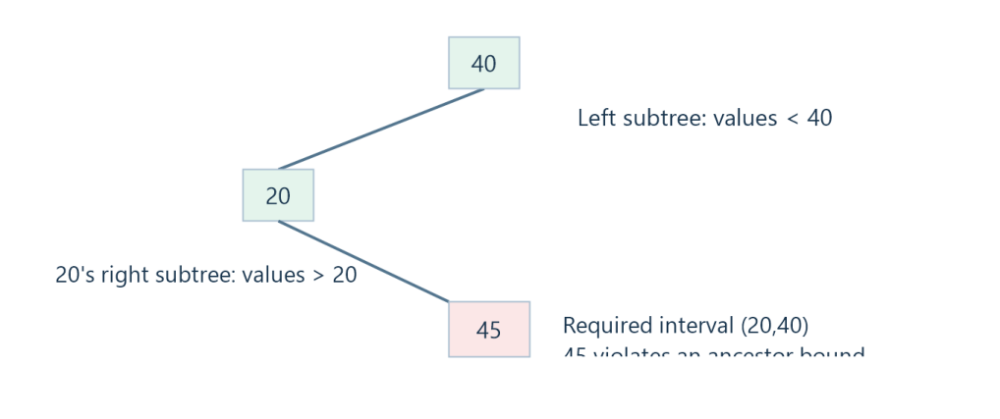

# 14. Binary Search Trees

[Topic overview](topics/trees.md) | [All topics](index.md) | [Revision](revision.md) | [Answer key](answers.md#solutions---chapter-14)

> Adapted from the supplied study-notes PDF, pages 71-74. Examples use [pseudocode](index.md#pseudocode-conventions). [Source notes](index.md#provenance-and-numbering).

Chapter goal: Propagate ancestor ranges, preserve BST order during updates, and analyse operations in terms of height.



*Figure 14. A descendant can satisfy its parent comparison but still violate an inherited ancestor bound.*

## 14.1 BST invariant
For every node, all values in its left subtree are less than the node and all values in its right subtree are greater, under the common no-duplicates policy. The constraint applies to the entire subtree, not only immediate children.

If duplicates are allowed, define exactly which side accepts equality; all operations and validation must use the same policy.

## 14.2 Validation
### Range propagation
Each node inherits valid lower and upper bounds from ancestors.

```pseudocode
FUNCTION IsValidBst(root)
    FUNCTION Validate(node, low, high)
        IF node = null
            RETURN true
        IF node.Val <= low OR node.Val >= high
            RETURN false
        RETURN Validate(node.Left, low, node.Val)
            AND Validate(node.Right, node.Val, high)
    RETURN Validate(root, NEGATIVE_INFINITY, INFINITY)
```

The bounds must lie outside the legal node-value range. Symbolic infinities
express that requirement without excluding minimum or maximum legal values.
Time O(n), stack O(h).

### Inorder validation
A no-duplicate BST has strictly increasing inorder values. Track the previous visited value/node. Be careful to reset state between calls.

Checking only node.Left.Val &lt; node.Val &lt; node.Right.Val is insufficient because a deeper descendant may violate an ancestor bound.

## 14.3 Search and insert
Follow one branch per comparison.

```pseudocode
FUNCTION SearchBst(root, target)
    WHILE root != null
        IF target = root.Val
            RETURN root
        root <- root.Left IF target < root.Val ELSE root.Right
    RETURN null

FUNCTION InsertBst(root, value)
    IF root = null
        RETURN TreeNode(value)
    IF value < root.Val
        root.Left <- InsertBst(root.Left, value)
    ELSE IF value > root.Val
        root.Right <- InsertBst(root.Right, value)
    RETURN root
```

Time O(h): average O(log n) if balanced, worst O(n) if skewed.

## 14.4 Delete
Find the node, then handle:

1.  No child: return null.

2.  One child: return that child.

3.  Two children: replace with inorder successor (minimum in right subtree), then delete that successor from the right subtree. Predecessor from left is symmetric.

```pseudocode
FUNCTION DeleteBst(root, key)
    IF root = null
        RETURN null
    IF key < root.Val
        root.Left <- DeleteBst(root.Left, key)
    ELSE IF key > root.Val
        root.Right <- DeleteBst(root.Right, key)
    ELSE
        IF root.Left = null
            RETURN root.Right
        IF root.Right = null
            RETURN root.Left
        successor <- root.Right
        WHILE successor.Left != null
            successor <- successor.Left
        root.Val <- successor.Val
        root.Right <- DeleteBst(root.Right, successor.Val)
    RETURN root
```

#### Time O(h), recursive stack O(h).

If nodes carry immutable identity/payload that cannot be copied safely, transplant actual nodes rather than only copying the successor value.

## 14.5 Inorder and kth smallest
BST inorder is sorted. The kth visited node in inorder is kth smallest (1-based).

Iterative traversal can stop early after k pops:

```pseudocode
FUNCTION KthSmallest(root, k)
    REQUIRE k >= 1
    stack <- empty stack
    current <- root
    WHILE current != null OR stack is not empty
        WHILE current != null
            stack.push(current)
            current <- current.Left
        current <- stack.pop()
        k <- k - 1
        IF k = 0
            RETURN current.Val
        current <- current.Right
    ERROR "k exceeds the number of nodes"
```

Time O(h + k) in a typical analysis; worst O(n). Space O(h).

For frequent kth queries on a changing tree, augment each node with subtree size and maintain it during updates, enabling rank selection in O(h).

## 14.6 Successor and predecessor
### Successor of a node
- If right subtree exists: successor is its leftmost node.

- Otherwise: successor is the lowest ancestor for which the node lies in the ancestor's left subtree.

Without parent pointers, search from root while tracking a candidate:

- If target value is less than current, current can be successor; go left.

- Otherwise go right.

Predecessor is symmetric.

Duplicates or identity-based lookup require a clearly defined policy; value-only traversal may not identify a particular duplicate node.

## 14.7 BST LCA
Use ordering:

- If both targets are smaller, go left.

- If both are larger, go right.

- Otherwise current is the split point and LCA.

```pseudocode
FUNCTION LcaBst(root, p, q)
    REQUIRE p and q are present in a BST with distinct values
    WHILE root != null
        IF p.Val < root.Val AND q.Val < root.Val
            root <- root.Left
        ELSE IF p.Val > root.Val AND q.Val > root.Val
            root <- root.Right
        ELSE
            RETURN root
    RETURN null
```

Time O(h), space O(1). State whether both nodes are guaranteed present.

## 14.8 Balanced versus unbalanced reality
A BST is not automatically balanced. Sorted insertion can create a chain. Therefore search/insert/delete are:

- O(log n) on a balanced tree.

- O(n) worst case on a skewed tree.

Do not silently claim logarithmic complexity without a balance guarantee.

## Common mistakes
- Validating only immediate children.

- Using int bounds and rejecting extreme legal values.

- Inconsistent duplicate policy.

- Forgetting to assign recursive insert/delete results back to child links.

- Mishandling the two-child deletion case.

- Assuming inorder is sorted for every binary tree.

- Treating BST operations as guaranteed O(log n).

- Using general-tree LCA when BST ordering could reduce work, or using BST LCA on a non-BST.

## Worked example and diagram guide - Every ancestor contributes a bound
Consider root 40, left child 20, and 20's right child 45. The local comparisons 20&lt;40 and 45&gt;20 look fine, but 45 is in 40's left subtree and violates its upper bound 40. At that descendant the valid interval is (20,40), not merely "greater than 20".

For no duplicates, bounds are strict. Use symbolic infinities, optional
unbounded endpoints, or a wider numeric type for the bounds. Do not use a
legal node value as an exclusive initial sentinel.

### Two-child deletion without losing order
Deleting 50 from a BST with left subtree rooted at 30 and right subtree rooted at 70 (left child 60) can replace the value with 60, then delete the original 60 from the right subtree. Its minimum has no left child, so that final removal has at most one child. Copying only a key is not appropriate if the node has identity-sensitive payload; transplant nodes or explicitly copy the associated payload under a defined contract.

### Successor is a candidate that improves while searching
In the illustrated seven-node BST, successor(6)=8 and successor(14)=none. For strict successor of an absent value 5, find the smallest key greater than 5, namely 6. An API asking for a node's inorder successor and an API asking for a value's strict upper bound must agree on duplicate/identity semantics before sharing code.

Kth smallest via a full sorted traversal costs O(n) time/output. An early-stop stack traversal costs O(h+k) time and O(h) working space. Repeated rank queries can justify subtree-size augmentation, but that is a design extension rather than something the plain BST provides for free.

## Check Your Understanding - Chapter 14
### Q14.1

Why is checking only immediate children insufficient for BST validation?

[Solution](answers.md#a141)

### Q14.2

Why are long bounds useful when node values are int?

[Solution](answers.md#a142)

### Q14.3

Describe the three structural cases in BST deletion.

[Solution](answers.md#a143)

### Q14.4

How is a successor found when the node has a right subtree, and when it does not?

[Solution](answers.md#a144)

### Q14.5

Why are BST search/insert/delete not always O(log n)?

[Solution](answers.md#a145)

## Additional practice - Chapter 14
New application exercises. Attempt these before consulting the final answer section.

### E14.1

Root 40 has left child 20, whose right child is 45. Show inherited bounds at 45 and the failed condition.

[Solution](answers.md#e141)

### E14.2

Delete root 50 when left child is 30 and right subtree is 70 with left child 60. Explain the second deletion.

[Solution](answers.md#e142)

---

[All coding chapters](index.md) | [Previous chapter](13-tree-construction.md) | [Next chapter](15-heaps.md)
