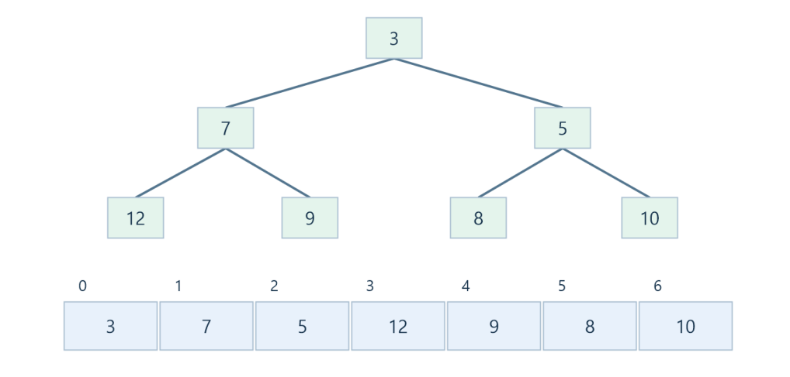
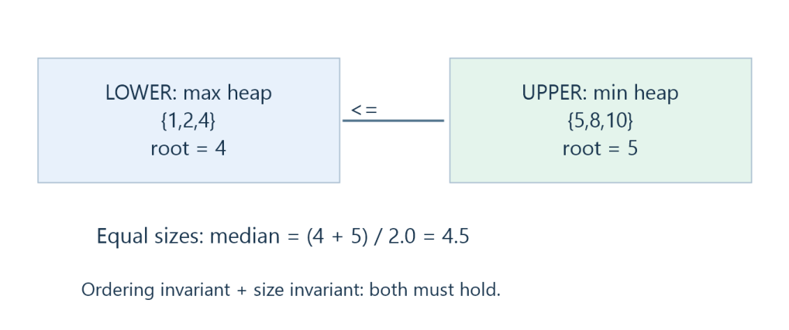

# 15. Heaps and Priority Queues

[Topic overview](topics/heaps.md) | [All topics](index.md) | [Revision](revision.md) | [Answer key](answers.md#solutions---chapter-15)

> Adapted from the supplied study-notes PDF, pages 75-81. Examples use [pseudocode](index.md#pseudocode-conventions). [Source notes](index.md#provenance-and-numbering).

??? note "Source coverage and history"
    This chapter corresponds to chat Chapter 9, Heaps & Priority Queues, now completed according to the updated roadmap. The existing worked explanations, including the supplemented streaming-median solution, are retained for revision; no individual quiz score is inferred from the completion update.

## 15.1 The abstraction and its implementation


*Figure 15. A complete binary min heap and its breadth-first array. The array is not sorted.*

A priority queue supports inserting an item with a priority and retrieving/removing the item that should be served next. A heap is a common implementation. Priority is a contract: a smaller number can mean more important, or the order can be reversed. A priority queue is not a FIFO queue, a sorted array, or a search tree.

A binary heap is a complete binary tree with a local order rule. In a min heap every parent is &lt;= each child; in a max heap every parent is &gt;= each child. The rule applies along ancestor paths but does not order siblings or the two subtrees relative to one another. Its array is not globally sorted.

For zero-based binary-heap index i, left child=2*i+1, right child=2*i+2,
and parent=(i-1) DIV 2 for i&gt;0. Do not evaluate the parent formula at
the root. The complete-tree shape makes height logarithmic without storing
explicit child references.

## 15.2 Inserting into a min heap
Start [3,7,5,12,9,8,10], insert 4. Append to preserve completeness: [3,7,5,12,9,8,10,4]. At index 7, parent index 3 holds 12; swap -&gt; [3,7,5,4,9,8,10,12]. Parent index 1 holds 7; swap -&gt; [3,4,5,7,9,8,10,12]. Now parent 3&lt;=4, so stop. Only the ancestor path can be broken.

## 15.3 Removing the minimum
Start again from [3,7,5,12,9,8,10]. Save root 3; move last value 10 to root and remove the final slot -&gt; [10,7,5,12,9,8]. Choose smaller child 5 and swap -&gt; [5,7,10,12,9,8]. Then swap 10 with child 8 -&gt; [5,7,8,12,9,10]. If a node has children 5 and 7 and contains 10, swapping with 7 would leave parent 7&gt;child 5: the invariant still fails. Choose the smaller child.

|**Operation**|**Binary heap cost**|**Why**|
|---|---|---|
|**Peek extreme**|O(1)|Root|

|**Operation**|**Binary heap cost**|**Why**|
|---|---|---|
|**Insert**|O(log n) heap-order repair|One ancestor path; an array resize can<br>separately cost O(n)|
|**Remove extreme**|O(log n)|One downward path|
|**Search arbitrary value**|O(n) worst case|Neither subtree can generally be<br>discarded|
|**Bottom-up heapify**|O(n)|Most nodes are near leaves|
|**Extra storage**|O(n) total; O(1) in-place heapify|Array-backed structure|

## 15.4 A binary min-heap implementation for learning
The following implementation isolates the heap mechanics. It rejects empty peek/removal explicitly. List growth makes a single insertion occasionally linear for allocation/copying, while the ordering work is logarithmic and growth is amortised.

```pseudocode
DATA STRUCTURE BinaryMinHeap(values)
    data <- copy(values)
    FOR i FROM length(data) DIV 2 - 1 DOWN TO 0
        SiftDown(i)

    FUNCTION Peek()
        REQUIRE data is not empty
        RETURN data[0]

    PROCEDURE Add(value)
        data.append(value)
        i <- length(data) - 1
        WHILE i > 0
            parent <- (i - 1) DIV 2
            IF data[parent] <= data[i]
                BREAK
            SWAP data[parent], data[i]
            i <- parent

    FUNCTION RemoveMin()
        result <- Peek()
        last <- data.removeLast()
        IF data is not empty
            data[0] <- last
            SiftDown(0)
        RETURN result

    PROCEDURE SiftDown(i)
        WHILE 2 * i + 1 < length(data)
            child <- 2 * i + 1
            IF child + 1 < length(data) AND data[child + 1] < data[child]
                child <- child + 1
            IF data[i] <= data[child]
                BREAK
            SWAP data[i], data[child]
            i <- child
```

Library priority queues may use a different layout from this educational binary
heap. For example, the source's referenced library uses a quaternary heap.
Do not assume its private layout uses these binary formulas. Equal priorities
need not be FIFO; add an explicit sequence component when stable ties are
required. [R1]

## 15.5 Top-K: expose the weakest accepted candidate
For the k largest values, retain a size-k min heap. Its root is the smallest accepted item, therefore the easiest one to evict. If an incoming value is larger than root, replace root; otherwise ignore it. Invariant: after every input, the heap contains the largest min(k,processedCount) values seen so far, counting duplicates under the usual rank definition.

Example stream [12,3,17,8,34,25,1,19], k=3:

|**Incoming**|**Accepted set after processing**|**Threshold (heap minimum)**|
|---|---|---|
|**12**|{12}|12|
|**3**|{3,12}|3|
|**17**|{3,12,17}|3|
|**8**|{8,12,17}|8|
|**34**|{12,17,34}|12|
|**25**|{17,25,34}|17|
|**1**|{17,25,34}|17|
|**19**|{19,25,34}|19|

The third largest is 19. Sets in this table describe membership, not heap-array order; heaps can have different valid layouts. For k smallest, reverse the idea: keep a max heap so the largest accepted candidate is easy to evict.

```pseudocode
FUNCTION KthLargest(values, k)
    REQUIRE 1 <= k <= length(values)
    heap <- empty min-heap
    FOR EACH value IN values
        IF size(heap) < k
            heap.insert(value, priority = value)
        ELSE IF value > heap.peek()
            heap.removeMin()
            heap.insert(value, priority = value)
    RETURN heap.peek()
```

Expected interview shorthand is O(n log k) time and O(k) space; a bound that also handles k=1 cleanly is O(n log(k+1)). A streaming version can maintain this state without knowing all future input; a kth answer exists only after at least k values have arrived. Sorting all n inputs is O(n log n) time and needs access to the data. Sorted Top-K output requires additionally sorting/extracting the k retained values.

The chat corrected a numerical estimate: for n=1,000,000 and k=100, log2(n) is about 19.93 and log2(k) about 6.64. Thus n log2(n) is about 19.9 million and n log2(k) about 6.64 million, not exact operation counts or wallclock predictions.

## 15.6 K-way merge: one live frontier per source
For individually sorted sources, only each source's next unconsumed element can be the next global minimum. Keep one candidate from each nonempty source. Pop the smallest, emit it, and push its successor from that same source. This preserves a frontier that represents every source without adding values that cannot yet win.

For A=[2,8], B=[1,9], C=[6,12], D=[3,7,10], initial candidates are {2(A),1(B),6(C),3(D)}. First six emissions: 1(B),2(A),3(D),6(C),7(D),8(A). The earlier chat used its own source lists; this newly authored example is internally complete.

```pseudocode
FUNCTION MergeSortedSources(sources)
    heap <- empty min-heap
    FOR s FROM 0 TO length(sources) - 1
        IF sources[s] is not empty
            heap.insert((s, 0), priority = sources[s][0])
    result <- empty list
    WHILE heap is not empty
        (s, i) <- heap.removeMin()
        result.append(sources[s][i])
        next <- i + 1
        IF next < length(sources[s])
            heap.insert((s, next), priority = sources[s][next])
    RETURN result
```

If N is total items and k is source count, there are at most k live heap entries: O(k + N log(k+1)) time including scanning source headers, O(k) working heap space, plus O(N) returned output. For k&gt;=2 and ordinary nonempty sources this is commonly written O(N log k). The inputs must already be sorted; arbitrary unsorted streams do not satisfy the frontier proof.

## 15.7 Bottom-up heapify: why it is linear
Leaves already satisfy heap order. The last nonleaf index is floor(n/2)-1. Sift down from that index to 0. After fixing a node, its child subtrees are already heaps, so only that node's downward path can need repair.

For [10,5,8,2,6,3,9,1], processing index 3 yields [10,5,8,1,6,3,9,2]; index 2 yields [10,5,3,1,6,8,9,2]; index 1 yields [10,1,3,2,6,8,9,5]; index 0 yields [1,2,3,5,6,8,9,10]. A final sorted-looking array is possible but is not required for a valid heap.

About n/2 nodes move zero levels, n/4 at most one, n/8 at most two, and so on. Total work is bounded by n*(1/4 + 2/8 + 3/16 + ...)=O(n). Multiplying n by the root's worst-case log n height overcounts almost all nodes. Repeated insertion has O(n log n) worst-case total ordering work, while bottom-up heap construction is linear. [R2]

## 15.8 Priority values and tie contracts
The exact correction from the latest checkpoint: A has priority 10, B=2, C=7, D=1, and smaller means higher priority. Removal order is D,B,C,A, not A,C,B,D. "Highest priority" is a semantic label; it does not necessarily mean the largest numeric value.

For a max-priority queue, reverse the comparison direction rather than
negating fixed-width signed priorities. Negating the minimum representable
integer can overflow; subtracting priorities in a comparator can also overflow.
A stable tie-break can use `(priority, sequence)`, with a monotonically
increasing sequence under a documented overflow policy.

## 15.9 Streaming median - Worked revision and supplemented solution


*Figure 16. Streaming median is the boundary between a lower max heap and an upper min heap.*

Split the observed values into a lower half and upper half. The lower half is a max heap (exposes its largest value); the upper half is a min heap (exposes its smallest). The median is at their boundary, not at a global extreme.

Ordering invariant: every value in lower &lt;= every value in upper; equivalently, when both nonempty, max(lower)&lt;=min(upper). Size invariant: lower.Count==upper.Count or lower.Count==upper.Count+1. Maintaining both is essential: sizes alone do not prove the partitions are ordered.

Insert into lower when it is empty or x&lt;=max(lower); otherwise insert into upper. If lower has two extra, move its maximum to upper. If upper becomes larger, move its minimum to lower. With the invariants true before insertion, at most one such root transfer is needed.

Odd count: median=max(lower). Even count: median=(max(lower)+min(upper))/2.0. Widen before adding to avoid int overflow; floating-point division preserves a .5 result.

### Worked trace of the streaming-median checkpoint
|**Incoming**|**Lower membership (max**|**Upper membership (min**|**Median**|
|---|---|---|---|
||**heap)**|**heap)**||
|**5**|{5}|{}|5|
|**2**|{2}|{5}|3.5|
|**10**|{2,5}|{10}|5|
|**4**|{2,4}|{5,10}|4.5|
|**8**|{2,4,5}|{8,10}|5|
|**1**|{1,2,4}|{5,8,10}|4.5|

At 2, lower briefly contains {2,5}, so move 5 upward. At 10, upper is larger, so move 5 downward. At 4, lower is too large, so move 5 upward. At 8, move 5 downward; at 1, move 5 upward again. Membership sets are deliberately not presented as heap-array layouts.

```pseudocode
DATA STRUCTURE StreamingMedian
    lower <- empty max-heap
    upper <- empty min-heap

    PROCEDURE Add(value)
        IF lower is empty OR value <= lower.peek()
            lower.insert(value)
        ELSE
            upper.insert(value)
        IF size(lower) > size(upper) + 1
            upper.insert(lower.removeMax())
        ELSE IF size(upper) > size(lower)
            lower.insert(upper.removeMin())

    FUNCTION Median()
        REQUIRE size(lower) + size(upper) > 0
        IF size(lower) > size(upper)
            RETURN lower.peek()
        RETURN (lower.peek() + upper.peek()) / 2
```

Insertion O(log n), maintained median query O(1), storage O(n). Exact median retains all observed values across the two heaps. This differs from Top-K's bounded O(k) retention. Sliding-window median additionally needs deletion/expiration and is not solved by this insertion-only class.

## Check Your Understanding - Chapter 15
### Q15.1

Give binary-heap child/parent index formulas and explain why they require a complete-tree layout.

[Solution](answers.md#a151)

### Q15.2

Insert 4 into [3,7,5,12,9,8,10]. Give every swap and the final min heap.

[Solution](answers.md#a152)

### Q15.3

Remove the minimum from the original heap in Q15.2. Why must sift-down choose the smaller child?

[Solution](answers.md#a153)

### Q15.4

For k largest, which heap direction exposes the weakest accepted item? State the retained-set invariant.

[Solution](answers.md#a154)

### Q15.5

In K-way merge, why insert only the successor of the source just popped? Give heap-space complexity excluding output.

[Solution](answers.md#a155)

### Q15.6

Why does bottom-up heapify take O(n), not O(n log n)? Where does it start?

[Solution](answers.md#a156)

### Q15.7

A=10,B=2,C=7,D=1; smaller number means higher priority. Give the removal order and explain whether a priority queue must serve equal priorities in FIFO order.

[Solution](answers.md#a157)

### Q15.8

State both streaming-median invariants and the median rule for odd/even counts.

[Solution](answers.md#a158)

### Q15.9

Give insertion, query, and storage complexities for the two-heap median. Why is one ordinary heap not enough to expose the median in O(1)?

[Solution](answers.md#a159)

### Q15.10

Explain two fixed-width arithmetic hazards: negated max-heap priorities and averaging two integer roots.

[Solution](answers.md#a1510)

## Additional practice - Chapter 15
### E15.1

Process [12,3,17,8,34,25,1,19] with k=3. Give the retained membership after each value and the kth largest.

[Solution](answers.md#e151)

### E15.2

Heapify [10,5,8,2,6,3,9,1] bottom-up. Identify the last nonleaf and a valid final heap.

[Solution](answers.md#e152)

### E15.3

Revisit the streaming-median checkpoint: insert 5,2,10,4,8,1 into the two-heap median structure. Give the median after each insertion and both final partitions.

[Solution](answers.md#e153)

### E15.4

Merge A=[2,8], B=[1,9], C=[6,12], D=[3,7,10]. Give complete output and explain why unsorted input would break the proof.

[Solution](answers.md#e154)

---

[All coding chapters](index.md) | [Previous chapter](14-binary-search-trees.md) | [Next chapter](16-backtracking.md)
