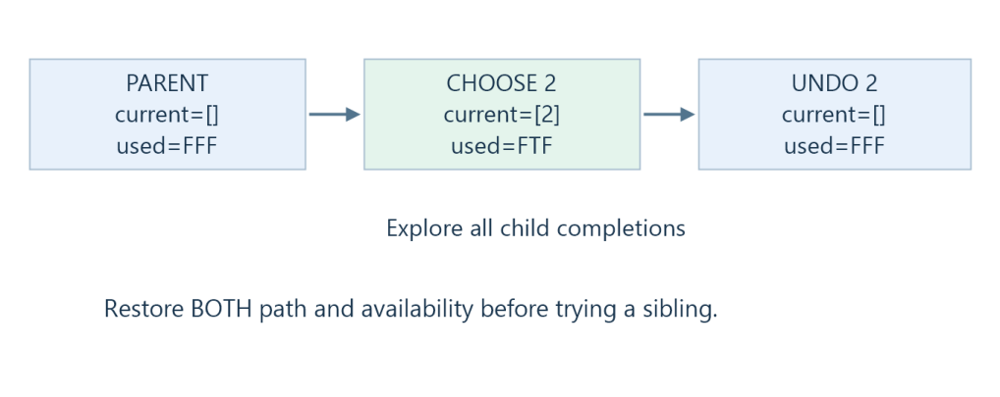
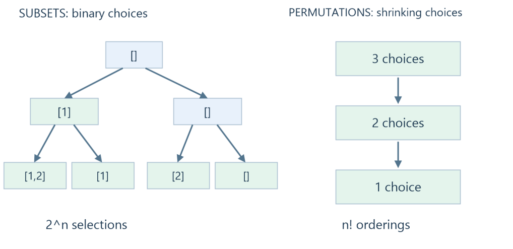
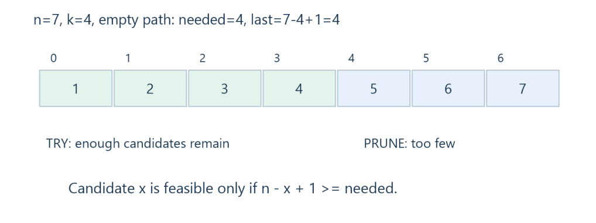

# 16. Recursion and Backtracking

[Topic overview](topics/backtracking.md) | [All topics](index.md) | [Revision](revision.md) | [Answer key](answers.md#solutions---chapter-16)

> Adapted from the supplied study-notes PDF, pages 82-91. Examples use [pseudocode](index.md#pseudocode-conventions). [Source notes](index.md#provenance-and-numbering).

??? note "Source coverage and history"
    Chat chapter: 10. Historical source status: the PDF reports this track completed in its underlying transcript. This detailed chapter follows the recorded teaching and corrected checkpoints. The continuation starts after Subsets; its recap and implementation below are a labelled reconstruction of that already-completed prerequisite, not a recovered missing message.

## 16.1 The recursion contract and the active stack
Recursion solves a state by asking smaller or more constrained versions of the same question. Before coding, complete: "Solve(state) returns or generates _____, assuming _____ is already true." Define a base case and a progress measure. Without progress, correct-looking recursive syntax can still repeat the same state forever.

For a normal tree, the structure supplies the children. In backtracking, the algorithm creates a decision tree from choices. A node is a partial answer; an edge commits one choice; a leaf may be an accepted answer or a dead end. The recursion tree describes all work over time. The call stack contains only the current active root-to-node chain in a sequential depth-first execution.

If a search visits one million states but has depth 15, its runtime depends on the work at those million states, not on 15 alone. With constant local frame data, the stack uses O(d) space for variable depth d, not O(number of visited states). A literal fixed depth of 15 is constant with respect to input size; O(d) expresses the reusable relationship.

## 16.2 Choose, explore, undo: the state-restoration invariant


*Figure 17. A child branch must restore every shared mutation before a sibling is explored.*

The core pattern is: choose a permitted candidate, update every affected state component, recurse, then undo every mutation before trying a sibling. Before and after each sibling branch, shared state must represent exactly the same parent state.

A scalar parameter such as remaining is local to each call in this pseudocode.
A mutable path, array, board, or set can be shared: returning does not undo its
writes. If choosing updates both current and used, undoing only current is incomplete.

Saving a completed answer requires a snapshot: `result.append(copy(current))`.
Saving the live path object would make the results alias the buffer that later
branches modify. Undo isolates sibling searches; copying isolates saved answers
from future mutation.

## 16.3 Subsets recap - Reconstructed prerequisite


*Figure 18. Subsets branch over include/exclude; permutation branches shrink with the unused choices.*

For n distinct input values, each index makes exactly two decisions: include this value or exclude it. The state is (index,current); the contract is to generate all selections of the undecided suffix while preserving the already chosen prefix.

For [1,2], the four results are [], [1], [2], [1,2]. Their enumeration order depends on whether include or exclude runs first; the set of answers does not. Subsets do not treat [1,2] and [2,1] as different selections. The empty input has one subset, the empty subset.

```pseudocode
FUNCTION Subsets(nums)
    result <- empty list
    current <- empty list
    PROCEDURE Search(index)
        IF index = length(nums)
            result.append(copy(current))
            RETURN
        current.append(nums[index])
        Search(index + 1)
        current.removeLast()
        Search(index + 1)
    Search(0)
    RETURN result
```

The include/exclude tree has 2^n leaves and O(2^n) nodes. Copying the returned subsets takes Theta(n*2^n) total element writes for n&gt;=1: each element occurs in exactly half the subsets, so there are n*2^(n-1) stored elements. Auxiliary path plus stack is O(n); returned storage includes both the 2^n list objects and their contents.

## 16.4 Distinct permutations - Recurse over output positions
Subsets ask which elements are selected. Permutations ask in which order all elements appear. At each output position, try every unused input index. There are n choices, then n-1, then n-2, down to one; for distinct values the leaf count is n!, not n^n.

State: current holds the partial ordering; used[i] is true if and only if input index i is present in that path. The number of true entries equals current.Count. The base case is current.Count==nums.Length.

```pseudocode
FUNCTION PermutationsDistinct(nums)
    REQUIRE all values are distinct
    result <- empty list
    current <- empty list
    used <- array(length(nums), initial = false)
    PROCEDURE Search()
        IF length(current) = length(nums)
            result.append(copy(current))
            RETURN
        FOR i FROM 0 TO length(nums) - 1
            IF used[i]
                CONTINUE
            used[i] <- true
            current.append(nums[i])
            Search()
            current.removeLast()
            used[i] <- false
    Search()
    RETURN result
```

This method assumes distinct values. For [1,2,3], group the six results by the first choice: [1,2,3],[1,3,2]; [2,1,3],[2,3,1]; [3,1,2],[3,2,1].

### Exact branch from the checkpoint: [2,3,1]
|**Action**|**current**|**used for indices 0,1,2**|
|---|---|---|
|**Start**|[]|false,false,false|
|**Choose nums[1]=2**|[2]|false,true,false|
|**Choose nums[2]=3**|[2,3]|false,true,true|
|**Choose nums[0]=1**|[2,3,1]|true,true,true|
|**Snapshot, then undo 1**|[2,3]|false,true,true|

The learner originally traced [1,2,3] instead. That was a valid path but did not answer the requested branch. Track value, input index, and output position separately.

If the root's branch beginning with 1 is finished but used[0] remains true, current=[] and used disagree. Siblings starting with 2 or 3 cannot use 1, and valid complete permutations disappear. This is stale state, not merely an inconvenient ordering.

Constructing n! length-n outputs takes Theta(n*n!) time and output space. The loop over candidate indices at partial nodes also fits this bound for this implementation. Stack, current, and used each use O(n) live space; adding them still gives O(n), excluding returned results.

## 16.5 Unique permutations - Suppress equivalent siblings
For [1,1,2], ordinary index-based permutations visit 3!=6 index arrangements but produce only three unique value sequences: [1,1,2], [1,2,1], [2,1,1]. Do not prohibit equal values inside a path: the two copies of 1 must coexist in valid results.

Sort so equal values are adjacent, then skip candidate i when i&gt;0, nums[i]==nums[i-1], and the previous equal index is not used in the current path. That enforces a canonical order among interchangeable copies at one decision level.

```pseudocode
FUNCTION PermutationsUnique(nums)
    SORT nums ascending in place
    result <- empty list
    current <- empty list
    used <- array(length(nums), initial = false)
    PROCEDURE Search()
        IF length(current) = length(nums)
            result.append(copy(current))
            RETURN
        FOR i FROM 0 TO length(nums) - 1
            IF used[i]
                CONTINUE
            IF i > 0 AND nums[i] = nums[i - 1] AND NOT used[i - 1]
                CONTINUE
            used[i] <- true
            current.append(nums[i])
            Search()
            current.removeLast()
            used[i] <- false
    Search()
    RETURN result
```

At the root of [1,1,2], the second 1 sees the first unused and is skipped: the first 1 already represented that sibling choice. Deeper under a path containing the first 1, used[0] is true, so the second 1 is allowed. "Previous equal unused" means redundant sibling; "previous equal used" permits another occurrence in the same path.

Sorting alone identifies neighbors; used identifies path membership. Neither replaces the other. This implementation mutates input by sorting. The unique output count is n! divided by the factorial of each value's multiplicity. Output copying costs n times that count; worst-case time remains O(n*n!) when all values are distinct.

## 16.6 Combinations - Availability is encoded by start


##### Figure 19. Candidate x can start a k-combination only when enough values remain to fill the path.
Choose k distinct numbers from 1..n, ignoring order. After selecting candidate x, future choices begin at x+1. This generates increasing paths and never explores the equivalent reorder [2,1] after [1,2]. A used array is unnecessary because the availability boundary moves only forward.

For n=4,k=2, the results are [1,2],[1,3],[1,4],[2,3],[2,4],[3,4]. For n=5,k=2, add [1,5],[2,5],[3,5],[4,5] to the appropriate groups, giving C(5,2)=10 results.

The contract Search(start) is: generate every length-k completion of current using candidates at least start. The current call's start is fixed, while its loop candidate changes. After choosing 1, the child is Search(2); after finishing candidate 2, that same child's loop may try 3, but its start argument remains 2.

### Deriving safe feasibility pruning
Let needed=k-current.Count. Choosing x leaves n-x+1 candidates available including x. Completion requires n-x+1&gt;=needed, so x&lt;=n-needed+1. Larger candidates leave fewer available values and cannot succeed; this is an insufficiency proof, not a heuristic.

```pseudocode
FUNCTION Combinations(n, k)
    REQUIRE n >= 0 AND 0 <= k <= n
    result <- empty list
    current <- empty list
    PROCEDURE Search(start)
        IF length(current) = k
            result.append(copy(current))
            RETURN
        needed <- k - length(current)
        last <- n - needed + 1
        FOR candidate FROM start TO last
            current.append(candidate)
            Search(candidate + 1)
            current.removeLast()
    Search(1)
    RETURN result
```

For n=7,k=4 at the root, needed=4 and last=4; try 1,2,3,4. Candidate 5 leaves only 5,6,7, three values for four slots. At current=[2,4],start=5, needed=2 and last=6; the completed descendants are [2,4,5,6],[2,4,5,7],[2,4,6,7].

Choosing 5 at the root for n=5,k=3 does not violate increasing order; it is currently valid but impossible to complete. Without pruning, an otherwise correct generator still returns the right answers but wastes work on such dead ends.

There are C(n,k)=n!/(k!*(n-k)!) results. With the displayed pruning, every visited prefix extends to an output; O((k+1)*C(n,k)) bounds traversal plus copying, and stack/path space is O(k+1). The +1 handles k=0, where the single result is [].

Editorial precision: copying outputs costs O(k*C(n,k)), but that is not automatically a bound on an unpruned implementation's entire search. The unpruned forward loop can visit sum(j=0..k) C(n,j) prefixes; for k=n it explores an exponential tree despite returning only one combination. Distinguish an unavoidable output cost from a proven total runtime.

## 16.7 Combination Sum - Reuse and the remaining target
For distinct positive candidates [2,3,6,7] and target 7, return [2,2,3] and [7]. Order does not create another answer, but each candidate can be reused. State is (start,remaining,current). Choosing index i recurses with i, not i+1, and subtracts the chosen value from remaining.

```pseudocode
FUNCTION CombinationSum(candidates, target)
    REQUIRE target >= 0 AND candidates are distinct positive integers
    SORT candidates ascending in place
    result <- empty list
    current <- empty list
    PROCEDURE Search(start, remaining)
        IF remaining = 0
            result.append(copy(current))
            RETURN
        FOR i FROM start TO length(candidates) - 1
            value <- candidates[i]
            IF value > remaining
                BREAK
            current.append(value)
            Search(i, remaining - value)
            current.removeLast()
    Search(0, target)
    RETURN result
```

Distinct candidates are a precondition; the positivity check explicitly prevents nontermination through reusable zero or negative values. Input is sorted in place. Target zero returns the empty combination once. An empty candidate set with a positive target returns no combinations.

For [2,3,5], target 8, the complete output is [2,2,2,2], [2,3,3], [3,5]. The direct [2,3,3] path has (current,remaining,start): ([],8,0),([2],6,0),([2,3],3,1),([2,3,3],0,1).

Once the path advances from 2 to 3, it cannot move back to 2, so [2,3,2] and [3,2,2] are not generated separately. Reuse means staying at the chosen index, not resetting availability to zero.

For single-use candidates, the complete transition is Search(i+1,remaining-value). Merely changing i to i+1 while leaving remaining unchanged forgets to account for the chosen value. The source checkpoint corrected exactly this two-part state-update error.

When sorted candidates [2,3,6,7] have remaining=5, reaching 6 permits break: all later values are also too large. In unsorted [2,6,3,7], break would incorrectly skip 3; use continue or sort first.

If the smallest candidate is m&gt;0 and target is T, path depth is at most D=floor(T/m). Search stack/path space is O(D+1), plus sorting's own stack. Runtime depends on target, candidates, failed prefixes, and total copied output length L. A deliberately loose safe description is O(N*sum(j=0..D) N^j + L), plus sorting, where N is candidate count. For N&gt;=2 this is exponential in depth; for N=1, retain the linear depth term rather than claiming 1^D accounts for D recursive calls.

## 16.8 Pruning needs a proof, not a guess
Soundness means every returned answer is valid. Completeness means every valid answer is returned. Returning only valid answers does not establish completeness: an unsafe shortcut may silently omit a valid combination.

|**Pruning category**|**Proof of impossibility**|**Example**|
|---|---|---|
|**Constraint violation**|A committed rule is already broken and<br>cannot be repaired by extension|Two placed queens attack|
|**Insufficient resources**|The current state is valid, but too few<br>remaining choices can fill the required<br>slots|Need three values, only two remain|
|**Bound-based**|Even the best possible continuation<br>cannot meet the objective|Maximum achievable remaining sum is<br>too small|

|**Control operation**|**Scope stopped**|**When appropriate**|
|---|---|---|
|**return**|Entire current recursive call|No continuation of this state can<br>succeed|

|**Control operation**|**Scope stopped**|**When appropriate**|
|---|---|---|
|**break**|Current candidate loop and all later<br>candidates|Sorted candidates are already too large|
|**continue**|Only this candidate|Duplicate sibling or conflicting square;<br>later choices may work|

A pruning rule must explain both why the candidate fails and why the chosen control scope does not discard another valid answer.

Detecting impossibility before making a choice saves an unnecessary recursive call. Entry checks can still be correct, such as remaining&lt;0 with positive values. What matters is preserving the invariant and completeness, not the particular location of the if statement.

## 16.9 N-Queens - One structural decision per row
![Figure 20. The four-queen board at columns [1,3,0,2] satisfies unique columns and both diagonal families.](images/One-Month-Software-Interview-Plan-Study-Notes.pdf-0088-05.png)

*Figure 20. The four-queen board at columns [1,3,0,2] satisfies unique columns and both diagonal families.*

Place n queens on an n-by-n board with no shared row, column, or diagonal. Recurse by row, choosing one column for that row. This automatically enforces exactly one queen per row; there is no need for a row set.

For square (row,col), descending-diagonal key=row-col and ascending-diagonal key=row+col. Equal keys in the same diagonal family identify a shared diagonal. Numerically equal keys in different sets are not a conflict with each other: the families represent different directions.

For (1,3),(2,2),(3,1), descending keys are -2,0,2, while every ascending key is 4. All three therefore share the ascending diagonal.

Given queens at (0,1),(1,3), occupied columns are {1,3}, descending keys {-1,-2}, and ascending keys {1,4}. Proposed (2,0) has column 0 and diagonal keys 2,2, none occupied in their respective sets, so it is safe.

```pseudocode
FUNCTION SolveQueens(n)
    REQUIRE n > 0
    result <- empty list
    board <- n by n matrix filled with '.'
    columns, descending, ascending <- three empty sets
    PROCEDURE Search(row)
        IF row = n
            result.append(deepCopy(board))
            RETURN
        FOR col FROM 0 TO n - 1
            down <- row - col
            up <- row + col
            IF col IN columns OR down IN descending OR up IN ascending
                CONTINUE
            board[row, col] <- 'Q'
            columns.add(col)
            descending.add(down)
            ascending.add(up)
            Search(row + 1)
            ascending.remove(up)
            descending.remove(down)
            columns.remove(col)
            board[row, col] <- '.'
    Search(0)
    RETURN result
```

Invariant on entry to Search(row): exactly one non-attacking queen occupies each previous row, and the board and three sets describe exactly those placements. At row==n, all n rows have one queen and all checked constraints still hold, proving a complete valid solution.

Choosing (2,0) changes board[2][0], columns, descending, and ascending. Undo must restore all four, not just the sets. A conflict requires continue, not return: a later column in the same row might work.

For n=4, one solution uses columns [1,3,0,2], producing .Q.. / ...Q / Q... / ..Q.; the other uses [2,0,3,1]. There are no solutions for n=2 or n=3. The method deliberately requires n&gt;=1.

Complexity precision: enforcing unique columns gives a factorial candidate-tree intuition rather than n^n. The displayed implementation still scans all n columns at each nonterminal state; a conservative search bound is O(n*n!), not a claim that the whole program is exactly Theta(n!). Add O(Q*n^2) time/storage to materialize Q boards. Expected set checks are O(1); live board storage is O(n^2), with O(n) sets and stack. A placement-only int[] representation can reduce search-state storage, but that is not the board-backed code shown here.

## 16.10 Pattern map and output-sensitive complexity
|**Problem**|**State / contract**|**Choice progression**|**Successful base case**|
|---|---|---|---|
|**Subsets**|index,current; decide suffix|Include/exclude, then<br>index+1|All indices decided|
|**Permutations**|current,used; fill next<br>position|Every unused input index|Path length n|
|**Unique permutations**|Sorted values,current,used|Skip equivalent siblings|Path length n|
|**Combinations**|start,current; complete k<br>slots|candidate+1|Path length k|
|**Combination Sum**|start,remaining,current|i for reuse; i+1 for single use|remaining==0|
|**N-Queens**|row,board,column/diagonal<br>state|Safe column, then row+1|row==n|

The decisive interview question is: what choices must remain available after I choose this one? That answer determines the recursive transition. A generic branching-factor/depth estimate counts search nodes; it does not automatically include candidate scanning, path copying, or result-board construction.

If one million required outputs each contain 20 integers, writing those 20 million integers is unavoidable. Pruning eliminates failed work, not the requested answers. Always report search time, maximum active state, and output storage separately.

## 16.11 Corrected checkpoint lessons to remember
- Trace the requested branch, not just any valid branch.

- The path and used array must agree in both directions.

- A call's start parameter is not its loop's current candidate.

- Reuse rules and target subtraction are independent state transitions.

- Prove a pruning rule and its scope; valid-only output can still be incomplete.

- Restore every board and set mutation after a queen branch.

- Distinguish recursion depth, tree size, per-state work, and output size.

## Check Your Understanding - Chapter 16
Consolidated checkpoints from the supplied teaching and corrected replies. Solutions remain in the final answer key.

### Q16.1

State the contract, base case, and progress measure for a recursive generator.

[Solution](answers.md#a161)

### Q16.2

A search visits one million states with depth 15. What determines time and simultaneous stack space?

[Solution](answers.md#a162)

### Q16.3

What must undo restore, and why is copying a completed path a separate requirement?

[Solution](answers.md#a163)

### Q16.4

For [1,2], give all subsets, the decision at each index, and the result for empty input.

[Solution](answers.md#a164)

### Q16.5

For n distinct elements, compare subsets' tree work, copied output, auxiliary space, and output storage.

[Solution](answers.md#a165)

### Q16.6

List all permutations of [1,2,3], grouped by first choice.

[Solution](answers.md#a166)

### Q16.7

Trace current and used for [2,3,1] and its first undo.

[Solution](answers.md#a167)

### Q16.8

State both directions of the current/used invariant.

[Solution](answers.md#a168)

### Q16.9

Why do permutations scan all candidates at each position, and what if a used flag is not undone?

[Solution](answers.md#a169)

### Q16.10

Why are there n! distinct permutations rather than n^n? Include copying and space.

[Solution](answers.md#a1610)

### Q16.11

Why does ordinary permutation generation duplicate [1,1,2], and what are the unique outputs?

[Solution](answers.md#a1611)

### Q16.12

Evaluate the unique-permutation duplicate condition at the root and after the first 1 is already used.

[Solution](answers.md#a1612)

### Q16.13

Why sort before same-level duplicate suppression? Does it forbid equal values inside one result?

[Solution](answers.md#a1613)

### Q16.14

List the combinations for n=4,k=2 and explain candidate+1 versus resetting start.

[Solution](answers.md#a1614)

-

### Q16.15

After choosing 1 in a combinations call, is start necessarily 3 when the loop later tries candidate 3?

[Solution](answers.md#a1615)

### Q16.16

Derive the combinations pruning bound from the count of available candidates.

[Solution](answers.md#a1616)

### Q16.17

For n=7,k=4,current=[2,4],start=5, give needed, final candidate, and all completed descendants.

[Solution](answers.md#a1617)

### Q16.18

Does choosing 5 at the root for n=5,k=3 immediately violate ordering? What does pruning change?

[Solution](answers.md#a1618)

### Q16.19

State combinations' output count and explain why output-copy cost alone is not every implementation's total runtime.

[Solution](answers.md#a1619)

### Q16.20

For [2,3,5],target=8, list every Combination Sum result and trace [2,3,3].

[Solution](answers.md#a1620)

### Q16.21

Write both complete transitions for reusable and single-use sum candidates.

[Solution](answers.md#a1621)

### Q16.22

Why does sorted positive Combination Sum permit break, and why are zero/negative reusable values excluded?

[Solution](answers.md#a1622)

### Q16.23

Explain why [2,2,3] is not separately generated as [2,3,2] or [3,2,2].

[Solution](answers.md#a1623)

### Q16.24

Distinguish return, break, and continue with one safe backtracking example each.

[Solution](answers.md#a1624)

### Q16.25

Define soundness and completeness. Can aggressive pruning preserve one but break the other?

[Solution](answers.md#a1625)

### Q16.26

Identify constraint, resource, and bound-based pruning examples.

[Solution](answers.md#a1626)

### Q16.27

Calculate diagonal keys for (1,3),(2,2),(3,1). Which diagonal is shared?

[Solution](answers.md#a1627)

### Q16.28

Given queens at (0,1),(1,3), is (2,0) safe? State its four choose/undo mutations.

[Solution](answers.md#a1628)

### Q16.29

State the N-Queens invariant and why row==n proves success; why not return after a conflicting column?

[Solution](answers.md#a1629)

### Q16.30

Give N-Queens' live/output memory and explain the qualification behind the factorial search shorthand.

[Solution](answers.md#a1630)

## Additional practice - Chapter 16
### E16.1

Generate the subsets of [1,2,3] and count the total stored integer entries.

[Solution](answers.md#e161)

### E16.2

A permutation branch has current=[] but used=[true,false,false]. Diagnose and repair the invariant.

[Solution](answers.md#e162)

### E16.3

List unique permutations of [1,1,2,2] and derive their count.

[Solution](answers.md#e163)

### E16.4

For n=5,k=3, list root candidates after pruning and every completion beginning with 3.

[Solution](answers.md#e164)

### E16.5

Trace the exact combination [1,3,4] for n=4,k=3, keeping function start separate from loop candidate.

[Solution](answers.md#e165)

### E16.6

Find all reusable combinations of [2,3,6,7] summing to 7; then give the single-use results.

[Solution](answers.md#e166)

### E16.7

In unsorted candidates [2,7,3,5] with remaining 6, show why breaking at 7 is incomplete.

[Solution](answers.md#e167)

### E16.8

Write both n=4 queen boards as row-column sequences and verify one board's diagonal uniqueness.

[Solution](answers.md#e168)

### E16.9

A search has branching factor at most 4 and depth d. Separate node count, stack, and output work.

[Solution](answers.md#e169)

### E16.10

The unpruned combinations algorithm returns one result when k=n. Can its runtime therefore be O(n)?

[Solution](answers.md#e1610)

---

[All coding chapters](index.md) | [Previous chapter](15-heaps.md) | [Next chapter](17-sorting.md)
