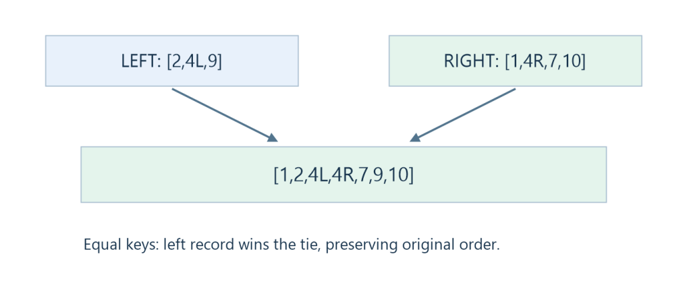
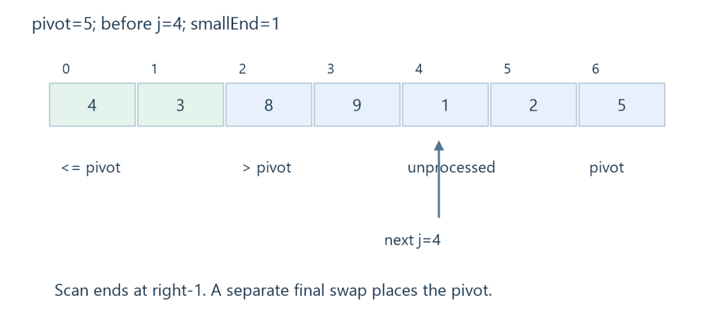
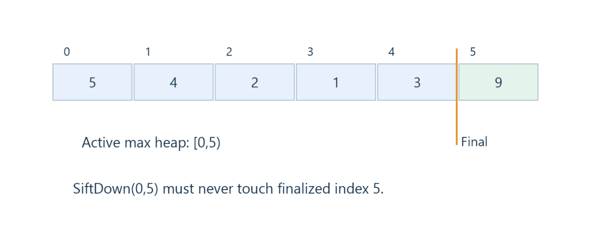
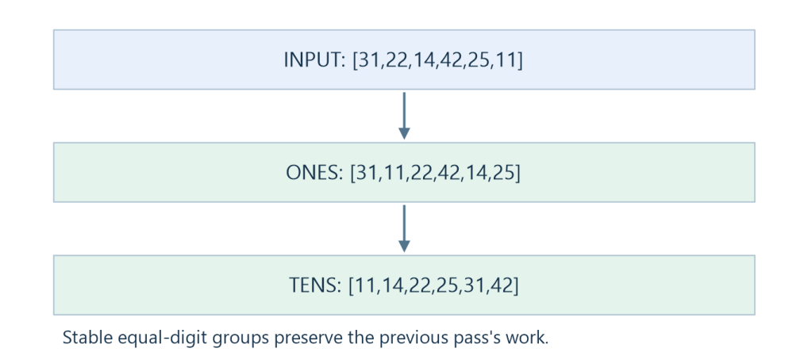

# 17. Sorting Algorithms and Selection

[Topic overview](topics/sorting.md) | [All topics](index.md) | [Revision](revision.md) | [Answer key](answers.md#solutions---chapter-17)

> Adapted from the supplied study-notes PDF, pages 92-104. Examples use [pseudocode](index.md#pseudocode-conventions). [Source notes](index.md#provenance-and-numbering).

??? note "Source coverage and history"
    Chat chapter: 11. Status: completed in the supplied October 24 transcript. This chapter covers all recorded sorting topics and the final corrected comparison table. Examples are consolidated for revision; explicit implementation guards and complexity qualifications are editorial clarifications.

## 17.1 What sorting buys, and what it costs
Sorting creates a monotonic order that enables safe two-pointer elimination, ordinary binary search, adjacent duplicate grouping, interval scans, greedy ordering, and rank operations. It usually changes the original order and incurs preprocessing work.

For unsorted Two Sum, sorting followed by a linear two-pointer scan costs O(n log n), not O(n). If original indices are required, carry (value,originalIndex) pairs. A hash-based alternative may use expected linear time with extra storage; sorting is not automatically the best answer.

Sort intervals [8,10],[1,3],[2,6],[15,18] by start -&gt; [1,3],[2,6],[8,10],[15,18]. For inclusive intervals,

currentStart&lt;=lastMergedEnd means overlap; extend the end with max(lastEnd,currentEnd). Otherwise begin a new merged interval. Only the last merged interval can need extension because start order prevents an earlier disjoint result from overlapping a later arrival.

For half-open intervals [start,end), touching endpoints need not overlap: the contract determines whether equality joins intervals. Event tie rules likewise depend on whether departures free resources before arrivals at the same time.

## 17.2 Stability, adaptiveness, and in-place terminology
A stable sort preserves original order among equal keys. For input (A,80),(B,70),(C,80),(D,70), stable ascending score order is (B,70),(D,70),(A,80),(C,80). Stability concerns full record identity, not merely the numeric key sequence.

Stable multi-pass sorting applies the least important key first, then a stable pass for each more important key. A single comparator can instead encode the complete priority chain directly. A zero comparator result means a tie under the chosen ordering, not complete object equality.

An adaptive algorithm exploits existing order. Insertion Sort performs fewer shifts on nearly sorted input; Selection Sort still scans the entire remaining suffix. In-place partitioning means no second input-sized data array, but a recursive implementation still consumes stack space. Always state both data-movement and call-stack qualifications.

## 17.3 Bubble Sort - Finalize the largest suffix
Swap adjacent inverted pairs. After each full left-to-right pass, the largest remaining value reaches the end of the active range; after p passes, the final p positions contain the largest p values in sorted order.

```pseudocode
PROCEDURE BubbleSort(nums)
    FOR end FROM length(nums) - 1 DOWN TO 1
        swapped <- false
        FOR i FROM 0 TO end - 1
            IF nums[i] > nums[i + 1]
                SWAP nums[i], nums[i + 1]
                swapped <- true
        IF NOT swapped
            BREAK
```

Checkpoint trace [6,3,8,2,5]: swap 6/3 -&gt; [3,6,8,2,5]; 6/8 needs no swap; swap 8/2 -&gt; [3,6,2,8,5]; swap 8/5 -&gt; [3,6,2,5,8]. The 8 is finalized.

If a complete pass makes no swaps, every examined adjacent pair is ordered and the already finalized suffix remains ordered, so stop. Best time Theta(n) with this flag; average/worst Theta(n^2); auxiliary space O(1). Strict inversion swaps preserve equal-key order.

## 17.4 Selection Sort - Finalize the smallest prefix
For each next output position, scan the entire unsorted suffix for its minimum and swap that minimum into place. The invariant is stronger than "the prefix is sorted": it contains the globally smallest finalized values.

```pseudocode
PROCEDURE SelectionSort(nums)
    FOR i FROM 0 TO length(nums) - 2
        smallest <- i
        FOR j FROM i + 1 TO length(nums) - 1
            IF nums[j] < nums[smallest]
                smallest <- j
        SWAP nums[i], nums[smallest]
```

For [7,4,6,2,5], the first minimum is 2; swap with 7 -&gt; [2,4,6,7,5]. The 2 is in its final position. An internally sorted prefix such as [4,7 | 1,2,3] would not establish this invariant.

All input arrangements require n(n-1)/2 comparisons, so best/average/worst are Theta(n^2). There are at most n-1 placement swaps and O(1) auxiliary space. Standard swap-based Selection Sort is unstable: (4,A),(4,B),(1,C) becomes (1,C),(4,B),(4,A) after the first swap, reversing the equal-key records.

## 17.5 Insertion Sort - Grow an ordered prefix
Save the next key, shift larger prefix values right, then fill the gap. Before iteration i, [0,i) is sorted; afterwards [0,i+1) is sorted, but those values need not yet be the globally smallest finalized values.

```pseudocode
PROCEDURE InsertionSort(nums)
    FOR i FROM 1 TO length(nums) - 1
        key <- nums[i]
        j <- i - 1
        WHILE j >= 0 AND nums[j] > key
            nums[j + 1] <- nums[j]
            j <- j - 1
        nums[j + 1] <- key
```

Inserting 3 into [1,4,6,8,3] requires all three shifts: [1,4,6,8,8], [1,4,6,6,8], [1,4,4,6,8], then [1,3,4,6,8]. Saving key prevents those shifts from destroying the value being inserted.

Best time Theta(n); average/worst Theta(n^2); space O(1). Shifting only values strictly greater than key preserves stability. For small or nearly sorted arrays, low overhead and few shifts can outweigh the asymptotic benefit of a more elaborate sort.

## 17.6 Merge Sort - Split by position, combine ordered halves


##### Figure 21. Merge Sort splits by index and combines sorted ranges; equal keys take the left record first.
The contract Sort(left,right) sorts the inclusive subrange. Split with mid=left+(right-left)/2, sort both children, then merge. Before merging, both halves must already be sorted; a pointer then exposes the smallest remaining value from its half.

For indices 0..6, split into 0..3 and 4..6. The left splits into 0..1 and 2..3; the right splits into 4..5 and 6..6. Never invent an index 7 to make the halves equal.

The generic implementation below makes stable record sorting explicit. For int arrays, call MergeSort; the

same merge routine also supports the tagged-record stability exercises.

```pseudocode
PROCEDURE StableMergeSort(nums, compare)
    temp <- array(length(nums))
    PROCEDURE Sort(left, right)
        IF left >= right
            RETURN
        mid <- left + (right - left) DIV 2
        Sort(left, mid)
        Sort(mid + 1, right)
        i <- left
        j <- mid + 1
        write <- left
        WHILE i <= mid AND j <= right
            IF compare(nums[i], nums[j]) <= 0
                temp[write] <- nums[i]
                i <- i + 1
            ELSE
                temp[write] <- nums[j]
                j <- j + 1
            write <- write + 1
        WHILE i <= mid
            temp[write] <- nums[i]
            write <- write + 1
            i <- i + 1
        WHILE j <= right
            temp[write] <- nums[j]
            write <- write + 1
            j <- j + 1
        FOR k FROM left TO right
            nums[k] <- temp[k]
    Sort(0, length(nums) - 1)
```

Merge [2,4,9] with [1,4,7,10]: take 1(R),2(L),4(L),4(R),7(R),9(L),10(R). On equal keys, take the left record first because it appeared earlier in the original range. Taking the right first could reverse equal identities.

Each level processes O(n) total elements across disjoint ranges, and there are O(log n) levels. This implementation has Theta(n log n) best/average/worst time. One reusable O(n) temporary array plus O(log n) active frames gives O(n) peak auxiliary space, not O(n log n). Total allocations over time and simultaneously live memory are different measures.

Do not merge unsorted halves: front values 8 and 7 in [8,2] and [7,1] hide the true minima. Merge Sort is useful for large inputs when stability and worst-case guarantees matter and linear auxiliary memory is acceptable, not only when the input looks "totally out of order".

## 17.7 Lomuto partitioning - Four regions and one final swap


*Figure 22. Lomuto partition maintains four regions and reserves the pivot for a final separate swap.*

Choose nums[right] as pivot. Before each loop iteration j: [left,smallEnd] contains processed values&lt;=pivot; [smallEnd+1,j) contains processed values&gt;pivot; [j,right) is unprocessed; nums[right] is reserved as pivot.

```pseudocode
FUNCTION PartitionLast(nums, left, right)
    pivot <- nums[right]
    smallEnd <- left - 1
    FOR j FROM left TO right - 1
        IF nums[j] <= pivot
            smallEnd <- smallEnd + 1
            SWAP nums[smallEnd], nums[j]
    index <- smallEnd + 1
    SWAP nums[index], nums[right]
    RETURN index
```

### Exact corrected trace: [9,4,8,3,1,2,5]
|**j**|**Inspected value**|**smallEnd after action**|**Array**|
|---|---|---|---|
|**0**|9 &gt; 5; no swap|-1|[9,4,8,3,1,2,5]|
|**1**|4 &lt;= 5; swap 0,1|0|[4,9,8,3,1,2,5]|
|**2**|8 &gt; 5; no swap|0|[4,9,8,3,1,2,5]|
|**3**|3 &lt;= 5; swap 1,3|1|[4,3,8,9,1,2,5]|
|**4**|1 &lt;= 5; swap 2,4|2|[4,3,1,9,8,2,5]|
|**5**|2 &lt;= 5; swap 3,5|3|[4,3,1,2,8,9,5]|

The loop ends before right. Separately swap indices 4 and 6 -&gt; [4,3,1,2,5,9,8], returning pivot index 4. Do not add a fictitious j=6 comparison to the loop trace.

Both partitions can remain internally unsorted. The pivot nevertheless occupies a valid final rank because every left value is&lt;=it and every right value is&gt;it. With duplicate keys, this is one valid sorted position among equal occurrences.

## 17.8 Quick Sort - Recursively order both partitions
```pseudocode
PROCEDURE QuickSort(nums)
    PROCEDURE Sort(left, right)
        IF left >= right
            RETURN
        pivot <- PartitionLast(nums, left, right)
        Sort(left, pivot - 1)
        Sort(pivot + 1, right)
    Sort(0, length(nums) - 1)
```

If a range 2..9 yields pivot 6, recurse on 2..5 and 7..9. Including a finalized pivot can prevent progress: if pivot==right, Sort(left,pivot) repeats the identical range and may overflow the call stack.

Balanced partitions create O(log n) levels with O(n) total partition work per level, yielding O(n log n) time and O(log n) stack. Repeated extreme pivots produce sizes n,n-1,n-2,..., summing to Theta(n^2) work and O(n) stack. Partitioning itself uses O(1) temporary variables; the recursive algorithm does not therefore have O(1) total auxiliary space.

The familiar O(n log n) average bound assumes an appropriate input/pivot distribution. Sorted, reversesorted, or all-equal input can be bad for this last-pivot two-way Lomuto implementation. Randomizing pivots reduces dependence on adversarial distinct-key input order but does not by itself fix all-equal degeneration with this &lt;= partition; three-way partitioning is an extension for duplicate-heavy data.

Standard long-distance swaps make this algorithm unstable. Merge Sort divides by position and performs the main ordering work during merging; Quick Sort divides by pivot value and performs its main work before recursively sorting the partitions.

## 17.9 Heap Sort - Active max heap plus finalized suffix


##### Figure 23. Heap Sort maintains an active max heap before an exclusive boundary and a finalized ascending suffix.
For ascending output, expose the largest remaining item with a max heap, move it to the end of the active range, shrink the range, and restore the heap. The heap array need not be sorted internally.

```pseudocode
PROCEDURE HeapSort(nums)
    PROCEDURE SiftDown(index, size)
        WHILE 2 * index + 1 < size
            child <- 2 * index + 1
            IF child + 1 < size AND nums[child + 1] > nums[child]
                child <- child + 1
            IF nums[index] >= nums[child]
                BREAK
            SWAP nums[index], nums[child]
            index <- child
    FOR i FROM length(nums) DIV 2 - 1 DOWN TO 0
        SiftDown(i, length(nums))
    FOR end FROM length(nums) - 1 DOWN TO 1
        SWAP nums[0], nums[end]
        SiftDown(0, end)
```

For [3,9,2,1,4,5], last nonleaf=2. Sifting 2 swaps with child 5 -&gt; [3,9,5,1,4,2]; index 1 is already valid; index 0 swaps with 9 then with 4 -&gt; [9,4,5,1,3,2]. First extraction swaps root/last -&gt; [2,4,5,1,3,9], then sifts within size 5 -&gt; [5,4,2,1,3 | 9].

Invariant: [0,end) is a valid max heap, while [end,n) contains the largest finalized values in ascending order. In SiftDown(0,end), end is an exclusive index boundary, not the value of the last maximum.

Choose the larger child: parent 2 with children 5 and 8 cannot swap only with 5, since the new parent would still be less than 8. Moving 8 upward restores the parent relationship to both child branches; continue repairing only the displaced value's path.

Bottom-up heap construction is O(n), because most nodes can move only zero or a few levels. Up to n extractions cost O(log n) each, giving O(n log n) worst-case total time and iterative O(1) auxiliary space. Standard root/end swaps are unstable. The usual table's O(n log n) best-case entry is an upper bound; on allequal keys, early-stopping sifts in this concrete implementation can make actual work linear.

## 17.10 Counting Sort - Time and memory depend on key range
For [3,1,2,3,0,2,3], counts over keys 0..3 are [1,1,2,3], reconstructing [0,1,2,2,3,3,3]. At each reconstruction step, the output prefix already contains all smaller keys with their correct frequencies.

For signed values, offset by min. Input [-3,-1,-3,2] has min=-3,max=2, range=6; indices for -3,-1,2 are 0,2,5. Counts [2,0,1,0,0,1] reconstruct [-3,-3,-1,2].

```pseudocode
PROCEDURE CountingSort(nums)
    IF nums is empty
        RETURN
    low <- min(nums)
    high <- max(nums)
    range <- high - low + 1
    REQUIRE range fits the available memory budget
    counts <- array(range, initial = 0)
    FOR EACH value IN nums
        counts[value - low] <- counts[value - low] + 1
    write <- 0
    FOR offset FROM 0 TO range - 1
        REPEAT counts[offset] TIMES
            nums[write] <- low + offset
            write <- write + 1
```

Compute max-min+1 in a sufficiently wide numeric type before allocating.
A representable array length is not a practical memory budget: even a
technically valid count array can be unaffordable. Choose an algorithm using
the actual range and available memory; no silent fallback is hidden here.

Let R=max-min+1 and n=input length. Basic reconstruction takes O(n+R) time and O(R) extra space. It is attractive for one million values restricted to 0..100, where R=101. It is poor for [5,1_000_000_000,20]: a huge frequency range is needed to sort three values.

Primitive-value reconstruction discards record identity. Calling its numeric output "stable" does not demonstrate preservation of equal-key records; a stable record version must place full records into an output array.

## 17.11 Stable Counting Sort - Prefix values are exclusive ends
Compute frequencies, then cumulative counts. Initially counts[key] means number of input records with key&lt;=this key, an exclusive ending position for the key's output block. Scan input right-to-left, place a record at --counts[key], and preserve its full payload.

```pseudocode
FUNCTION StableCountingSort(input, keyRange, key)
    REQUIRE keyRange >= 0 AND every key is in [0, keyRange)
    counts <- array(keyRange, initial = 0)
    FOR EACH item IN input
        k <- key(item)
        counts[k] <- counts[k] + 1
    FOR k FROM 1 TO keyRange - 1
        counts[k] <- counts[k] + counts[k - 1]
    output <- array(length(input))
    FOR i FROM length(input) - 1 DOWN TO 0
        k <- key(input[i])
        counts[k] <- counts[k] - 1
        output[counts[k]] <- input[i]
    RETURN output
```

The key selector must be deterministic during sorting. For frequencies [2,1,3,2], cumulative positions are [2,3,6,8]: key 0 occupies indices 0..1, key 1 index 2, key 2 indices 3..5, key 3 indices 6..7.

For (80,A),(70,B),(80,C), right-to-left placement puts C in the last 80 slot, then A before C, giving (70,B),(80,A),(80,C). Scanning left-to-right while still assigning decreasing end positions would reverse equalkey records. Stable Counting Sort uses O(n+R) time and space, including its output array. [R5]

## 17.12 LSD Radix Sort - Stable passes preserve previous work


*Figure 24. Stable digit passes preserve lower-digit ordering while introducing the next more significant key.*

Sort by ones, then tens, then hundreds, treating absent higher digits as zero. Digit=(value/exp)%10 for exp=1,10,100,... . At each pass, the new digit is primary and the already-processed lower digits break ties through stability.

For 583, the extracted digits at exp 1,10,100,1000 are 3,8,5,0. After sorting [21,13,12] by ones, [21,12,13] is produced. A stable tens pass keeps 12 before 13, giving [12,13,21]. An unstable tens pass could destroy the previous ones ordering.

```pseudocode
PROCEDURE RadixSort(nums)
    REQUIRE all values are nonnegative integers
    maximum <- max(nums, default = 0)
    exp <- 1
    WHILE maximum DIV exp > 0
        output <- StableCountingSort(nums, 10,
            key = FUNCTION(value): (value DIV exp) MOD 10)
        COPY output into nums
        exp <- exp * 10
```

This pseudocode supports nonnegative integer keys and shares the stable
counting helper above. When implementing with fixed-width numbers, use an
exponent type wide enough for the final multiplication, or stop before it
overflows. Arbitrary-precision arithmetic has an additional bit-length cost.

### Corrected checkpoint trace: [31,22,14,42,25,11]
|**Pass**|**Current input's digits**|**Stable result**|
|---|---|---|
|**Ones**|[1,2,4,2,5,1]|[31,11,22,42,14,25]|
|**Tens of the ones-result**|[3,1,2,4,1,2]|[11,14,22,25,31,42]|

Recompute each pass's digit labels from its actual current input. The learner reached the right final array but originally paired tens digits with the old order.

The larger source example passes through [170,90,802,2,24,45,75,66], then [802,2,24,45,66,170,75,90], then [2,24,45,66,75,90,170,802]. Each pass is stable within equal-digit groups.

With d digits and base b, runtime is O(d*(n+b)); live auxiliary space is O(n+b), not O(b), O(n+d), or O(d*n). Repeated passes reuse the role of the working arrays; they do not require retaining all past outputs. Direct Counting Sort depends on the entire key range; Radix Sort depends on the digit base and number of passes. Both exploit restrictions outside arbitrary comparison sorting. [R5]

## 17.13 Quickselect - Follow only the required rank
For one-based kth smallest, target index=k-1; kth largest maps to n-k in ascending order. A finalized pivot tells which partition contains that rank. Unlike Quick Sort, selection does not need both sides fully ordered.

```pseudocode
FUNCTION SelectKthSmallest(nums, k)
    REQUIRE 1 <= k <= length(nums)
    target <- k - 1
    left <- 0
    right <- length(nums) - 1
    WHILE left < right
        pivot <- PartitionLast(nums, left, right)
        IF pivot = target
            RETURN nums[pivot]
        IF pivot < target
            left <- pivot + 1
        ELSE
            right <- pivot - 1
    RETURN nums[left]
```

Find second-smallest in [8,3,6,1,5], target index 1. Last-pivot partition yields [3,1,5,8,6], pivot 2: retain 0..1. Partition [3,1] around 1 -&gt; [1,3,5,8,6], pivot 0: retain 1..1 and return 3. The right suffix need not be globally sorted.

With target 5, pivot 3 discards indices through 3; pivot 7 discards indices from 7 onward. Keep the target index global; do not accidentally compare a subrange-relative rank against an absolute pivot index.

Balanced one-sided work is n+n/2+n/4+...=O(n); balanced full Quick Sort instead processes n elements at each of log n levels. Selection's average linear statement needs input/pivot assumptions, and randomized algorithms can provide expected linear comparison counts; it is not guaranteed halving. The shown deterministic last-pivot code has O(n^2) worst time, especially for bad order or duplicate-heavy degeneration, and iterative O(1) auxiliary space. [R6]

|**Approach for kth largest**|**Time**|**Auxiliary space**|**Appropriate when**|
|---|---|---|---|
|**Full sorting**|O(n log n) for an appropriate<br>comparison sort|Depends on selected sort|Full order is also needed|
|**Size-k min heap**|O(n log(k+1))|O(k)|Streaming, small k, preserve<br>input|
|**Iterative Quickselect**|Average O(n) under suitable<br>assumptions; worst O(n^2)|O(1)|Full mutable array, only a<br>rank needed|

For an even-size median, define whether the contract requests a lower rank, upper rank, or arithmetic mean of the two central values. "Find the median" alone does not specify which single rank to select.

## 17.14 Custom comparisons - One ordered chain of rules
A comparator returns negative if a should precede b, zero for an ordering tie,
and positive if a should follow b. Ascending comparison is `compare(a, b)`;
descending is `compare(b, a)`. Do not implement comparison by subtraction:
fixed-width overflow can reverse the apparent ordering.

Compare primary key; return immediately if different. Only a tie allows the next key to decide. Three independent sorts or lambdas do not automatically implement a single multi-key ordering, particularly with an unstable API.

```pseudocode
FUNCTION CompareEmployees(a, b)
    result <- compareOrdinal(a.Team, b.Team)
    IF result != 0
        RETURN result
    result <- compare(b.Score, a.Score)
    IF result != 0
        RETURN result
    RETURN compareOrdinal(a.Name, b.Name)

FUNCTION CompareIntervals(a, b)
    result <- compare(a.Start, b.Start)
    IF result != 0
        RETURN result
    RETURN compare(b.End, a.End)

FUNCTION CompareFrequencies(a, b)
    result <- compare(b.Frequency, a.Frequency)
    IF result != 0
        RETURN result
    RETURN compare(a.Value, b.Value)

SORT employees using CompareEmployees
SORT intervals using CompareIntervals
SORT items using CompareFrequencies
```

Employees are ordered by team ascending, score descending, name ordinal ascending. Intervals [2,7],[1,4],[2,5],[1,6] become [1,6],[1,4],[2,7],[2,5]. Frequencies (4,2),(1,3),(2,2),(7,1) become (1,3),(2,2),(4,2),(7,1): retain each full value-frequency pair, not just its value.

For length-first string ordering, compare lengths and then compare symbols
ordinally on a tie. For closeness to a numeric target, compute the difference
in a sufficiently wide type before taking its absolute value. Widening after
the subtraction is too late. Tie-break by value when required.

Comparator consistency requires compare(x,x)==0, sign reversal when arguments are reversed, transitivity, and coherent ties. A&lt;B, B&lt;C, C&lt;A is cyclic and cannot define a linear order. State null, culture, case, and tie policies where relevant.

Library sorting algorithms may be unstable and need not be the educational
Quick Sort shown above. Check the library contract instead of relying on input
order among comparator ties. Add an original-index tie-breaker when that order
must be reproduced with an unstable sort. [R4]

## 17.15 Why comparison sorting has a lower bound
For n distinct keys, arbitrary input has n! possible orders. A binary comparison decision tree needs enough leaves to distinguish them. A tree of height h has at most 2^h leaves, so h&gt;=log2(n!).

For n&gt;=2, at least n/2 factors in n! are at least n/2; hence log2(n!) &gt;= (n/2)*log2(n/2)=Omega(n log n). Also n!&lt;=n^n gives an O(n log n) upper bound for that logarithm. Thus the needed worst-case comparison depth is Omega(n log n).

This is a worst-case lower bound for arbitrary comparison-based ordering, not a prohibition on every faster best case or every integer sort. Counting and Radix Sort exploit range/digit structure and additional storage outside that model. Comparison counts also do not automatically equal elapsed time when comparing long strings or expensive custom keys.

## 17.16 Choosing an algorithm and reporting the whole cost
|**Constraint**|**Strong candidate**|**Essential qualification**|
|---|---|---|
|**Small or nearly sorted input**|Insertion Sort|Few shifts, O(1) extra space|
|**Stable output and worst-case O(n log**<br>**n)**|Merge Sort|O(n) auxiliary memory|
|**Worst-case O(n log n), constant**<br>**auxiliary space**|Iterative Heap Sort|Normally unstable|
|**General comparison ordering**|Library sort with explicit comparator|Respect documented stability and<br>memory properties|
|**One million integers in 0..100**|Counting Sort|R=101; simpler than multiple radix<br>passes|
|**Bounded nonnegative digit keys,**<br>**larger numeric range**|LSD Radix Sort|Stable passes, O(n+b) work storage|
|**One rank in a mutable in-memory**<br>**array**|Quickselect|Average versus worst-case distinction|
|**Tenth largest from a stream**|Size-10 min heap|No complete array required|

No algorithm is universally best. Ask about input size, value type/range, existing order, stability, memory budget, permitted mutation, worst-case guarantees, and whether the output needs full ordering or only a rank/Top-K set.

### Consolidated upper-bound table for the implementations in this chapter
|**Algorithm**|**Best / adaptive**<br>**case**|**Average / typical**|**Worst**|**Auxiliary space**|**Stable?**|
|---|---|---|---|---|---|
|**Bubble**|O(n), early stop|O(n^2)|O(n^2)|O(1)|Yes, strict swaps|
|**Selection**|Theta(n^2)<br>comparisons|O(n^2)|O(n^2)|O(1)|No|
|**Insertion**|O(n)|O(n^2)|O(n^2)|O(1)|Yes, strict shifts|
|**Merge**|O(n log n)|O(n log n)|O(n log n)|O(n)|Yes, left tie first|
|**Quick, two-way**<br>**last pivot**|O(n log n)<br>balanced|O(n log n) under<br>suitable<br>distribution|O(n^2)|O(log n) balanced;<br>O(n) worst stack|No|
|**Heap**|O(n log n) upper<br>bound; equal keys<br>may be faster|O(n log n) upper<br>bound|O(n log n)|O(1), iterative|No|
|**Counting**|O(n+R)|O(n+R)|O(n+R)|O(R) basic;<br>O(n+R) stable|Stable record<br>version|
|**Radix, d**<br>**digits/base b**|O(d*(n+b))|O(d*(n+b))|O(d*(n+b))|O(n+b)|If every pass is<br>stable|

The column headings intentionally distinguish upper bounds from tight counts and distribution assumptions. R is key-range size, b is digit base, d is digit count. They are not interchangeable variables.

Sort -&gt; two pointers, interval merge, duplicate grouping, greedy order, event sweep, binary search, or canonical backtracking are useful pipelines. Include sorting in their total complexity. Reusing a sorted representation across many later queries can amortise preprocessing, but one fresh sort plus one scan is still O(n log n).

## 17.17 Corrected checkpoint lessons to remember
- An ordered prefix is not necessarily finalized; Selection Sort needs the globally-smallest-prefix invariant.

- Insertion Sort shifts every larger prefix value, not just the neighbor at the insertion point.

- Odd-sized recursive ranges do not create an extra array index.

- Lomuto's pivot placement is separate from its j&lt;right scan.

- Sorting time, recursive depth, and auxiliary-array size are three different measurements.

- Heap Sort's end is an exclusive index boundary, not a maximum value.

- Counting Sort's storage depends on range; stable Counting Sort also needs output storage.

- Radix passes use the current array order; space depends on n+b, not n+d.

- Quickselect follows one partition but does not guarantee discarding half.

- Stable worst-case sorting points to Merge Sort, not ordinary Heap Sort.

## Check Your Understanding - Chapter 17
Consolidated checkpoints from the supplied teaching and corrected replies. Solutions remain in the final answer key.

### Q17.1

Name four downstream patterns sorting can enable and include preprocessing in a one-scan complexity.

[Solution](answers.md#a171)

### Q17.2

Give the stable ascending score order for (A,80),(B,70),(C,80),(D,70). What is preserved?

[Solution](answers.md#a172)

### Q17.3

Can an in-place array transformation still use O(log n) auxiliary space?

[Solution](answers.md#a173)

### Q17.4

What does Bubble Sort finalize after each pass, and what proves early termination?

[Solution](answers.md#a174)

### Q17.5

Trace one Bubble pass over [6,3,8,2,5].

[Solution](answers.md#a175)

### Q17.6

State the stronger Selection Sort invariant and give a stability counterexample.

[Solution](answers.md#a176)

### Q17.7

Trace every shift when inserting 3 into [1,4,6,8,3].

[Solution](answers.md#a177)

### Q17.8

Compare Bubble, Selection, and Insertion on best time, extra space, and stability.

[Solution](answers.md#a178)

### Q17.9

Split Merge Sort's range 0..6 through one additional level without inventing an index.

[Solution](answers.md#a179)

### Q17.10

Merge [2,4,9] and [1,4,7,10], retaining side labels and stable ties.

[Solution](answers.md#a1710)

### Q17.11

What must be true before Merge, and why is its work linear?

[Solution](answers.md#a1711)

### Q17.12

Derive Merge Sort time and explain peak space versus allocations over time.

[Solution](answers.md#a1712)

### Q17.13

State all four regions in the shown Lomuto partition.

[Solution](answers.md#a1713)

### Q17.14

For [9,4,8,3,1,2,5], give the final partition array/index and explain why the pivot is not an ordinary loop item.

[Solution](answers.md#a1714)

### Q17.15

Why is a partitioned pivot finalized when neither surrounding partition is necessarily sorted?

[Solution](answers.md#a1715)

### Q17.16

For left=2,right=9,pivot=6, give recursive ranges and a failure mode from including pivot again.

[Solution](answers.md#a1716)

### Q17.17

Derive balanced and extreme-pivot Quick Sort time and stack space.

[Solution](answers.md#a1717)

### Q17.18

Does a randomized pivot guarantee half-size partitions or fix all-equal Lomuto input?

[Solution](answers.md#a1718)

### Q17.19

Build a max heap from [3,9,2,1,4,5] and perform the first Heap Sort extraction.

[Solution](answers.md#a1719)

### Q17.20

State Heap Sort's active-prefix/final-suffix invariant and why SiftDown uses end as exclusive.

[Solution](answers.md#a1720)

### Q17.21

Explain the larger-child rule, heap-build time, extraction time, and iterative space.

[Solution](answers.md#a1721)

### Q17.22

For [-3,-1,-3,2], give range, offset indices, frequencies, and output.

[Solution](answers.md#a1722)

### Q17.23

When is Counting Sort attractive? Distinguish basic and stable-record space.

[Solution](answers.md#a1723)

### Q17.24

What do cumulative counts [2,3,6,8] represent, and which direction preserves stability with decreasing end positions?

[Solution](answers.md#a1724)

### Q17.25

Explain why integer-key reconstruction alone does not establish record stability.

[Solution](answers.md#a1725)

### Q17.26

Give digits of 583 for exponents 1,10,100,1000 and both stable passes for [31,22,14,42,25,11].

[Solution](answers.md#a1726)

### Q17.27

State the LSD Radix invariant, time/space parameters, and exponent-overflow correction.

[Solution](answers.md#a1727)

### Q17.28

For n=10, convert fourth-smallest, third-largest, largest, and smallest to ascending zero-based indices.

[Solution](answers.md#a1728)

### Q17.29

Trace second-smallest selection in [8,3,6,1,5] with last-pivot partitioning.

[Solution](answers.md#a1729)

### Q17.30

Why can Quickselect be linear on average while Quick Sort is n log n? Include caveats and mutation.

[Solution](answers.md#a1730)

### Q17.31

Define comparator return signs, safe descending int order, and a transitivity failure.

[Solution](answers.md#a1731)

### Q17.32

How must team ascending, score descending, name ascending be combined? What does an ordering tie mean?

[Solution](answers.md#a1732)

### Q17.33

Derive the comparison-sort lower bound and explain why Counting/Radix do not contradict it.

[Solution](answers.md#a1733)

### Q17.34

Select methods for a compact integer range, stable guaranteed sorting, nearly sorted small input, minimal-memory guaranteed sorting, one rank, and streaming Top-K.

[Solution](answers.md#a1734)

## Additional practice - Chapter 17
### E17.1

Sort (A,80),(B,70),(C,80),(D,70) stably by score, then explain why an unspecified library sort cannot be assumed stable.

[Solution](answers.md#e171)

### E17.2

Compare one Selection Sort step and one Insertion Sort insertion for the examples [7,4,6,2,5] and [1,4,6,8,3].

[Solution](answers.md#e172)

### E17.3

Merge tagged halves [(4,A),(7,B)] and [(4,C),(6,D)] stably.

[Solution](answers.md#e173)

### E17.4

For pivot 6, partition [4,2,7,3,6] and identify what is proved and not proved.

[Solution](answers.md#e174)

### E17.5

Contrast heap construction and complete Heap Sort on [4,10,3,5,1].

[Solution](answers.md#e175)

### E17.6

Stably count-sort [(80,A),(70,B),(80,C)] and describe prefix ending positions.

[Solution](answers.md#e176)

### E17.7

Run Radix Sort on [170,45,75,90,802,24,2,66] and identify peak working storage.

[Solution](answers.md#e177)

### E17.8

Give rank-selection indices and approaches for median, fifth-largest mutable array, twentieth-largest stream, and all values ordered.

[Solution](answers.md#e178)

### E17.9

Apply both comparators: intervals start ascending/end descending; items frequency descending/value ascending.

[Solution](answers.md#e179)

### E17.10

Choose for one million integers 0..100 and for a stable guaranteed O(n log n) record sort; explain two rejected alternatives.

[Solution](answers.md#e1710)

---

[All coding chapters](index.md) | [Previous chapter](16-backtracking.md) | [Next chapter](18-graphs.md)
