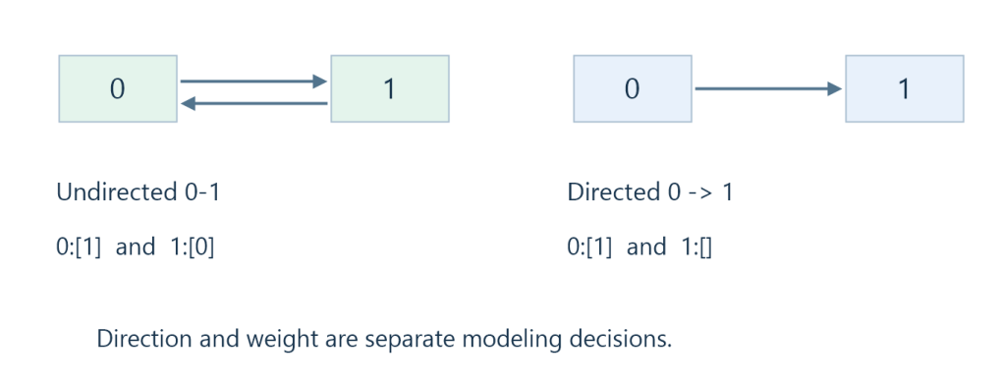
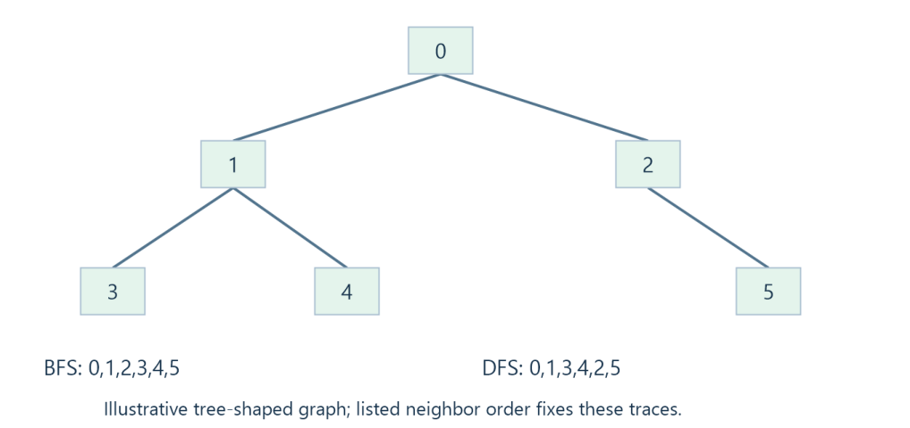
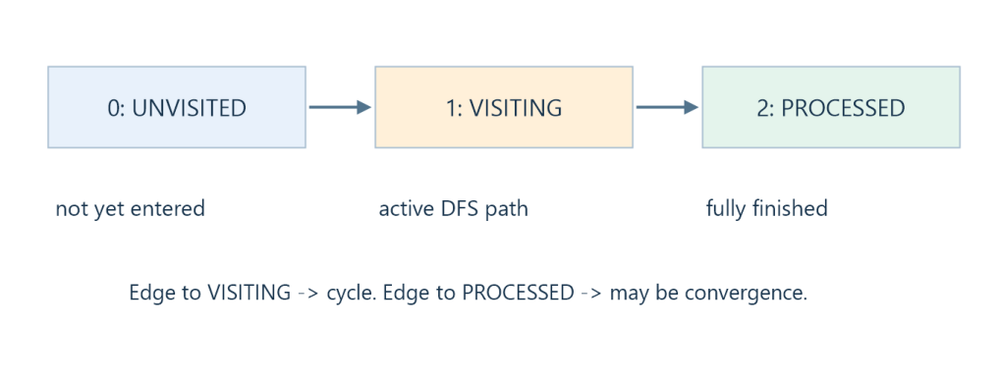
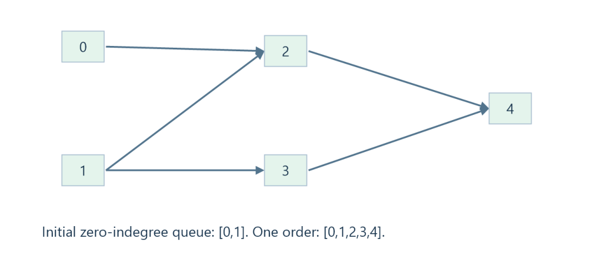
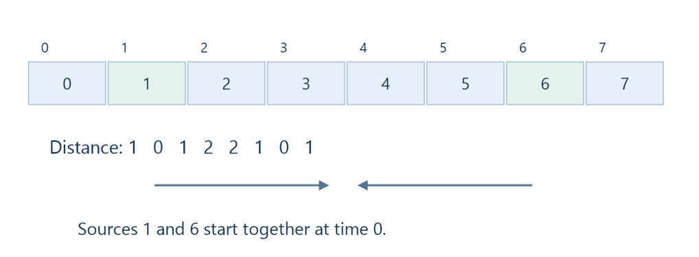
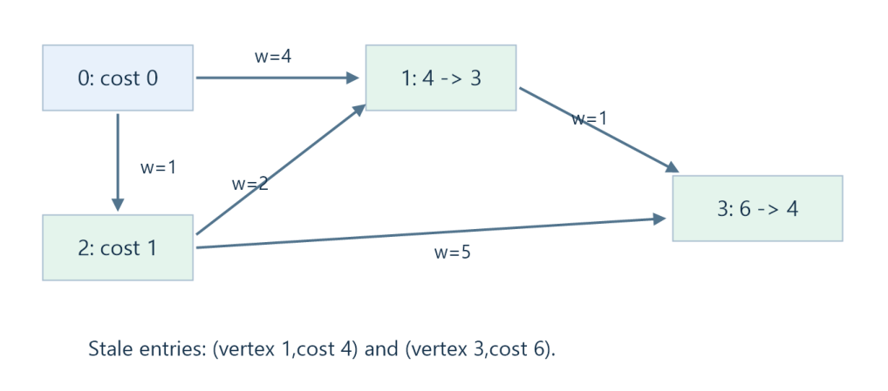
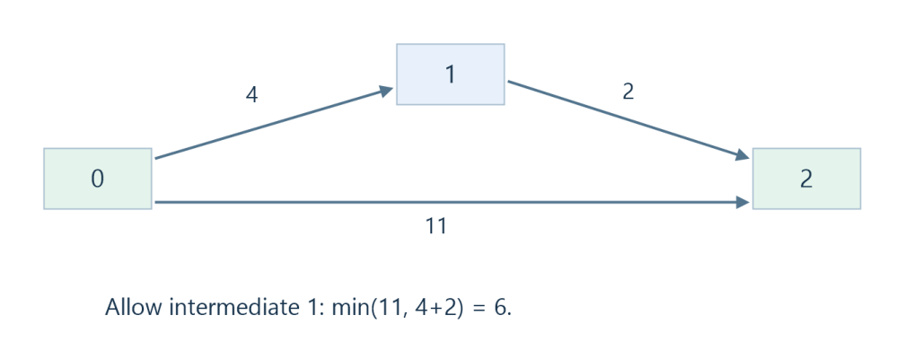
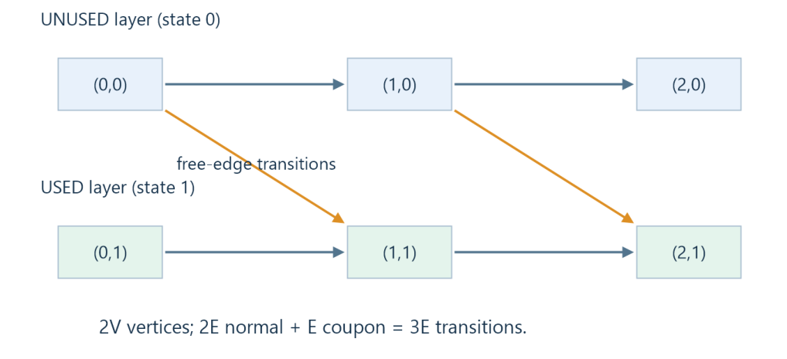
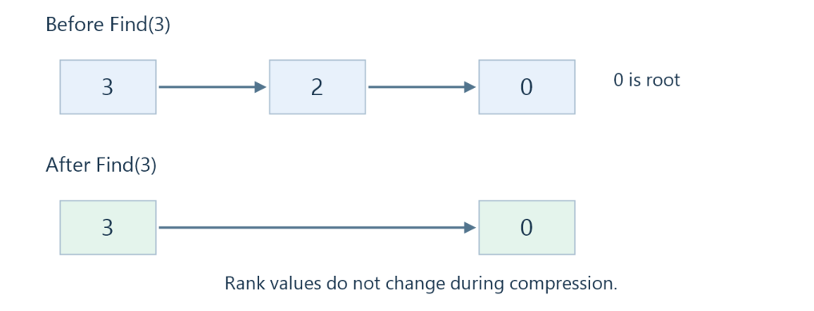
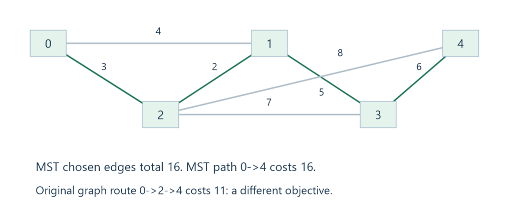

# 18. Graphs

[Topic overview](topics/graphs.md) | [All topics](index.md) | [Revision](revision.md) | [Answer key](answers.md#solutions---chapter-18)

> Adapted from the supplied study-notes PDF, pages 105-129. Examples use [pseudocode](index.md#pseudocode-conventions). [Source notes](index.md#provenance-and-numbering).

??? note "Source coverage and history"
    Chat chapter: 12. Status: completed in the supplied October 24-26 transcript, which explicitly closes Graphs after Prim and then supplies a consolidated theory recap. Dynamic Programming follows this source's handoff and is now documented in Chapter 19. This handbook keeps its existing numbering: chat Chapter 12 is this Chapter 18, not the earlier binary-tree revision chapter numbered 12.

    The source contains the teaching, learner answers, corrected traces, and a final recap. This chapter consolidates those study portions, omits unrelated exchanges and UI, and supplies complete implementations where the chat gave only a pattern. Newly drawn examples and implementation caveats are explanatory additions, not claims of extra completed lessons. In particular, 0-1 BFS is retained at the recognition/selection level taught in the source.

## 18.1 Graph models and representation contracts


*Figure 25. Undirected edges appear in both lists; directed edges encode only their stated direction.*

A graph G=(V, E) models entities as vertices and relationships as edges. Vertices can represent cities, services, courses, accounts, or cells; an edge is the precise allowed relationship or movement, not simply anything visually nearby.

Directedness and weight are independent. Mutual friendships are naturally undirected/unweighted; follows and prerequisites are directed/unweighted; a two-way road with travel time is undirected/weighted; a oneway road with time is directed/weighted. Weight does not imply direction.

A directed edge u-&gt;v contributes v to u's adjacency list, not u to v's. An undirected edge contributes both entries. For edges 0-1,0-2,1-3,2-3, the lists are 0:[1,2],1:[0,3],2:[0,3],3:[1,2]. There are four vertex lists and eight neighbor entries, not four entries. The source checkpoint corrected this distinction.

|**Representation**|**Storage**|**Check edge u, v**|**Enumerate**<br>**neighbors of u**|**Useful when**|
|---|---|---|---|---|
|**Adjacency list**|O(V+E)|O(degree(u)) for a<br>plain list|O(degree(u))|Sparse traversal|
|**Adjacency matrix**|O(V^2)|O(1)|O(V)|Dense input or<br>frequent edge tests|
|**Edge list**|O(V+E) including<br>vertex metadata|Usually O(E) without<br>another index|Usually O(E)|Global edge passes or<br>sorting|

For an undirected graph, lists store 2 E entries; O(V+2 E)=O(V+E). A million sparse vertices makes a full matrix impractical. A dictionary representation must still account for isolated and sink vertices; an absent outgoing edge is not an absent vertex.

The runnable snippets below use dense IDs 0..V-1, non-null lists for every vertex, and valid endpoint indices. Weighted edges use int costs while accumulated distances use long. Undirected algorithms require symmetric adjacency. The parent-vertex DFS cycle implementation assumes a simple undirected graph; parallel-edge models need edge IDs to distinguish the incoming edge from another edge to the same parent.

```pseudocode
FUNCTION GraphBuild(count, edges, directed = false)
    REQUIRE count >= 0
    graph <- array of count independent empty lists
    FOR EACH (u, v) IN edges
        REQUIRE 0 <= u < count AND 0 <= v < count
        graph[u].append(v)
        IF NOT directed
            graph[v].append(u)
    RETURN graph
```

## 18.2 BFS - Schedule each vertex once, by distance layer
BFS keeps a FIFO queue of discovered but not yet processed vertices. Initialize source distance 0; all others - 1. Assign distance and parent when enqueuing a neighbor, not when removing it. Scheduling reserves the vertex so another frontier vertex cannot enqueue it again.

In the diamond 0-&gt;1,0-&gt;2,1-&gt;3,2-&gt;3, marking only after dequeue can schedule 3 twice. Marking at discovery gives one queue entry. Distances can double as visited flags because -1 means no discovery yet.

```pseudocode
FUNCTION GraphBfsPaths(graph, source)
    REQUIRE source is a valid vertex
    distance <- array(length(graph), initial = -1)
    parent <- array(length(graph), initial = -1)
    queue <- empty queue
    distance[source] <- 0
    queue.enqueue(source)
    WHILE queue is not empty
        u <- queue.dequeue()
        FOR EACH v IN graph[u]
            IF distance[v] = -1
                distance[v] <- distance[u] + 1
                parent[v] <- u
                queue.enqueue(v)
    RETURN (distance, parent)
```

### Corrected source trace - Shared six-vertex traversal
Use lists 0:[1,2],1:[0,3,4],2:[0,4,5],3:[1],4:[1,2],5:[2], in that order.

|**Removed**|**Newly scheduled**|**Queue afterwards**|
|---|---|---|
|**0**|1,2|[1,2]|
|**1**|3,4|[2,3,4]|
|**2**|5; 4 is already discovered|[3,4,5]|
|**3**|none|[4,5]|

|**Removed**|**Newly scheduled**|**Queue afterwards**|
|---|---|---|
|**4**|none|[5]|
|**5**|none|[]|

The traversal is 0,1,2,3,4,5 and distances are [0,1,1,2,2,2]. Neighbor order changes within-level order and sometimes the selected parent, not shortest edge-count distances.

Why is first discovery shortest? A vertex discovered from layer d-1 gets distance d. If a shorter route existed, its predecessor would have been processed at an earlier layer and discovered the vertex sooner. A four-edge shortest route has three intermediate vertices, not four; distinguish vertices from edges.

BFS minimizes edge count, and hence total cost when each edge has the same nonnegative cost. It does not minimize arbitrary weights: a direct cost-100 edge can lose to two cost-1 edges. Graph traversal visits vertices and adjacency entries, not every possible path.

Core queue work on a reachable region is O(Vr+Er). This array-based implementation also initializes V slots, so its full time is O(V+Er), bounded by O(V+E). Extra arrays and queue use O(V). Matrix-based neighbor scans instead give O(V^2) for a full traversal.

## 18.3 DFS - Finish a reachable region before returning


##### Figure 26. BFS explores distance layers while DFS suspends ancestor calls and follows a branch.
The recursive contract is: Visit(u) marks and explores every vertex reachable from u through the still-unvisited region available to this call. Mark upon entry before exploring neighbors. A visited neighbor is inspected, not recursively entered again.

For the shared graph above, recursive DFS gives 0,1,3,4,2,5. The call structure is 0-&gt;1, with 1's first child 3 and second child 4; then 4-&gt;2-&gt;5. Vertex 2 is discovered under 4 even though 0 also lists 2. On returning to 0, that later neighbor is already visited.

```pseudocode
FUNCTION GraphDfsOrder(graph, source)
    REQUIRE source is a valid vertex
    visited <- array(length(graph), initial = false)
    order <- empty list
    PROCEDURE Visit(u)
        visited[u] <- true
        order.append(u)
        FOR EACH v IN graph[u]
            IF NOT visited[v]
                Visit(v)
    Visit(source)
    RETURN order
```

Recursive DFS uses O(depth) active frames, up to O(V) on a chain. Merely saying graph DFS is O(log V) confuses it with balanced-tree height. Its time is O(V+E) including vertex-array setup and all relevant adjacency scans.

An explicit stack can preserve suspended neighbor positions, exactly like recursion. This avoids runtime callstack depth limits while keeping O(V) live frames.

```pseudocode
FUNCTION GraphDfsFrames(graph, source)
    REQUIRE source is a valid vertex
    seen <- array(length(graph), initial = false)
    order <- list containing source
    stack <- empty stack
    seen[source] <- true
    stack.push((source, 0))
    WHILE stack is not empty
        (u, next) <- stack.pop()
        IF next = length(graph[u])
            CONTINUE
        stack.push((u, next + 1))
        v <- graph[u][next]
        IF seen[v]
            CONTINUE
        seen[v] <- true
        order.append(v)
        stack.push((v, 0))
    RETURN order
```

The simpler source pattern pushes neighbors in reverse order and marks when popped. It is also a valid traversal, but pending duplicate entries can use O(E) stack space. Marking on push prevents duplicates but can change which branch discovers a shared vertex. The frame version makes exact recursive order and O(V) active-stack storage explicit rather than promising those properties for every iterative DFS variant.

Use BFS for minimum equal-cost moves or flights counted as steps. Either BFS or DFS works for reachability and regions. DFS is natural for structural entry/exit reasoning, dependencies, and cycles; it need not enumerate every path to answer connectivity.

## 18.4 Connected components - Restart only from unvisited vertices
In an undirected graph, a component is a maximal mutually reachable group. An isolated vertex is a component of size one. A source-only traversal cannot reach another component.

Loop over all V vertices with one shared visited array. Each unvisited root starts one new component and explores its whole region. The loop does not multiply total traversal cost: vertices and edges are partitioned among the component traversals.

```pseudocode
FUNCTION GraphCountComponents(graph)
    REQUIRE graph is undirected
    seen <- array(length(graph), initial = false)
    count <- 0
    FOR start FROM 0 TO length(graph) - 1
        IF seen[start]
            CONTINUE
        count <- count + 1
        queue <- empty queue
        seen[start] <- true
        queue.enqueue(start)
        WHILE queue is not empty
            u <- queue.dequeue()
            FOR EACH v IN graph[u]
                IF NOT seen[v]
                    seen[v] <- true
                    queue.enqueue(v)
    RETURN count
```

The corrected source example contains edges 0-1,0-2,1-3,2-3,4-5,4-6 and isolated 7. Its three components are {0,1,2,3},{4,5,6},{7}; vertex 6 is connected to 4, not isolated. Roots in ascending order are 0,4,7; counts become 1,2,3.

This notion is undirected connectivity. Repeating arbitrary directed reachability searches does not compute strongly connected components, whose vertices must reach each other in both directions. SCC algorithms are not presented as newly completed material.

## 18.5 Undirected cycles - Ignore the one incoming parent edge
Every undirected edge appears twice in adjacency. While exploring 1 after arriving from 0, the neighbor 0 is already visited because it is the same incoming edge represented backwards. Ignore neighbor==parent. A visited neighbor!=parent closes a cycle in the simple-graph model.

```pseudocode
FUNCTION GraphHasUndirectedCycle(graph)
    REQUIRE graph is a simple undirected graph
    seen <- array(length(graph), initial = false)
    FUNCTION Visit(u, parent)
        seen[u] <- true
        FOR EACH v IN graph[u]
            IF NOT seen[v]
                IF Visit(v, u)
                    RETURN true
            ELSE IF v != parent
                RETURN true
        RETURN false
    FOR u FROM 0 TO length(graph) - 1
        IF NOT seen[u] AND Visit(u, -1)
            RETURN true
    RETURN false
```

For square edges 0-1,1-2,2-3,3-0, actual calls can be Visit(0,-1), Visit(1,0), Visit(2,1), Visit(3,2). The edge 3-0 detects the cycle because 0 is visited but is not parent 2. No additional recursive call is made to an already visited parent.

Pass the current node as the child's parent, not the current call's parent. Propagate a child's true result; ignoring the recursive return can erase a deeper discovery. The outer loop is necessary when the cycle lies outside vertex 0's component.

Self-loops are cycles. For a multigraph, two distinct parallel edges can form a length-two cycle under that model; use incoming edge identity rather than skipping all edges whose endpoint equals the parent. State that model explicitly instead of silently applying the simple-graph proof.

## 18.6 Directed cycles and DFS topological order


*Figure 27. Only an edge into the active visiting path proves a directed DFS cycle; convergence to processed state is different.*

Two directed paths can converge without cycling: 0-&gt;1-&gt;3 and 0-&gt;2-&gt;3. A visited boolean cannot distinguish an active ancestor from an already finished branch.

Use states 0=unvisited,1=visiting,2=processed. Visiting means on the active DFS path. An edge to state 1 closes a directed cycle; an edge to state 2 is safe for cycle detection. On safe exit, mark processed. Leaving a completed node visiting would create false cycle reports.

For a DAG, append a vertex only after finishing its outgoing neighbors, then reverse the finish list. Every prerequisite edge u-&gt;v must place u before v. This one routine performs directed-cycle detection and produces an order only when the graph is acyclic. [R7]

```pseudocode
FUNCTION GraphDirectedDfs(graph)
    state <- array(length(graph), initial = UNSEEN)
    finish <- empty list
    FUNCTION Visit(u)
        state[u] <- ACTIVE
        FOR EACH v IN graph[u]
            IF state[v] = ACTIVE
                RETURN true
            IF state[v] = UNSEEN AND Visit(v)
                RETURN true
        state[u] <- FINISHED
        finish.append(u)
        RETURN false
    FOR u FROM 0 TO length(graph) - 1
        IF state[u] = UNSEEN AND Visit(u)
            RETURN (HasCycle = true, Order = [])
    REVERSE finish
    RETURN (HasCycle = false, Order = finish)
```

For 0-&gt;1,1-&gt;2,2-&gt;1, edge 2-&gt;1 points to visiting 1 and detects the cycle. For the convergence DAG, the second edge into finished 3 is not a back edge.

The directed parent-skip rule would miss a two-way directed cycle u-&gt;v-&gt;u: unlike an undirected reverse representation, these are two actual directed edges. Keep the two cycle-detection models separate.

## 18.7 Kahn's topological sort - Remove satisfied prerequisites


*Figure 28. Kahn schedules only vertices whose incoming prerequisites have all been removed.*

Indegree[v] counts incoming edges. Initially enqueue every zero-indegree vertex, including isolated vertices. On removing u, append it and decrement each successor's indegree; enqueue a successor exactly when its remaining prerequisite count becomes zero.

```pseudocode
FUNCTION GraphKahn(graph)
    indegree <- array(length(graph), initial = 0)
    FOR EACH neighbors IN graph
        FOR EACH v IN neighbors
            indegree[v] <- indegree[v] + 1
    queue <- empty queue
    FOR u FROM 0 TO length(graph) - 1
        IF indegree[u] = 0
            queue.enqueue(u)
    order <- empty list
    WHILE queue is not empty
        u <- queue.dequeue()
        order.append(u)
        FOR EACH v IN graph[u]
            indegree[v] <- indegree[v] - 1
            IF indegree[v] = 0
                queue.enqueue(v)
    RETURN (IsDag = length(order) = length(graph), Order = order)
```

Invariant: queued vertices have no unresolved incoming dependency in the remaining graph. If processedCount&lt;V, some vertices remain locked by a directed cycle. The returned prefix is not a valid complete schedule when IsDag is false.

Illustrative DAG: 0-&gt;2,1-&gt;2,1-&gt;3,2-&gt;4,3-&gt;4. Initial queue [0,1]; one valid order is [0,1,2,3,4]. After 0, vertex 2 still needs 1. Topological order need not be unique: unrelated vertices can exchange positions if every edge remains forward.

Both Kahn and cycle-aware DFS topological sorting use O(V+E) time and O(V) working state. A DAG permits the empty order for an empty graph; a self-loop prevents any full topological order.

## 18.8 Bipartite graphs - Alternate colors across every edge
A graph is bipartite when vertices can be divided into two sets with every edge crossing between the sets. For undirected graphs, this is equivalent to having no odd cycle. Even cycles can alternate colors consistently; an odd cycle forces a same-color closing edge.

Use -1 for uncolored and 0/1 for colors. Uncolored neighbors get 1-color[u]; an already colored neighbor must differ. Start a new coloring BFS in every uncolored component.

```pseudocode
FUNCTION GraphIsBipartite(graph)
    REQUIRE graph is undirected
    color <- array(length(graph), initial = -1)
    FOR start FROM 0 TO length(graph) - 1
        IF color[start] != -1
            CONTINUE
        color[start] <- 0
        queue <- empty queue
        queue.enqueue(start)
        WHILE queue is not empty
            u <- queue.dequeue()
            FOR EACH v IN graph[u]
                IF color[v] = -1
                    color[v] <- 1 - color[u]
                    queue.enqueue(v)
                ELSE IF color[v] = color[u]
                    RETURN false
    RETURN true
```

Square 0-1-2-3-0 can color {0,2} versus {1,3}. Triangle 0-1-2-0 cannot. A disconnected triangle still invalidates the entire graph even when the component containing 0 is bipartite. A self-loop is an immediate same-color conflict.

This code expects undirected adjacency. If a directed problem asks only for a two-group edge separation, form its undirected constraint graph first; do not assume this incoming/outgoing traversal convention is interchangeable with directed reachability.

## 18.9 Grids are implicit graphs
Each traversable cell is a vertex; allowed movement creates edges without materializing neighbor lists. A wall removes transitions. Four-directional movement is up/down/left/right; eight-directional movement additionally allows diagonals. The problem contract determines which cells are connected.

Check bounds before reading grid[nr, nc] or visited[nr, nc]. With four directions, each cell examines at most four candidates, so full traversal is O(R*C), not O((R*C)^2).

```pseudocode
FUNCTION GraphIslandCount(grid)
    (rows, cols) <- dimensions(grid)
    seen <- rows by cols matrix filled with false
    steps <- [(-1, 0), (1, 0), (0, -1), (0, 1)]
    islands <- 0
    FOR EACH cell (r, c) IN grid, in row-major order
        IF grid[r, c] != 1 OR seen[r, c]
            CONTINUE
        islands <- islands + 1
        queue <- empty queue
        seen[r, c] <- true
        queue.enqueue((r, c))
        WHILE queue is not empty
            (cr, cc) <- queue.dequeue()
            FOR EACH (dr, dc) IN steps
                (nr, nc) <- (cr + dr, cc + dc)
                IF (nr, nc) is outside grid
                    CONTINUE
                IF grid[nr, nc] != 1 OR seen[nr, nc]
                    CONTINUE
                seen[nr, nc] <- true
                queue.enqueue((nr, nc))
    RETURN islands
```

Here 1 is land and other cells are not land; the routine preserves input and uses an O(R*C) visited matrix/queue. Flood fill uses the same region traversal but updates a specified color. If mutation is allowed, a changed cell value can act as visited, but a BFS frontier still consumes memory; mutation alone does not make every traversal O(1) space.

For diagonal cells in a 2-by-2 grid, four-directional connectivity gives two islands while eight-directional connectivity gives one. Confirm the neighbor model before reasoning from a drawing.

## 18.10 Multi-source BFS - All sources form time zero


##### Figure 29. Sources 1 and 6 share the initial time-zero frontier; distances measure the nearer source.
Put every source in the queue at distance 0 before processing any. The single combined wavefront then discovers each vertex at its distance to the nearest source, not its distance from whichever source happened to be traversed first.

```pseudocode
FUNCTION GraphNearestSources(graph, sources)
    distance <- array(length(graph), initial = -1)
    queue <- empty queue
    FOR EACH source IN sources
        REQUIRE source is a valid vertex
        IF distance[source] = -1
            distance[source] <- 0
            queue.enqueue(source)
    WHILE queue is not empty
        u <- queue.dequeue()
        FOR EACH v IN graph[u]
            IF distance[v] = -1
                distance[v] <- distance[u] + 1
                queue.enqueue(v)
    RETURN distance
```

For line 0-1-2-3-4-5-6-7 with sources 1 and 6, initial queue=[1,6] and final distances=[1,0,1,2,2,1,0,1]. The waves meet between 3 and 4; neither middle vertex is scheduled twice.

The grid checkpoint has exactly three rows, four columns, and sources (0,0),(1,3), with no obstacles. Distance is the minimum Manhattan distance to those two sources. The corrected matrix is:


&lt;!-- Start of picture text --&gt;
3<br>1<br>&lt;!-- End of picture text --&gt;

|**Row / column**<br>**0**<br>**1**|**2**<br>**3**|
|---|---|
|**0**<br>0<br>1|2<br>1|

|**Row / column**|**0**|**1**|**2**<br>**3**|
|---|---|---|---|
|**1**|1|2|1<br>0|
|**2**|2|3|2<br>1|

The mistaken answer treated the second source as (2,3). Preserve the actual source coordinates; multisource correctness cannot repair a changed input.

K independent traversals repeat work, potentially O(K*(V+E)), while one shared traversal costs O(V+E+K) including source enumeration. A grid scan finds at most R*C distinct sources, so the total remains O(R*C). Separately computing distances from each source and taking their minimum can be correct but inefficient; sequentially mutating spread state can additionally model the wrong timing.

## 18.11 Simultaneous propagation and unreachable targets
To count rounds, snapshot levelSize=queue.Count and process exactly that many current-time cells. Newly enqueued neighbors belong to the next round, not the current one. Alternatively, store explicit arrival times and take the greatest required target time.

The following four-directional model uses 2=initial source,1=target,0=blocked, and mutates newly reached targets to 2. It explicitly checks invalid cell codes rather than interpreting them as successful spread.

```pseudocode
FUNCTION GraphSpreadMinutes(grid)
    REQUIRE each cell is 0 (empty), 1 (target), or 2 (source)
    queue <- all source cells in row-major order
    remaining <- number of target cells
    minutes <- 0
    WHILE remaining > 0 AND queue is not empty
        levelSize <- size(queue)
        REPEAT levelSize TIMES
            cell <- queue.dequeue()
            FOR EACH orthogonal neighbor next of cell inside grid
                IF grid[next] = 1
                    grid[next] <- 2
                    remaining <- remaining - 1
                    queue.enqueue(next)
        minutes <- minutes + 1
    RETURN minutes IF remaining = 0 ELSE -1
```

No targets initially -&gt; 0; targets left when the queue empties -&gt; -1; all reached -&gt; elapsed rounds. With rows [2,0,1]/[0,0,1]/[1,1,1], the source at (0,0) is blocked on every valid side; all five targets remain unreachable and the answer is -1. No sources with any targets also returns -1.

## 18.12 Reconstruct one shortest path with parents
Distance records a cost or number of steps; parent records a preceding vertex ID, never a distance value. BFS fixes the first parent at discovery because its first distance is shortest. Different neighbor orders may select different equal-length paths.

For lists 0:[1,2],1:[0,3,4],2:[0,4],3:[1,5],4:[1,2,5],5:[3,4], BFS from 0 discovers 3 before 4. Final distances are [0,1,1,2,2,3] and parents [-1,0,0,1,1,3]. The selected path to 5 is 0-&gt;1-&gt;3-&gt;5. Path 0-&gt;1-&gt;4-&gt;5 is equally short, but its existence does not change this exact first-parent trace.

```pseudocode
FUNCTION GraphRestorePath(parent, source, destination)
    REQUIRE source and destination are valid vertices
    path <- empty list
    node <- destination
    REPEAT at most length(parent) TIMES
        IF node = -1
            RETURN []
        REQUIRE node is a valid vertex
        path.append(node)
        IF node = source
            REVERSE path
            RETURN path
        node <- parent[node]
    IF node = -1
        RETURN []
    ERROR "Cyclic parent chain"
```

Call with a valid shortest-path parent forest rooted at the specified source. Returning [] means its parent chain does not reach that source. For source==destination, the path is [source]. A malformed cycle is an error, not a valid unreachable result.

BFS may stop on first discovery of the one requested destination, since that fixes its minimum edge count. It cannot then claim every other distance is final or explored. A full-source result is produced by the earlier routine.

## 18.13 Choose the shortest-path algorithm from its edge contract
|**Path problem**|**First technique**|**What must be true**|
|---|---|---|
|**Fewest equal-cost moves**|BFS|Unit or same nonnegative edge cost|
|**Nearest of several simultaneous**<br>**sources**|Multi-source BFS|Sources share initial distance; same-<br>cost moves|
|**Edge costs only 0 or 1**|0-1 BFS|Relax distances; zero edges go to<br>deque front, one edges to back|
|**Single-source nonnegative weighted**<br>**paths**|Dijkstra|No negative edge in the validated graph|
|**Single-source paths with negative**<br>**edges**|Bellman-Ford|Detect reachable negative cycles<br>before trusting affected results|
|**All-pairs paths**|Floyd-Warshall|O(V^3) time/O(V^2) matrix acceptable;<br>interpret negative cycles|
|**Path with coupons, fuel, keys, or stop**<br>**constraints**|State expansion, then choose again|State contains every fact affecting<br>future transitions|

0-1 BFS was discussed for selection and its deque rule; it is not ordinary FIFO BFS with a different label. A zero-cost move should not increase distance. These notes do not claim a separate completed advanced 0-1 implementation exercise.

## 18.14 Weighted arithmetic and infinity are part of the contract
Use sufficiently wide numbers for accumulated path costs and totals, even
when individual weights fit a smaller type. `INFINITY` denotes unreachable;
never relax from an unreachable source or add infinity to a weight. If the
implementation reserves a finite machine value as its sentinel, reject any
finite result that collides with that value.

Finite addition can still overflow. The shared helper below throws on overflow or on colliding with the reserved infinity value. This is an explicit error rather than wrapping, clamping, or turning an unrepresentable finite path into "unreachable".

```pseudocode
FUNCTION GraphAddCost(value, weight)
    REQUIRE value and weight are finite
    result <- CHECKED_ADD(value, weight)
    REQUIRE result does not collide with the unreachable sentinel
    RETURN result
```

The code assumes representable intermediate costs. Bellman-Ford on a negative cycle and Floyd-Warshall with repeatedly improving negative walks can produce large magnitudes; a real overflow is surfaced even though the intended graph problem might instead require arbitrary precision. The lesson's infinity guard prevents sentinel arithmetic, not every possible arithmetic error.

## 18.15 Dijkstra - Tentative discovery versus final extraction


##### Figure 30. A later relaxation can replace a tentative cost; obsolete lazy queue entries are skipped.
Initialize distance[source]=0 and all others infinity; parent=-1. A successful relaxation of u-&gt;v with weight w computes candidate=distance[u]+w, and if smaller, updates distance[v], parent[v]=u and enqueues v with priority candidate.

Nonnegative weights justify greedy finalization: when the least current non-stale distance is removed, any later path through an unsettled vertex cannot return with a smaller cost. The first queue insertion is only the best route known so far, not final.

Lazy queues insert a new entry after every improvement rather than changing the old priority. On removal, skip entries whose priority no longer matches distance[u]. Only current entries expand outgoing edges. Equal-priority removal order is not guaranteed FIFO and need not change shortest distances.

```pseudocode
FUNCTION GraphDijkstra(graph, source)
    REQUIRE source is a valid vertex AND every edge weight is nonnegative
    distance <- array(length(graph), initial = INFINITY)
    parent <- array(length(graph), initial = -1)
    queue <- empty min-priority queue
    distance[source] <- 0
    queue.insert(source, priority = 0)
    WHILE queue is not empty
        (u, popped) <- queue.removeMinWithPriority()
        IF popped != distance[u]
            CONTINUE
        FOR EACH (v, weight) IN graph[u]
            candidate <- GraphAddCost(popped, weight)
            IF candidate < distance[v]
                distance[v] <- candidate
                parent[v] <- u
                queue.insert(v, priority = candidate)
    RETURN (Distance = distance, Parent = parent)
```

This version rejects negative edges anywhere in the supplied graph before search, even in unreachable components, so callers cannot accidentally use it as a partially validated negative-weight algorithm. Valid adjacency endpoints remain the shared representation precondition.

### Corrected source trace A
Edges: 0-&gt;1(4),0-&gt;2(1),2-&gt;1(2),1-&gt;3(1),2-&gt;3(5).

|**Event**|**Distances [0,1,2,3]**|**Parents [0,1,2,3]**|
|---|---|---|
|**Initialize**|[0, INF, INF, INF]|[-1,-1,-1,-1]|
|**Expand 0**|[0,4,1, INF]|[-1,0,0,-1]|
|**Expand 2 at cost 1**|[0,3,1,6]|[-1,2,0,2]|
|**Expand 1 at cost 3**|[0,3,1,4]|[-1,2,0,1]|

The final path is 0-&gt;2-&gt;1-&gt;3, cost 4. Entries (vertex 1, cost 4) and (vertex 3, cost 6) both become stale. Stopping when 3 first enters would return 6 incorrectly; stop only when destination 3 is removed with its current distance 4.

### Corrected source trace B
Edges: 0-&gt;1(7),0-&gt;2(2),0-&gt;3(10),1-&gt;4(1),2-&gt;1(3),2-&gt;3(4),2-&gt;4(9),3-&gt;4(2). Final distance=[0,5,2,6,6], parent=[1,2,0,2,1], path to 4=0-&gt;2-&gt;1-&gt;4, cost 6.

Stale entries are (1,7),(3,10),(4,11). Vertices 3 and 4 both finalize at cost 6, so either tie order is valid. The source learner copied distances into the final parent array; keep those two result meanings separate.

Negative-edge counterexample: 0-&gt;1(3),0-&gt;2(5),2-&gt;1(-4). The first removal of 1 would accept 3, but route 0- &gt;2-&gt;1 costs 1. Dijkstra's finalization/early-stop proof is invalid; a lazy implementation that happens to reprocess an improvement on one example has not regained its nonnegative-weight guarantees. [R8]

For this lazy implementation, validation/initialization is O(V+E), successful relaxations and inserted entries are O(E+1), and queue operations cost O(log(E+2)). A robust bound is O(V+E*log(E+2)), with O(V+E) extra arrays/queue. For simple graphs, log E=O(log V), yielding the familiar O((V+E)*log V) upper bound. An indexed decrease-key heap instead bounds queue vertices directly; do not silently use its storage bound for a lazy queue with duplicate entries.

## 18.16 Bellman-Ford - Repeated edge relaxation, including negatives
A simple finite shortest path can be chosen with at most V-1 edges when no relevant negative cycle exists. V- 1 complete edge passes suffice; after pass p, every reachable shortest path using at most p edges has been accounted for, and in-place edge order may propagate farther during the same pass.

An entire unchanged pass permits early stopping. After the ordinary passes, any reachable edge that can still improve proves a reachable negative cycle. Vertices on that cycle and reachable downstream have no finite shortest distance, because repeated loops reduce the cost without bound.

```pseudocode
FUNCTION GraphBellmanFord(count, edges, source)
    REQUIRE source is a valid vertex
    distance <- array(count, initial = INFINITY)
    parent <- array(count, initial = -1)
    distance[source] <- 0
    FOR pass FROM 1 TO count - 1
        changed <- false
        FOR EACH (u, v, weight) IN edges
            IF distance[u] = INFINITY
                CONTINUE
            candidate <- GraphAddCost(distance[u], weight)
            IF candidate < distance[v]
                distance[v] <- candidate
                parent[v] <- u
                changed <- true
        IF NOT changed
            BREAK
    FOR EACH (u, v, weight) IN edges
        IF distance[u] != INFINITY
            IF GraphAddCost(distance[u], weight) < distance[v]
                RETURN (distance, parent, HasNegativeCycle = true)
    RETURN (distance, parent, HasNegativeCycle = false)
```

HasNegativeCycle is a mandatory interpretation flag. When true, the arrays are intermediate labels, not a promise of valid finite shortest distances for all vertices; do not reconstruct an affected parent chain. The routine detects a source-reachable cycle, not every negative cycle anywhere.

### Exact ordered-edge checkpoint
Count=4, source=0; edge order: 2-&gt;3(3),1-&gt;2(-2),0-&gt;1(4),0-&gt;2(5),1-&gt;3(6).

|**Pass**|**Distance array**|**Parent array**|
|---|---|---|
|**Initial**|[0, INF, INF, INF]|[-1,-1,-1,-1]|
|**1**|[0,4,5,10]|[-1,0,0,1]|
|**2**|[0,4,2,8]|[-1,0,1,2]|
|**3**|[0,4,2,5]|[-1,0,1,2]|

Pass 2 scans 2-&gt;3 before improving 2, so 3 must wait until pass 3 to benefit. Pass 3 changed a value; it did not satisfy the no-change early-stop condition. The separate final detection scan makes no improvement, confirming no reachable negative cycle. Path 0-&gt;1-&gt;2-&gt;3 costs 5.

### Exact negative-cycle checkpoint
Edges in order: 0-&gt;1(1),1-&gt;2(-2),2-&gt;1(-1),2-&gt;3(2). Cycle 1-&gt;2-&gt;1 has cost -3.

|**Pass**|**Correct in-place distances**|
|---|---|
|**1**|[0,-2,-1,1]|
|**2**|[0,-5,-4,-2]|
|**3**|[0,-8,-7,-5]|

After pass 3, edge 1-&gt;2 can still lower -7 to -10, proving the cycle. Earlier updates within a pass immediately affect later edges; do not freeze an entire previous-pass array unless using a different explicitly two-buffer variant.

An unreachable negative cycle is ignored because all its starting labels remain infinity. To detect any negative cycle anywhere, a super-source model is an extension. Standard edge-pass time is O(V*E) plus O(V) initialization; auxiliary arrays are O(V), excluding input. [R8]

## 18.17 Floyd-Warshall - Grow the set of allowed intermediates


*Figure 31. Allowing intermediate 1 replaces direct cost 11 by route 0-&gt;1-&gt;2 with cost 6.*

This all-pairs DP uses distance[i, j]. Initialize diagonal to 0, direct edges to their minimum cost, and other entries to infinity. Parallel edges require the minimum direct cost; a negative self-loop must not be overwritten by the diagonal zero.

For each intermediate k, try distance[i, k]+distance[k, j]. The old path either avoids k or splits into i-&gt;k and k- &gt;j. After stage k, paths may use intermediates 0..k. Therefore k is the outer loop in the standard in-place recurrence.

```pseudocode
FUNCTION GraphFloydWarshall(count, edges)
    REQUIRE count >= 0
    distance <- count by count matrix filled with INFINITY
    FOR i FROM 0 TO count - 1
        distance[i, i] <- 0
    FOR EACH (u, v, weight) IN edges
        distance[u, v] <- min(distance[u, v], weight)
    FOR k FROM 0 TO count - 1
        FOR i FROM 0 TO count - 1
            IF distance[i, k] = INFINITY
                CONTINUE
            FOR j FROM 0 TO count - 1
                IF distance[k, j] = INFINITY
                    CONTINUE
                candidate <- GraphAddCost(distance[i, k], distance[k, j])
                distance[i, j] <- min(distance[i, j], candidate)
    negative <- ANY distance[i, i] < 0
    RETURN (distance, HasNegativeCycle = negative)
```

The source checkpoint uses edges 0-&gt;1(4),0-&gt;2(11),1-&gt;2(2),2-&gt;0(3).

|**Stage**|**Row 0**|**Row 1**|**Row 2**|
|---|---|---|---|
|**Initial**|[0,4,11]|[INF,0,2]|[3, INF,0]|
|**k=0**|[0,4,11]|[INF,0,2]|[3,7,0]|
|**k=1**|[0,4,6]|[INF,0,2]|[3,7,0]|
|**k=2**|[0,4,6]|[5,0,2]|[3,7,0]|

Thus d(0,2)=6, d(1,0)=5, d(2,1)=7. The directed cycle 0-&gt;1-&gt;2-&gt;0 makes every ordered pair reachable. This is strong connectivity, not merely an undirected connection.

Time is O(V^3) and matrix space O(V^2). Negative edges are allowed, but if any distance[k, k]&lt;0, pairs that can reach that k and then reach their destination have unbounded-below path cost. The flag reports existence; this implementation does not mark every affected pair as negative infinity. Negative diagonals represent a negative closed walk, which implies a negative cycle; they need not identify only the literal cycle vertices. [R9]

## 18.18 State-expanded shortest paths - Node identity includes future options


##### Figure 32. The coupon's unused and used layers are separate vertices with one-way state-changing transitions.
One physical vertex is not enough when future transitions depend on coupon use, fuel, keys, stops, movement mode, or removed obstacles. Define (vertex, extraState), and only merge histories when they permit the same future actions at the same cost rules.

For one optional free-edge coupon, states are (u,0)=unused,(u,1)=used. For original edge u-&gt;v(w), normal transitions are (u,0)-&gt;(v,0) and (u,1)-&gt;(v,1), each cost w; the coupon transition is (u,0)-&gt;(v,1), cost 0. There is no used-to-unused transition.

The complete executable version below builds the two-layer graph and reuses the tested Dijkstra helper rather than duplicating its relaxation loop. Original weights must be nonnegative.

```pseudocode
FUNCTION GraphCouponDistances(graph, source)
    REQUIRE every original edge weight is nonnegative
    expanded <- array of 2 * length(graph) independent empty lists
    FOR EACH edge (u, v, weight) IN graph
        expanded[2 * u].append((2 * v, weight))
        expanded[2 * u + 1].append((2 * v + 1, weight))
        expanded[2 * u].append((2 * v + 1, 0))
    result <- GraphDijkstra(expanded, 2 * source).Distance
    distance <- length(graph) by 2 matrix
    FOR u FROM 0 TO length(graph) - 1
        distance[u, 0] <- result[2 * u]
        distance[u, 1] <- result[2 * u + 1]
    RETURN distance
```

Initial distance is 0 for (source,0), infinity for (source,1). Starting the used layer at zero would represent consumed status without actually traversing an edge; it changes the stated semantics, especially when use is mandatory. A reachable zero-cost cycle can legitimately reach the source's used layer later.

For optional use, answer=min(d[target,0], d[target,1]); mandatory use requires the used-state result specifically. If both are infinity, the target is unreachable under either state.

Exact source example: 0-&gt;1(5),0-&gt;2(2),2-&gt;1(1),1-&gt;3(4),2-&gt;3(10). Best route 0-&gt;2-&gt;3 uses the coupon on cost10 edge 2-&gt;3, total 2. Final unused distances=[0,3,2,7], used distances=[INF,0,0,2]. The direct coupon arrival (1,1) costs 0, so its normal outgoing cost to (3,1) is 4, not 6.

Reaching a vertex cheaply with coupon used does not dominate every more expensive unused arrival: the latter still has a future free edge. A single long[] distance would discard that distinction.

There are exactly 2 V expanded vertices,2 E normal transitions, E coupon transitions, total 3 E. For constant two-state expansion, asymptotic shape is unchanged from Dijkstra. For S resource states, measure actual expanded vertices V' and transitions E'; costs can grow dramatically, particularly key masks with S=2^K. Distance-table O(V*S) is not the whole lazy-queue/materialized-edge storage.

## 18.19 Union-Find - Merge component representatives


*Figure 33. Union links representatives; Find compresses the particular chain it traverses.*

DSU maintains disjoint sets under connectivity additions; it does not natively split components after edge deletion. Each root points to itself. Find follows parents to the representative; path compression shortens only the nodes actually encountered by Find.

Union finds both roots and attaches one root to the other. Union by rank avoids tall trees; with equal ranks, the implementation below attaches the second root under the first and increments only the first root's rank. Rank is a historical upper-bound measure, not the exact current height after compression.

```pseudocode
DATA STRUCTURE GraphDisjointSet(count)
    REQUIRE count >= 0
    parent <- [0, 1, ..., count - 1]
    rank <- array(count, initial = 0)
    Components <- count

    FUNCTION Find(node)
        REQUIRE node is a valid index
        IF parent[node] != node
            parent[node] <- Find(parent[node])
        RETURN parent[node]

    FUNCTION Union(a, b)
        ra <- Find(a)
        rb <- Find(b)
        IF ra = rb
            RETURN false
        IF rank[ra] < rank[rb]
            parent[ra] <- rb
        ELSE
            parent[rb] <- ra
            IF rank[ra] = rank[rb]
                rank[ra] <- rank[ra] + 1
        Components <- Components - 1
        RETURN true

    FUNCTION Connected(a, b)
        RETURN Find(a) = Find(b)
```

Union by size is an alternative: store a size at each root and attach the smaller component under the larger. Do not combine an exact-size explanation with rank updates that merely increment on ties.

### Exact source rank/compression trace
|**Operation**|**Immediate parent array**|**Rank array**|
|---|---|---|
|**Initially**|[0,1,2,3,4,5]|[0,0,0,0,0,0]|
|**Union(0,1)**|[0,0,2,3,4,5]|[1,0,0,0,0,0]|
|**Union(2,3)**|[0,0,2,2,4,5]|[1,0,1,0,0,0]|
|**Union(1,2)**|[0,0,0,2,4,5]|[2,0,1,0,0,0]|
|**Union(4,5)**|[0,0,0,2,4,4]|[2,0,1,0,1,0]|

Vertex 3 still follows 3-&gt;2-&gt;0 until Find(3) compresses it to 3-&gt;0. Losing root 2's stored rank stays 1; it is not reset, and compression does not change rank. Calling Connected(0,3) invokes Find(3) and can already perform that compression before another inspection.

With compression and rank/size, initialization is O(V), a sequence of operations has near-constant amortized O(alpha(V)) per operation, and storage is O(V). This is not a promise that each individual Find is strict worstcase O(1). The parent tree is a component representation, not necessarily a path using original graph edges.

## 18.20 Detect undirected cycles with DSU
Process each undirected input edge once, not both adjacency copies. If its endpoints already share a representative, an existing path plus the new edge makes a cycle. Union returning false conveniently expresses this.

```pseudocode
FUNCTION GraphHasDsuCycle(count, edges)
    REQUIRE each undirected edge is listed once
    dsu <- GraphDisjointSet(count)
    FOR EACH (u, v) IN edges
        IF NOT dsu.Union(u, v)
            RETURN true
    RETURN false
```

For edges 0-1,1-2,3-4,2-3,4-1,4-5, component counts are 6 initially then 5,4,3,2,2,1. Edge 4-1 is redundant and creates cycle 1-2-3-4-1. Vertex 0 is connected to that component but is not part of this particular cycle.

The final 4-5 edge joins root 0 and isolated root 5, so it is accepted. Failing union does not decrement components. Directed convergence may share a weak component without any directed cycle, so DSU is not a substitute for stateful directed DFS/Kahn.

DSU detects the existence of a redundant edge but does not itself reconstruct its original graph cycle. Preserve accepted-edge adjacency and search the endpoints if that actual route is required.

## 18.21 MSTs optimize total connection cost, not source routes


*Figure 34. Minimum total connection cost and minimum source-to-target route cost are different objectives.*

A spanning tree connects every vertex of a connected undirected graph without cycles and has V-1 edges. A minimum spanning tree minimizes the sum of its chosen edge weights. It is not a shortest-path tree.

The cut-property exchange argument explains both MST algorithms: take a cheapest crossing edge of a cut respected by the current forest. If an optimum tree lacks it, adding it creates a cycle containing another crossing edge of no smaller weight; exchanging preserves or reduces cost. Thus some optimum can include the safe edge. With ties, a minimum crossing edge belongs to some MST, not necessarily every MST. [R10]

MST weights may be negative; they are not restricted like Dijkstra costs. Disconnected input has no single spanning tree and instead admits a minimum spanning forest. Equal-weight edges can permit different optimal trees; distinct edge weights are sufficient, though not necessary, for uniqueness.

## 18.22 Kruskal - Cheapest global edge joining distinct components
Sort edges by weight, maintain DSU for the selected forest, and accept only edges joining different roots. Each accepted edge merges two trees. On connected input, V-1 accepted edges complete the MST.

The implementation copies and sorts the input edge array and returns component count explicitly. A disconnected forest is not silently labelled a successful connected MST.

```pseudocode
FUNCTION GraphKruskal(count, edges)
    dsu <- GraphDisjointSet(count)
    sorted <- copy(edges) sorted by ascending weight
    selected <- empty list
    total <- 0
    FOR EACH (u, v, weight) IN sorted
        IF dsu.Union(u, v)
            selected.append((u, v, weight))
            total <- GraphAddCost(total, weight)
            IF dsu.Components = 1
                BREAK
    RETURN (selected, total, dsu.Components)
```

### Exact five-vertex source graph
Edges are 0-1(4),0-2(3),1-2(2),1-3(5),2-3(7),2-4(8),3-4(6).

|**Edge in sorted order**|**Decision**|**Running selected weight**|
|---|---|---|
|**1-2 (2)**|Accept, merge roots|2|
|**0-2 (3)**|Accept|5|
|**0-1 (4)**|Reject; existing 0-2-1 path|5|
|**1-3 (5)**|Accept|10|
|**3-4 (6)**|Accept; four selected edges, stop|16|

Weights 7 and 8 need not be processed after the MST completes. The tree's path 0-&gt;2-&gt;1-&gt;3-&gt;4 costs 16, while the original graph has 0-&gt;2-&gt;4 costing 11. Kruskal minimized total network construction, not that pair's route.

For V vertices and E edges, include O(V) DSU initialization, O(E log(E+1)) sorting, and O(E*alpha(V)) DSU processing. A safe full bound is O(V+E log(E+1)+E*alpha(V)); the common O(E log E) shorthand assumes edges dominate vertex setup. This copy-based version additionally stores O(E) sorted edges and selected output plus O(V) DSU.

## 18.23 Prim - Cheapest edge crossing out of the current tree
Prim starts at one vertex and grows a connected tree. A priority represents one candidate crossing-edge weight, not accumulated source distance. If maintaining key[v], update with edgeWeight, not key[u]+edgeWeight.

The lazy edge-queue version holds candidates (from, to, weight). Skip a removed edge if to is already included. A starting entry (from=-1, to=start, weight=0) seeds the tree without adding an artificial graph edge.

```pseudocode
FUNCTION GraphPrim(graph, start)
    REQUIRE start is a valid vertex in an undirected weighted graph
    inside <- array(length(graph), initial = false)
    queue <- empty min-priority queue
    selected <- empty list
    queue.insert((-1, start, 0), priority = 0)
    total <- 0
    reached <- 0
    WHILE queue is not empty AND reached < length(graph)
        (from, to, weight) <- queue.removeMin()
        IF inside[to]
            CONTINUE
        inside[to] <- true
        reached <- reached + 1
        IF from != -1
            selected.append((from, to, weight))
            total <- GraphAddCost(total, weight)
        FOR EACH (v, nextWeight) IN graph[to]
            IF NOT inside[v]
                queue.insert((to, v, nextWeight), priority = nextWeight)
    RETURN (selected, total, SpansAll = reached = length(graph))
```

For disconnected input, this returns the minimum tree of the starting component with SpansAll=false. To compute a whole minimum forest, restart at each outside vertex or use Kruskal's forest result. Empty input has no valid start for this method; a one-vertex graph returns no edges, total 0, SpansAll=true.

On the source five-vertex graph from 0: accept 0-2(3), then 2-1(2), skip old 0-1(4), accept 1-3(5), accept 3- 4(6), total 16. Entries 2-3(7) and 2-4(8) remain unused when the loop stops; they were not necessarily removed and skipped. The source corrected that distinction.

Starting at 4 can change the acceptance order. It does not change the optimal total. This graph has distinct weights and a unique MST, so its edge set also stays the same.

Lazy edge-queue time is O(V+E log(E+2)) for a full connected traversal with list storage; O(E log V) is a standard simple-connected-graph shorthand. Queue storage can be O(E), not only O(V). A matrix Prim implementation with linear minimum selection can run in O(V^2) time without a heap. [R10]

## 18.24 Selection map, invariants, and complexity reference
|**Signal**|**Technique**|**Invariant to explain aloud**|
|---|---|---|
|**Reachable region**|BFS/DFS|Each scheduled/entered vertex is<br>tracked|
|**All undirected components**|Outer loop plus traversal|Unvisited root means new component|
|**Undirected cycle**|Parent-aware DFS or DSU|Ignore incoming edge; or accept only<br>distinct roots|
|**Directed cycle**|Three-state DFS or Kahn|Active-path back edge; or incomplete<br>processing count|
|**Prerequisite order**|Topological sort|Every directed edge points forward|
|**Two-group separation**|Bipartite coloring|Adjacent endpoints have opposite<br>colors|
|**Matrix connectivity**|Implicit graph|Bounds and terrain define legal<br>neighbors|
|**Simultaneous sources**|Multi-source BFS|Shared time-zero frontier|
|**Nonnegative shortest cost**|Dijkstra|Non-stale minimum removal finalizes<br>distance|
|**Negative edges/cycles**|Bellman-Ford|Complete passes propagate paths;<br>extra improvement detects cycle|
|**All ordered-pair costs**|Floyd-Warshall|Newly allowed intermediate set grows<br>by k|
|**Limited-use actions**|Expanded-state search|Distinct future options require distinct<br>state IDs|
|**Incremental merges**|DSU|Roots identify components|

|**Signal**|**Technique**|**Invariant to explain aloud**|
|---|---|---|
|**Cheapest network**|Kruskal/Prim|Accepted edges remain safe for some<br>optimum|
|**Algorithm**|**Time including stated setup**|**Working storage beyond graph input**|
|**BFS, DFS, components,**<br>**cycle/color/topological checks**|O(V+E)|O(V); pop-mark iterative variants may<br>queue duplicates|
|**Grid traversal/spread**|O(R*C)|O(R*C)|
|**Multi-source graph BFS**|O(V+E+K)|O(V), K source entries scanned|
|**Lazy Dijkstra**|O(V+E log(E+2))|O(V+E) including lazy queue|
|**Bellman-Ford**|O(V+V*E)|O(V)|
|**Floyd-Warshall**|O(V^3+E) including direct-edge setup|O(V^2) distance matrix|
|**DSU initialization and M operations**|O(V+M*alpha(V)) amortized|O(V)|
|**Kruskal, copy/sort version**|O(V+E log(E+1)+E*alpha(V))|O(V+E), including edge copy|
|**Lazy Prim, connected graph**|O(V+E log(E+2))|O(V+E)|
|**State expansion**|Substitute actual V' and E' into chosen<br>algorithm|Distance plus frontier/materialized<br>transitions|

Output arrays, paths, and chosen tree edges are stated separately where relevant. For simple connected graphs, the familiar heap O((V+E)log V) and Kruskal O(E log E) bounds are useful shorthand; do not erase setup costs for isolated vertices or the lazy queue's extra entries.

## 18.25 Corrected checkpoint lessons and remaining scope
- Weight does not imply direction; count neighbor entries separately from vertex lists.

- BFS marks at enqueue; recursive DFS marks on entry before exploring neighbors.

- Traversal order depends on adjacency order; one parent array chooses one valid path.

- Read explicit edges and coordinates; the source's vertex 6 and grid source (1,3) were misread.

- Ignore neighbor==parent for undirected DFS; detect active state 1 for directed DFS.

- Propagate recursive true; finish safe directed calls as processed.

- Kahn needs processedCount==V; DFS topological sorting appends on exit, then reverses.

- Dijkstra's first insertion is tentative; final non-stale extraction is decisive.

- Distances are costs; parents are vertex IDs. Track all obsolete queue entries.

- Bellman-Ford uses earlier updates later in the same pass; a changed final ordinary pass is not no-change early stopping.

- Floyd-Warshall needs k outermost, guarded finite arithmetic, and negative-cycle interpretation.

- Expanded-state tables include the resource dimension; a coupon gives 2 V states and 3 E transitions.

- Union links roots, not arbitrary nodes; it does not compress every descendant or reset losing ranks.

- A DSU forest is not the original graph's route tree.

- MST minimizes total edge weight; Prim priorities are single connection costs, not source distances.

- Distinguish actually skipped queue entries from entries left unused after early completion.

Graphs is complete according to the pasted continuation. Its next-track handoff was Dynamic Programming; see the later Chapter 19 for that track's lessons and current checkpoint status. Advanced SCCs, max-flow, full dynamic connectivity with deletions, and a separate 0-1 BFS implementation course are not newly asserted completed topics.

## Check Your Understanding - Chapter 18
Consolidated checkpoints from the supplied teaching and corrected replies. Solutions remain in the final answer key.

### Q18.1

Classify mutual friendships, one-way follows, two-way roads with travel times, and prerequisites. Does weight determine direction?

[Solution](answers.md#a181)

### Q18.2

For edges 0-1,0-2,1-3,2-3, give adjacency lists, vertex-list count, and neighbor-entry count.

[Solution](answers.md#a182)

### Q18.3

Compare list, matrix, and edge-list representations and handling of sink/isolated vertices.

[Solution](answers.md#a183)

### Q18.4

State BFS's queue invariant and the precise time to mark a neighbor visited.

[Solution](answers.md#a184)

### Q18.5

Trace BFS for 0:[1,2],1:[0,3,4],2:[0,4,5],3:[1],4:[1,2],5:[2].

[Solution](answers.md#a185)

### Q18.6

Why is first BFS discovery shortest, and what does discovering X at distance 4 mean?

[Solution](answers.md#a186)

### Q18.7

For the same graph, give recursive DFS order and who first calls vertex 2.

[Solution](answers.md#a187)

### Q18.8

State DFS's postcondition and explain why reachability does not enumerate every possible path.

[Solution](answers.md#a188)

### Q18.9

What differs between recursive DFS, frame-stack DFS, and a simple mark-on-pop vertex stack?

[Solution](answers.md#a189)

### Q18.10

Correct the components for edges 0-1,0-2,1-3,2-3,4-5,4-6 with isolated 7; give new roots.

[Solution](answers.md#a1810)

### Q18.11

Why does an outer loop over all components not multiply total BFS/DFS work by component count?

[Solution](answers.md#a1811)

### Q18.12

In undirected cycle DFS, distinguish the ignore and detection conditions, and the child's parent argument.

[Solution](answers.md#a1812)

### Q18.13

Trace cycle detection on 0-1-2-3-0 and identify which extra calls must not occur.

[Solution](answers.md#a1813)

### Q18.14

Why distinguish unvisited, visiting, and processed in directed DFS?

[Solution](answers.md#a1814)

### Q18.15

Explain why 0-&gt;1-&gt;3 and 0-&gt;2-&gt;3 is acyclic while 1-&gt;2-&gt;1 is not.

[Solution](answers.md#a1815)

### Q18.16

State Kahn's initial queue, update rule, invariant, and cycle test.

[Solution](answers.md#a1816)

### Q18.17

Why does DFS topological sorting append on exit and reverse? Must the result be unique?

[Solution](answers.md#a1817)

### Q18.18

Define bipartiteness and give square, triangle, self-loop, and disconnected cases.

[Solution](answers.md#a1818)

### Q18.19

How does a grid become an implicit graph, and when do diagonal cells belong to one island?

[Solution](answers.md#a1819)

### Q18.20

State multi-source initialization and give distances for line 0..7 with sources 1 and 6.

[Solution](answers.md#a1820)

### Q18.21

Give the corrected 3-by-4 nearest-source matrix for sources(0,0),(1,3), with no obstacles.

[Solution](answers.md#a1821)

### Q18.22

Why snapshot queue.Count for propagation time, and what are the no-target/unreachable rules?

[Solution](answers.md#a1822)

### Q18.23

For grid [2,0,1]/[0,0,1]/[1,1,1], which targets can be reached and what is returned?

[Solution](answers.md#a1823)

### Q18.24

For path lists 0:[1,2],1:[0,3,4],2:[0,4],3:[1,5],4:[1,2,5],5:[3,4], give exact BFS parents/path to 5.

[Solution](answers.md#a1824)

### Q18.25

Compare safe one-destination stopping in BFS and Dijkstra.

[Solution](answers.md#a1825)

### Q18.26

Choose for equal costs,0/1 costs, nonnegative arbitrary costs, negative edges, and all pairs.

[Solution](answers.md#a1826)

### Q18.27

What does a full Dijkstra relaxation update, and why can two entries for the same vertex remain?

[Solution](answers.md#a1827)

### Q18.28

For 0-&gt;1(4),0-&gt;2(1),2-&gt;1(2),1-&gt;3(1),2-&gt;3(5), give final distances, parents, path, and both stale entries.

[Solution](answers.md#a1828)

### Q18.29

Give the corrected final arrays and tie caveat for the five-vertex Dijkstra trace B.

[Solution](answers.md#a1829)

### Q18.30

Why does edge 2-&gt;1(-4) break finalization after 0-&gt;1(3),0-&gt;2(5)?

[Solution](answers.md#a1830)

### Q18.31

Explain lazy Dijkstra queue/time bounds without silently assuming decrease-key storage.

[Solution](answers.md#a1831)

### Q18.32

Why V-1 Bellman-Ford passes, and when is early stopping legitimate?

[Solution](answers.md#a1832)

### Q18.33

Give all three distance arrays in the ordered-edge Bellman-Ford checkpoint and its final path.

[Solution](answers.md#a1833)

### Q18.34

For negative-cycle edges 0-&gt;1(1),1-&gt;2(-2),2-&gt;1(-1),2-&gt;3(2), give pass arrays and the proving extra relaxation.

[Solution](answers.md#a1834)

### Q18.35

What does source reachability change in negative-cycle detection and parent reconstruction?

[Solution](answers.md#a1835)

### Q18.36

State Floyd-Warshall initialization, recurrence, loop order, and parallel/self-edge details.

[Solution](answers.md#a1836)

### Q18.37

Give the three improved entries and final Floyd matrix for edges 0-&gt;1(4),0-&gt;2(11),1-&gt;2(2),2-&gt;0(3).

[Solution](answers.md#a1837)

### Q18.38

What does a negative Floyd diagonal prove, and are all pairs necessarily invalid?

[Solution](answers.md#a1838)

### Q18.39

Why do finite guards alone not guarantee safe path arithmetic?

[Solution](answers.md#a1839)

### Q18.40

List all three transitions per edge with one optional free-edge coupon.

[Solution](answers.md#a1840)

### Q18.41

Solve the coupon source example and give final layer distances.

[Solution](answers.md#a1841)

### Q18.42

How large is the two-layer coupon graph, and why are same-node states not duplicates?

[Solution](answers.md#a1842)

### Q18.43

State DSU Find, Union, root/rank rules, and what path compression does not do.

[Solution](answers.md#a1843)

### Q18.44

Give immediate arrays after Union(0,1), Union(2,3), Union(1,2), Union(4,5), and the effect of Find(3).

[Solution](answers.md#a1844)

### Q18.45

Trace component counts and the exact redundant-edge cycle for 0-1,1-2,3-4,2-3,4-1,4-5.

[Solution](answers.md#a1845)

### Q18.46

Define spanning tree, MST, minimum spanning forest, and their difference from shortest-path trees.

[Solution](answers.md#a1846)

### Q18.47

Explain the cut-property exchange argument and tie qualification.

[Solution](answers.md#a1847)

### Q18.48

Give the source five-vertex Kruskal decisions, total, and the MST-versus-shortest-route counterexample.

[Solution](answers.md#a1848)

### Q18.49

State Prim's priority semantics and compare its source-graph accept/skip/unused entries.

[Solution](answers.md#a1849)

### Q18.50

Explain disconnected and negative-weight handling for Kruskal and Prim, plus the source's next-track handoff.

[Solution](answers.md#a1850)

## Additional practice - Chapter 18
### E18.1

Build undirected components for edges 0-1,0-2,1-3,2-3,4-5,4-6 on vertices 0..7. Count lists, neighbor entries, components, and isolates.

[Solution](answers.md#e181)

### E18.2

For the shared six-vertex traversal, compare BFS and exact recursive DFS orders and their parentage of 2.

[Solution](answers.md#e182)

### E18.3

Provide one Kahn order and one DFS order for edges 0-&gt;2,1-&gt;2,1-&gt;3,2-&gt;4,3-&gt;4. Verify every edge rather than assuming an exact unique sequence.

[Solution](answers.md#e183)

### E18.4

Construct one disconnected graph whose component containing 0 is bipartite but the whole graph is not.

[Solution](answers.md#e184)

### E18.5

Give island counts for grid[1,0]/[0,1] under four/eight directions and explain the neighbor contract.

[Solution](answers.md#e185)

### E18.6

Repeat the nearest-source line and grid examples, then handle no sources and no targets separately.

[Solution](answers.md#e186)

### E18.7

Compute both Dijkstra source traces and explain which parent arrays must not be replaced by distance values.

[Solution](answers.md#e187)

### E18.8

Trace Bellman-Ford on the ordered finite example and on the reachable negative-cycle example.

[Solution](answers.md#e188)

### E18.9

From Floyd's final matrix, read 0-&gt;2,1-&gt;0,2-&gt;1. What additional result would be needed to return routes?

[Solution](answers.md#e189)

### E18.10

Find the free-coupon optimum in the source graph and compare optional versus mandatory use at the source itself.

[Solution](answers.md#e1810)

### E18.11

Perform the six-node DSU unions and query Connected(0,3), Connected(0,4), Connected(4,5). Does querying mutate internal structure?

[Solution](answers.md#e1811)

### E18.12

Run Kruskal and Prim on the shared five-vertex graph; contrast order, weight, and a cheaper original 0-to 4 path.

[Solution](answers.md#e1812)

### E18.13

Explain what results mean for three isolated vertices under components, Kahn, Kruskal, and Prim from 0.

[Solution](answers.md#e1813)

### E18.14

Choose an algorithm for unit moves,0/1 tolls, negative edges, all-pairs queries, incremental connectivity, and cheapest total network.

[Solution](answers.md#e1814)

---

[All coding chapters](index.md) | [Previous chapter](17-sorting.md) | [Next chapter](19-dynamic-programming.md)
