# 19. Dynamic Programming

[Topic overview](topics/dynamic-programming.md) | [All topics](index.md) | [Revision](revision.md) | [Answer key](answers.md#solutions---chapter-19)

> Adapted from the supplied study-notes PDF, pages 130-153. Examples use [pseudocode](index.md#pseudocode-conventions). [Source notes](index.md#provenance-and-numbering).

??? note "Source coverage and history"
    Chat chapter: 13. Source: the supplied October 26-28 continuation, from the DP mental model through pattern recognition. All recorded lessons are included. The final eight-problem recognition checkpoint is posed but has no subsequent learner answer or chapter-completion confirmation in the supplied text. Status: lessons covered; final consolidation pending. Greedy Algorithms follows after that consolidation.

    This is handbook Chapter 19, not the earlier Chapter 13 about tree construction. Existing chapter numbers and their question links are preserved. Worked solutions requested directly in the chat are included as teaching, not misrepresented as independently passed learner assessments. Model answers to the unanswered final checkpoint are explicitly supplemental.

    The notes consolidate the PDF's teaching into named pseudocode routines.
    Small-input guards, checked arithmetic, and dependency-order explanations make
    the contracts explicit. Inputs are assumed non-null and structurally valid
    unless stated otherwise. The examples preserve input unless noted.

## 19.1 The DP mental model - Cache a precisely defined state
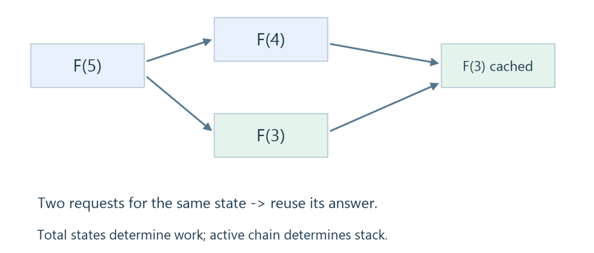

*Figure 35. Repeated recursive calls collapse into shared states, but the live stack still follows one active dependency chain.*

Dynamic programming avoids solving equivalent smaller problems repeatedly. Overlapping subproblems mean several decision paths ask the same remaining question. Optimal substructure means an optimum can be built from suitable optimum subproblem answers; for counting/existence, the same design discipline combines counts or truth values instead.

Start with a clear recursive choice, identify the information determining the future, and finish the sentence "dp[...] represents ...". Then specify base cases, transition, dependency order, final answer, and complexity. A cache key that omits an availability limit or remaining capacity can merge different problems and compute the wrong answer faster.

Fibonacci illustrates overlap: F(5) asks F(4) and F(3); F(4) asks F(3) again. The recurrence F(i)=F(i-1)+F(i-2), F(0)=0, F(1)=1 has only O(n) distinct states even though plain recursion makes exponentially many calls.

|**Approach**|**Work order**|**Retained state**|**Main caveat**|
|---|---|---|---|
|**Plain recursion**|Follow all choices|Active call chain|Repeats states|
|**Memoisation**|Top-down; cache completed|Memo plus active stack|A large allocated memo still|
||answers||consumes its full storage|

|**Approach**|**Work order**|**Retained state**|**Main caveat**|
|---|---|---|---|
|**Tabulation**|Bottom-up dependency|Planned table|Solve prerequisites before|
||order||reading them|
|**Compressed tabulation**|Same recurrence, fewer<br>retained dependencies|Live rows/scalars|Overwriting can silently<br>change the recurrence|

Memoisation does not automatically make every recursive solution polynomial: count distinct states and work per state. It may visit fewer states than tabulation, but allocating an m-by-n cache still costs O(mn) storage/setup. A recurrence needs an acyclic progress relation or another valid staged formulation; caching alone does not resolve cyclic dependencies. [R11]

For a proof, establish that the choices cover every legal solution, combine disjoint counts without double counting, and use already-correct subproblem answers. The objective determines the operator: maximum reward -&gt; max; minimum cost -&gt; min; number of ways -&gt; sum; existence -&gt; OR. Do not copy a recurrence's operator from another problem.

## 19.2 Climbing Stairs - One recurrence, four evaluation strategies
For one- or two-step moves, W(i) is the number of ordered step sequences reaching step i. W(0)=1 counts the empty sequence, W(1)=1, and W(i)=W(i-1)+W(i-2). Every route ends with a one-step arrival or a two-step arrival; the groups are disjoint, so add them.

For n=5, values W(0..5) are [1,1,2,3,5,8]. The eight sequences are 11111,1112,1121,1211,2111,122,212,221, where each digit is a move size.

```pseudocode
FUNCTION DpStairsRecursive(n)
    REQUIRE n >= 0
    FUNCTION Solve(i)
        IF i <= 1
            RETURN 1
        RETURN CHECKED_ADD(Solve(i - 1), Solve(i - 2))
    RETURN Solve(n)

FUNCTION DpStairsMemo(n)
    REQUIRE n >= 0
    memo <- array(n + 1, initial = UNKNOWN)
    FUNCTION Solve(i)
        IF i <= 1
            RETURN 1
        IF memo[i] = UNKNOWN
            memo[i] <- CHECKED_ADD(Solve(i - 1), Solve(i - 2))
        RETURN memo[i]
    RETURN Solve(n)

FUNCTION DpStairsTable(n)
    REQUIRE n >= 0
    dp <- array(n + 1, initial = 1)
    FOR i FROM 2 TO n
        dp[i] <- CHECKED_ADD(dp[i - 1], dp[i - 2])
    RETURN dp[n]

FUNCTION DpStairs(n)
    REQUIRE n >= 0
    twoBack <- 1
    oneBack <- 1
    FOR i FROM 2 TO n
        current <- CHECKED_ADD(oneBack, twoBack)
        twoBack <- oneBack
        oneBack <- current
    RETURN oneBack
```

Plain recursion has O(2^n) time as a coarse upper bound but O(n) simultaneous stack depth, not exponential stack space. Memoisation uses O(n) cache plus O(n) frames; tabulation uses O(n) table; the rolling version uses O(1) numeric slots, all with O(n) arithmetic operations after removing repeated work.

Counts grow quickly. These long examples throw on overflow; W(91) fits while W(92) does not. Fixed-width arithmetic, not arbitrary mathematical integers, is the implementation contract. A BigInteger extension avoids numeric overflow but arithmetic and memory then depend on bit lengths, so "constant space" would mean a constant number of growing integers rather than constant bits.

## 19.3 Minimum-cost climbing - State meaning changes answer extraction
Given nonnegative leave-costs, paying cost[i] permits jumping one or two steps. You may start at position 0 or 1, and the top is n, just past the array.

|**Formulation**|**Base**|**Transition**|**Answer**|
|---|---|---|---|
|**Minimum cost to leave**|leave[0]=cost[0],|leave[i]=cost[i]+min(leave[i-|min(leave[n-1], leave[n-2])|
|**step i**|leave[1]=cost[1]|1], leave[i-2])||
|**Minimum cost to reach**<br>**position i**|reach[0]=reach[1]=0|reach[i]=min(reach[i-<br>1]+cost[i-1], reach[i-<br>2]+cost[i-2])|reach[n]|

Both are correct under their stated nonnegative-cost contract, but mixing one state's initialization with the other's final cell is not. For [10,15,20], the leave table is [10,15,30] and the answer is 15, not 30. Start at 1, pay 15, jump to the top.

The executable method uses the reach formulation and defines empty/single-step inputs as zero cost: start directly at an allowed top position. The nonnegative contract matters; a separate negative-cost interpretation could change starting/base decisions.

```pseudocode
PROCEDURE DpRequireNonnegative(values)
    REQUIRE every value is nonnegative

FUNCTION DpMinClimbCost(cost)
    DpRequireNonnegative(cost)
    twoBack <- 0
    oneBack <- 0
    FOR i FROM 2 TO length(cost)
        current <- min(CHECKED_ADD(oneBack, cost[i - 1]),
                       CHECKED_ADD(twoBack, cost[i - 2]))
        twoBack <- oneBack
        oneBack <- current
    RETURN oneBack
```

Before processing i, the rolling values represent reach[i-2] and reach[i-1]. Compute current before shifting either one. Runtime O(n), auxiliary space O(1).

## 19.4 House Robber - Prefix optimum versus compulsory endpoint
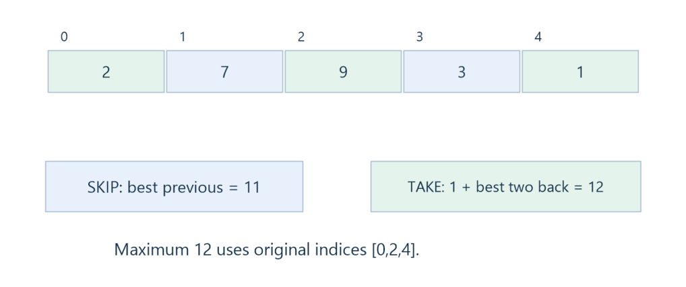

##### Figure 36. House Robber compares skipping the current house with taking it plus the optimum prefix two positions back.
For nonnegative rewards, let best[i] be the maximum money obtainable from the first i houses, with best[0]=0. Taking house i-1 adds money[i-1] to best[i-2]; skipping uses best[i-1]. The preceding optimum does not require the last house of that prefix to be selected.

For [2,7,9,3,1], the inclusive-index source table is [2,7,11,11,12]; selected indices [0,2,4] give values [2,9,1] and total 12. Before the final house, the best prefix was 11; taking the final 1 improves it to 12.

```pseudocode
FUNCTION DpRobRange(money, start, end)
    twoBack <- 0
    oneBack <- 0
    FOR i FROM start TO end
        current <- max(oneBack, CHECKED_ADD(twoBack, money[i]))
        twoBack <- oneBack
        oneBack <- current
    RETURN oneBack

FUNCTION DpRob(money)
    DpRequireNonnegative(money)
    RETURN DpRobRange(money, 0, length(money) - 1)
```

DpRobRange is a shared helper for valid inclusive ranges; an empty range returns zero. DpRob validates the reward contract. The two retained values describe adjacent prefix optima, not "money from exactly these two houses". Time O(n), auxiliary space O(1).

### Reconstructing choices needs history
Retain an O(n) prefix table if indices are requested. At prefix length i, if best[i]==best[i-1], skip house i-1; otherwise take it and reduce i by two. With ties, this rule chooses one optimum, not all. The rolling value-only method does not preserve that predecessor history.

An optimum value and a witness are different outputs. Memory compression can preserve the value while making witness reconstruction less direct.

## 19.5 Circular House Robber - Two exhaustive exclusions
The linear recurrence does not know that the first and last houses are adjacent. For n&gt;=2, solve [0, n-2] excluding the last and [1, n-1] excluding the first, then take the maximum.

The second case is not "force the last house to be taken". Excluding the first only makes the last eligible; the range optimum may still skip it. Every valid circular selection excludes at least one endpoint, so these two cases cover all valid choices.

```pseudocode
FUNCTION DpRobCircular(money)
    DpRequireNonnegative(money)
    IF money is empty
        RETURN 0
    IF length(money) = 1
        RETURN money[0]
    RETURN max(DpRobRange(money, 0, length(money) - 2),
               DpRobRange(money, 1, length(money) - 1))
```

[2,3,2] gives max(3,3)=3. For [1,2,3,1], the ranges give 4 and 3, so answer 4. Empty -&gt; 0; one house [5] -&gt; 5; two houses [4,7] -&gt; 7. Two sequential linear passes still give O(n) time and O(1) auxiliary space.

## 19.6 Delete and Earn - Aggregate by conflicting value, not input position
Selecting value x earns all its nonnegative occurrences and forbids x-1, x+1. Define points[x]=x*frequency(x), then apply House Robber along the value axis.

For [2,2,3,3,3,4], points[0..4]=[0,0,4,9,4]; the best values become [0,0,4,9,9]. Select all three 3s for 9.

Selecting 2s and 4 is legal but yields only 8. The original source's "4 -&gt; 1" was a frequency, not the total reward of 4.

```pseudocode
FUNCTION DpDeleteEarn(nums)
    DpRequireNonnegative(nums)
    IF nums is empty
        RETURN 0
    size <- max(nums) + 1
    REQUIRE size fits the memory budget for a dense table
    points <- array(size, initial = 0)
    FOR EACH value IN nums
        points[value] <- CHECKED_ADD(points[value], value)
    twoBack <- 0
    oneBack <- 0
    FOR EACH reward IN points
        current <- max(oneBack, CHECKED_ADD(twoBack, reward))
        twoBack <- oneBack
        oneBack <- current
    RETURN oneBack
```

Full runtime is O(n+M+1), not merely O(M), because reading/aggregating input costs O(n). Dense storage is O(M+1) even though the final recurrence uses only two scalars. A technically representable dense array may still exceed the real memory budget.

For a huge sparse value range, aggregate in a dictionary and sort distinct keys as an extension. Preserve gaps: nonconsecutive keys do not conflict. Compressing them into blindly adjacent houses would change the problem.

## 19.7 0/1 Knapsack and unbounded reuse - Item stage plus capacity
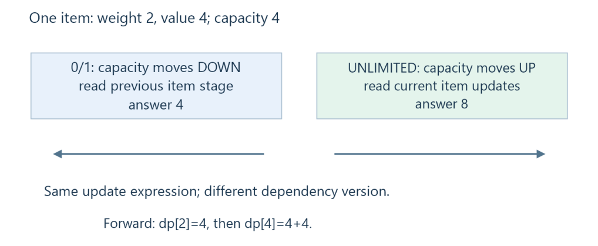

*Figure 37. Descending capacity reads the previous item stage; ascending capacity permits reusing a newly updated state.*

Let dp[i, c] mean the best reward from the first i items with capacity limit c. Item index i-1 has weight w and value v. Skip=dp[i-1, c]. If w&lt;=c, take=v+dp[i-1, c-w]. Choose max(skip, take).

With positive weights, dp[0, c]=0 and dp[i,0]=0. Both dimensions are essential conceptually: the same item prefix has different answers for different capacities, and the same capacity with different available items is a different subproblem.

Source example weights=[2,3,4], values=[4,5,7], capacity=5:

|**Items**|**c 0**|**c 1**|**c 2**|**c 3**|**c 4**|**c 5**|
|---|---|---|---|---|---|---|
|**considered**|||||||
|**none**|0|0|0|0|0|0|
|**weight 2,**<br>**value 4**|0|0|4|4|4|4|
|**add weight 3,**<br>**value 5**|0|0|4|5|5|9|
|**add weight 4,**<br>**value 7**|0|0|4|5|7|9|

Answer 9 takes weights 2 and 3. Having some remaining capacity is insufficient: the complete weight must fit. A prefix recurrence computes row i from row i-1; the source's attempted forward-state assignment mixed indices and omitted max.

```pseudocode
PROCEDURE DpCheckItems(weights, values, capacity)
    REQUIRE capacity >= 0 AND length(weights) = length(values)
    REQUIRE every weight > 0

FUNCTION DpKnapsack01(weights, values, capacity)
    DpCheckItems(weights, values, capacity)
    dp <- array(capacity + 1, initial = 0)
    FOR i FROM 0 TO length(weights) - 1
        FOR c FROM capacity DOWN TO weights[i]
            dp[c] <- max(dp[c], CHECKED_ADD(values[i], dp[c - weights[i]]))
    RETURN dp[capacity]

FUNCTION DpKnapsackUnlimited(weights, values, capacity)
    DpCheckItems(weights, values, capacity)
    dp <- array(capacity + 1, initial = 0)
    FOR i FROM 0 TO length(weights) - 1
        FOR c FROM weights[i] TO capacity
            dp[c] <- max(dp[c], CHECKED_ADD(values[i], dp[c - weights[i]]))
    RETURN dp[capacity]
```

These are capacity-at-most problems: selecting no item is allowed, so negative item values can simply be skipped. Positive weights prevent zero-weight unlimited rewards. Exact-fill knapsack has different unreachable-state initialization and must not silently reuse the all-zero table.

### Why backward means once and forward means reuse
For one item w=2, v=4 and capacity 4, a forward update sets dp[2]=4 and then reads that new value to set dp[4]=8, using the item twice. Backward traversal reads a source still belonging to the previous item stage, keeping the 0/1 answer 4. Forward traversal deliberately gives unlimited answer 8.

Both methods perform O(n*C) updates and use O(C) storage; a full table uses O(n*C). This is pseudopolynomial in the numeric capacity, not polynomial in its binary bit length. [R12]

## 19.8 Subset Sum - Replace maximum reward by Boolean reachability
For nonnegative inputs and target S, dp[i, s] means some subset of the first i elements sums exactly to s. dp[i,0]=true includes the empty subset; dp[0, s&gt;0]=false.

For x=nums[i-1], use dp[i, s]=dp[i-1, s] OR dp[i-1, s-x] when x&lt;=s; otherwise skip. The equality case matters: one 3 must be allowed to form target 3. Do not read nums[i] when row i means the first i elements.

```pseudocode
FUNCTION DpSubsetSum(nums, target)
    DpRequireNonnegative(nums)
    REQUIRE target >= 0
    dp <- array(target + 1, initial = false)
    dp[0] <- true
    FOR EACH number IN nums
        FOR sum FROM target DOWN TO number
            dp[sum] <- dp[sum] OR dp[sum - number]
    RETURN dp[target]
```

For [3,4,5,2], reachable sums restricted to 0..9 progress as:

|**After value**|**Reachable sums**|
|---|---|
|**none**|{0}|
|**3**|{0,3}|
|**4**|{0,3,4,7}|
|**5**|{0,3,4,5,7,8,9}|
|**2**|{0,2,3,4,5,6,7,8,9}|

Target 9 is made by {4,5} or {3,4,2}. One-dimensional sums go backward; otherwise a single [3] could falsely form 6. Zero values are allowed here and do not break finite 0/1 processing. Negative values need a different state domain/offset or sparse-state approach.

Complexity is O(n*S) updates and O(S) compressed space, plus normal initialization/validation. Retaining the full table makes reconstructing one subset straightforward: skip if the preceding row already supports s; otherwise take x and subtract it.

## 19.9 Partition Equal Subset Sum - A reduction, not a new recurrence
If total T is odd, equal integer sums are impossible. Otherwise ask whether some subset sums to T/2. Its unused elements automatically form the complementary half.

For [1,5,11,5], total 22, target 11; [11] and [1,5,5] form the partition. Once target becomes reachable, additional unused items cannot undo that fact, so early exit is safe.

```pseudocode
FUNCTION DpEqualPartition(nums)
    DpRequireNonnegative(nums)
    total <- checked sum of nums
    IF total MOD 2 != 0
        RETURN false
    target <- total DIV 2
    REQUIRE target + 1 fits the memory budget for a dense table
    RETURN DpSubsetSum(nums, target)
```

Empty input admits two empty subsets under this convention. This is not a requirement for two nonempty groups; that would be an additional contract. Time O(n*T), space O(T) are simplified numeric bounds, with the actual target T/2. Accumulate total in long before converting an affordable dense target to int.

## 19.10 Minimum Coin Change - Infinity belongs inside minimisation
For distinct positive denominations and unlimited reuse, dp[a] is the minimum coin count forming amount a. dp[0]=0. Nonzero states start above every valid count, not at -1: min(-1, validCount) would select impossibility as if it were cheaper.

Amount+1 is a safe upper sentinel because every positive integer coin contributes at least 1: any solution for A uses at most A coins, even when denomination 1 is absent. Convert an unchanged impossible result to -1 only at the API boundary.

```pseudocode
PROCEDURE DpCheckCoins(coins, amount)
    REQUIRE amount >= 0 AND coins are distinct positive integers

FUNCTION DpMinCoins(coins, amount)
    DpCheckCoins(coins, amount)
    dp <- array(amount + 1, initial = INFINITY)
    dp[0] <- 0
    FOR a FROM 1 TO amount
        FOR EACH coin IN coins
            IF coin <= a AND dp[a - coin] != INFINITY
                dp[a] <- min(dp[a], dp[a - coin] + 1)
    RETURN -1 IF dp[amount] = INFINITY ELSE dp[amount]
```

For coins[1,3,4], amount 6, dp[0..6]=[0,1,2,1,1,2,2]. Optimum 3+3 uses two coins, while greedily choosing 4 first would require 4+1+1, three coins. Both minimum-coin loop orders can be valid: amounts outside with all possible last coins, or coins outside with amounts forward. The minimum objective does not count reordered answers separately.

Runtime O(K*A), space O(A), with input validation O(K). Empty denominations form only amount 0; zero/negative denominations would invalidate progress assumptions. The shared validator rejects duplicate denomination entries to keep counting methods below unambiguous.

## 19.11 Coin Change II - Availability is a hidden dimension
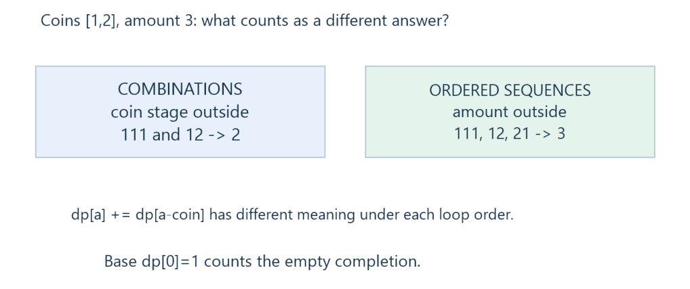

##### Figure 38. Coin stages count unordered combinations; changing the outer loop to amount counts ordered sequences.
Now count unordered combinations, not minimum coins. Define Count(i, remaining) as combinations using denominations from i onward. Taking retains i because reuse is allowed; skipping advances i. Recurrence: Count(i, r)=Count(i, r-coin[i])+Count(i+1, r), omitting the take branch when it does not fit.

Base cases: remaining 0 -&gt; 1 (the empty completion); exhausted denominations with positive remaining -&gt; 0. Check success before exhaustion so no coins and amount 0 still has one combination.

```pseudocode
FUNCTION DpCoinCombinationsMemo(coins, amount)
    DpCheckCoins(coins, amount)
    memo <- length(coins) by (amount + 1) matrix filled with UNKNOWN
    FUNCTION Count(index, remaining)
        IF remaining = 0
            RETURN 1
        IF index = length(coins)
            RETURN 0
        IF memo[index, remaining] != UNKNOWN
            RETURN memo[index, remaining]
        skip <- Count(index + 1, remaining)
        take <- 0
        IF coins[index] <= remaining
            take <- Count(index, remaining - coins[index])
        memo[index, remaining] <- CHECKED_ADD(take, skip)
        RETURN memo[index, remaining]
    RETURN Count(0, amount)

FUNCTION DpCoinCombinations(coins, amount)
    DpCheckCoins(coins, amount)
    dp <- array(amount + 1, initial = 0)
    dp[0] <- 1
    FOR EACH coin IN coins
        FOR a FROM coin TO amount
            dp[a] <- CHECKED_ADD(dp[a], dp[a - coin])
    RETURN dp[amount]

FUNCTION DpCoinSequences(coins, amount)
    DpCheckCoins(coins, amount)
    dp <- array(amount + 1, initial = 0)
    dp[0] <- 1
    FOR a FROM 1 TO amount
        FOR EACH coin IN coins
            IF coin <= a
                dp[a] <- CHECKED_ADD(dp[a], dp[a - coin])
    RETURN dp[amount]
```

After processing a denomination in the combination loop, dp[a] counts combinations using only the processed types. Amounts go forward so that type can repeat; the coin stage imposes a canonical denomination order. No sorting is necessary if distinct types are processed in any fixed order.

The source trace for coins[1,2,5], amount 5 is:

|**Stage**|**dp[0..5]**|
|---|---|
|**Initially**|[1,0,0,0,0,0]|
|**After coin 1**|[1,1,1,1,1,1]|
|**After coin 2**|[1,1,2,2,3,3]|
|**After coin 5**|[1,1,2,2,3,4]|

Four combinations: 11111,1112,122,5. With coins[1,2], amount 3, combinations are 111 and 12 (2), but ordered sequences are 111,12,21 (3). Amount-only recursion summing all possible final coins computes the latter, not an O(A)-state combination recursion.

Memoised combinations have up to K*(A+1) states and O(K*A) work, plus O(K+A/m) stack depth where m is the smallest positive denomination. The allocated memo uses O(K*(A+1)); bottom-up compresses it to O(A) space without eliminating the denomination loop. O(K*A)=O(A) time only when K is treated as a fixed constant. Counts use checked long and fail explicitly if too large.

## 19.12 LCS - Two sequence positions, not contiguous matching
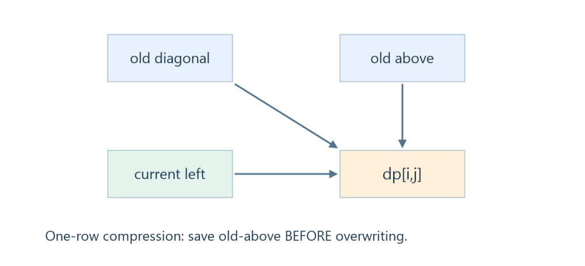

*Figure 39. Sequence tables read an old diagonal, old above, and current left; one-row compression must preserve these meanings.*

A subsequence preserves relative order but may skip positions; a substring is contiguous. For "abcde"/"ace", LCS is "ace", length 3. "ca" is not a subsequence of "abcde".

Suffix recursion Lcs(i, j) means the best length for a[i..], b[j..]. If either index reaches its string's length, return 0. Checking only whether the original strings have length zero misses recursion exhaustion.

When a[i]==b[j], consume both with 1+Lcs(i+1, j+1). Otherwise take max(Lcs(i+1, j), Lcs(i, j+1)). Matching consumes a position from each sequence; reusing either would not represent a valid subsequence.

For tabulation, dp[i, j] means LCS length for prefixes of lengths i, j. Base row/column are 0. Match uses 1+dp[i-1, j-1]; mismatch uses max(dp[i-1, j], dp[i, j-1]).

```pseudocode
FUNCTION DpLcsTable(a, b)
    dp <- (length(a) + 1) by (length(b) + 1) matrix filled with 0
    FOR i FROM 1 TO length(a)
        FOR j FROM 1 TO length(b)
            IF a[i - 1] = b[j - 1]
                dp[i, j] <- 1 + dp[i - 1, j - 1]
            ELSE
                dp[i, j] <- max(dp[i - 1, j], dp[i, j - 1])
    RETURN dp

FUNCTION DpLcsLength(a, b)
    IF length(b) > length(a)
        SWAP a, b
    dp <- array(length(b) + 1, initial = 0)
    FOR i FROM 1 TO length(a)
        diagonal <- 0
        FOR j FROM 1 TO length(b)
            above <- dp[j]
            IF a[i - 1] = b[j - 1]
                dp[j] <- diagonal + 1
            ELSE
                dp[j] <- max(above, dp[j - 1])
            diagonal <- above
    RETURN dp[length(b)]

FUNCTION DpLcsOne(a, b)
    dp <- DpLcsTable(a, b)
    i <- length(a)
    j <- length(b)
    reverse <- empty list
    WHILE i > 0 AND j > 0
        IF a[i - 1] = b[j - 1]
            reverse.append(a[i - 1])
            i <- i - 1
            j <- j - 1
        ELSE IF dp[i - 1, j] >= dp[i, j - 1]
            i <- i - 1
        ELSE
            j <- j - 1
    RETURN join(reverse in reverse order)
```

### Exact checkpoint table - Columns "abc", rows "bac"
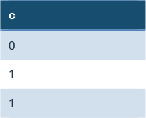

&lt;!-- Start of picture text --&gt;
c<br>0<br>1<br>1<br>&lt;!-- End of picture text --&gt;

|**Prefix**|**empty**|**a**|**b**|**c**|
|---|---|---|---|---|
|**empty**|0|0|0|0|
|**b**|0|0|1|1|
|**ba**|0|1|1|1|
|**bac**|0|1|1|2|

The two distinct LCS strings are "ac" and "bc". Length 2 is unique as a numeric answer even though the witness is not. DpLcsOne returns one consistent witness; it does not enumerate every LCS.

Full table time/storage O(mn), with row/column boundary setup understood; memoised recursion additionally has O(m+n) stack depth. A one-row length calculation needs old-above, current-left, and olddiagonal. Save old-above before overwriting, then carry it as the next diagonal. Working storage is O(min(m, n)+1), not an implicit full history. Full-table reconstruction is simplest here; specialised lower-memory witness algorithms are beyond the recorded lessons.

String examples compare indexed symbols, using ASCII for the worked examples.
For general Unicode, explicitly choose the text unit and normalization policy
as described in the strings topic.

## 19.13 LIS quadratic DP - Best subsequence ending exactly here
Let dp[i] be the length of a strictly increasing subsequence whose last element is nums[i]. Initialize each to 1. For every j&lt;i with nums[j]&lt;nums[i], update dp[i]=max(dp[i],1+dp[j]).

Do not assign 1+dp[j] unconditionally: a later weaker predecessor can overwrite a better candidate. Equal values are not extendable in a strictly increasing subsequence.

```pseudocode
FUNCTION DpLisQuadratic(nums)
    dp <- array(length(nums), initial = 1)
    answer <- 0
    FOR i FROM 0 TO length(nums) - 1
        FOR j FROM 0 TO i - 1
            IF nums[j] < nums[i]
                dp[i] <- max(dp[i], 1 + dp[j])
        answer <- max(answer, dp[i])
    RETURN answer
```

For [10,9,2,5,3,7,101,18], dp=[1,1,1,2,2,3,4,4], length 4. Valid witnesses include [2,5,7,101] and [2,3,7,18]. Values 10 and 9 are also valid predecessors for 18, even though their length-one states do not yield the optimum.

The answer is max(dp), not necessarily the final entry: for [1,2,3,0], dp=[1,2,3,1], answer 3. Runtime O(n^2), space O(n), empty input 0.

## 19.14 LIS tails - A frontier of best endings, with a proof
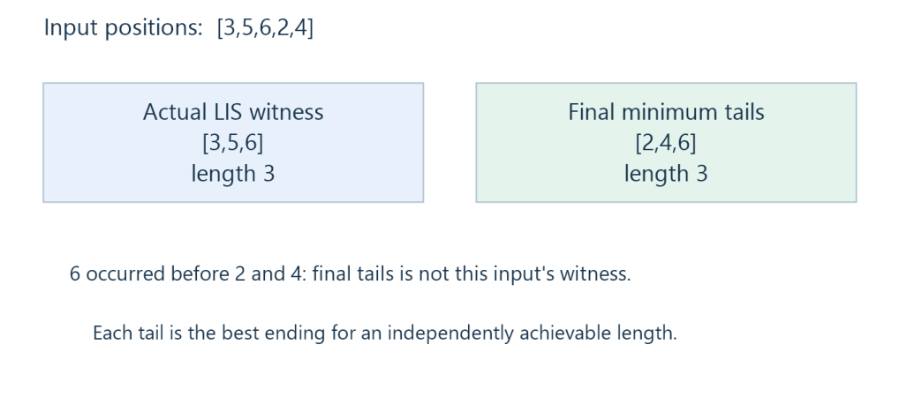

*Figure 40. Minimum tails represent independent best endings; they need not form one compatible input subsequence.*

tails[k] is the smallest possible last value among increasing subsequences of length k+1 in the processed prefix. A smaller ending is at least as extendable as a larger ending of the same length.

For each x, find the first tails position&gt;=x (lower bound). Replace it, or append if none exists. Use &gt;= for strict increase so equal values do not extend length. Using the first &gt; instead computes the non-decreasing variant.

```pseudocode
FUNCTION DpLisTails(nums)
    tails <- empty list
    FOR EACH x IN nums
        left <- 0
        right <- length(tails)
        WHILE left < right
            mid <- left + (right - left) DIV 2
            IF tails[mid] < x
                left <- mid + 1
            ELSE
                right <- mid
        IF left = length(tails)
            tails.append(x)
        ELSE
            tails[left] <- x
    RETURN length(tails)
```

### Corrected duplicate checkpoint
|**Input consumed**|**tails afterwards**|
|---|---|
|**0**|[0]|
|**1**|[0,1]|
|**second 0**|[0,1], replace position 0|
|**3**|[0,1,3]|
|**2**|[0,1,2]|
|**final 3**|[0,1,2,3]|

Length 4 has actual witness [0,1,2,3] at indices[0,1,4,5]. The learner's [0,0,2,3] is non-decreasing, not strictly increasing. Replacing an equal tail is about avoiding a false length increase, not making that equal value smaller.

### Inductive minimum-tail argument
Assume the invariant before x. Let p be its first tail&gt;=x. If p&gt;0, tails[p-1]&lt;x; a real length-p subsequence with that ending exists in the already processed prefix, so appending x creates a real length-p+1 subsequence.

Replacing tails[p] by x improves or preserves that length's minimum ending. Every shorter tail is already&lt;x, so x cannot improve their smaller minima. No longer subsequence ending at x can be formed: its required predecessor length would have a minimum tail&gt;=x, contradicting strict extension. Existing subsequences not using x remain achievable, even though only their minimal ending representatives are stored.

If p==tails.Count, x extends a longest known achievable length by one. Existing shorter minima remain better, so appending preserves the invariant. The first element is a valid base, and the empty frontier handles empty input.

Tails stays sorted: predecessor&lt;x&lt;=oldTail, while a later tail is&gt;oldTail&gt;=x. Thus lower-bound binary search remains valid after an update.

The count cannot overestimate: every occupied length is backed by a real subsequence. It cannot underestimate: along any actual increasing subsequence a 1&lt;...&lt;aL, the minimal tail for each preceding length is at most that subsequence's predecessor, so processing the next element forces a position at least one larger. Therefore the count equals the LIS length.

### Why tails itself may not be the witness
For [3,5,6,2,4], tails becomes [3],[3,5],[3,5,6],[2,5,6],[2,4,6]. Final [2,4,6] is not an input subsequence because 6 occurs before 2 and 4. The length 3 is still correct, witnessed by [3,5,6]. Independent minimumending representatives need not share one compatible history.

Time O(n log(n+1)), space O(n). To reconstruct an actual fast-LIS witness, retain original indices and predecessor links as an extension; do not print tails and claim it always solves that output requirement.

## 19.15 Edit Distance - Align two suffixes with three choices
Edit(i, j) is the minimum unit-cost insertions, deletions, replacements transforming a[i..] into b[j..]. If i reaches m, insert n-j remaining target characters. If j reaches n, delete m-i source characters.

Matching characters cost 0 and consume both. At a mismatch: insert b[j] -&gt; (i, j+1); delete a[i] -&gt; (i+1, j); replace -&gt; (i+1, j+1). Take 1+minimum of these three.

For "horse"-&gt;"ros", one optimum is horse-&gt;rorse (replace h), rorse-&gt;rose (delete the second r), rose-&gt;ros (delete e), cost 3.

```pseudocode
FUNCTION DpEditMemo(a, b)
    memo <- length(a) by length(b) matrix filled with UNKNOWN
    FUNCTION Edit(i, j)
        IF i = length(a)
            RETURN length(b) - j
        IF j = length(b)
            RETURN length(a) - i
        IF memo[i, j] != UNKNOWN
            RETURN memo[i, j]
        IF a[i] = b[j]
            answer <- Edit(i + 1, j + 1)
        ELSE
            answer <- 1 + min(Edit(i, j + 1), Edit(i + 1, j),
                              Edit(i + 1, j + 1))
        memo[i, j] <- answer
        RETURN answer
    RETURN Edit(0, 0)

FUNCTION DpEditTable(a, b)
    dp <- (length(a) + 1) by (length(b) + 1) matrix
    FOR i FROM 0 TO length(a)
        dp[i, 0] <- i
    FOR j FROM 0 TO length(b)
        dp[0, j] <- j
    FOR i FROM 1 TO length(a)
        FOR j FROM 1 TO length(b)
            IF a[i - 1] = b[j - 1]
                dp[i, j] <- dp[i - 1, j - 1]
            ELSE
                dp[i, j] <- 1 + min(dp[i, j - 1], dp[i - 1, j],
                                   dp[i - 1, j - 1])
    RETURN dp
```

The tabulated state uses prefixes, not suffixes. Its base row is j insertions and base column i deletions; setting both to zero would make a nonempty string convertible to empty for free.

For "cat"/"cut", replace a by u; distance 1. The source solution requested by the learner fills:

|**Source prefix / target**|**empty**|**c**|**cu**|**cut**|
|---|---|---|---|---|
|**prefix**|||||
|**empty**|0|1|2|3|
|**c**|1|0|1|2|
|**ca**|2|1|1|2|
|**cat**|3|2|2|1|

Memo time/cache O(mn), stack O(m+n). Full tabulation uses O(mn) storage. Unit symmetric edit costs allow swapping the string roles for length-only storage O(min(m, n)+1).

```pseudocode
FUNCTION DpEditLength(a, b)
    IF length(b) > length(a)
        SWAP a, b
    dp <- [0, 1, ..., length(b)]
    FOR i FROM 1 TO length(a)
        diagonal <- dp[0]
        dp[0] <- i
        FOR j FROM 1 TO length(b)
            above <- dp[j]
            IF a[i - 1] = b[j - 1]
                dp[j] <- diagonal
            ELSE
                dp[j] <- 1 + min(diagonal, above, dp[j - 1])
            diagonal <- above
    RETURN dp[length(b)]
```

After saving old-above, dp[j-1] is current-left and diagonal is old-upper-left. A full table makes an actual editscript backtrace easier. Unequal operation costs or transpositions define a different recurrence; they are not silently included. [R11]

## 19.16 Grid paths and obstacles - Sum predecessor counts
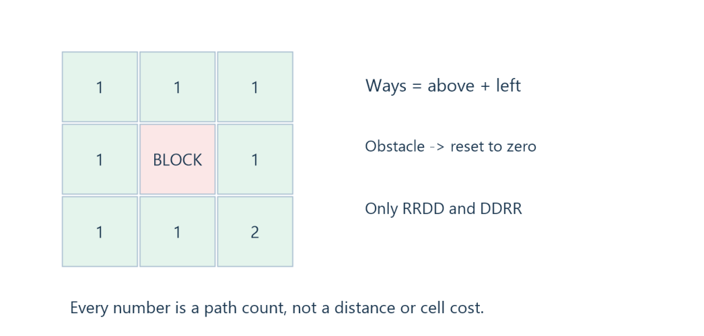

##### Figure 41. A blocked center resets its path count to zero, leaving exactly two monotone routes around it.
For right/down moves, suffix Paths(r, c) counts completions from a cell to the destination: destination 1, outof-bounds 0, otherwise down+right. Prefix tabulation instead counts routes from the start to each cell: dp[r, c]=above+left. State direction changes, but both must respect the same movement contract.

Without obstacles a 3-by-3 prefix table is [1,1,1]/[1,2,3]/[1,3,6], answer 6. Do not use BFS shortest-path rules to count every monotone route; DP here aggregates distinct incoming possibilities on an acyclic movement graph.

For 0=open,1=blocked, every blocked cell has count 0, including blocked start or destination. A one-row update must reset blocked cells to 0, not leave the old value from above.

```pseudocode
FUNCTION DpGridPaths(blocked)
    (rows, cols) <- dimensions(blocked)
    REQUIRE each cell is 0 (open) or 1 (blocked)
    IF rows = 0 OR cols = 0
        RETURN 0
    dp <- array(cols, initial = 0)
    dp[0] <- 1
    FOR r FROM 0 TO rows - 1
        FOR c FROM 0 TO cols - 1
            IF blocked[r, c] = 1
                dp[c] <- 0
            ELSE IF c > 0
                dp[c] <- CHECKED_ADD(dp[c], dp[c - 1])
    RETURN dp[cols - 1]
```

For the source 3-by-3 center obstacle, the DP table is [1,1,1]/[1,0,1]/[1,1,2]. Only RRDD and DDRR survive. If a first-row/first-column obstacle blocks a route, counts beyond it remain zero unless another legal predecessor supplies a route.

Time O(R*C), storage O(C) for this concrete code, preserving input. O(min(R, C)) is attainable by changing iteration orientation, not automatically true for a code path allocating columns. Memoised suffix DP adds O(R+C) recursion depth to its O(R*C) cache.

## 19.17 Minimum grid and triangle paths - Min instead of sum
For a cost grid with right/down moves, dp[r, c]=grid[r, c]+min(above, left), with dp[0,0]=grid[0,0]. First row/column have only one predecessor. Do not give a missing predecessor free cost 0 in a minimum problem; handle boundaries or use a properly guarded unreachable value.

```pseudocode
FUNCTION DpMinGridCost(grid)
    (rows, cols) <- dimensions(grid)
    REQUIRE rows > 0 AND cols > 0
    dp <- array(cols)
    dp[0] <- grid[0, 0]
    FOR c FROM 1 TO cols - 1
        dp[c] <- CHECKED_ADD(dp[c - 1], grid[0, c])
    FOR r FROM 1 TO rows - 1
        dp[0] <- CHECKED_ADD(dp[0], grid[r, 0])
        FOR c FROM 1 TO cols - 1
            dp[c] <- CHECKED_ADD(grid[r, c], min(dp[c], dp[c - 1]))
    RETURN dp[cols - 1]
```

For grid[1,3,1]/[1,5,1]/[4,2,1], prefix costs are [1,4,5]/[2,7,6]/[6,8,7]. Minimum 7 takes RRDD with values 1,3,1,1,1. Negative cell values also work for this fixed acyclic right/down model; adding arbitrary revisits would be a different problem.

### Triangle - Two legal children, not an arbitrary minimum in the next row
Suffix cost T(r, c) includes the current value plus min(T(r+1, c), T(r+1, c+1)); the last row returns its own values. For [2]/[3,4]/[6,5,7]/[4,1,8,3], working upward yields [4,1,8,3] -&gt; [7,6,10] -&gt; [9,10] -&gt; [11].

```pseudocode
FUNCTION DpTriangleCost(triangle)
    REQUIRE row r contains exactly r + 1 values
    IF triangle is empty
        RETURN 0
    dp <- copy(last row of triangle)
    FOR r FROM length(triangle) - 2 DOWN TO 0
        FOR c FROM 0 TO r
            dp[c] <- CHECKED_ADD(triangle[r][c], min(dp[c], dp[c + 1]))
    RETURN dp[0]
```

Optimal values are 2-&gt;3-&gt;5-&gt;1, cost 11. Memo time/cache O(R^2), stack O(R); this bottom-up code uses O(R) storage. Its columns move left-to-right so dp[c] and dp[c+1] are both still from the lower row when read; moving right-to-left would read a just-overwritten current-row value.

## 19.18 Matrix-chain multiplication - Try every final split
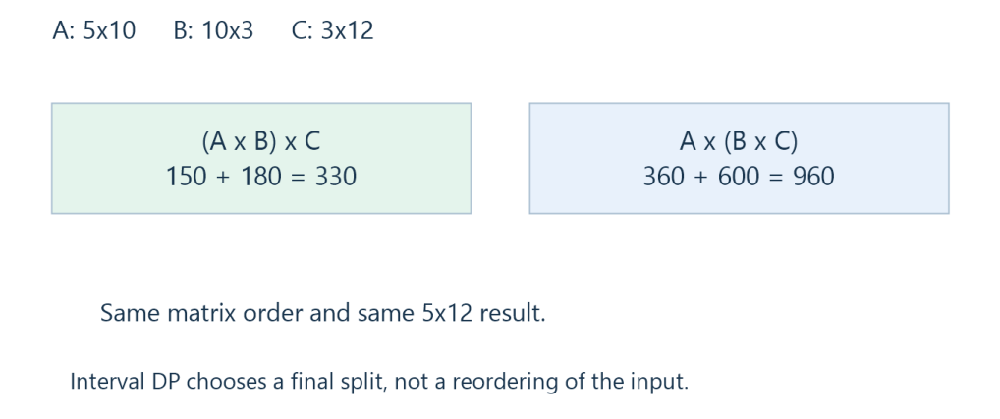

*Figure 42. Changing parenthesization preserves matrix order and result shape while changing multiplication cost.*

Only parentheses change; matrix order stays fixed. Dimensions d describe matrix i as d[i-1] by d[i], using 1- based matrix indices. Cost(l, r) is the minimum scalar multiplications for matrices l..r. One matrix costs 0.

For each split k in[l, r-1], combine Cost(l, k)+Cost(k+1, r)+d[l-1]*d[k]*d[r]. The left product is d[l-1] by d[k], and the right d[k] by d[r]; their dimensions justify that merge term.

```pseudocode
FUNCTION DpMatrixChain(dimensions)
    REQUIRE length(dimensions) >= 2 AND every dimension is positive
    n <- length(dimensions) - 1
    dp <- (n + 1) by (n + 1) matrix filled with 0
    FOR size FROM 2 TO n
        FOR left FROM 1 TO n - size + 1
            right <- left + size - 1
            best <- INFINITY
            FOR k FROM left TO right - 1
                merge <- checked product of
                    dimensions[left - 1], dimensions[k], dimensions[right]
                candidate <- checked sum of dp[left, k], dp[k + 1, right], merge
                best <- min(best, candidate)
            dp[left, right] <- best
    RETURN dp[1, n]
```

The source derives recursion and memoisation; the tabulation here is the same recurrence evaluated by increasing interval length. Smaller left/right intervals are ready before the enclosing range. Products widen before multiplying, with checked long arithmetic rather than overflowing int first.

|**Dimensions**|**(A*B)*C cost**|**A*(B*C) cost**|**Optimum**|
|---|---|---|---|
|**[10,30,5,60]**|1500+3000=4500|9000+18000=27000|4500|
|**[5,10,3,12]**|150+180=330|360+600=960|330|

For the second checkpoint, split 1 means A*(B*C), split 2 means (A*B)*C; both produce 5-by-12 matrices. DP chooses cheaper computation, not a different mathematical result. O(n^2) intervals times O(n) splits gives O(n^3) time, not O(n^2) merely because the memo has two dimensions. Space O(n^2); recursive forms additionally have O(n) active depth. Store split indices if an actual parenthesization is required. [R11]

## 19.19 Palindrome partitioning - Minimum pieces versus cuts
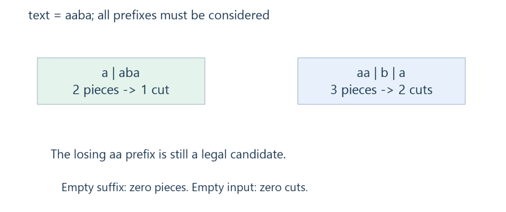

*Figure 43. Try every palindromic prefix; a|aba beats aa|b|a by one cut.*

Pieces(start) is the minimum number of palindromic substrings partitioning the entire suffix s[start..], not merely its first palindrome. Pieces(n)=0; for each palindromic prefix s[start..end], try 1+Pieces(end+1) and take the minimum.

For nonempty strings, cuts=pieces-1. Empty string needs 0 cuts, not-1. With direct O(n) palindrome tests, there are O(n) starting states and O(n) endings each, giving O(n^3) time even after memoising pieces.

Precompute pal[l, r]=(s[l]==s[r]) AND (r-l&lt;=1 OR pal[l+1, r-1]). The source uses r-l&lt;=2, which is also valid because the interior of a length-three substring is one character and already palindromic. Fill left backward so its inner row is ready.

```pseudocode
FUNCTION DpPalindromeCuts(text)
    n <- length(text)
    IF n = 0
        RETURN (Cuts = 0, Pieces = [])
    pal <- n by n matrix filled with false
    FOR left FROM n - 1 DOWN TO 0
        FOR right FROM left TO n - 1
            pal[left, right] <- text[left] = text[right] AND
                (right - left <= 1 OR pal[left + 1, right - 1])
    pieces <- array(n + 1, initial = 0)
    next <- array(n)
    FOR start FROM n - 1 DOWN TO 0
        pieces[start] <- n + 1
        FOR end FROM start TO n - 1
            IF pal[start, end] AND 1 + pieces[end + 1] < pieces[start]
                pieces[start] <- 1 + pieces[end + 1]
                next[start] <- end + 1
    result <- empty list
    start <- 0
    WHILE start < n
        result.append(slice(text, start, next[start]))
        start <- next[start]
    RETURN (Cuts = pieces[0] - 1, Pieces = result)
```

This editorial tabulation additionally returns one optimal partition using next indices. Every character is a palindrome by itself, so every suffix has a valid candidate and next always advances.

For "aab", Pieces(0)=2 and optimum"aa"|"b" has 1 cut. For checkpoint"aaba", Pieces(4..0) in reverse evaluation are 0,1,2,1,2; equivalently Pieces[0..4]=[2,1,2,1,0].

At index 0, both"a" and"aa" must be tested:1+Pieces(1)=2 versus 1+Pieces(2)=3. The optimum is"a"|"aba", one cut. Getting the right result while silently ignoring"aa" does not demonstrate a complete recurrence.

Precomputation O(n^2), partition DP O(n^2), matrix storage O(n^2); the witness has total O(n) characters plus piece metadata. The shown bottom-up method has no recursive stack. An alternative Cuts(start) state avoids subtracting 1 but must handle the final piece without charging a cut after the end.

## 19.20 Burst Balloons - Choose the last operation to fix boundaries
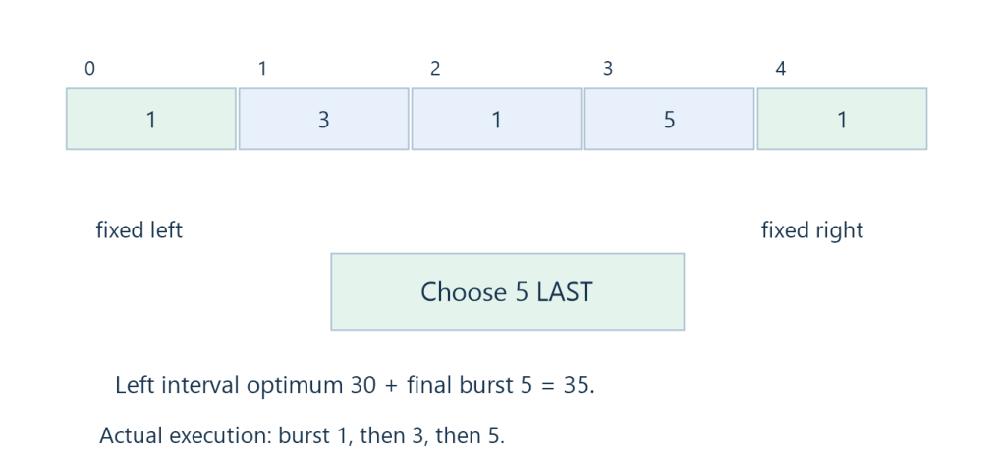

##### Figure 44. Selecting the last balloon fixes the exterior boundaries and separates left/right subproblems.
Bursting a balloon earns leftSurvivor*current*rightSurvivor. Choosing the first balloon changes surviving neighbor relationships and couples the two sides. Choosing the last balloon k of an interval fixes its external survivors, so the remaining left/right intervals become independent.

Pad values with virtual 1 at both ends. MaxCoins(l, r) bursts all real balloons in inclusive[l, r] while values[l-1], values[r+1] remain present. Empty interval gives 0.

For each k in[l, r], candidate=MaxCoins(l, k-1)+values[l-1]*values[k]*values[r+1]+MaxCoins(k+1, r). Take max. In the child intervals, k remains a boundary while that child is processed; it is removed only after both children are done.

```pseudocode
FUNCTION DpBurstBalloons(nums)
    DpRequireNonnegative(nums)
    n <- length(nums)
    values <- concatenate([1], nums, [1])
    memo <- (n + 2) by (n + 2) matrix filled with UNKNOWN
    FUNCTION Solve(left, right)
        IF left > right
            RETURN 0
        IF memo[left, right] != UNKNOWN
            RETURN memo[left, right]
        best <- 0
        FOR last FROM left TO right
            reward <- checked product of
                values[left - 1], values[last], values[right + 1]
            total <- checked sum of
                Solve(left, last - 1), reward, Solve(last + 1, right)
            best <- max(best, total)
        memo[left, right] <- best
        RETURN best
    RETURN Solve(1, n)
```

Nonnegative balloon values justify best=0; negative-valued mandatory-burst variants need a different initial maximum. Nullable memo entries distinguish not-computed from a legitimate zero answer. Empty input returns 0.

### Exact checkpoint - [3,1,5]
|**Last balloon in full**|**Left optimum**|**Final burst**|**Right optimum**|**Candidate**|
|---|---|---|---|---|
|**interval**|||||
|**3**|0|1*3*1=3|30 for [1,5] bounded<br>by 3,1|33|
|**1**|3|1*1*1=1|5|9|
|**5**|30 for [3,1] bounded<br>by 1,5|1*5*1=5|0|35|

Maximum 35 is achieved by actual burst order 1,3,5:rewards 3*1*5=15, then 1*3*5=15, then 1*5*1=5. The DP chooses which balloon is last, not necessarily the one to execute first.

For [3,1,5,8], an optimum order 1,5,3,8 gives 15+120+24+8=167. O(n^2) cached intervals times O(n) last choices -&gt; O(n^3) arithmetic operations; memo O(n^2), stack O(n). The count of states is not the final runtime until per-state choices are included.

## 19.21 Pattern recognition - State, operator, and dependency direction
|**Problem signal**|**Natural state**|**Combination operator**|
|---|---|---|
|**Ways to reach position**|Prefix/position index|Sum disjoint arrivals|
|**Minimum position cost**|Position|Minimum predecessor cost|
|**Nonadjacent rewards**|Prefix index|Maximum of take/skip|
|**Bounded budget, each item once**|Item stage, capacity|Maximum|
|**Exact target existence**|Item stage, sum|Boolean OR|
|**Unlimited minimum coins**|Amount|Minimum|
|**Unordered coin combinations**|Coin stage, amount|Sum|
|**Compare sequences**|Two prefix/suffix indices|LCS maximum or edit minimum|
|**Increasing subsequence ending here**|Endpoint index|Maximum predecessor|
|**Monotone grid paths**|Row, column|Sum or minimum|
|**Choose a range split**|Left, right|Minimum over split candidates|
|**Palindromic suffix partition**|Start, with palindrome interval lookup|Minimum pieces/cuts|
|**Removals changing neighbors**|Interval with fixed external boundaries|Maximum over final action|

Do not infer a state only from the output type. Both BFS and DP can return minima; both greedy and DP can maximize reward. Identify future-relevant constraints and prove why each transition is legal. The DP decision graph connects back to the topological-order reasoning in Graphs.

### Final source checkpoint - Supplemental model answers at the end
The transcript ends by asking eight recognition problems:budgeted projects, equal partition, unordered coin counts, edit distance, minimum grid route, burst balloons, LCS, and House Robber. No learner reply follows. The final eight Q19 entries below preserve those tasks; their answer-key entries are model solutions added for revision, not recorded learner results.

Greedy Algorithms is the next roadmap track after this consolidation. No new Greedy lessons, independent final-quiz pass, or explicit DP-completion confirmation is inferred from the source.

## 19.22 Space optimisation, complexity, and numeric contracts
|**Dependency**|**Safe compression**|**What to preserve**|
|---|---|---|
|**Previous two scalar states**|Two rolling values|Compute current before shifting|
|**Previous item row,0/1 selection**|One capacity row, descending|Do not read current item's writes|
|**Current item reusable**|Forward amount/capacity loop|Reuse is intentional|
|**Above, left, diagonal string states**|One row plus saved diagonal|Save old-above before overwriting|
|**Above and current-left grid states**|One row|Reset blocked cells rather than<br>retaining stale counts|
|**Two children in next triangle row**|One row, left-to-right|Right child must still be lower-row data|
|**Arbitrary smaller intervals**|Usually retain quadratic table|Do not discard intervals still needed|

|**Algorithm**|**Standard time**|**Space after stated optimisation**|
|---|---|---|
|**Stairs/minimum stairs/House**<br>**Robber**|O(n)|O(1) fixed-width numeric slots|
|**Delete and Earn, dense**|O(n+M+1)|O(M+1)|
|**0/1 or unlimited knapsack**|O(n*C)|O(C)|
|**Subset Sum / equal partition**|O(n*S)|O(S)|
|**Coin minimum/counts**|O(K*A)|O(A) bottom-up; O(K*A) memo|
|**LCS / unit Edit Distance**|O(m*n)|O(min(m, n)+1) value-only|
|**LIS quadratic / tails**|O(n^2) / O(n log(n+1))|O(n)|
|**Grid DP / triangle**|O(R*C) / O(R^2)|O(C) / O(R) in shown code|
|**Matrix chain / Burst Balloons**|O(n^3)|O(n^2), plus O(n) stack for memo<br>recursion|
|**Palindrome cuts, precomputed**|O(n^2)|O(n^2)|

The usual products abbreviate boundary setup and validation:for example allocating/initializing an emptyedge string table still involves row/column lengths, not literal zero work. Check code and input constraints rather than treating an asymptotic shorthand as an instruction to allocate an unlimited table.

Numeric-amount DP is pseudo-polynomial when capacities/targets are binary encoded. Counts and products may overflow long; checked arithmetic exposes that constraint. The examples do not silently wrap, change the objective, or saturate a finite answer to an infinity marker.

Recursion stack size is the longest active dependency chain, not the number of cached states. Compression preserves only what its dependency proof allows; reconstructing choices or enumerating all answers adds output/history costs.

## 19.23 Corrected lessons and study handoff
- Plain recursive stairs has exponential calls but linear stack depth.

- State meaning must agree with base cases and final-answer extraction.

- Circular robbery excludes endpoints in two cases; it does not force either endpoint.

- Delete and Earn aggregates points, not frequencies alone, and still reads all input.

- Prefix row i uses item index i-1; allow equality when a weight/value fits exactly.

- 0/1 updates go backward; unlimited updates go forward for the stated row compression.

- Minimum coins needs an internal infinity sentinel, not unguarded-1.

- Coin combinations retain the denomination stage, explicitly or via outer-loop order.

- Recursion exhaustion checks indices, not just unchanged original string lengths.

- LIS uses maximum over all legal predecessors; strict means no equal-value extension.

- Tails' minimal-ending invariant proves the length, not a shared witness sequence.

- Edit insertion/deletion advance different indices; the two empty-suffix bases differ.

- Obstacles erase a path count; the minimum-cost start includes its own cell value.

- Triangle updates read only the two legal children, not any minimum in the next row.

- Interval methods count choices per state; two indices alone do not imply quadratic time.

- Palindrome pieces and cuts differ by one only for nonempty strings.

- Burst Balloons fixes dependencies by choosing the last action.

Continue by answering the final recognition checkpoint, then begin Greedy Algorithms. The remaining roadmap after that is Tries, Bit Manipulation, Maths & Geometry, and mixed unhinted interview practice. The pasted Chapter 13 transcript is retained unchanged alongside the previous chapter sources.

## Check Your Understanding - Chapter 19
Consolidated checkpoints from the supplied teaching and corrected replies. Solutions remain in the final answer key.

### Q19.1

What makes a state complete, and how do overlapping subproblems differ from the active call stack?

[Solution](answers.md#a191)

### Q19.2

List the DP design steps and choose the operator for min cost, max reward, counting, and existence.

[Solution](answers.md#a192)

### Q19.3

Compare stairs' plain recursion, memoisation, tabulation, and rolling time/space.

[Solution](answers.md#a193)

### Q19.4

For n=5, explain W(0)=1, the transition, and the complete value sequence.

[Solution](answers.md#a194)

### Q19.5

Compare minimum-climbing reach and leave states and solve[10,15,20].

[Solution](answers.md#a195)

### Q19.6

Give House Robber's source trace, selected indices, and what dp[i-2] does not require.

[Solution](answers.md#a196)

### Q19.7

Why do circular robbery's two exclusion cases cover all valid selections? Give small-input results.

[Solution](answers.md#a197)

### Q19.8

Aggregate Delete and Earn for[2,2,3,3,3,4] and include the input scan in its bounds.

[Solution](answers.md#a198)

### Q19.9

Define 0/1 knapsack's two-dimensional state, base cases, and full take/skip recurrence.

[Solution](answers.md#a199)

### Q19.10

Solve weights[2,3,4], values[4,5,7], capacity 5, and explain why a state needs both item stage and capacity.

[Solution](answers.md#a1910)

### Q19.11

Show how a forward capacity loop accidentally reuses one 0/1 item and when that behavior is intended.

[Solution](answers.md#a1911)

### Q19.12

Define Subset Sum bases, take condition, and the two index corrections in the source.

[Solution](answers.md#a1912)

### Q19.13

List reachable sums up to 9 after[3],[3,4],[3,4,5],[3,4,5,2] and both subsets for 9.

[Solution](answers.md#a1913)

### Q19.14

Reduce equal partition for[1,5,11,5], state the parity test, and explain pseudo-polynomial time.

[Solution](answers.md#a1914)

### Q19.15

Why is-1 inappropriate as an unguarded internal minimum-coin sentinel? Is amount+1 safe without denomination 1?

[Solution](answers.md#a1915)

### Q19.16

Give the minimum-coin table for[1,3,4], amount 6, and a greedy counterexample.

[Solution](answers.md#a1916)

### Q19.17

State Coin Change II's recursive state, base cases, and take/skip transitions.

[Solution](answers.md#a1917)

##### BACKEND + AI INTERVIEW PREPARATION
### Q19.18

For coins[1,2,5], amount 5, give the table after each denomination and all four combinations.

[Solution](answers.md#a1918)

### Q19.19

Why does amount-only coin recursion count ordered sequences, and when can O(KA) be called O(A)?

[Solution](answers.md#a1919)

### Q19.20

For coins[1,2], amount 3, contrast combination versus ordered-sequence loops and counts.

[Solution](answers.md#a1920)

### Q19.21

State LCS's suffix and prefix definitions, exhaustion base, and match/mismatch transitions.

[Solution](answers.md#a1921)

### Q19.22

For'abc'/'bac', give all LCS strings and why one numeric answer need not identify one witness.

[Solution](answers.md#a1922)

### Q19.23

Explain one-row LCS dependencies and the reconstruction trade-off.

[Solution](answers.md#a1923)

### Q19.24

Define quadratic LIS's endpoint state, why max is required, and why the answer is not always dp[n-1].

[Solution](answers.md#a1924)

### Q19.25

Give the complete quadratic LIS array for[10,9,2,5,3,7,101,18] and two witnesses.

[Solution](answers.md#a1925)

### Q19.26

State the tails invariant and explain the strict/non-decreasing lower-bound distinction.

[Solution](answers.md#a1926)

### Q19.27

Dry-run tails for[0,1,0,3,2,3] and correct the witness[0,0,2,3].

[Solution](answers.md#a1927)

### Q19.28

Why is tails replacement safe, and why can final tails fail to be a subsequence?

[Solution](answers.md#a1928)

### Q19.29

Define Edit(i, j), both empty-suffix bases, and insert/delete/replace successor states.

[Solution](answers.md#a1929)

### Q19.30

Give optimal edits for'horse'-&gt;'ros' and the complete'cat'/'cut' table.

[Solution](answers.md#a1930)

### Q19.31

State Unique Paths' suffix and prefix recurrences and the obstacle update.

[Solution](answers.md#a1931)

### Q19.32

Give no-obstacle and center-obstacle 3-by-3 tables and valid paths in the latter.

[Solution](answers.md#a1932)

### Q19.33

Give the minimum-cost grid source table and explain why first-row/column boundaries need special treatment.

[Solution](answers.md#a1933)

### Q19.34

Reduce the source triangle upward and state why left-to-right one-row updates are safe.

[Solution](answers.md#a1934)

### Q19.35

Derive the matrix-chain split cost and solve dimensions[5,10,3,12].

[Solution](answers.md#a1935)

### Q19.36

Why are matrix-chain and Burst Balloons cubic after memoisation despite quadratic state counts?

[Solution](answers.md#a1936)

### Q19.37

For'aaba', calculate Pieces[0..4], minimum cuts, and the omitted source candidate.

[Solution](answers.md#a1937)

### Q19.38

Compare palindrome partition complexity with direct tests versus a precomputed interval table.

[Solution](answers.md#a1938)

### Q19.39

Why choose the last burst, and what are all full-interval candidates for[3,1,5]?

[Solution](answers.md#a1939)

### Q19.40

Explain checked arithmetic, impossible-state markers, and the value-versus-witness distinction across this chapter.

[Solution](answers.md#a1940)

### Q19.41

Final source checkpoint 1: choose projects with profits/costs under a budget, each at most once. Give pattern, state, operator, time, space.

[Solution](answers.md#a1941)

### Q19.42

Final source checkpoint 2: divide numbers into equal-sum groups. Give pattern, state, operator, time, space.

[Solution](answers.md#a1942)

### Q19.43

Final source checkpoint 3: count unlimited-coin combinations where order does not matter. Give pattern, state, operator, time, space.

[Solution](answers.md#a1943)

### Q19.44

Final source checkpoint 4: minimum edits between strings. Give pattern, state, operator, time, space.

[Solution](answers.md#a1944)

### Q19.45

Final source checkpoint 5: cheapest top-left to bottom-right cost-grid route. Give pattern, state, operator, time, space.

[Solution](answers.md#a1945)

### Q19.46

Final source checkpoint 6: maximum coins when removals change surviving neighbors. Give pattern, state, operator, time, space.

[Solution](answers.md#a1946)

### Q19.47

Final source checkpoint 7: longest common relative-order sequence in two strings. Give pattern, state, operator, time, space.

[Solution](answers.md#a1947)

### Q19.48

Final source checkpoint 8: maximum nonadjacent house rewards. Give pattern, state, operator, time, space.

[Solution](answers.md#a1948)

## Additional practice - Chapter 19
### E19.1

Teach back all four stairs implementations for n=5, and identify which storage is lost after rolling compression.

[Solution](answers.md#e191)

### E19.2

Compute minimum climbing cost[10,15,20] and both circular robbery examples without forcing an endpoint.

[Solution](answers.md#e192)

### E19.3

Compare 0/1 and unlimited knapsack for one item weight 2, value 4, capacity 4; then solve the source three-item example.

[Solution](answers.md#e193)

### E19.4

Find two subsets totaling 9 in[3,4,5,2] and partition[1,5,11,5].

[Solution](answers.md#e194)

### E19.5

Contrast minimum coins, combination counts, and ordered sequence counts on coins[1,2], amount 3.

[Solution](answers.md#e195)

### E19.6

Explain why Count(index, remaining) generally cannot be replaced by an amount-only combination recursion, then derive O(A) storage.

[Solution](answers.md#e196)

### E19.7

Give both LCS witnesses for'abc'/'bac' and diagnose a base case testing only unchanged string lengths.

[Solution](answers.md#e197)

Solution

### E19.8

Give one valid LIS for[0,1,0,3,2,3] and explain the counterexample tails=[2,4,6].

[Solution](answers.md#e198)

### E19.9

Compare edit distance'cat'/'cut', obstacle-grid paths, and minimum-grid costs using the correct combining operators.

[Solution](answers.md#e199)

### E19.10

Trace the triangle and matrix-chain checkpoints; count states and choices rather than inferring time from dimensions alone.

[Solution](answers.md#e1910)

### E19.11

Find the optimal cut for'aaba' and compare all last-balloon candidates for[3,1,5].

[Solution](answers.md#e1911)

### E19.12

Answer the final eight source recognition problems without hints, then compare the model answers. Was a passed result recorded in the source?

[Solution](answers.md#e1912)

---

[All coding chapters](index.md) | [Previous chapter](18-graphs.md)
