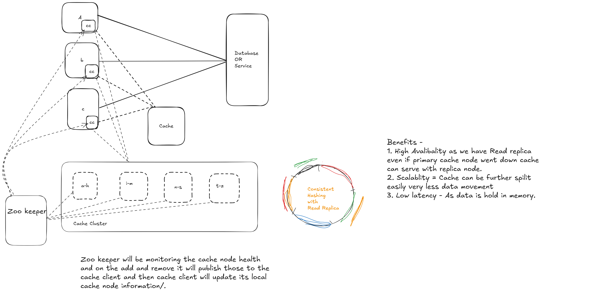

# Design a Distributed Cache

A **distributed-cache service** stores temporary copies of data on several networked
servers. The application reads these copies to reduce response time and database work.
The cache holds product records that the application can load again from the database.
The database remains the **source of truth**: it stores committed records and their
versions. If every cache server loses its data, the database must still hold those records.

## Start with one cache

The application sends a **key**, an identifier for a value, to the cache. If the cache
has an unexpired value, it returns that value. This is a **hit**. If the value is missing
or expired, the cache returns a **miss**. The application then reads the database,
saves a copy in the cache for future lookups, and returns the record.
This process is called **cache-aside** because the application manages cache reads and fills.

```text
Application -- GET(key) --> Cache -- hit --> return cached value
                |
                +-- miss --> Database --> return row and cache a copy
```

When the application updates a record, it commits the database change and then
invalidates (deletes) the cached copy. Another reader may still receive **stale data**,
a value older than the current database record. The application also sets a **time
to live (TTL)**, which tells the cache how long a copy may remain valid. The database
and cache perform separate operations; neither deletion nor TTL makes them one transaction.

If one cache server cannot hold the data or handle the requests, the service divides
the keys among servers. The client needs **routing** to choose the server for a key.
The service uses **replication** to keep extra copies and **membership** to record
which servers may own data. These mechanisms also let it replace a failed server.

## Requirements and explicit choices

The application may use briefly stale product descriptions. It reads checkout prices
and authorization decisions from authoritative systems instead of this cache.
When a cache lookup misses or fails, a **fallback read** loads the record from the database.
A **shard** is a group of keys assigned to a server. The shard's **primary** serves
normal requests, and its **replica** receives copies of changes. With **asynchronous
replication**, the primary may acknowledge a change before the replica receives it.
The service places each replica in a separate **failure domain**, such as another
host or availability zone, so one infrastructure failure is less likely to remove both copies.

| Requirement | Chosen contract |
| --- | --- |
| Workload | 20,000 reads/s; target 95% hit ratio; five million resident records |
| Value size | Average 512 bytes before key and storage overhead |
| Freshness | TTL chosen between 45 and 60 seconds; stronger bounds discussed below |
| Latency budget | Example 100 ms application read deadline; cache attempts get 10 ms total |
| Data placement | Four primary shards, each with one asynchronous replica in another failure domain |
| Reads and updates | Read primaries; commit database writes before invalidating cache |
| Database protection | At most 2,000 fallback reads/s globally, plus a concurrency limit |
| Non-goals | Durable cache-only writes, cross-region coherence, application-local value caching |

These figures are design inputs. The team must measure whether the implementation meets them.

## Read the supplied architecture



[Download the editable Excalidraw source](../assets/DistributedCache.excalidraw)

The artwork and editable source are unchanged. Each cache server is a **node**.
The cache client library, labelled CC, runs inside each application. It keeps a local
**topology map** of node addresses, key ownership, and replica assignments so it can
send requests without asking a coordinator on every read.

| Artwork label | Meaning and limitation |
| --- | --- |
| A/B/C | Each application uses the same shared cache service through its CC library. |
| Client's local node information | CC saves the topology map and its version; it does not save product values here. |
| Shared cache cluster | The cache nodes store the product values and replicate changes. |
| `a-h`, `i-m`, `n-s`, `t-z` | These ranges illustrate partitioning. The hash-based routing below does not use alphabetical ranges. |
| ZooKeeper watches health | ZooKeeper observes sessions and membership; it cannot prove that a node can serve requests. |
| Read replicas give availability | The service must detect failure, choose a replacement, and update routing; a replica can have older data. |
| Memory means low latency | Nodes read memory, but requests still spend time on networks, conversion to bytes, and queues. |

An application **near-cache** would store product values inside the application.
CC stores only routing information here; this design does not add a near-cache.

## Capacity and fallback arithmetic

The **working set** is the set of records the service intends to keep in memory.
The calculations use decimal GB. The team must check the assumed hit ratio against
actual requests, entry expiry, and available memory.

| Estimate | Calculation | Result |
| --- | --- | --- |
| Cache hits | 20,000 × 0.95 | 19,000/s |
| Normal database misses | 20,000 × 0.05 | 1,000/s |
| Primary value bytes | 5,000,000 × 512 | 2.56 GB |
| Values including one replica | 2.56 × 2 | 5.12 GB |
| Illustrative 50% key/metadata/allocation overhead | 5.12 × 1.5 | 7.68 GB |

Eight nodes would hold an average of `7.68 / 8 = 0.96 GB/node`. The team must not use
this average as the node size: some nodes receive more data or traffic, and replacement
and transfer operations need spare capacity. A node may also perform **eviction**,
removing entries before their TTL to free memory. Those removals create more misses.

If the cache becomes unavailable, applications could send 20,000 reads/s to the database,
20 times the normal 1,000 misses/s. The service permits at most 2,000 fallback reads/s
across all applications. With unique requests and no cached responses, it must reject
or degrade at least `20,000 - 2,000 = 18,000 requests/s`. The team must confirm that the
database can support this budget after reserving capacity for writes and other traffic.

## Keys, routing, and membership

The application builds a key such as `product:v1:tenant-7:item-42`. The prefix separates
products, tenants, and value formats; `v1` identifies the format. The application stores
`{record_version, product_fields}` with an expiry. It sends record changes to the
database, not to the cache alone. The cache exposes these operations:

```text
GET(key) -> HIT(value) | MISS | ERROR
SET(key, value, ttl_seconds) -> OK | ERROR
DELETE(key) -> OK | ERROR
```

If a request times out, the client does not know whether the node completed it.
The client must not treat this as a confirmed miss or retry without a limit.

The client uses **consistent hashing** to find a key's primary. It calculates a
**hash**, a repeatable numeric fingerprint of the complete key, and places it on a ring.
It finds the next **token**, an ownership position on that ring, and sends the request
to the token's primary. The service assigns multiple tokens to each node to improve
expected balance. All clients must use the same key encoding, hash function, and map.

When a fifth balanced primary joins four primaries, the service moves roughly one
fifth of keys in expectation. It does not move zero keys or guarantee that exact fraction.
The moved keys may carry a different fraction of requests. More tokens do not fix a
**hot key**, a single key that receives a disproportionate number of requests.

```text
Control plane: Nodes -- sessions/membership --> Coordinator
               App CC <-- watch, then refresh -- Versioned topology

Data plane:    App CC -- hash key, use local map --> Primary --> async replica
                  +-- admitted miss -------------------------> Database
                  +-- after database commit --> invalidate primary
```

The **control plane** manages membership and ownership; the **data plane** serves reads
and writes. Nodes maintain renewable **sessions**, connections with expiry rules, with
a coordinator such as ZooKeeper. If a session expires, the node may have failed or lost
network access while still running. A live session also does not prove that reads work.
The service combines session observations with request failures before replacing a node.

The client registers a **watch** to receive notice that membership information changed.
When notified, it fetches the current map and registers another watch if the previous
watch was one-shot. After reconnecting, it fetches the full map again because notifications
are not a complete history. For each read, it uses its local map, not a ZooKeeper request.

A **controller**, the component that manages ownership changes, publishes a new map
when nodes join or leave. It limits data transfers and allows space for duplicate copies;
if it rebuilds empty shards instead, it limits the extra database reads.
Before activating a replacement primary, it must stop the old owner or enforce **fencing**:
nodes reject operations from an outdated ownership **epoch**, a generation number that
increases whenever ownership changes. Updating client maps alone cannot prevent two
primaries from serving conflicting data. If coordination fails, the service keeps only
routes whose ownership remains valid and stops unsafe promotions. Clients do not elect
their own replacements. The implementation must use a supported ownership-change protocol.

## Read, update, and expiry semantics

The application checks the caller's permissions and builds the tenant-scoped key.
The client routes the read to the primary. If the primary returns an unexpired value,
the application returns it; finding a value never grants permission to read it.
On a miss, the application uses **request coalescing**: one database loader serves
concurrent requests for the same key. The loader obtains a fallback permit, reads the
database, and fills the cache. It returns the database result even if the fill fails.
It may cache a genuine “not found” result briefly, but never a database error as absence.

Each application can still start its own loader. An optional shared **lease** gives one
loader temporary permission across applications, but the service must handle lease expiry
and loader failure. The application chooses TTLs between 45 and 60 seconds at random
to spread expirations. It limits both active loaders and requests waiting for them.

For an update, the application commits the database change and sends deletion to the
primary, which replicates it. If deletion must survive application failure, the application
uses a **transactional outbox**: it records deletion work in the same database transaction.
A worker reads that work and retries deletion. Operators monitor how long work waits.
An asynchronous replica may still miss a recent fill or deletion; if it becomes primary,
it can return an older value. Sending deletion only to the old primary does not prevent this.

### Deeper: the stale-fill race and freshness bounds

1. A reader fetches database version 7 but has not filled the cache.
2. A writer commits version 8 and invalidates the key.
3. The delayed reader fills version 7 after that invalidation.

A node starts the TTL when it inserts the value, not when the writer commits. If an old
load can take at most `L`, the simplified stale-data bound is `L + 60 seconds` after
the commit. This requires bounded loads and retries, authoritative database reads,
and replicas and transfers that preserve expiry without extending old values' lifetimes.
Without these conditions, neither TTL nor delayed outbox deletion promises 60-second freshness.

If the application needs a stronger bound, the cache must check versions when filling
and invalidating. It retains a minimum allowed version after deleting the value and
rejects older fills. It replicates that version fence and keeps it beyond every possible
delayed load. Merely storing a version field does not perform these checks. Use a tested
implementation or bypass the cache when these races are unacceptable. This design does
not serve expired values; doing so requires a separate policy for stale data during errors.

## Failure handling without overwhelming the database

| Failure | Response and limitation |
| --- | --- |
| Slow cache | The client spends at most 10 ms across cache attempts. It refreshes routing and retries at most once, only if safe and time remains. |
| Lost primary | The controller selects a replica, makes it primary safely, and updates the map. Requests may fail during the change; recent cache updates may be lost. |
| Coordinator outage | Clients use existing routes only while ownership remains valid. The service may be unable to replace nodes safely. |
| Empty or unavailable cache | Applications limit fallback, refill gradually, and reject excess misses. |
| Database outage | Applications return permitted unexpired cached values. For misses, they return an unavailable response, not invented empty records. |
| Hot key | Applications coalesce loads. The service uses replica reads only if callers accept the possible delay in copied updates. |

A **stampede** occurs when many requests load missing or expired values at once.
Coalescing and random TTLs reduce it, but applications still need fallback permits.
A shared limiter admits at most 2,000 database reads/s, including retries and refilling.
Alternatively, each application receives a quota whose total stays within 2,000/s,
even as instances join or leave. If quota coordination fails, applications reject
fallback or retain only allocations known to fit the global limit.

Applications also limit outstanding database reads. At a measured mean of 20 ms,
`2,000/s × 0.020 s = 40` reads run concurrently on average. Slower requests can raise
that number, so operators load-test the concurrency limit rather than adopting 40 blindly.
Applications bound waiting queues and stop work when the 100 ms request deadline expires.
If cache attempts consume 10 ms, at most 90 ms remains for all other work.
**Load shedding** means rejecting work beyond these limits. A **circuit breaker**
temporarily stops calls to a failing cache, but does not add database capacity.

## Security, operations, and validation

Operators keep cache and coordinator endpoints private, authenticate connections, encrypt
traffic, and restrict administrative access. The application checks tenant permissions
before lookup; a tenant prefix prevents key collisions, not unauthorized access.
Clients and nodes limit key/value sizes. They avoid storing secrets and redact sensitive logs.

Operators measure hit ratio, eviction count, memory, timeouts, and p95/p99 latency
(the response times within which 95%/99% of requests finish). They compare these with
database fallback rate, concurrency, and rejected requests to detect cache-driven overload.
They also measure how far replicas lag, how old each client's map is, how long replacement
takes, and how long invalidations wait. Sampled database/cache versions help detect stale
values. Operators alert on falling hits with rising database demand and test recovery.

**Exercise:** send 20,000 unique reads/s and make the cache unreachable. Check that the
applications send at most 2,000 fallback reads/s, bound their queues, and reject or degrade
excess requests. Add application instances and confirm that the total limit does not rise.
Restore the cache gradually. Then disconnect a primary or coordinator, delay a client's
map refresh, and reproduce the stale-fill race. Check that replacement preserves fencing
and expiry. The cache must rebuild from the database, never become the only durable truth.

**Related:** [Notification service](notification-service.md) — durable retry boundaries.
