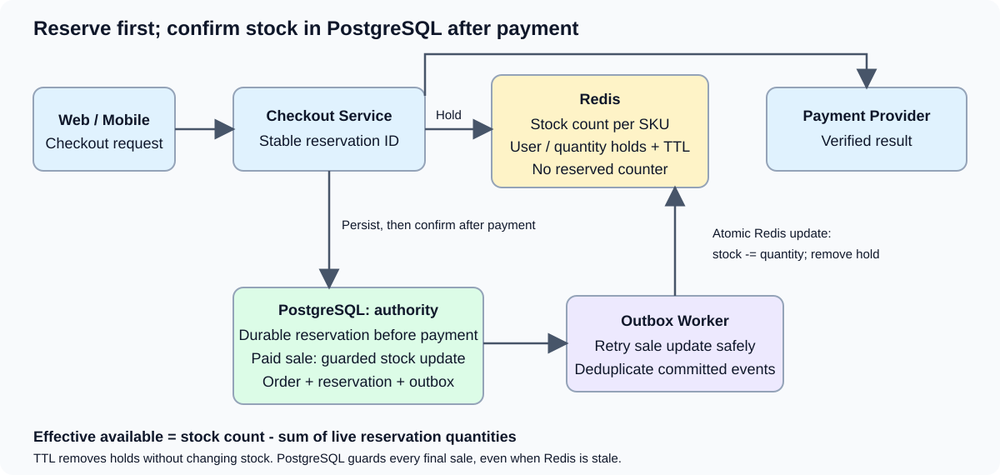

# E-commerce Checkout & Inventory Reservation System Design

## Basic description

An e-commerce checkout design for reserving quantities of a SKU while payment
is in progress. Redis tracks stock and temporary TTL-backed reservation entries;
PostgreSQL authoritatively confirms sales before Redis applies the stock update.

## Functional requirements

- Check effective SKU availability and atomically create a temporary reservation.
- Persist reservations and their deadlines before initiating payment.
- Confirm paid orders and conditionally decrement durable stock in PostgreSQL.
- Apply committed sales to Redis idempotently through an outbox.
- Expire unpaid holds and reconcile delayed or duplicate payment outcomes.

## Non-functional requirements

- Prevent confirmed overselling through atomic PostgreSQL stock checks.
- Keep frequent availability checks off the primary database when Redis is healthy.
- Recover from crashes, lost Redis state, and delayed cross-store updates.
- Make checkout, payment, and inventory transitions safe to retry.
- Bound per-SKU reservation aggregation and monitor hot-SKU contention.

## 1. Scope and goals

Design the checkout and inventory-reservation part of an e-commerce platform where users order quantities of a SKU (for example, 3 phones out of 10,000 available units).

The central goals are:

- Handle high-volume inventory checks and reservation attempts without querying the database on every attempt.
- Prevent overselling when many requests compete for the same SKU.
- Hold inventory temporarily while payment is in progress.
- Automatically release abandoned/expired reservations.
- Confirm paid orders durably.
- Recover safely from process crashes, duplicate messages, delayed payment notifications, and Redis failures.

This document focuses on checkout, reservation, payment orchestration, expiry, and consistency. Catalog search, recommendations, shipping, tax, promotions, and returns are outside the core scope, though they can integrate with the order lifecycle.

## 2. Core design decision

Use Redis as the fast reservation coordination layer:

1. **Inventory heat map in Redis**: stores a stock count per SKU, decremented only after successful payment and a PostgreSQL commit.
2. **Reservation heat map in Redis**: stores temporary SKU/user/quantity entries with TTLs. There is no separate reserved-quantity counter.
3. **Database**: stores durable orders, reservation records (including `reserved_until`), payment attempts, and recovery/outbox records.

A Redis Lua script atomically computes effective availability from the stock count minus live reservations and creates a TTL-backed hold. It does not decrement the stock count. The database is not queried for every inventory availability check. However, a reservation is persisted before payment for recovery, and successful payment is finalized in PostgreSQL before updating Redis.

> Important: Redis and a relational database do not share a single atomic transaction. The design must include idempotency, durable retry/recovery, and reconciliation.

**PostgreSQL is the final source of truth for stock and confirmed sales.** Every checkout that passes Redis must still pass the PostgreSQL conditional stock update before the order is confirmed. Stale or lost Redis state can admit a hold that is later rejected, but cannot cause a confirmed oversell when that database guard is enforced. Redis availability is not a fulfillment guarantee.

## 3. High-level architecture

<div class="diagram-scroll" role="region" aria-label="E-commerce checkout and inventory reservation architecture" tabindex="0" markdown="1">

[](assets/overview.svg)

</div>

```text
                         ┌───────────────────┐
                         │   Web / Mobile    │
                         └─────────┬─────────┘
                                   │
                                   ▼
                         ┌───────────────────┐
                         │   API Gateway     │
                         └─────────┬─────────┘
                                   │
                                   ▼
                         ┌───────────────────┐
                         │   Checkout /      │
                         │   Order Service   │
                         └──────┬───────┬────┘
                                │       │
                 reserve/release│       │ durable records
                                ▼       ▼
                       ┌────────────┐  ┌──────────────────┐
                       │   Redis    │  │ Relational DB    │
                       │            │  │ Orders           │
                       │ Inventory  │  │ Reservations     │
                       │ heat map   │  │ Payment attempts │
                       │            │  │ Outbox / recovery│
                       │ Reservation│  └────────┬─────────┘
                       │ heat map   │           │
                       └────────────┘           │
                                                ▼
                                       ┌──────────────────┐
                                       │ Outbox Publisher │
                                       │ / Reconciliation │
                                       └──────────────────┘

        Order Service ───────────────► Payment Provider
              ▲                              │
              │                              │ webhook
              └──────────────────────────────┘

        ┌─────────────────────┐
        │ Reservation Expiry  │
        │ Worker / Scheduler  │
        └──────────┬──────────┘
                   │ queries due durable records,
                   │ then performs idempotent release
                   ▼
                Redis + DB
```

### Responsibilities

- **API Gateway**: authentication, rate limiting, request routing.
- **Checkout/Order Service**: coordinates reservation, order, payment, and state transitions.
- **Redis**: fast atomic stock allocation and temporary reservation coordination.
- **Database**: durable source for orders, reservation lifecycle, payment attempts, and recovery.
- **Payment Provider**: processes the payment and sends webhooks. We do not rely exclusively on it to expire our inventory reservations.
- **Expiry Worker**: reconciles expired durable reservations and payment outcomes. Redis TTL removes temporary holds; expiry does not increment the stock count.
- **Outbox/reconciliation workers**: retry incomplete steps after crashes and reconcile DB/Redis/provider state.

## 4. Data model

### 4.1 Redis inventory heat map

For a simple logical model:

```text
inventory:available
  SKU-123 -> 9800
  SKU-456 -> 500
```

The field is named `available`, but in this design it means stock remaining after committed sales, BEFORE subtracting temporary reservations. It is not the effective quantity eligible for another hold. Creating or expiring a reservation does not change it. Decrement it only when applying a successful PostgreSQL sale to Redis, exactly once.

An alternative hash-per-SKU model:

```text
inv:{SKU-123}
  available = 9800
  version   = 42
```

The `{SKU-123}` hash tag can be useful for Redis Cluster key placement. All keys touched by one Lua script must be in the same Redis Cluster hash slot.

### 4.2 Redis reservation heat map

Logically, the reservation heat map is `SKU -> user -> quantity`. Each entry has a TTL. Use a stable reservation ID as well so retries and separate checkouts by the same user are distinguishable:

```text
reservation:{SKU-123}:R101
  sku        = SKU-123
  user_id    = U42
  quantity   = 3
  status     = ACTIVE
  expires_at = 2026-10-25T12:15:00Z
  TTL        = remaining hold duration
```

To find the entries belonging to a SKU without scanning Redis globally, maintain a per-SKU index, such as a sorted set:

```text
reservations:{SKU-123}:index
  score = expiry epoch milliseconds
  member = R101
```

Each reservation is a separate TTL-backed key; a single Redis hash with an ordinary key TTL would expire all its fields together. The index may retain IDs after their keys expire. Availability reads ignore missing keys and can remove those stale index members.

Effective availability is the inventory count minus the sum of quantities in live reservation entries. TTL expiry removes a hold from that sum automatically; there is no stock increment and no stored reserved-quantity counter.

TTL handles the Redis hold, not durable order or payment cleanup. PostgreSQL retains the reservation and deadline for reconciliation. Expiring an entry before a committed sale reaches Redis can expose stale stock; see the payment and failure sections.

### 4.3 Relational database tables

Example schema (simplified):

```sql
CREATE TABLE inventory (
    sku_id              VARCHAR(100) PRIMARY KEY,
    total_quantity      BIGINT NOT NULL,
    sold_quantity       BIGINT NOT NULL DEFAULT 0,
    version             BIGINT NOT NULL DEFAULT 0,
    CHECK (total_quantity >= 0),
    CHECK (sold_quantity >= 0),
    CHECK (sold_quantity <= total_quantity)
);

CREATE TABLE orders (
    order_id            VARCHAR(64) PRIMARY KEY,
    customer_id         VARCHAR(64) NOT NULL,
    status              VARCHAR(32) NOT NULL,
    total_amount        DECIMAL(12,2) NOT NULL,
    currency            CHAR(3) NOT NULL,
    idempotency_key     VARCHAR(128) NOT NULL,
    created_at          TIMESTAMP NOT NULL,
    updated_at          TIMESTAMP NOT NULL,
    UNIQUE (customer_id, idempotency_key)
);

CREATE TABLE reservations (
    reservation_id      VARCHAR(64) PRIMARY KEY,
    order_id            VARCHAR(64) NOT NULL,
    sku_id              VARCHAR(100) NOT NULL,
    quantity            BIGINT NOT NULL,
    status              VARCHAR(32) NOT NULL,
    reserved_until      TIMESTAMP NOT NULL,
    created_at          TIMESTAMP NOT NULL,
    updated_at          TIMESTAMP NOT NULL,
    version             BIGINT NOT NULL DEFAULT 0
);

CREATE INDEX idx_reservations_expiry
    ON reservations (status, reserved_until);

CREATE TABLE payment_attempts (
    payment_attempt_id  VARCHAR(64) PRIMARY KEY,
    order_id            VARCHAR(64) NOT NULL,
    provider_reference  VARCHAR(128),
    status              VARCHAR(32) NOT NULL,
    amount              DECIMAL(12,2) NOT NULL,
    currency            CHAR(3) NOT NULL,
    created_at          TIMESTAMP NOT NULL,
    updated_at          TIMESTAMP NOT NULL
);

CREATE TABLE outbox (
    event_id             VARCHAR(64) PRIMARY KEY,
    aggregate_id         VARCHAR(64) NOT NULL,
    event_type           VARCHAR(100) NOT NULL,
    payload              TEXT NOT NULL,
    created_at           TIMESTAMP NOT NULL,
    published_at         TIMESTAMP
);
```

In production, add foreign keys where appropriate, indexes for common queries, retry metadata, and carefully chosen status constraints. If an order can contain multiple SKUs, use an `order_items` table and a separate reservation row per SKU (or a reservation header plus reservation items).

### 4.4 Source-of-truth responsibilities

- **DB** is durable for orders, reservation lifecycle, payment attempts, and sold quantities.
- **Redis** is the low-latency coordination state used for hot-path reservations.
- Redis available counts are derived/maintained state and must be rebuildable or reconcilable from durable inventory plus active reservations.
- The DB's `reserved_until` is the durable expiry deadline. Redis reservation TTLs use the same deadline, rather than restarting the full duration on retries. The per-SKU index is not the only record of a reservation.

Do not independently decrement stock in both Redis and DB without a clearly defined accounting model. Pick a single invariant and make each transition update the required representations idempotently.

## 5. Inventory accounting invariant

For each SKU, the logical invariant is:

```text
sellable quantity = total quantity - sold quantity
available to reserve = sellable quantity - active reserved quantity
```

Once committed updates have been applied to Redis, the accounting is:

```text
Redis inventory count = DB total quantity - DB sold quantity
Active reserved quantity = SUM(quantity of live Redis reservation entries)
Effective available = Redis inventory count - active reserved quantity
```

There is no separate reserved counter. This model sums the live entries for the requested SKU during the atomic availability check. Avoid a global reservation scan. The per-SKU aggregation has a cost that grows with concurrent holds; it is not an O(1) counter lookup.

Example:

| Quantity | Value |
|---|---:|
| Total sellable units | 10,000 |
| Already sold | 200 |
| Active reservations | 300 |
| Available for new holds | 9,500 |

The Redis inventory count in that example is 9,800, not 9,500.

The requested payment sequence looks like this:

| Event | Redis stock count | Live reserved quantity | Effective available |
|---|---:|---:|---:|
| Initial state | 10 | 0 | 10 |
| Customer reserves 2 | 10 | 2 | 8 |
| Payment succeeds; PostgreSQL commits | 10 | 2 | 8 |
| Redis applies the sale and removes the hold atomically | 8 | 0 | 8 |

If payment fails or the hold expires before a sale, remove the reservation (or let its TTL expire). Stock stays at 10 and effective availability returns to 10.

For a multi-SKU order, reserve every requested SKU. If the order requires all items to be held together, the reservation workflow must compensate by releasing already-held SKUs if a later SKU reservation fails. Redis Lua atomicity only covers keys within the same Redis atomic execution and, in Redis Cluster, the same hash slot. A single Lua script cannot atomically reserve arbitrary SKUs spread across different cluster slots. Options include per-SKU reservations with a saga/compensation workflow, or carefully partitioning related inventory into the same slot where practical.

## 6. Main checkout flow

Assume the user requests 3 units of `SKU-123` and the hold lasts 15 minutes.

### Step 1: Create an idempotent checkout request

The client sends:

```http
POST /checkout
Idempotency-Key: client-generated-unique-key
```

```json
{
  "items": [
    {"skuId": "SKU-123", "quantity": 3}
  ],
  "currency": "USD"
}
```

The service validates the request and uses the idempotency key to prevent duplicate orders if the client retries because of a timeout. Do not trust prices sent by the client; calculate the amount from server-side price data.

### Step 2: Establish the checkout identity and deadline

Generate stable order/reservation IDs and a deadline. The requested main flow creates the Redis hold first, then persists it in PostgreSQL before payment.

If the process crashes before persistence, the orphan Redis hold expires by TTL and no payment should have started. Retrying must use the same reservation identity and verify its user, SKU, quantity, and deadline. A durable request-to-ID mapping or optional pending intent can make that identity recoverable across process crashes; it does not change the stock accounting.

### Step 3: Atomically check Redis and create the TTL-backed reservation

Conceptual Lua logic:

```lua
-- KEYS[1] = inventory hash for SKU
-- KEYS[2] = reservation hash for stable reservation ID
-- KEYS[3] = per-SKU reservation index sorted set
-- ARGV[1] = quantity
-- ARGV[2] = reservation ID
-- ARGV[3] = expiry epoch milliseconds
-- ARGV[4] = user ID
--
-- All keys must share a Redis Cluster hash slot.

local existingStatus = redis.call('HGET', KEYS[2], 'status')
if existingStatus then
    -- Idempotent retry: return existing reservation state.
    return {'EXISTS', existingStatus}
end

local qty = tonumber(ARGV[1])
local deadline = tonumber(ARGV[3])
local nowParts = redis.call('TIME')
local nowMs = tonumber(nowParts[1]) * 1000
    + math.floor(tonumber(nowParts[2]) / 1000)
if qty == nil or qty <= 0 or qty ~= math.floor(qty)
    or deadline == nil or deadline <= nowMs then
    return {'REJECTED', 'INVALID_REQUEST'}
end

local stock = tonumber(redis.call('HGET', KEYS[1], 'available'))
if stock == nil then
    return {'REJECTED', 'INVENTORY_NOT_READY'}
end

-- The service passes the indexed reservation keys in KEYS[4..n].
-- It also passes a per-SKU index version in ARGV[5].
local version = redis.call('HGET', KEYS[1], 'reservation_version') or '0'
if version ~= ARGV[5] then
    return {'RETRY', 'INDEX_CHANGED'}
end
local reserved = 0
for i = 4, #KEYS do
    if redis.call('HGET', KEYS[i], 'status') == 'ACTIVE' then
        reserved = reserved
            + tonumber(redis.call('HGET', KEYS[i], 'quantity'))
    end
end
if stock - reserved < qty then
    return {'REJECTED', 'INSUFFICIENT_STOCK'}
end

redis.call('HSET', KEYS[2],
    'reservation_id', ARGV[2],
    'user_id', ARGV[4],
    'quantity', qty,
    'status', 'ACTIVE',
    'expires_at', ARGV[3])
redis.call('PEXPIREAT', KEYS[2], ARGV[3])
redis.call('ZADD', KEYS[3], ARGV[3], ARGV[2])
redis.call('HINCRBY', KEYS[1], 'reservation_version', 1)

return {'OK', 'ACTIVE'}
```

This is illustrative, not production-ready. It does NOT decrement `available`. The service reads the index version, obtains the complete per-SKU list, then invokes the script with every reservation key explicitly supplied through `KEYS`. Every application-driven addition/removal/confirmation must increment that version atomically; a mismatch requires rereading the list. Expired keys are ignored. Do not truncate or paginate the list and then treat a partial sum as complete.

Add key/type validation before writes, verify that a repeated reservation ID belongs to the same order/SKU/user/quantity, and prevent an expired retry from recreating a previously finalized reservation. Durable idempotency records must outlive the temporary keys. Summing many keys inside Lua can block Redis; this model needs bounded per-SKU concurrency and admission control.

### Step 4: Persist the successful reservation

Update the database reservation record to `ACTIVE` with the same `reserved_until`. Use a transaction to update the order/reservation state and write an outbox event such as `ReservationCreated` if downstream processing requires it.

If the DB update fails after Redis grants the hold:
- Do not start payment.
- Retry the DB write with the same reservation ID.
- Have a reconciler inspect any pending intents and Redis state.
- If the hold cannot be durably established, remove its reservation entry idempotently or let its TTL expire. Do not increment or decrement stock.

This is one of the key cross-store failure windows.

### Step 5: Start payment

Only after the hold and durable reservation record are established, create a payment attempt and call the payment provider. Use a stable provider idempotency key derived from the payment attempt/order to avoid duplicate charges on retries.

The user may leave the page. The backend must still own the order and reservation lifecycle; it must not depend on the browser returning.

## 7. Payment outcomes

### Payment succeeds before expiry

1. Verify the webhook signature or query the provider through a trusted server-side API.
2. Deduplicate the provider event using its event ID and/or payment reference.
3. Check the reservation state and deadline under the chosen policy.
4. In a PostgreSQL transaction, serialize against expiry/cancellation using the durable reservation row. Confirm only an eligible reservation, record the payment, conditionally decrement remaining durable stock, confirm the order, and write a sale event to the outbox. With the example schema, decrementing remaining stock means increasing `sold_quantity`; do not also reduce `total_quantity`.
5. Use a guarded update such as `UPDATE inventory SET sold_quantity = sold_quantity + :qty WHERE sku_id = :sku AND total_quantity - sold_quantity >= :qty`, require one updated row, and commit it together with the reservation transition. Duplicate confirmation must not update stock again. If inventory is insufficient after a successful payment, do not confirm the order; persist refund/recovery work.
6. After the commit, apply the outbox sale event to Redis atomically: decrement its inventory count, remove the matching reservation and index member if present, and record that this sale event was applied. The stock decrement must still happen if the reservation key has already expired.
7. Retry safely if Redis is unavailable. Retain event deduplication state for the replay horizon, and fence/version cache rebuilds so an event already included in a rebuilt count cannot decrement it again.

There is no separate reserved counter to decrement: removing the live reservation entry reduces the derived reservation sum.

**TTL race:** if the hold expires after PostgreSQL commits but before Redis applies the sale, Redis can temporarily overstate effective availability. Atomic Redis update alone cannot close this earlier window. The guarded PostgreSQL allocation prevents final overselling, but a later checkout may fail after payment and need a refund. If every accepted hold must guarantee fulfillment, add durable reservation allocation or a properly fenced confirmation/recovery protocol; TTL-backed Redis holds alone do not provide that guarantee.

Do not simply mark an order paid and hope the inventory update succeeds. Confirmation needs a recoverable workflow.

### Payment definitively fails

- Persist the definitive payment failure and conditionally release the durable reservation in PostgreSQL, serialized against confirmation. Do not override a confirmed sale.
- Remove only the matching Redis reservation and index member idempotently, or let its TTL expire.
- Do not change the Redis stock count or durable sold quantity.
- Permit a new payment attempt only under the explicit retry policy; a released reservation cannot be reused without a new hold.

A provider failure notification is useful, but the reservation release must be idempotent.

### User leaves checkout or payment remains unknown

The Redis reservation stays held until its TTL expires or another defined policy applies. A worker reconciles the durable reservation/payment state. A browser disconnect is not proof of payment failure.

### Late payment success after expiry/cancellation

A payment may succeed after our reservation expires, depending on the provider/payment method. The system must not silently confirm an order without inventory. Possible recovery:
- Re-reserve inventory if available and fulfill;
- otherwise issue a refund or send the case to manual recovery.

The policy should be explicit, and the user should not be charged twice. Payment status and inventory status are separate state machines.

## 8. Reservation expiry design

### Durable expiry field

The DB stores `reserved_until`, for example 15 minutes after the hold is granted. This is the durable deadline.

### Finding due reservations

A worker periodically queries an indexed range:

```sql
SELECT reservation_id
FROM reservations
WHERE status = 'ACTIVE'
  AND reserved_until <= CURRENT_TIMESTAMP
ORDER BY reserved_until
LIMIT 500;
```

Multiple workers can use `FOR UPDATE SKIP LOCKED` (where supported) or conditional claims to avoid doing the same work unnecessarily. Correctness must still rely on idempotent state transitions, not on assuming one worker runs.

A per-SKU Redis index can accelerate discovery, but the DB deadline is retained for recovery. TTL removes the temporary Redis entry; it does not erase the durable payment/reservation record.

### Expiry worker algorithm

For each due reservation:
1. Read the durable reservation and current status.
2. If already `CONFIRMED`, `RELEASED`, or `EXPIRED`, no-op.
3. Check payment state. If definitively successful, run the confirmation workflow. If definitively failed, release. If unknown/processing, reconcile with the provider and apply the explicit timeout policy.
4. Conditionally persist expiry/release and an outbox event in PostgreSQL, serialized against payment confirmation on the same durable reservation.
5. Remove the matching Redis reservation if it still exists and clean its index member. It may already have disappeared through TTL.
6. Do not increment stock: reservation creation never decremented it.
7. Retry transient failures; reconcile DB/Redis disagreement. If PostgreSQL already confirmed the sale, ensure its stock-decrement event reaches Redis instead of treating it as an unpaid release.

A simple state transition such as `UPDATE ... WHERE status='ACTIVE'` is useful, but it is not by itself enough to atomically coordinate Redis and the DB. Use a recoverable workflow, operation IDs, and reconciliation for cross-store partial failure.

## 9. Reservation state machine

```text
RESERVATION_PENDING
        |
        | Redis hold succeeded and durable state recorded
        v
      ACTIVE
      /    \
     /      \
payment    expiry / definitive failure
success      |
   |         v
   v      EXPIRED / RELEASED
CONFIRMED

Late payment success after EXPIRED / RELEASED:
    -> recovery workflow
       -> re-reserve if possible, otherwise refund/manual handling
```

Recommended states may include `RESERVATION_PENDING`, `ACTIVE`, `CONFIRMING`, `CONFIRMED`, `RELEASING`, `RELEASED`, `EXPIRED`, and `RECOVERY_REQUIRED`. Keep the state machine no more complex than necessary, but represent cross-store in-progress transitions if they help recover from crashes.

## 10. Idempotency and race conditions

Every transition must be safe to repeat.

### Duplicate checkout request
Use a client idempotency key with a DB uniqueness constraint. Return the same order/reservation outcome for a repeated request.

### Duplicate payment webhook
Store processed provider event IDs or enforce idempotent payment-state transitions. A duplicate webhook must not confirm twice or decrement inventory twice.

### Two requests for the last units
The Lua script serializes the sum/check/create operation. With 2 effective units remaining, two concurrent requests for 2 cannot both create holds against the same intact Redis state: the second sees the first reservation. Redis data loss and stale post-payment counts require the additional safeguards described above.

### Expiry worker and payment webhook race
Both attempt mutually exclusive durable transitions in PostgreSQL. Only one can confirm or expire the same reservation. Redis TTL can expire independently and cannot be rolled back by that transaction; a sale committed before TTL expiry still needs its Redis stock update even if the key disappears before delivery. A recovery workflow reconciles partial failure.

### Redis hold succeeds but DB write fails
Retry with the same reservation ID, or reconcile any pending durable intent. An orphan hold expires by TTL. Never issue payment until the reservation is durably represented.

### DB says active but Redis says absent
An absent key can mean ordinary TTL expiry, data loss, or a partially delivered transition. Check the durable status before choosing recovery. For a confirmed reservation, apply the pending sale event; do not skip its decrement merely because the key is missing. Rebuild inventory counts from durable remaining stock and restore only eligible unexpired reservations, using a controlled cutover.

### Redis failover/data loss
Configure persistence/replication according to requirements, understand that asynchronous replication can lose recent writes, and have a recovery/reconciliation plan. Pause reservation admission for uninitialized/rebuilding inventory. The guarded PostgreSQL final allocation prevents confirmed sales exceeding stock, but does not guarantee every Redis hold can be fulfilled. Strict hold guarantees require durable reservation allocation or equivalent fencing. Do not lazily initialize a missing stock count from SQL while ignoring live or in-flight reservations.

## 11. Multi-SKU orders

If an order has multiple SKUs:
- Reserve each SKU with an atomic operation.
- If any SKU fails, release all earlier holds through compensating idempotent operations.
- Start payment only when all required SKU holds and durable reservation records are established.

In Redis Cluster, a Lua script can only operate atomically on keys in the same hash slot. Arbitrary SKU keys will often be on different slots. Do not claim a single Lua script can atomically reserve arbitrary SKUs across the cluster. Use a saga/compensation workflow, or co-locate inventory where practical if cross-SKU atomicity is required.

## 12. Redis scaling and performance

### Hot SKU
A popular SKU may become a hot spot because its reservation scripts aggregate the same growing set of holds and serialize updates on the same Redis shard. The stock count is changed only when applying confirmed sales, not on each hold. If contention becomes a bottleneck, options include:
- partitioned inventory pools or pre-allocated quotas;
- admission control/rate limiting;
- queueing high-demand purchases;
- regional allocation with bounded stock pools.

Partitioning inventory adds complexity and can strand stock in one partition while another is empty.

### Redis Cluster
Use deliberate key design. Lua keys must be passed through `KEYS` and, in Cluster, share a hash slot. A key pattern like `inv:{SKU-123}` and `reservation:{SKU-123}:R101` can co-locate a reservation with its SKU, but a reservation containing several SKUs cannot naturally fit every SKU's slot.

### Read path
This chosen model has no reserved-quantity counter. It sums live reservation quantities per SKU and subtracts them from the inventory count. Use the per-SKU index, not a global scan, and keep the final check plus reservation creation atomic. This work grows with active holds and is a hot-SKU bottleneck. A separate aggregate reserved counter is a possible future optimization, not part of this design; it would require an explicit expiry/accounting workflow rather than relying solely on entry TTLs.

### Cache/heat-map rebuild
Redis inventory counts are not an independent permanent truth. Rebuild them from durable remaining stock, and separately restore eligible active reservation entries with their remaining TTLs. Do not subtract reservations from the stock count and then subtract them again on reads. Do not rebuild while writes are active without a controlled cutover/versioning strategy that also accounts for pending sale events.

## 13. Database and outbox strategy

The database is used for durable lifecycle records, not every availability read.

Recommended practices:
- Write reservation/order state in transactions.
- Write an outbox event in the same transaction as a durable state transition.
- Publish outbox events asynchronously and mark them published only after successful delivery.
- Make consumers idempotent.
- Use retry limits, dead-letter handling, and operational alerts.
- Periodically reconcile DB reservations, Redis reservation keys/counters, order states, and payment provider status.

The outbox pattern only guarantees durable publication of events created in the same DB transaction. It does not magically make Redis and DB atomic; cross-store transitions still need a recoverable workflow.

## 14. API sketch

### Create checkout
```http
POST /checkout
Idempotency-Key: <unique-key>
```

Response when reservation succeeds:
```json
{
  "orderId": "ORD123",
  "reservationId": "R101",
  "status": "PENDING_PAYMENT",
  "reservedUntil": "2026-10-25T12:15:00Z",
  "paymentUrl": "..."
}
```

### Get order status
```http
GET /orders/ORD123
```

Example:
```json
{
  "orderId": "ORD123",
  "status": "PENDING_PAYMENT",
  "paymentStatus": "PROCESSING",
  "reservationStatus": "ACTIVE"
}
```

### Payment webhook
```http
POST /webhooks/payment-provider
```

Verify signature, deduplicate the event, validate amount/currency/order reference, and enqueue or process the state transition safely.

## 15. Operational monitoring

Track:
- Reservation success/rejection rate and Redis Lua latency.
- Negative stock count or effective availability.
- Active reservations past `reserved_until`.
- Time from expiry deadline to release.
- Redis-vs-DB inventory reconciliation drift.
- Orders stuck in reservation-pending, confirming, or releasing states.
- Payment attempts stuck in processing.
- Duplicate webhook counts and idempotency conflicts.
- Redis evictions, memory pressure, failovers, replication lag, and script errors.
- Outbox age, retry counts, and dead-letter queue depth.
- Late-payment successes after reservation expiry.

Alert on negative stock/effective availability, unexplained drift, or a growing backlog of expired durable reservations. Monitor per-SKU aggregation size and sale-event delivery lag as well.

## 16. Key trade-offs and caveats

1. **DB offload:** Redis avoids DB reads on every reservation attempt, but durable reservation writes still occur before payment as required by this design.
2. **Redis is not automatically durable enough:** replication and persistence configuration determine the failure guarantees. Acknowledged writes can be lost under some failure modes.
3. **TTL releases the temporary hold, not the durable workflow:** deleting the reservation removes it from the live sum without changing stock. It does not update PostgreSQL, reconcile payment, or deliver a committed sale event.
4. **Payment outcome can be delayed:** a user leaving checkout is not equivalent to payment failure.
5. **Cross-store atomicity is unavailable:** Redis + DB transitions need idempotency, retries, and reconciliation.
6. **Final oversell safety:** the PostgreSQL confirmation transaction must guard the durable stock decrement. Redis loss or TTL/sale-update races can still create unfulfillable holds; strict hold guarantees require durable reservation allocation or equivalent safeguards.
7. **Multiple SKUs:** a Redis Lua script cannot atomically reserve arbitrary keys across different Redis Cluster slots; use compensation or a different partitioning strategy.

## 17. Interview summary

- Keep a Redis inventory heat map containing stock before temporary reservations.
- Keep SKU/user/quantity reservation entries with TTLs and a per-SKU index; there is no separate reserved counter.
- Effective availability is stock minus the sum of live reservation quantities.
- Use Lua to atomically check effective availability and create a hold without decrementing stock.
- Persist the reservation in the database before initiating payment, including `reserved_until`.
- Start payment only after the Redis hold and durable reservation record are established.
- After successful payment, PostgreSQL confirms the reservation and conditionally decrements durable stock first; an outbox event then atomically decrements Redis stock and removes the hold.
- Payment failure/expiry removes the hold without changing stock; TTL handles temporary entry removal.
- A worker reconciles expired DB reservations and payment outcomes. PostgreSQL serializes durable confirmation against expiry.
- Do not rely on browser disconnects, provider expiry events, or Redis TTL alone.
- Use durable outbox/retry/reconciliation workflows for Redis–DB failure windows.
- Treat Redis counts and TTL-backed reservations as rebuildable state. Account for the TTL/post-payment-update window and never replay a sale decrement twice.

## Design exercise

Start with 10 units and two checkouts requesting 6 units each. Walk through
concurrent reservation attempts, payment confirmation, and TTL expiry. Then
delay the Redis sale update until after the reservation expires: explain why
PostgreSQL still prevents a confirmed oversell and how a paid but rejected
checkout is recovered.

Compare the same lifecycle with [individual ticket holds](../ticket-booking/index.md)
and review the [storage and transaction fundamentals](../../03-storage.md).
