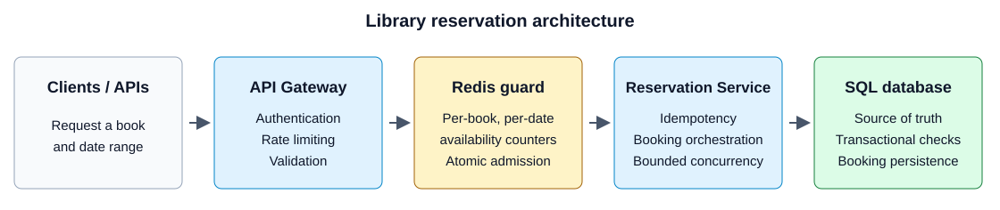

# Library Reservation System — System Design Summary

## Basic description

A library reservation system lets users reserve a book title for a date range.
Each title can have several physical copies, so the service tracks available
capacity for each book and date. SQL confirms a reservation only when every
requested date has capacity; Redis filters competing requests to reduce SQL load.

## Functional requirements

- **Reserve a book:** Accept the book title, user, and requested start and end dates.
- **Check every date:** Verify capacity across the entire date range, not only
  the start date.
- **Enforce the booking window:** Reject requests outside the 30-day booking window.
- **Reserve all or none:** Decrement every requested date and save the booking
  together, or leave all dates unchanged.
- **Make retries safe:** Use the user's request ID to return the same booking
  instead of creating a duplicate reservation.
- **Report the outcome:** Confirm only a committed SQL booking. A request waiting
  in an optional queue is not yet a confirmed reservation.

## Non-functional requirements

- **No overbooking:** Concurrent requests must not reserve more capacity than
  exists for any book and date. SQL transactions and row locks enforce this rule.
- **Durability:** Keep booking records and authoritative availability in SQL,
  independent of Redis restarts or data loss.
- **Burst handling:** Plan for the example of 100K competing requests for one
  book, using admission control rather than sending all work directly to SQL.
- **Bounded database load:** Limit request rate, concurrent transactions, and
  connection-pool use. Measure capacity before promising a throughput or latency target.
- **Recoverable cache state:** Reconcile Redis with SQL and release provisional
  capacity only after a definite rollback, not after an uncertain database outcome.
- **Atomic operations:** Keep multi-date Redis checks atomic and commit SQL
  availability changes and the booking record in the same transaction.
- **Operational visibility:** Monitor lock waits, failed transactions, queue
  depth, latency, and Redis/SQL counter differences.

## 1. Requirements and assumptions

**Assumption:** The end date is exclusive. A booking from the 15th to the 21st occupies the book for the 15th through the 20th.

## 2. Database schema

SQL is the source of truth.

### `Books`

| Column | Purpose |
|---|---|
| `book_id` | Primary key |
| `title` | Book title |
| `author` | Author |
| `isbn` | ISBN |

### `BookAvailability`

One row per book per date.

| Column | Purpose |
|---|---|
| `book_id` | Book identifier |
| `date` | Inventory date |
| `total_count` | Total copies |
| `avail_count` | Copies available on this date |

**Primary key:** `(book_id, date)`.

### `Bookings`

| Column | Purpose |
|---|---|
| `booking_id` | Primary key |
| `request_id` | Idempotency key |
| `user_id` | User making the booking |
| `book_id` | Reserved book |
| `start_date` | Reservation start |
| `end_date` | Reservation end |
| `status` | Pending, confirmed, cancelled, etc. |

Add a unique constraint on the appropriate idempotency key, such as `(user_id, request_id)`, to prevent duplicate bookings when the same request is retried.

## 3. High-level architecture

A durable queue can be added if reservation traffic arrives in large bursts and users can tolerate asynchronous confirmation. A queued request is **not** a confirmed booking.

## 4. How the booking flow works

Suppose a user requests a book from October 15 to October 21.

1. **Validate the request.** Check the user, dates, maximum booking window, and idempotency key.
2. **Check Redis atomically.** Check all requested date counters. If any date has zero capacity, reject immediately. Otherwise, decrement all affected dates as one atomic operation.
3. **Validate and reserve in SQL.** Start a transaction, lock the relevant `BookAvailability` rows in a consistent order, and check that all dates still have capacity.
4. **Update SQL atomically.** Decrement availability for every requested date and insert the booking record in the same transaction. If any check fails, roll back the entire transaction.
5. **Handle the outcome.** On a confirmed SQL commit, return success. On a definite rollback, release the provisional Redis reservation. If the outcome is uncertain, determine whether SQL committed before releasing Redis capacity.

## 5. How we prevent overbooking

The core SQL rule is:

- Every requested date must have sufficient capacity.
- Every affected availability row is locked and checked within a transaction.
- All date counters and the booking record are committed together.
- If even one date is unavailable, the whole reservation fails.

For example, if 1,000 copies are available throughout the requested interval, no more than 1,000 simultaneous one-copy reservations can be confirmed for that interval, accounting for existing bookings.

**Redis improves performance; SQL enforces correctness.** The database must remain safe even if Redis is stale, unavailable, or admits too many requests.

## 6. How we handle 100K concurrent requests

- **Redis admission guard:** rejects requests quickly when capacity is exhausted.
- **Atomic multi-date operation:** prevents concurrent requests from claiming the same cache capacity.
- **Rate limiting and bounded concurrency:** protect the reservation service and SQL connection pool.
- **Idempotency:** prevents repeated requests from creating duplicate bookings.
- **Compensation and reconciliation:** restore Redis counters after definite SQL failures and repair inconsistencies.
- **Cache recovery:** rebuild or reconcile Redis counters from SQL if cache state is lost or corrupted.
- **Monitoring:** track queue depth, database lock waits, latency, failed transactions, and Redis/SQL counter discrepancies.

The 100K requests won't all reach SQL if Redis correctly rejects exhausted capacity. Some additional requests may reach SQL due to failures, retries, or inconsistencies, so SQL still needs its own capacity protection.

## 7. Important trade-offs

| Decision | Benefit | Cost or risk |
|---|---|---|
| Per-date availability rows | Simplifies arbitrary date-range checks | More rows and multi-row updates |
| Redis guard | Reduces unnecessary SQL traffic | Cache consistency and recovery complexity |
| SQL transactions and row locks | Prevents overbooking | Contention for popular books |
| Idempotency keys | Makes retries safe | Requires persistent request tracking |
| Durable queue | Absorbs traffic bursts | Adds latency and asynchronous status handling |

One production refinement: Redis and SQL cannot participate in a single atomic transaction. Releasing Redis capacity after SQL failure is a **compensating action**. For uncertain SQL outcomes, use idempotency and reconciliation rather than blindly incrementing counters.

## 8. Interview closing statement

> I'd model availability at the book-and-date level, since reservations can span arbitrary date ranges. Redis would provide a fast, atomic first-level admission guard across all requested dates, reducing load on SQL. SQL would remain the source of truth and use transactions, row locking, and idempotency to prevent overbooking and duplicate bookings. If persistence fails, I'd compensate by releasing the provisional Redis reservation, while reconciling uncertain outcomes. To handle traffic spikes, I'd add rate limiting, bounded concurrency, and optionally a durable queue.

## Final assessment

This is a solid design direction. The strongest parts are the per-date inventory model, the distinction between Redis admission and SQL correctness, and explicit failure handling. The hardest part—and a likely interview follow-up—is keeping Redis counters consistent with SQL under concurrent requests, retries, and service crashes.
