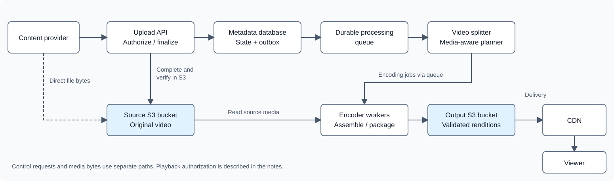
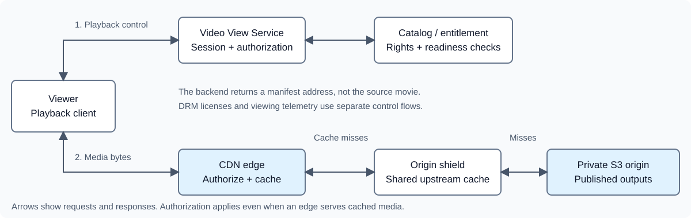

# Amazon Prime Video-Like System Design

## Basic description

A video-on-demand platform accepts large source videos, prepares multiple
playback qualities, and delivers those outputs to authorized viewers.

This is an interview design for a Prime-like service, not a description of
Amazon Prime Video's proprietary implementation. It covers two independently
scaled pipelines: content ingestion/preparation and authorized content serving.

Content providers upload source files directly to platform-managed S3 storage.
Application services authorize and finalize uploads; background workers read
the stored source and prepare streaming outputs.

## Functional requirements

- Let authorized content providers create resumable upload sessions for large videos.
- Register a studio delivery containing a master, required audio/subtitle tracks, artwork, and catalog metadata.
- Upload source bytes directly to object storage, retrying failed parts independently.
- Verify the completed source before scheduling media processing.
- Generate multiple encoded qualities, synchronized audio, and playback manifests.
- Publish a video only after its required outputs have been validated.
- Let viewers discover published titles and request authorized playback.
- Deliver playback segments through a CDN and record watch progress asynchronously.

## Non-functional requirements

- **Durability:** Retain completed source objects and metadata across worker failures.
- **Isolation:** Keep source buckets and unpublished outputs private; restrict each upload to an owned session and object.
- **Bounded resource use:** Limit concurrent uploads, memory buffers, encoder jobs, and retries.
- **Idempotency:** Tolerate repeated completion requests and at-least-once processing tasks.
- **Correct publication:** Prevent incomplete or stale processing attempts from replacing a published output version.
- **Low playback latency:** Serve media through a CDN rather than proxying video bytes through application services.
- **Observable recovery:** Measure upload failures, processing queue age, encoding errors, publication failures, and playback buffering.

A 100 GiB source is an illustrative large-file example, not a required typical
size. Monthly active users alone do not determine upload rate or simultaneous
playback; those need separate workload estimates.

## High-level architecture

<div class="diagram-scroll" role="region" aria-label="Video upload and processing architecture; scroll horizontally on small screens" tabindex="0" markdown="1">

[](assets/overview.svg)

</div>

| Component | Responsibility |
|---|---|
| Upload Service | Authenticate providers, create sessions, presign parts, finalize uploads, and expose status |
| Title / asset registry | Track the studio delivery, required assets, release windows, and regional rights |
| Source S3 bucket | Preserve the original uploaded video |
| Metadata database | Store titles, upload sessions, processing state, ownership, and published output versions |
| Outbox and durable queues | Recoverably schedule processing and tolerate duplicate delivery |
| Video splitter / planner | Inspect source media and create valid timeline-based encoding jobs |
| Encoder workers | Read source media, decode, resize, and encode assigned output intervals |
| Assembler / packager | Validate continuity and create HLS/DASH segments and manifests |
| Quality / publication workflow | Validate required tracks and media quality, then approve a specific output version |
| Playback-output S3 bucket | Store versioned encoded media, manifests, and associated assets |
| Search Service / index | Find published titles; maintain a rebuildable index from durable catalog state |
| Video View Service | Check entitlement and readiness, then establish playback authorization |
| CDN | Cache and deliver manifests and media segments |
| Origin shield / shared cache | Reduce repeated origin fetches across downstream CDN caches |
| DRM license service | Authorize license requests for encrypted playback on supported devices |

The splitter, encoder, and packager are logical stages. An existing media system
can combine them; they do not all need separately deployed custom services.

## Upload flow

### 0. Register the studio delivery

A studio may deliver a high-quality master, separate audio in several languages,
subtitles, artwork, and descriptive metadata. Uploading one movie file does not
necessarily complete the delivery.

```http
POST /titles HTTP/1.1
Authorization: Bearer <CONTENT_PROVIDER_TOKEN>
Content-Type: application/json

{
  "title": "Example Movie",
  "master": {"expectedBytes":107374182400,"declaredVideoFormat":"ProRes"},
  "requiredAudioLanguages": ["en","hi"],
  "requiredSubtitleLanguages": ["en","hi"]
}
```

The backend creates server-generated titleId, videoId, and asset identities.
Declared codec/format information is input to validate, not proof of what a file
actually contains. Each asset gets an owned upload session; subtitle and artwork
files may be small enough for single-object uploads.

Track each asset independently. Source inspection can begin once the master is
verified, but packaging and publication must wait for the required delivery
assets and their validation results. Licensing territories, publication dates,
permitted devices, and release windows belong to catalog/rights metadata.

### 1. Create a session

The creator selects a file. The client sends its name, expected size, and content
type to the Upload Service, not the entire video inside a JSON request.

```http
POST /videos/uploads HTTP/1.1
Authorization: Bearer <CONTENT_PROVIDER_TOKEN>
Idempotency-Key: create-video-request-123
Content-Type: application/json

{
  "titleId": "movie-123",
  "assetId": "master-v1",
  "filename": "movie.mp4",
  "sizeBytes": 107374182400,
  "contentType": "video/mp4"
}
```

The service authenticates the provider, checks quotas and access to the registered
asset, binds its videoId to a new uploadSessionId, and chooses a unique source
object key for this attempt. It initiates an S3
multipart upload and stores the returned provider uploadId.

```http
HTTP/1.1 201 Created
Content-Type: application/json

{
  "videoId": "video-123",
  "uploadSessionId": "upload-session-456",
  "partSizeBytes": 67108864,
  "status": "UPLOADING"
}
```

Persist session identity before external work and reconcile incomplete initiation
attempts. A crash between S3 initiation and saving uploadId can leave an orphaned
multipart upload; cleanup policies must cover it.

### 2. Issue presigned part URLs

S3 returns an uploadId, not a list of part URLs. The backend constructs
UploadPart operations using bucket, object key, uploadId, and partNumber, then
presigns them through the AWS SDK.

```http
POST /videos/uploads/upload-session-456/parts HTTP/1.1
Authorization: Bearer <CONTENT_PROVIDER_TOKEN>
Content-Type: application/json

{"partNumbers":[1,2,3]}
```

The response contains short-lived PUT URLs for those parts. They can be requested
in batches rather than issuing every URL at once. The backend checks ownership
and permitted part numbers before signing.

The application session ID and S3 uploadId are different identifiers. Clients
cannot select another provider's bucket, object key, or multipart upload simply
by supplying different request fields.

### 3. Upload bytes directly to source storage

```text
Client disk -> bounded memory buffer -> HTTPS PUT -> Source S3 bucket
```

For the example, 100 GiB divided into 64 MiB parts produces 1,600 parts.
S3 accepts up to 10,000 parts, and every part except the last must be at least
5 MiB. Choose chunk sizes that satisfy service limits and the expected maximum
file size.

The client uploads a bounded number concurrently, collects part numbers and
ETags, and retries failed parts with backoff. It does not load the entire source
into RAM. Configure CORS and expose ETag so a browser can read it.

If a URL expires, the client reauthorizes the same owned session through the
backend. Resuming after an application restart requires saved progress and access
to the same local source bytes.

The Upload Service handles control requests; it does not relay the 100 GiB
through its API servers. A dedicated resumable upload gateway is an alternative
if direct storage uploads are unsuitable.

### 4. Complete and verify the source

The client submits its part-number/ETag manifest to:

```http
POST /videos/uploads/upload-session-456/complete HTTP/1.1
Authorization: Bearer <CONTENT_PROVIDER_TOKEN>
Content-Type: application/json

{
  "parts": [
    {"partNumber": 1, "etag": "\"part-1-etag\""},
    {"partNumber": 2, "etag": "\"part-2-etag\""}
  ]
}
```

This abbreviated manifest illustrates the shape, not the complete 1,600-part
manifest for the 100 GiB example.

The backend verifies ownership, expected parts, and sizes, completes the
multipart upload, and checks the resulting object's identity, size, and supported
checksums. An ETag is not generally a whole-file MD5 checksum.

Return an accepted processing response only after the source is verified and
the next stage is recorded durably:

```http
HTTP/1.1 202 Accepted
Content-Type: application/json

{"videoId":"video-123","status":"PROCESSING"}
```

Make completion idempotent. A client message saying "upload complete" is not
proof that storage finalized the object. Storage completion and database writes
are separate operations; reconciliation handles a crash or lost response
between them.

In one database transaction, set the verified source/version, transition to
PROCESSING, and write an outbox event. A publisher delivers that event to the
processing queue.

For lower-level AWS and Azure requests, see
[Multipart Uploads](../../storage/multipart-uploads.md).

## Why workers read from S3

The source bucket is a platform-managed resource inside the logical system
boundary, even though S3 is a separate infrastructure service.

Direct upload avoids routing bytes through the Upload Service. It does not
eliminate the storage-to-worker reads needed for processing.

| Approach | Behavior and tradeoff |
|---|---|
| Download then process | Worker downloads the whole source to local disk. Simple, but needs disk capacity and download time. |
| Progressive reading | Worker starts processing while reading; container layout and seeking requirements determine what is possible. |
| Range-based processing | Media-aware workers seek and read relevant byte ranges, including metadata and decoding dependencies. More complex. |

Start with local download if it fits the workload. A planner can inspect enough
metadata to assign intervals without downloading and physically rewriting the
whole source into temporary chunk files.

Encoding the complete video still reads essentially all relevant source media
collectively, possibly more because workers need overlapping data or retry jobs.
Keep compute near source storage and account for request, storage, compute, and
applicable data-transfer costs; do not assume every transfer is free.

## Three different meanings of a chunk

| Kind | Purpose | Boundary |
|---|---|---|
| Upload part | Reliably transfer the original file to S3 | Arbitrary contiguous byte range |
| Encoding work interval | Parallelize media processing | Timeline interval with sufficient decoding context |
| Playback segment | Let a player buffer, seek, and switch quality | Media-aware boundaries chosen for the streaming format |

S3 reconstructs the exact source bytes before the initial batch-processing
pipeline starts. Its upload parts are not automatically valid video files.

## Media-aware splitting

### Container and compression information

An MP4 contains video/audio tracks and metadata describing codecs, timestamps,
and where samples are stored. A demuxer reads that container and exposes packets
for each track.

Compressed frames can reference other frames. Cutting the file every 1 GiB can
split a packet, remove initialization metadata, or omit necessary reference
frames. Independently encoding those arbitrary byte slices is not safe.

I-frames encode an image without referring to another image, but an I-frame
alone is not a universal independent-start guarantee. Open groups of pictures
(GOPs) can carry dependencies across boundaries. Use codec-appropriate random
access points, such as suitable H.264 IDR boundaries, or decode additional context.

### Plan jobs by timeline, not file size

For a long source, desired output jobs might cover:

```text
Worker A emits [0s, 60s)
Worker B emits [60s, 120s)
Worker C emits [120s, 180s)
```

The planner can move boundaries to safe source points, or keep exact output
intervals and let workers decode extra frames.

```text
Worker B:
    seek to safe source point at 58s
    decode from there
    discard output before 60s
    emit only frames assigned to [60s, 120s)
```

Reordered frames can also require reading packets beyond the emitted interval.
The media library handles decoding dependencies. Overlapping source reads are
acceptable; gaps or duplicates in the emitted timeline are not.

```json
{
  "videoId": "video-123",
  "sourceVersion": "source-v1",
  "processingVersion": "encode-v1",
  "decodeStartSeconds": 58,
  "outputStartSeconds": 60,
  "outputEndSeconds": 120,
  "rendition": {"height":720,"codec":"h264","videoBitrate":"2500k"}
}
```

This is an explanatory job shape. Production jobs use exact media timestamps,
time bases, and codec-specific parameters.

## Encoding, audio, and packaging

Workers decode source frames, resize them, and encode coordinated renditions
such as 1080p, 720p, and 480p. For suitable 4K sources and supported devices, the
ladder may also include 2160p; constrained connections may use 360p.
Choose the ladder using source quality, codec/device support, and platform
policy rather than upscaling every source into every resolution.
A single decode pipeline can feed several
renditions where supported, avoiding unnecessary repeated decoding.

Lower resolution does not imply a fixed percentage reduction in file size.
Encoded size depends mainly on duration and chosen bitrates, plus audio and
container overhead. Converting a 100 GiB source to 720p does not automatically
produce a 60 GiB output.

Audio packet boundaries may not align with video intervals. Handle timestamps,
trimming, encoder delay, and padding explicitly. One option is a continuous
audio-processing path combined with parallel video jobs.

Assembly must preserve ordering, compatible codec settings, timestamps, and
audio/video synchronization. Appending bytes from complete MP4 files is not
generally a valid assembly method; use media-aware remuxing or packaging.

**Transcoding** changes encoding characteristics such as codec, bitrate, or
resolution. **Packaging** organizes encoded tracks into a delivery format.
They are different operations even if one tool performs both.

Create HLS playlists or DASH manifests and media segments for streaming.
Coordinate segment/switching boundaries across representations so the player can
change quality without discontinuities.

For example, a simplified HLS package can contain:

```text
movie-123/output-v3/
  master.m3u8
  480p/
    playlist.m3u8
    segment001.ts
    segment002.ts
  720p/
    playlist.m3u8
    segment001.ts
    segment002.ts
  1080p/
    playlist.m3u8
    segment001.ts
    segment002.ts
```

The HLS master playlist identifies available representations; media playlists
identify their segments. This example omits separate audio/subtitle playlists.
Real packages can use fragmented MP4/CMAF with initialization segments instead
of MPEG-TS. DASH describes representations and segments in an MPD manifest.

There are two valid processing shapes:

```text
Simple:   Source -> encode -> package into playback segments

Parallel: Source -> media-aware work planning -> parallel encoding
                 -> assemble/package into playback segments
```

FFmpeg provides media inspection, decoding, encoding, and packaging primitives.
A distributed job scheduler, retries, and publication workflow are still
application responsibilities. A managed system such as AWS Elemental MediaConvert
can provide supported transcoding and packaging workflows instead of a custom
encoder fleet. Do not implement codec internals for this interview design.

## State, data, and safe publication

```text
UploadSession:
    uploadSessionId, assetId, videoId, ownerId, bucket, objectKey, s3UploadId
    expectedBytes, partSize, applicationDeadline, status

Title / SourceAsset:
    titleId, studioId, requiredAssets, rights, releaseWindow, catalogStatus
    assetId, titleId, kind, language, verifiedSourceVersion, validationStatus

Video:
    videoId, titleId, ownerId, sourceVersion, processingVersion
    processingStatus, publishedOutputVersion

ProcessingJob:
    jobId, videoId, sourceVersion, processingVersion
    interval, rendition, attempt, status, outputLocation
```

```text
Upload session: INITIATING -> UPLOADING -> FINALIZING -> COMPLETE
               failures/cancellation -> FAILED or CANCELLED

Video processing: UPLOADING -> PROCESSING -> QC_PENDING -> READY
                  failures -> retry or FAILED

Catalog: DRAFT -> PUBLISHED -> UNPUBLISHED
```

QC_PENDING means encoded/packaged outputs await quality validation or approval.
READY means the required assets and outputs have passed those checks. Catalog
publication separately requires editorial approval, release time, and regional
rights; a READY title is not automatically playable everywhere.

Quality checks can include corrupt or missing frames, black-frame detection,
audio/video synchronization, missing languages, subtitle timing, and manifest
completeness. Required DRM encryption/key metadata and any required artwork must
also be ready. Automated black-frame detection flags candidates for review; a
black scene is not by itself proof of a defect.

Write each processing attempt to a versioned output prefix. Deduplicate jobs
using source version, processing version, interval, and rendition. Duplicate
workers must not overwrite another attempt's partially written outputs.

After all required jobs, packaging, and quality checks succeed, validate manifests,
referenced objects, duration, continuity, and required tracks. Conditionally update
the published-output pointer and catalog eligibility only if this is still the
expected processing version and the publication gates are satisfied.
Keep incomplete prefixes unreachable from published manifests.

Update the search index through durable events. The database/catalog remains
authoritative; search results do not by themselves authorize playback.

## Content serving: control plane and media data plane

The **control plane** authenticates viewers, checks rights, and establishes a
playback session. The **media data plane** delivers the actual audio/video bytes
through a CDN, such as CloudFront. They have different scaling requirements.

<div class="diagram-scroll" role="region" aria-label="Authorized playback and CDN delivery; scroll horizontally on small screens" tabindex="0" markdown="1">

[](assets/playback.svg)

</div>

```text
Viewer -> Video View Service -> readiness / rights / subscription checks
Viewer <- manifest URL + temporary CDN authorization
Viewer -> CDN -> playback-output storage on cache miss
```

### 1. Authorize a playback session

```http
POST /playback-sessions HTTP/1.1
Authorization: Bearer <VIEWER_ACCESS_TOKEN>
Content-Type: application/json

{"titleId":"movie-123","deviceId":"device-456"}
```

The Video View Service checks authentication, publication/readiness, subscription
or rental entitlement, territory/release window, device compatibility, and any
concurrent-stream policy. A supplied deviceId is not automatically trusted proof
of a permitted device. If concurrent stream limits are enforced, claim a
bounded session slot atomically and release/expire it through heartbeat policy.

Choose a published output version and compatible playback format:

```json
{
  "playbackSessionId": "session-789",
  "manifestUrl": "https://media.example.com/movie-123/output-v3/master.m3u8",
  "authorization": {"mechanism":"signed-cookies","expiresInSeconds":900},
  "licenseUrl": "https://licenses.example.com/playback"
}
```

This is an illustrative API shape, not a complete cookie or DRM exchange.
The response also needs to establish the actual CDN authorization through
appropriately scoped cookies or URLs; the mechanism label alone grants nothing.
The license URL applies to encrypted content.

Return a manifest address, not the 100 GiB master download address. The View
Service carries these small control messages, not every segment. Existing
sessions may still need authorization refresh, license renewal, and telemetry.

### 2. Fetch the manifest and segments through the CDN

The player fetches HLS/DASH metadata, selects compatible video/audio tracks, and
requests media segments. It buffers a short interval and adapts quality using
available bandwidth and buffer health.

A CDN cache hit serves the object from an edge cache. A miss fetches it from an
upstream/shared cache or the private storage origin, then may cache it according
to policy. The application backend is not in this byte-delivery path.

Seeking uses manifest timing to find media near the desired position. The player
does not download all preceding movie bytes first; codec initialization and
decoding prerequisites are still needed.

Publish immutable versioned segments and appropriate cache lifetimes. Validate
viewer authorization on media requests, including cache hits. Do not require a
unique cached copy of identical media for every viewer: with edge authorization,
validated signature/cookie values can be excluded from the object cache key where
supported. Include fields that actually change response bytes or representation.
Never exclude authorization from the cache key without enforcing access separately.

### 3. Protect access and obtain DRM licenses

| Mechanism | Purpose |
|---|---|
| Application authentication and entitlement | Decide whether this viewer may play the title |
| Signed CDN URLs/cookies or an edge-validated token scheme | Authorize fetching permitted manifest/segment paths during a bounded window |
| Private storage origin access | Prevent viewers bypassing CDN access checks by reading S3 directly |
| DRM encryption and license authorization | Control access to media decryption keys and supported playback policies |

Signed access and DRM are not substitutes for each other. Protect segments and
audio/subtitle assets as needed, not only the top-level manifest. Use TLS and
avoid exposing temporary credentials in logs.

License requests follow a separate authorization flow. Define session, CDN
authorization, and license expiry/renewal behavior: short-lived credentials alone
do not promise immediate revocation of already-authorized playback.

### 4. Record viewing events asynchronously

Send progress and playback events to event ingestion and a durable queue.
Deduplicate event IDs, bound client event rates, and define out-of-order progress
handling. Save resume position separately from analytical view counts.
Requesting a playback session is not proof of watching; define a qualified-view
policy before counting views.

Billing, recommendations, live streaming, and detailed DRM protocols remain
outside this document.

## A major release or viral movie

Suppose five million viewers are concurrently streaming at an average delivered
video bitrate of 4 Mbps. That is about 20 Tbps of video delivery before audio and
protocol overhead. It is an illustrative concurrency scenario, not a forecast
derived from monthly active users.

Scale the following paths independently:

| Path | Main pressure | Scaling approach |
|---|---|---|
| Playback/control APIs | A burst of session and entitlement requests | Stateless API capacity, indexed data, bounded caches, and backpressure |
| CDN media delivery | Repeated reads of popular segments across regions | Edge caching, stable versioned object URLs, and sufficient delivery capacity |
| Origin | Cold/missed segments and cache-fill bursts | Shared origin shield, request collapsing, measured origin capacity, and controlled retries |
| Telemetry | Large volumes of playback events | Batched ingestion, durable queues, and asynchronous consumers |

For example, 100,000 requests for the same 4 MB segment represent 400 GB of
viewer-facing data in decimal units. Cache reuse can reduce origin bytes
substantially, but it does not eliminate delivery bandwidth to viewers.

An origin shield adds a shared cache tier so several edge misses can reuse an
upstream object. Request collapsing combines concurrent fetches for the same
cache key where supported. This does not guarantee one origin fetch globally:
geography, cache tiers, evictions, request variants, and authorization/cache
configuration all matter.

For anticipated releases, consider controlled prewarming where supported.
Prewarming does not pin every object in every edge indefinitely. Monitor miss
rates, protect origin capacity, and use bounded retry/backoff rather than letting
a cache failure turn into unlimited origin requests.

Authorization failures, origin failures, and missing published assets are
different outcomes. Do not cache a transient authorization or storage outage as
proof that the video does not exist.

## Failures and recovery

| Failure | Response |
|---|---|
| One upload part fails | Retry that part without restarting the whole source upload |
| Upload authorization expires | Reissue authorization for the same owned, still-valid session |
| Creator abandons the upload | Abort incomplete uploads and use an S3 lifecycle cleanup policy |
| Storage completes, metadata update fails | Reconcile the unique session/object and resume finalization |
| Processing event publication fails | Outbox publisher retries; consumers deduplicate |
| Encoder crashes | Retry a bounded job against the immutable source version |
| One rendition fails | Keep initial publication pending until required outputs are ready; define optional-rendition policy explicitly |
| Required audio, subtitles, artwork, or QC approval is missing | Track the blocking asset/check; do not publish merely because the master upload completed |
| An old worker finishes after reprocessing | Reject stale publication using the processing version |
| Source is corrupt or unsupported | Record FAILED with a provider-visible reason; do not retry indefinitely |
| CDN misses | Fetch from the private playback origin; monitor origin load and cache effectiveness |
| Many edges miss a newly released segment | Use shared caching/collapsing where supported and bound origin retries/load |
| CDN authorization expires during a movie | Refresh through an authorized session policy; do not make the source publicly readable as a fallback |
| Metadata or authorization is unavailable | Do not invent permission; fail new protected playback requests explicitly |

Retain source videos according to a deliberate retention policy so re-encoding
is possible. Originals are not disposable merely because a worker produced
some outputs.

## Capacity and operational signals

Estimate source bytes uploaded per day, concurrent upload sessions, and total
processing minutes per rendition. Provision workers for source duration,
codec complexity, output ladder, and measured encoding speed rather than file
size alone.

Playback bandwidth depends on concurrent viewers and their delivered bitrates,
not monthly active users alone. CDN caching reduces origin demand but does not
remove viewer-facing bandwidth requirements.

Measure upload completion/error rates, abandoned bytes, queue age, job retries,
encoding throughput, temporary output storage, missing-asset/QC age, publication
latency, entitlement/session latency, edge/shield hit ratio, origin fetch load,
license failures, playback startup time, and rebuffering. Use bounded retries and dead-letter
handling so a bad source cannot consume unlimited compute.

## Conceptual exercise

**Required material:** the upload, media splitting, and publication sections above.
This is a written exercise; no cloud account or encoder installation is needed.

Assume a creator uploads a 100 GiB source in 64 MiB parts. A completion response
is lost, one encoder job is delivered twice, and an older processing attempt
finishes after a replacement attempt.

1. Explain how to recover upload completion without creating another video.
2. Explain why the 1,600 upload parts cannot simply become independently encoded MP4 files.
3. Explain how duplicate workers and stale outputs are prevented from publishing.
4. Describe the authorization and byte-delivery paths when a viewer presses Play.
5. Explain why missing required subtitles block publication and how a release-day cold-cache burst is kept away from the application servers.

**Completion criteria:** distinguish storage state from application state,
arbitrary byte parts from media intervals, job deduplication from publication
version checks, required-asset gates, and View Service requests from CDN delivery.

??? success "Answer guidance"
    Recover through the owned upload session and verify the resulting source
    object before continuing. Media-aware processing needs codec/container
    metadata and reference frames, not arbitrary 64 MiB boundaries. Deduplicate
    jobs and isolate output attempts, then conditionally publish the expected
    processing version. The View Service authorizes playback; the CDN serves
    manifests and segments from validated playback outputs. Required delivery
    assets and QC gates must pass before publication. Shared shielding/collapsing
    can reduce cold-cache origin requests, but delivery bandwidth still scales
    with viewers.

## References

- [Multipart Uploads: AWS S3 and Azure](../../storage/multipart-uploads.md)
- [AWS S3 multipart upload overview](https://docs.aws.amazon.com/AmazonS3/latest/userguide/mpuoverview.html)
- [FFmpeg documentation](https://ffmpeg.org/documentation.html)
- [AWS Elemental MediaConvert overview](https://docs.aws.amazon.com/mediaconvert/latest/ug/what-is.html)
- [CloudFront Origin Shield](https://docs.aws.amazon.com/AmazonCloudFront/latest/DeveloperGuide/origin-shield.html)
- [Messaging and background work](../../05-async.md)
