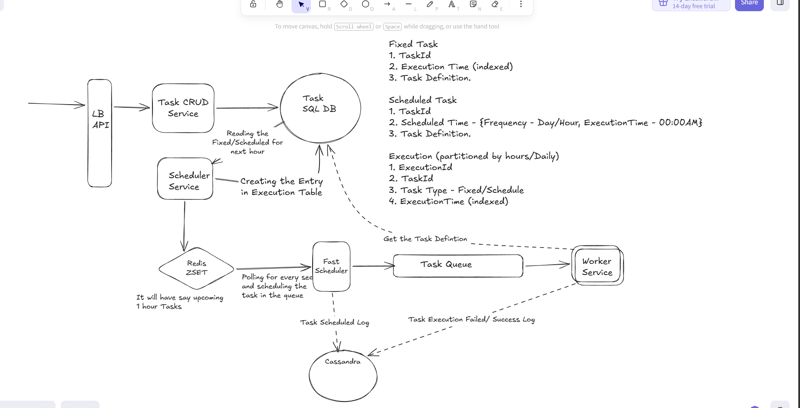

# Task Scheduler

## Basic description

Let users create one-time tasks and recurring schedules. A scheduler records
individual executions in SQL and loads the upcoming hour into Redis. Fast
schedulers poll Redis every second and dispatch due executions to a durable
queue. Workers consume the queue and run the tasks.

The design separates **when work should start**, **reliable dispatch**, and
**the actual execution**. Redis makes near-term lookups fast; SQL retains the
information needed to recover.

**First pass:** “send a report every day at 09:00” is one task definition.
Tomorrow's 09:00 run is one **execution occurrence** with its own execution ID.
SQL saves that occurrence; Redis indexes when it is due. A fast scheduler
temporarily claims it, publishes its ID, and clears the dispatch claim only
after the queue confirms durable storage. A worker later runs it, saves the
result, and acknowledges the queue. Dispatching work and completing it are
different milestones.

The diagram's **CRUD** service handles create, read, update, and delete
operations on task definitions; it does not execute the tasks.

## Functional requirements

- Create, update, cancel, and inspect one-time tasks and recurring schedules.
- Expand hourly or daily schedules into individual execution occurrences.
- Dispatch due executions to a queue and let workers process them independently.
- Record outcomes, retry eligible failures, and recover abandoned dispatch claims.

## Non-functional requirements

- Poll for due work at an example interval of one second, without promising an
  exact worker start time.
- Support multiple scheduler and worker nodes without relying on process-local state.
- Preserve durable execution records and tolerate duplicate queue delivery.
- Bound polling batches, retries, and Redis look-ahead memory; monitor overdue work.

## Architecture

<div class="diagram-scroll" role="region" aria-label="Task scheduler architecture with SQL, Redis, a durable queue, workers, and execution logs; scroll horizontally on small screens" tabindex="0" markdown="1">

[](assets/task-scheduler.png)

</div>

### Original design board


[Download the editable Excalidraw source](assets/DistributedTaskScheduler.excalidraw).
The original board is preserved unchanged; use Expand for a full-screen view.

The original diagram shows the main components. The **ready/in-flight protocol**
below refines its Redis-to-queue arrow: do not permanently pop an execution before
the queue accepts it.

```text
API -> Task CRUD service -> SQL task definitions
                               |
                         Scheduler service
                               |
                    SQL execution occurrences
                               |
                         Redis ready ZSET
                               |
                    Atomic Lua claim operation
                               |
                      Redis in-flight ZSET
                               |
                       Fast scheduler -> Durable queue -> Workers
                               |                            |
                     Remove dispatch claim          Update SQL outcome
                     after queue acceptance         and acknowledge queue

Expired dispatch claims -> Recovery scan -> Redis ready ZSET
```

## Definitions, executions, and retention

These are different records, not three independent copies of the full task.

| Record | Purpose | Important fields |
| --- | --- | --- |
| One-time task | A definition that should run once | `taskId`, `runAt`, definition/version, cancellation state |
| Recurring schedule | A long-lived rule producing many runs | `taskId`, recurrence, timezone, indexed `nextRunAt`, version, enabled state |
| Execution | One occurrence and its processing history | `executionId`, `taskId`, schedule version, `scheduledAt`, status, attempts, retry time, worker claim token and lease expiry |
| Redis entry | A small dispatch index | Execution ID plus due time or dispatch-lease expiry |

Use SQL execution states such as `PENDING`, `QUEUED`, `RUNNING`,
`RETRY_WAIT`, `SUCCEEDED`, `FAILED`, and `CANCELLED`. Redis claim state is
separate from the worker's execution state.

Partition execution history by scheduled day or hour when volume warrants it;
keep indexes supporting pending due work and expired worker leases. Enforce
occurrence uniqueness on `(taskId, scheduleVersion, scheduledAt)` using a
constraint compatible with the database's partitioning rules.

One-time definitions can be purged after a terminal outcome and, for example,
30 days of retention, provided no execution still depends on them. Do not delete
a task merely because it was created 30 days ago: it may be scheduled months
ahead. Recurring definitions remain until disabled/deleted under policy; old
terminal executions can expire independently.

## Finding upcoming hourly and daily tasks

Store `nextRunAt` in UTC and index it. Query enabled schedules whose
`nextRunAt <= horizonEnd`, including overdue schedules for explicit catch-up
handling. This avoids evaluating every recurrence rule on every scan.

For each schedule, calculate occurrences until the next one is outside the
look-ahead window. For an hourly task running at `:15`, at 10:00:

| Look-ahead | Occurrences to materialize | Following `nextRunAt` |
| --- | --- | --- |
| One hour | 10:15 | 11:15 |
| Six hours | 10:15, 11:15, 12:15, 13:15, 14:15, 15:15 | 16:15 |

These are alternative examples, not two consecutive scans. Compute each occurrence
from the previous scheduled time, not the scanner's current time, to avoid drift.
Distinguish "every 60 minutes" from "at this local clock time"; define timezone
and daylight-saving behavior for calendar-based schedules.

In a short SQL transaction, lock the relevant definition, insert unique execution
occurrences, and advance `nextRunAt` together. After commit, load their execution
IDs into Redis. Do not advance the schedule without durably recording its runs.

This can be **one normal scheduler pass**, rather than a mandatory second job
reading every newly inserted execution. A recovery scan still repairs SQL-to-Redis
gaps if the scheduler crashes after the SQL commit.

Refresh the horizon continuously. A six-hour look-ahead does not mean waiting six
hours between checks: a task created at 10:05 for 10:06 must be loaded promptly.
Use frequent incremental scans or a durable change notification. After downtime,
define whether missed runs execute late, are skipped, or are coalesced.

## Redis ready and in-flight sets

A **ZSET** is a Redis sorted set: each unique member has a numeric **score**
used for ordering. Here the scores are timestamps, so due work can be found
without scanning every execution. A **lease** is a temporary claim until a
deadline; its **token** identifies that particular owner. A **Lua script**
performs the claim's Redis checks and changes atomically, without another
Redis command interleaving them.

An **in-flight set** is an ordinary Redis ZSET maintained by the application.
Here it means **dispatch has been claimed**, not that a worker is running.

| ZSET | Member | Score |
| --- | --- | --- |
| `ready` | `executionId` | Scheduled dispatch time, or retry due time |
| `in-flight` | `executionId` | Dispatch claim expiry time |

Multiple fast schedulers can share these sets:

1. Every second, run a bounded Lua script that finds due ready entries, moves
   them to in-flight, and records a fresh claim token and expiry for each.
2. Publish each claimed execution ID to the durable task queue.
3. After the queue confirms durable acceptance, remove that in-flight claim
   **only if its token still matches**.
4. Periodically reclaim expired entries with another atomic script, returning
   them to ready and invalidating their old claim tokens.

Store claim tokens in companion Redis metadata. Token checks prevent a delayed
old scheduler from removing a newer scheduler's claim. If using Redis Cluster,
the ready, in-flight, and claim-metadata keys for one shard must share a hash slot
so the Lua operation can access them atomically.

Atomic read-and-remove alone solves concurrent claiming but leaves a crash gap
before queue publication. **Read-and-move with a lease makes that gap recoverable.**
Keep scripts and batches short because they block other commands on that shard.

### If a fast scheduler dies

```text
10:00:00  Node A claims E123; dispatch lease expires at 10:00:30.
10:00:01  Node A dies before publishing.
10:00:30+ Node B's recovery scan atomically returns E123 to ready.
          A live scheduler claims E123 and retries publication.
```

Every live scheduler can run recovery; it does not depend on the failed node.
ZSET scores do not trigger recovery automatically: a process must scan them.
Thirty seconds is illustrative. A ten-minute lease also works but delays recovery
by roughly that duration plus scan and queue delays. Choose a lease longer than
expected publication time, or renew it conditionally while the owner is active.

| Failure point | Recovery behavior |
| --- | --- |
| Before atomic claim | Execution stays ready |
| After claim, before queue acceptance | Claim expires and publication is retried |
| Queue accepted, but scheduler crashed before removing claim | Publication may repeat with the same execution ID |
| Redis loses ready/in-flight data | Rebuild from durable SQL execution state |

## Queue acceptance is not task completion

### Example: an execution with a ten-minute dispatch lease

Suppose `E123` is due at 10:00 and Node A claims it:

| Time / event | Ready ZSET | In-flight ZSET | What happens next |
| --- | --- | --- | --- |
| Before claim | `E123`, score 10:00 | Empty | Any fast scheduler may claim due work |
| Atomic Lua claim at 10:00 | Empty | `E123`, expiry 10:10, with claim token A | Node A attempts queue publication |
| Queue confirms acceptance at 10:00:02 | Empty | Claim A removed conditionally | The queue now owns delivery to workers |
| Alternatively, A dies before publication | Empty | Claim A remains until reclaimed | A live node scans for expired claims |
| At or after 10:10, recovery finds A's expired claim | `E123` returned to ready | Claim A removed atomically | A live node obtains a fresh claim and retries |

The success and failure rows are alternative paths. **We do not wait ten minutes
on the success path**: remove the in-flight claim as soon as the queue confirms
durable acceptance. Ten minutes is a chosen recovery timeout, not a Redis
default or a task execution time limit.

If publication succeeded but A died before removing its claim, another node
may publish `E123` again after expiry. This is expected at-least-once dispatch.
An acknowledgment with old token A must not remove a newer claim. Workers must
handle repeated `E123` messages without repeating committed business effects.

### Two separate acknowledgments

There are **two separate acknowledgments**:

- The queue confirms publication to the fast scheduler; the scheduler removes
  its Redis dispatch claim without waiting for task execution.
- The worker completes processing and durably records the result; only then
  does it acknowledge the queue message.

The queue must support redelivery/recovery of unacknowledged work. Workers use
conditional SQL claims with execution leases and claim tokens so two deliveries
do not normally start the same execution concurrently. Workers renew leases
and queue visibility where required. Updates from an expired owner must not
overwrite a newer owner's execution state.

Keep the same `executionId` across redeliveries. A worker that finds an already
succeeded execution acknowledges it without running it again. Business effects
must still be idempotent: a worker can apply an external effect and crash before
recording success. Pass the execution ID as an idempotency key where supported,
or use an appropriate transactional effect/outbox design. A lease alone cannot
guarantee exactly-once effects.

For retryable failures, durably record the next attempt time and bounded backoff.
Schedule that attempt through the same recovery-safe path; do not both
independently schedule a retry and blindly requeue the same attempt.

## SQL recovery, edits, and logs

Treat Redis as rebuildable. Restore overdue and upcoming pending/retry executions
from SQL without blindly resetting live Redis claims. Redis reinsertion should
atomically check ready/in-flight membership. Audit stale queued and running
executions as well: reconcile them with queue guarantees and worker leases before
retrying; never mark an execution complete merely because it was published.
Recovery can produce duplicates, so worker idempotency remains necessary.

Queue messages carry an execution ID and definition version. Workers load the
matching immutable definition or execution snapshot, rather than silently using
an edited task's latest instructions. Version schedule changes, invalidate
superseded pending runs, and check cancellation before starting. Define separately
whether already-running work can be stopped; cancellation is not a rollback.

The diagram's Cassandra store is useful for high-volume scheduling and outcome
logs, but is optional initially. Keep authoritative execution state in SQL;
logs help investigation and are not the only evidence used for recovery.

One-second polling is not an exact start-time guarantee. Measure scheduling lag,
queue age, expired claims, retry rate, and worker start delay. Redis improves
near-term indexing; total throughput still depends on SQL, the queue, and workers.

Related: [Messaging](../../05-async.md),
[Reliability](../../06-reliability.md), and
[Distributed Cache](../distributed-cache.md).
