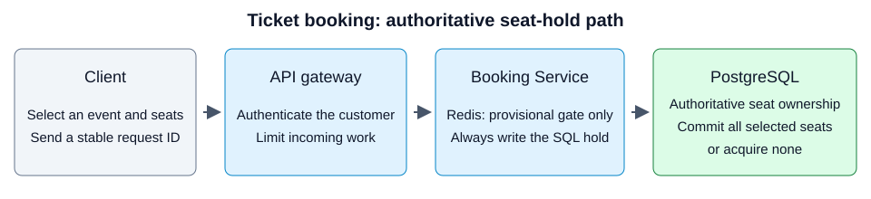
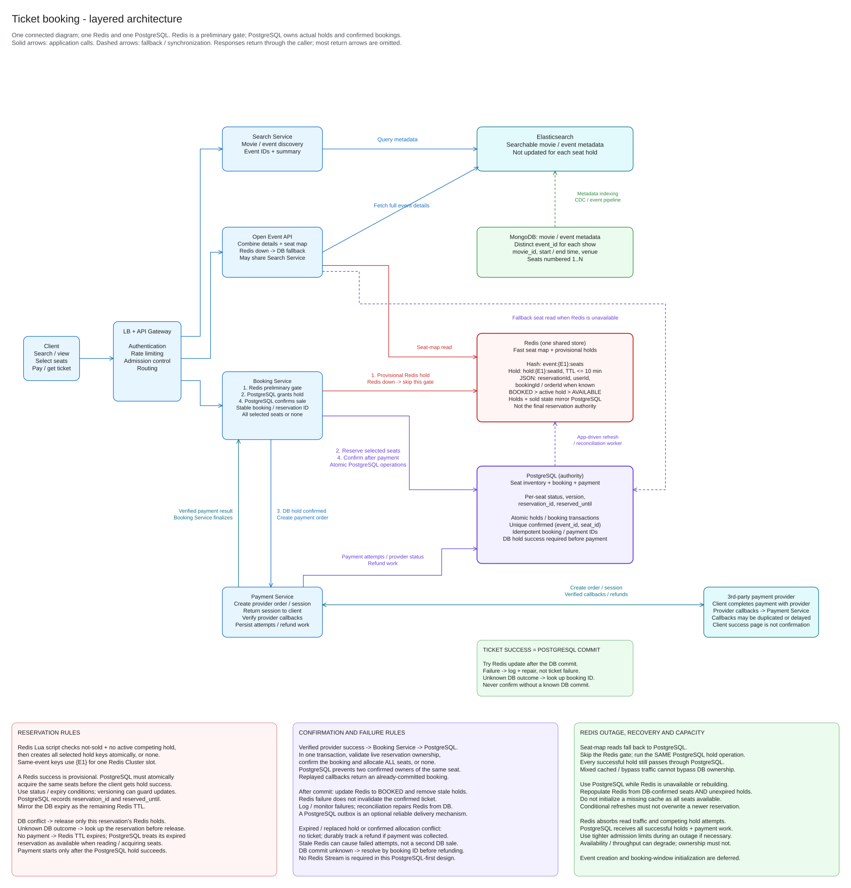

# Ticket Booking System

## Basic description

A ticket booking system lets a customer find an event, choose seats, pay, and
receive a ticket. Its hardest rule is simple: **two confirmed bookings must
never own the same seat for the same event**.

A seat shown as available is not a promise. Another customer may reserve it
before the request arrives. A **hold** is a temporary reservation that gives a
customer time to pay. A **confirmed booking** is a durable allocation saved in
PostgreSQL after verified payment.

## Functional requirements

- **Find an event:** Search by title, location, or date and open the event's
  details and seat map.
- **Hold selected seats:** Require sign-in and reserve all requested seats
  together or none. Accept the hold only after PostgreSQL commits it.
- **Take payment:** Create a payment session for the server-verified amount and
  currency, then let the customer pay through the provider.
- **Confirm a booking:** Verify the provider's payment result and allocate all
  selected seats in one database transaction before returning a confirmed ticket.
- **Expire unpaid holds:** Make expired seats available again using database
  time. Retrying a hold must not extend its original deadline.
- **Handle retries and status checks:** Return the saved result for the same
  operation and let the customer check a pending booking's status.
- **Resolve late payments:** If payment succeeds after the hold expires and the
  seats cannot be allocated, record refund or reconciliation work instead of
  issuing an invalid ticket.

## Non-functional requirements

- **Ownership correctness:** Never confirm the same seat for two bookings of the
  same event. Database constraints and transactions enforce this rule.
- **Durability:** Persist accepted holds, bookings, payment attempts, and refund
  work so application or cache restarts do not erase their outcome.
- **Safe degraded operation:** When Redis fails, use the same PostgreSQL hold
  transaction under stricter admission limits. If PostgreSQL is unavailable,
  accept no new holds or confirmations.
- **Burst handling:** Use rate limits, bounded concurrent work, and a waiting
  room when needed. Adding instances does not remove contention for one seat.
- **Measured performance:** Measure search, seat-map reads, holds, and
  confirmations separately. This example does not claim a numeric latency or
  throughput guarantee without a workload test.
- **Secure payments and access:** Authenticate customers, verify callback
  signatures and payment status, and check the exact booking, amount, and currency.
- **Operational visibility:** Monitor database contention, rejected admissions,
  payment outcomes, and Redis repair so degraded behavior is visible.

## Requirements and assumptions

This example supports searching events, opening an event's details and seat map,
holding selected seats together, and paying for a booking. It prioritizes
correct ownership over accepting requests during a database outage.

- A movie is reusable descriptive information. An **event**, or show, is one
  bookable occurrence at a venue and time. Two screenings of the same movie
  have different `event_id` values and separate inventory.
- Each event has an optional `movie_id`, start and end times, a venue, and
  `seat_count`. For this example, seats are integers from `1` through
  `seat_count`; sections and physical layouts are later extensions.
- Customers sign in before holding seats. All selected seats are acquired
  together or the request acquires none.
- Ten minutes is an illustrative hold duration, not a measured capacity or a
  promise to extend a hold whenever a request is retried.
- Prices and currency are checked by the server and saved with the booking.
  The client cannot choose the amount charged.

Event creation, detailed booking-window policies, cancellations, resale, and
multiple-region writes are outside this example. Before opening sales, an
initialization process must create the authoritative seat rows. It can preload
Redis automatically for events about to become bookable. A missing cache must
never be interpreted as a new event with all seats available.

## Basic architecture

<div class="diagram-scroll" role="region" aria-label="Ticket booking architecture; scroll horizontally on small screens" tabindex="0" markdown="1">

[](assets/overview.svg)

</div>

This horizontal overview shows the seat-hold path. Responses return to the
customer after the database outcome is known. Payment begins only after a
durable hold; search and payment components are detailed below.

## Architecture and supplied diagram

[](assets/ticket-master-latest.svg)

**Open the image for readable detail.** This local SVG previews the latest
section headed “Ticket booking - layered architecture” in the supplied board.
It uses the source's actual shapes, text, and arrow points, excluding deleted
elements. It is a native SVG rendering rather than an Excalidraw screenshot;
hand-drawn styling and installed-font appearance can differ.

- [Download the original editable TicketMaster.excalidraw](assets/TicketMaster.excalidraw).
  This is a byte-for-byte snapshot of the requested original file, not a
  reviewed replacement. Neither download file was edited.
- [Open the full-board SVG preview](assets/ticket-master-full.svg), including
  earlier live drafts.

??? info "Preview the complete Excalidraw board"
    

    The React preview renders the source automatically. Use Fit or 100% and
    scroll within the read-only board. The earlier SVG exports remain available
    above for reference.

The supplied board is a working design board with several iterations, not a
production specification. Earlier drafts place temporary holds only in Redis.
**This documentation follows the latest PostgreSQL-authoritative design: every
accepted hold is saved in PostgreSQL before payment begins.** Some response
arrows are omitted on the board. In particular, the client receives a payment
session and pays the provider; the provider separately calls the Payment Service.
The [request flows](#request-flows) spell out those directions.

One source-board inconsistency is preserved rather than silently redrawn:
the “Fetch full event details” arrow points toward Elasticsearch. In the
documented flow, the Open Event API fetches those details from **MongoDB**;
Elasticsearch serves search summaries only.

## What each component does

These are logical responsibilities; they need not start as separate deployments.
For example, the Open Event API can run inside the Search Service.

| Component | Responsibility |
| --- | --- |
| Client | Searches, displays a possibly stale seat map, requests holds, and completes payment with the provider. |
| Load balancer and API gateway | Distribute requests, authenticate callers, limit request rates, and admit only work the system can handle. |
| Search Service and Elasticsearch | Find event IDs and basic metadata using a searchable index. They do not decide seat ownership. |
| Open Event API and MongoDB | Fetch full movie/event details from the metadata store and combine them with a seat map. |
| Booking Service | Requests provisional Redis holds, acquires actual database holds, and confirms allocations transactionally. |
| Redis | Caches seat state and filters competing attempts with short-lived provisional holds. It is not the final authority. |
| PostgreSQL | Owns seat inventory, reservations, bookings, payment records, and durable refund work. |
| Payment Service and payment provider | Create payment sessions, process authenticated results, and reconcile payments or refunds. |

Metadata moves **MongoDB → indexing pipeline → Elasticsearch**. The pipeline
copies changed metadata into the search index, possibly with a delay. It does
not copy search results back to MongoDB, and it does not update Elasticsearch
for every seat hold.

PostgreSQL owns both temporary reservations and final sales. Redis can reject
obvious competing requests cheaply, but a Redis success alone cannot accept a
reservation. Both normal traffic and Redis-outage traffic use the same database
operation. There is no Redis Stream or asynchronous “save the booking to
PostgreSQL later” step in this design.

## Request flows

A **reservation ID** identifies one attempt to hold a particular set of seats.
A **booking ID** identifies the purchase and remains stable through payment and
confirmation. `user_id` alone is insufficient: one customer can make several bookings.

### Search for an event

1. The client submits a title, location, or date filter through the gateway.
2. The Search Service queries Elasticsearch.
3. The service returns matching event IDs and basic metadata, not every event's
   full seat map.

The search index may lag behind MongoDB. Search results help discovery; they
cannot guarantee that sales are open or that any seat is still available.
The Booking Service checks the current booking policy before accepting a hold.

### Open an event

1. The client sends the chosen `event_id` to the Open Event API.
2. The API reads full details from MongoDB, or an explicitly bounded metadata
   cache, and obtains the seat map from Redis.
3. If Redis is unavailable or its event inventory is not ready, the API reads
   PostgreSQL under read concurrency and rate limits.
4. The API returns details and the seat map. It renders expired database holds
   as available using database time, even if a cleanup worker has not run.

An optional short-lived seat-map snapshot can reduce repeated reads. Such a
snapshot must not extend a hold beyond its expiry. The displayed map can still
be stale when the customer selects a seat; only a successful hold request
reserves it.

### Hold all selected seats

1. The client sends `event_id`, selected seat IDs, and a stable idempotency key.
   **Idempotency** means a retry of the same operation returns its saved result
   instead of creating another reservation. The server associates the key with
   the authenticated caller and the request's contents.
2. The Booking Service resolves an existing durable operation before the Redis
   gate: a retry of an accepted hold returns that result, not a new deadline.
   For a new operation, it checks seat IDs and policy and establishes stable
   reservation and booking IDs. It first asks Redis for a provisional hold.
   Redis checks that none of the selected seats is sold or held by a competing
   reservation, then creates all selected hold keys together or none.
3. A Redis conflict rejects the attempt cheaply. If Redis is down or returns an
   error, the service skips the gate under stricter database admission limits.
   It does not treat the outage as a successful Redis reservation.
4. After provisional success or bypass, the Booking Service **always** runs the
   same PostgreSQL hold transaction. The database acquires every selected seat
   or none, records ownership, and chooses `reserved_until` from database time.
5. Only a successful database commit permits an accepted-hold response.
   The service mirrors the database expiry into Redis as the *remaining*
   lifetime, rather than starting a fresh ten-minute window on each retry.

If PostgreSQL reports a conflict, release only provisional Redis keys whose
`reservationId` matches this attempt. Do not delete another customer's hold.
If the database call times out, its outcome is **unknown**, not necessarily
failed. Resolve the stable reservation ID or retry idempotently before
releasing keys or telling the client that no reservation exists.

The cache can falsely reject an available seat while stale. This hurts
availability, not ownership safety; repair stale state rather than bypassing
the database checks. See [the atomic operation](#the-postgresql-hold-operation).

### Pay and confirm

1. **Booking Service → PostgreSQL:** acquire the actual hold described above.
   Do not create payment before this succeeds.
2. **Booking Service → Payment Service → provider:** persist a payment attempt
   and stable idempotency identity before calling the provider to create an
   order or session for the saved amount and currency. Save returned provider
   IDs and recover unknown outcomes using that identity, so a timeout or restart
   does not cause a second charge.
3. **Payment Service → gateway → client:** return the payment session. The
   **client then completes payment with the third-party provider**, using the
   provider's hosted page or supported client integration.
4. **Provider → Payment Service:** send an authenticated server-to-server
   callback. The service verifies the signature and provider payment status,
   checks the exact booking, amount, and currency, and deduplicates the result.
   The browser's success page is not authoritative.
5. **Payment Service → Booking Service → PostgreSQL:** first look for an
   already-confirmed booking. A replay must return that booking even though
   its old holds have been removed. Otherwise, in one transaction, lock and
   validate ownership and expiry of every seat, confirm the booking, and
   allocate all seats. A database constraint prevents duplicate confirmed
   allocations for the same event and seat.
6. **After the database commit:** try to mark Redis seats `BOOKED` and remove
   matching hold keys. If Redis fails, log and measure the error, schedule or
   leave durable evidence for repair, and still return the confirmed ticket.
   The committed database allocation is the success boundary.

The client can read booking status while waiting for the callback. A pending
callback is not proof of payment failure. The service must also resolve an
unknown database commit outcome by booking ID before refunding or releasing
anything.

Payment at the provider and ticket confirmation in PostgreSQL are not one
atomic transaction. Money can be collected after the hold expires, or a
callback can arrive too late. If another reservation now owns a seat, the
service must not take it away: issue no ticket and durably track refund or
reconciliation work for the captured money.

### What happens when a hold expires?

Redis removes a hold key when its TTL expires. **TTL**, or time to live, is the
remaining period before automatic expiry. All the key's reservation metadata
disappears with it; the service does not move the seat between arrays.

PostgreSQL can still contain a row marked `HELD` with an expired deadline.
Reads treat it as available and a new transaction can replace it after checking
database time and ownership. A cleanup job can tidy old records, but is not
required to make expiration correct. Starting payment or retrying a request
does not silently extend the deadline.

## API and data

These illustrative contracts support the [request flows](#request-flows).
They are not a runnable application. All customer booking endpoints require
authentication and ownership checks. Provider callbacks use provider
authentication, not a customer's browser session.

### Example API

| Request | Purpose and result |
| --- | --- |
| `GET /v1/events?query=...&date=...` | Search event summaries with pagination; no full seat maps. |
| `GET /v1/events/E1` | Return event details and a possibly stale seat map with observation time and hold deadlines. |
| `POST /v1/reservations` | Hold all selected seats after the PostgreSQL transaction commits. |
| `POST /v1/bookings/B1/payment-sessions` | Create or recover a provider session only for this customer's live database hold. |
| `GET /v1/bookings/B1` | Return authorized booking status, seat IDs, and separate payment/refund status. |
| `POST /v1/payments/provider-callback` | Authenticate a provider result and durably record/process it idempotently. |

```http
POST /v1/reservations
Authorization: Bearer <access-token>
Idempotency-Key: reserve-E1-attempt-42
Content-Type: application/json

{"event_id": "E1", "seat_ids": [2, 3]}
```

An accepted response is `201 Created` with, for example:

```json
{
  "reservation_id": "R1",
  "booking_id": "B1",
  "event_id": "E1",
  "seat_ids": [2, 3],
  "status": "HELD",
  "reserved_until": "2026-10-18T12:10:00Z",
  "amount_minor": 5000,
  "currency": "INR"
}
```

`amount_minor` stores an integer in the currency's minor units; in this example,
5000 means INR 50.00, not a suggested ticket price. The server calculates it.
Use UTC timestamps in responses and show the venue's local time in the UI.

Reject empty lists, duplicate seat IDs, out-of-range IDs, and invalid event
states with `400` or a documented policy error. Use `409 Conflict` when a seat
cannot be acquired or an idempotency key is reused with different contents.
Use `429 Too Many Requests` for admission limits and `503 Service Unavailable`
when the authority cannot serve the request. Do not report a database timeout
as a definite seat conflict; expose a pending/retryable outcome and let the
client query the stable operation.

Store the idempotency key, authenticated caller, request fingerprint, stable IDs,
and result durably. A fingerprint is a representation used to detect whether
the request's important fields changed. Concurrent retries must converge on
one operation, not just consult an application instance's memory.

### Metadata and transactional records

| Store / record | Important fields and rules |
| --- | --- |
| MongoDB movie | `movie_id`, title, description, language, and other reusable metadata. |
| MongoDB event | `event_id`, optional `movie_id`, start/end time, venue, `seat_count`, and display metadata. |
| Elasticsearch event document | Event ID and searchable summaries copied from metadata; not authoritative per-seat availability. |
| PostgreSQL event inventory | Valid event ID, seat count and sale-policy facts needed to validate holds without trusting an old search result. |
| PostgreSQL seat inventory | One row per `(event_id, seat_id)` with `status`, `version`, `reservation_id`, `reserved_until`, and confirmed `booking_id` when sold. |
| Reservation and selected seats | Stable reservation ID, booking ID, customer, event, exact seat set, deadline, and state/history. |
| Booking and allocations | Booking ID, customer, server-calculated amount/currency, state; a unique `(event_id, seat_id)` allocation prevents two confirmed owners. |
| Payment attempt | Attempt ID, booking ID, provider order/payment IDs, idempotency key, expected amount/currency, verified status, and result history. |
| Refund task | Stable refund ID, payment ID, reason, amount, retry state, provider reference, and completion evidence. |

Use primary keys, foreign keys, and uniqueness rules so records refer to valid
events, seats, and bookings. The inventory's primary key alone is not enough
if an application can overwrite a sold seat; enforce legal state transitions
and confirmed-allocation uniqueness inside database transactions. Retain
reservation/payment history separately when reusing an expired seat row.

Booking states such as `HELD`, `CONFIRMED`, and `EXPIRED` describe ticket
ownership. Payment states such as `PENDING`, `SUCCEEDED`, and `FAILED` describe
money movement. Refund work can be `PENDING` or `COMPLETED`. A succeeded payment
with an expired booking and pending refund is a valid state that operations
must be able to find; do not compress everything into one “success” flag.

### The PostgreSQL hold operation

A **transaction** groups database operations so they commit together or have no
effect. A **row lock** prevents another transaction from changing a selected
row while the current transaction checks and updates it.

One possible implementation is the following; it describes database behavior,
not SQL ready to paste into an application:

```text
begin transaction
  resolve/create this caller's idempotent operation and stable IDs
  validate event sale policy and the normalized, distinct seat set
  lock every selected inventory row in increasing seat_id order
  obtain one database timestamp after locks are acquired
  require all requested rows to exist
  require each seat is AVAILABLE, or HELD with reserved_until <= DB timestamp
  require no seat has a confirmed allocation
  if any condition fails: roll back the entire acquisition
  otherwise:
    save reservation, booking, price, and selected seat records
    set all selected rows to HELD with this reservation_id
    set one reserved_until = DB timestamp + configured hold duration
    increment each row's version and save the operation result
commit
```

For an existing operation, return or resolve its recorded outcome instead of
creating a new deadline. Reading database time after waiting for locks avoids
using an old request timestamp for expiry decisions. Consistent lock ordering
reduces deadlocks; bounded retries still need the same idempotency identity.

Atomic conditional writes are an alternative to explicit row locks: write only
when the status, ownership, version, and expiry conditions hold, verify that
every requested row changed, and roll back if any failed. An application-side
“read version, compare in memory, then write” is unsafe. The condition must be
checked by PostgreSQL as part of the protected write.

Confirmation uses another transaction: return an existing confirmed booking
first; otherwise lock the booking and all its seat rows, check verified payment
and the live matching reservation using database time, insert the unique
allocations, and mark all seats and the booking confirmed. Coordinate
confirmation and expiry/reacquisition on the same locked rows. If any seat
fails validation, commit no partial ticket allocation.

### Redis seat representation

Redis holds a derived view, not the only copy of reservations:

```text
Hash key: event:{E1}:seats
  field "2" -> AVAILABLE
  field "3" -> BOOKED

Expiring key: hold:{E1}:2
  {"reservationId":"R1", "userId":"U1", "bookingId":"B1"}
  TTL = remaining PostgreSQL hold lifetime after DB acceptance
```

The hash stores reusable cached `AVAILABLE`/`BOOKED` state. Separate hold keys
store temporary ownership, optionally including `orderId` once known.
`BOOKED` wins over a hold; otherwise an active hold displays `HELD`; otherwise
the seat is effectively `AVAILABLE` **only if the event cache is initialized
and trustworthy enough to serve**. A missing event cache triggers a database
read/rebuild, not an empty available map.

Read the hash with `HGETALL` for a small venue or `HMGET` for selected seats,
and read hold keys with batched `MGET` calls. There is no need for one network
round trip per seat.

A Redis **Lua script** runs a group of cache checks and writes atomically.
It can check sold state and competing holds, then create every selected
provisional key or none. The `{E1}` part is a Redis Cluster hash tag: these
keys share one cluster slot so the script can operate on them together.
Same-reservation retries and cleanup must compare `reservationId`; cleanup
must never blindly delete a key now owned by another reservation.

Before database acceptance the gate can use a bounded provisional TTL. After
acceptance, synchronize to `reserved_until`'s remaining lifetime. Redis and
PostgreSQL clocks can differ, so the database deadline always decides. Expiry
notifications are not durable messages and cannot drive booking correctness.

Cache refreshes and rebuilds need a version/epoch or equivalent conditional
write protocol: an old database snapshot must not replace a newer sold marker,
erase a newer hold, or recreate an expired owner. Designing and testing that
protocol is an implementation requirement, not something a blind `SET` solves.

## Scaling and failures

The design uses PostgreSQL for ownership and Redis for speed.
This section explains the cost of that choice and how to recover when components
fail.

### Popular events create two kinds of load

Thousands of people may repeatedly open the same event while many try to hold
the same few seats. Repeated map reads create read load; competing writes to
one seat create **contention**, where operations wait for or lose access to the
same protected data.

Stateless services can add instances to handle more independent requests.
That does not make one seat sellable to several customers or remove its
database lock bottleneck.

- Use gateway rate limits, bounded concurrent work, and a waiting room for
  extreme bursts. A waiting room admits customers gradually instead of letting
  every request reach the database at once.
- Redis absorbs repeated seat reads and rejects many competing hold attempts.
  **Every actual accepted hold still reaches PostgreSQL**, as does confirmation.
  Size the database for holds and payment work, not just final sales.
- Cache metadata and short-lived map snapshots where useful. Combine identical
  in-flight reads so one refresh serves several waiting requests. This is
  **request coalescing** and helps prevent a cache miss from causing a flood of
  database reads.
- Cache inventory for active/bookable events rather than every historical
  event. Retain it through sales and payment reconciliation. Use pagination or
  section-based map reads for very large venues.
- Bound seat count per request and database transaction duration. Monitor lock
  wait time, conflict rate, query latency, and connection-pool saturation.

Measure search, map reads, holds, confirmations, and hot-event concentration
separately. This example does not claim a requests-per-second capacity or
machine count without a workload test. A single event's Redis keys share a
cluster slot for atomic operations; adding Redis shards does not divide that
one hot event automatically.

### Dependency and outcome rules

| Failure or race | Required behavior |
| --- | --- |
| Search index lags | Allow discovery to be stale; recheck policy and inventory on the authoritative path. |
| MongoDB details cannot be read | Use an explicitly permitted metadata cache or report unavailability; do not invent event details. |
| Redis is down, missing inventory, or rebuilding | Read PostgreSQL under limits; skip the provisional gate and use the same database hold transaction. |
| PostgreSQL cannot be reached | Accept no new holds or ticket confirmations. Never promote Redis into a separate authority. |
| Database reports a definite seat conflict | Acquire none; remove only this reservation's provisional Redis holds. |
| Database response times out | Resolve by stable reservation/booking ID or retry idempotently; do not assume failure. |
| Provider order creation times out | Query/retry using the persisted attempt and provider idempotency identity, rather than creating another independent charge. |
| Payment succeeds after expiry or another owner wins | Issue no ticket; persist refund/reconciliation work for captured money. |
| Redis update fails after confirmed database commit | Return the confirmed ticket, log/measure the failure, and repair Redis. |
| Callback is duplicated | Return the committed booking or continue the same saved operation; never charge or allocate twice. |

Rate and concurrency caps must cover fallback map reads as well as hold
writes. During a complete Redis outage, reduce admissions so PostgreSQL remains
usable for both. Some requests may wait or fail with retry guidance. Throughput
and availability can degrade while ownership remains correct.

### Repair Redis without changing ownership

The chosen default is **database commit followed by a best-effort Redis
update**. A Redis exception must be visible in logs and metrics; silently
discarding it makes stale seats hard to diagnose. Ticket success still depends
on the already-committed database result, not cache availability.

A repeatable reconciliation process compares Redis with PostgreSQL and repairs
missing or stale state. **Reconciliation** means checking records against the
authority until they agree. It must discover discrepancies even if the
application crashes between the database commit and the cache update; an
in-memory retry list is not enough.

An optional stronger delivery mechanism is a **transactional outbox**: save a
cache-refresh task in PostgreSQL in the same transaction as the booking, then
have a worker deliver it repeatedly until processed. This improves retry
delivery but is not required by the selected best-effort-plus-reconciliation
default. Neither approach makes PostgreSQL and Redis one atomic transaction.

While stale, Redis may show a sold seat as available or grant a misleading
provisional hold. The database rejects the actual hold. No payment session
should be created for that rejected reservation. If money has nevertheless
been captured in a delayed/racing payment flow, the database still prevents a
second sale and the payment requires refund/reconciliation handling.

For a rebuild:

1. Mark the event's cache as not ready and serve its seat reads from PostgreSQL
   under admission caps.
2. Load both confirmed allocations **and unexpired database holds**. Loading
   only sold seats would hide customers who are still paying.
3. Restore hold keys using remaining database deadlines, not fresh durations.
4. Apply concurrent changes using a tested conditional refresh/version protocol,
   or keep serving the database until a consistent rebuild/catch-up is complete.
5. Mark the cache ready only when it is safe to serve. Continue reconciliation.

Readiness and versioning need to survive process changes and concurrent
workers. Do not claim a snapshot alone solves writes racing with a rebuild.

### Payment and refund recovery

Persist payment attempts before relying on provider results. Record provider
IDs, booking identity, expected amount/currency, verified results, and refund
tasks in durable storage. Deduplicate both provider payment IDs and callback
event IDs as appropriate; several notifications can describe one payment.

Callbacks can be delayed, duplicated, reordered, or missed. Authenticate them,
verify relevant provider status, and acknowledge according to the provider
contract only after the result or required work is durably recorded.
Provider retries and a periodic reconciliation job should recover payments
whose callbacks never arrived. That job queries provider records using saved
IDs and compares them with booking/payment state.

For captured money without a valid booking, persist a refund task. A worker
uses a stable provider refund idempotency key, retries transient failures, and
checks unknown outcomes before retrying. Track failed or long-pending refunds
for operator attention. “Refund pending” is not “refund completed.”

Before deciding a payment needs a refund, resolve any unknown booking commit
by booking ID. A timeout may have hidden a successful ticket allocation.
Likewise, an already-confirmed booking wins on callback replay even if its
temporary reservation no longer exists.

### Operational checks

- Alert on database errors, hold lock waits, fallback load, stale-cache repair
  lag, failed cache updates, callback verification failures, and aged pending
  payments/refunds.
- Keep audit history sufficient to trace reservation → booking → provider
  payment → refund without logging credentials or payment secrets.
- Test duplicate callbacks, overlapping seat requests, partial multi-seat
  conflicts, expiry while waiting for locks, and crashes around each commit.
- Exercise Redis loss and rebuild while traffic continues. Verify that
  existing unexpired holds remain protected in PostgreSQL.
- Test database backups and recovery. After restoration, reconcile payments
  with the provider before reopening admissions; lost local history does not
  mean a customer was never charged.

The essential trade-off is deliberate: when the database authority is
unavailable, stop accepting ownership changes rather than selling from an
independent cache.

## Conceptual exercise: two requests and one delayed callback

No application or payment account is needed. Assume event `E1` has seats `1..5`,
the hold duration is ten minutes, and PostgreSQL transactions enforce the
rules above. Use database time for every deadline.

1. Reservation `R1` holds seats `2` and `3` at 12:00; its database deadline is
   12:10. Its Redis mirror disappears at 12:02.
2. Reservation `R2` requests seats `3` and `4` at 12:03 while Redis is down.
3. At 12:11, reservation `R3` acquires seats `2` and `3`.
4. At 12:12, a verified callback reports that `R1`'s payment succeeded.
5. `R3` later pays; PostgreSQL confirms it, but the Redis update fails. The
   provider repeats `R3`'s callback.

For each step, write the database owner of seats `2`, `3`, and `4`, whether a
ticket can be issued, and what repair or refund work is needed. Completion
means explaining all-or-none acquisition, deadline enforcement, and callback
replay without relying on Redis for ownership.

??? note "Answer guidance"
    At 12:03 PostgreSQL still owns `R1`'s live hold. `R2` acquires neither seat
    `3` nor seat `4`, despite Redis being absent. At 12:11 the database can
    replace the expired holds with `R3`. `R1`'s late success produces no ticket;
    captured money needs durable refund/reconciliation work. `R3` receives its
    ticket after the database commits even if Redis cannot be updated. Repair
    the cache from PostgreSQL. The repeated callback returns `R3`'s committed
    booking before checking its now-removed holds.
