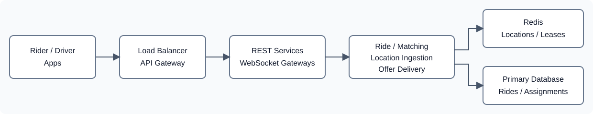

# Uber System Design - Quotes, Booking, and Driver Matching

## Basic description

An Uber-like service connects riders requesting trips with nearby available
drivers. It saves bookings durably, tracks live driver locations, and delivers
offers and ride updates through persistent connections.

This is the current design based on the architecture discussion and the latest
ride-hailing diagram. Detailed matching mechanics are maintained separately in
[Uber-Driver-Matching.md](Uber-Driver-Matching.md).

## Functional requirements

- Let riders request fare estimates, book rides, and cancel bookings.
- Receive driver GPS updates and track current availability.
- Find nearby eligible drivers and offer a ride to one driver at a time.
- Confirm assignments and provide the rider with driver details and live updates.
- Recover ride and pending-offer state after a connection is lost.
- Return a quote ID, estimated fare, currency, and expiry before booking.

## Non-functional requirements

- Prevent more than one active assignment for a driver or a ride.
- Preserve bookings and confirmed assignments across service restarts.
- Plan for 20,000 GPS updates per second with 100,000 online drivers reporting every five seconds.
- Reject stale location candidates and expired offer acceptance.
- Bound matching attempts and recover interrupted workflows without blocking worker threads.
- Authenticate connections and restrict ride and location access to authorized participants.

These are design targets and planning assumptions, not measured guarantees:

| Operation | Initial target or limit |
|---|---|
| Fare estimate | Respond within 1 second when dependencies are healthy |
| Driver GPS reporting | Every 5 seconds |
| Quote validity | 5 minutes |
| Response window for one offer | Up to 10 seconds, including processing and delivery time |
| Overall matching | Stop after 2 minutes or 10 offers |

The diagram's ten-second matching target is interpreted as an offer response
window, not a guarantee that a driver will be assigned within ten seconds.
Sequential declines and timeouts can make overall matching take longer.

## 1. High-level architecture


This is the original design board. Use the preview controls to zoom, fit the
board, or download its Excalidraw source. The notes below clarify the board's
flow: commit accepted assignments in the database before updating Redis, and
atomically check FREE status when acquiring a driver lease.

The simplified overview below provides a compact view of the main components.

<div class="diagram-scroll" role="region" aria-label="Ride-hailing architecture; scroll horizontally on small screens" tabindex="0" markdown="1">

[](architecture.svg)

</div>

| Component | Responsibility |
|---|---|
| Rider App | Book, cancel, and track rides |
| Driver App | Send GPS updates and receive offers |
| Load Balancer / API Gateway | Route REST traffic and WebSocket handshakes |
| Quote / Fare Service | Call a distance/ETA provider, estimate fare, and save a short-lived quote |
| Distance / ETA Provider | Estimate road distance and travel time between coordinates |
| REST API Services | Fare estimates, rides, cancellation, and state recovery |
| WebSocket Gateway Cluster | Live messages, GPS updates, and offer delivery |
| Backend Services | Ride Service, Matching Service, Location Ingestion, and Offer Delivery |
| Redis | Short-lived quotes, live driver state, search index, leases, and connection routing |
| Primary Database | Durable rides, offers, confirmed assignments, and outbox events |
| Durable Task Queue / Workers | Run matching attempts and delayed offer timeouts without sleeping threads |

The end-to-end flow represented by the diagram is:

```text
Rider -> API Gateway -> Quote / Fare Service -> Distance / ETA Provider
                                |
                                v
                         Redis quote, TTL 5 min

Rider -> API Gateway -> Ride Service -> Database: MATCHING ride + outbox
                                             |
                                             v
                                      Matching task
                                             |
                          Redis Search -> atomic driver reservation
                                             |
                                  Database: pending offer + outbox
                                             |
                                    WebSocket Gateway -> Driver

Driver ACCEPT -> WebSocket Gateway -> Ride / Assignment handler
                                             |
                                  Database assignment transaction
                                             |
                                  Redis status INRIDE, then notify
```

## 2. Fare estimate and booking

1. Rider provides pickup and destination.
2. Quote / Fare Service requests road distance and ETA from a provider.
3. It calculates an estimated fare and stores a server-generated quote in Redis:

   ```text
   quote:{quoteId}
     userId
     pickup
     destination
     estimatedFare
     currency
     expiresAt
     TTL = 5 minutes
   ```

4. Rider submits the quote ID to book.
5. Ride Service verifies the quote exists, is unexpired, and belongs to the authenticated rider. It uses the stored coordinates and fare rather than trusting client-supplied replacements.
6. In one database transaction, it creates a MATCHING ride with the quote snapshot and writes an outbox event that starts matching.
7. An outbox publisher delivers the matching task. A crash after booking must not lose the trigger.

Use a request idempotency key so retrying the same booking returns the same ride.
If quotes are single-use, enforce that policy through a database uniqueness
constraint on quoteId rather than a non-atomic Redis read-and-delete.

An expired quote requires a fresh estimate. Redis losing a quote before booking
does not lose an existing ride because the ride contains the accepted snapshot.

Keep Ride and RideOffer separate:

- Ride represents the rider's booking.
- RideOffer represents an offer sent to a particular driver.
- A created offer does not mean a driver has been assigned.

A temporary driver lease is acquired before an offer is sent. A durable
assignment is created only after the driver accepts successfully.

## 3. REST APIs and WebSockets

Use both REST and WebSockets.

| Operation | Proposed interface |
|---|---|
| Get fare estimate | REST: GET /quotes with pickup and destination query parameters |
| Create/book ride | REST: POST /rides with quoteId and an idempotency key |
| Get ride details/history | REST: GET /rides/{rideId} and GET /rides |
| Cancel ride | REST: POST /rides/{rideId}/cancel |
| Upload driver location every 5 seconds | WebSocket |
| Receive ride offers | WebSocket |
| Accept/decline offer | WebSocket commands referencing offerId |
| Pickup/drop-off transitions | Authorized ride commands, distinct from offer acceptance |
| Receive driver assignment and live location | WebSocket |
| Recover ride state after reconnect | REST |

REST is appropriate for explicit resource operations and recovery. WebSockets support persistent, bidirectional communication and server-initiated updates.

The WebSocket Gateway handles connections and routes messages; it should not own all ride-matching business logic.

For this version, the driver responds over WebSocket:

```json
{
  "type": "ACCEPT_OFFER",
  "offerId": "offer-501",
  "commandId": "command-789"
}
```

The gateway authenticates the connection and forwards the command to the
authoritative offer handler. Driver identity comes from authentication, not a
trusted driverId in the payload. DECLINE_OFFER follows the same path. REST is a
valid alternative transport, but should not introduce a second business workflow.

Do not use a generic ride-status PATCH to mix ACCEPTED, DECLINED, PICKED_UP,
and DROPPED_OFF: the first two describe an offer, while the latter two describe
ride progress.

## 4. Driver location and availability in Redis

Assume drivers send GPS updates every five seconds.

For N online drivers:

```text
Location updates per second = N / 5
100,000 online drivers = 20,000 updates per second
```

Options explored:

| Approach | Description |
|---|---|
| Standard Redis GEO | A key such as drivers:locations stores driver IDs as members with coordinates. GEOSEARCH returns nearby IDs and optional geographic metadata, not full driver objects. |
| GEO plus state lookup | Search nearby drivers, then batch-read their availability. |
| Available-only GEO index | Maintain an index containing only eligible available drivers. |
| Redis Search | Index driver documents with GEO and status fields, allowing a combined location-and-availability query. |

The preferred direction is a combined location-and-status query, potentially using Redis Search.

Whichever option is chosen, search results are only candidates. The system must atomically claim a driver before confirming assignment.

The logical stores can share one Redis deployment:

| Key | Contents | Lifetime |
|---|---|---|
| driver:{123}:state | location, status, lastSeen | Retained while useful; freshness is checked explicitly |
| driver:{123}:lease | Owning offerId | Up to 10 seconds |
| driver:connection:123 | Gateway, connection, and session information | Heartbeat-refreshed TTL |
| quote:{quoteId} | Rider-bound fare estimate | 5 minutes |

There is no need for separate Redis servers for location, status, and reservations.
The diagram's Driver-Offer store can be an optional cache of offer state; durable
RideOffer records are authoritative, so another mandatory store is unnecessary.

## 5. Driver matching logic

1. Get nearby candidates from the geospatial index.
2. Filter for available drivers and fresh GPS updates.
3. Rank candidates using estimated road travel time, not just straight-line distance.
4. Atomically check the driver's current FREE status and acquire its lease in one Redis script call.
5. If reservation fails, try the next candidate immediately.
6. Persist a pending offer, delivery event, and recoverable timeout intent before sending it.
7. On acceptance, atomically confirm assignment in the database.
8. On decline or expiry, close the offer and schedule another matching attempt within the ride's limits.

Use one active offer per ride and one lease per driver during normal dispatch.
This prevents concert-exit demand from flooding the same driver with many offers.

### One Redis invocation to validate and reserve

An earlier top-K result may still contain a driver who has since accepted another
ride. Acquiring only a lease is insufficient once their old lease expires.
Check current status and acquire the new lease atomically:

```lua
if redis.call("HGET", KEYS[1], "status") ~= "FREE" then
    return 0
end

local acquired = redis.call(
    "SET", KEYS[2], ARGV[1], "NX", "PX", ARGV[2]
)

if acquired then return 1 end
return 0
```

```text
KEYS[1] = driver:{123}:state
KEYS[2] = driver:{123}:lease
ARGV[1] = offer-501
ARGV[2] = 10000
```

The server supplies the TTL, bounded by the ride's remaining matching time.
This is one network round trip per candidate reservation attempt, not a separate
status read followed by another call to set the lease. The shared {123} hash tag
places both keys in one Redis Cluster slot.

The script handles status and lease ownership only. Search freshness, geographic
eligibility, and road-ETA ranking remain matching responsibilities.

### Simple retry tasks

Do not persist a candidate array or next-candidate index in the initial version.
Try a batch during one matching execution, then search again after a declined
or expired offer. Exclude drivers already offered this ride using durable offer
history, optionally cached as an attempted-driver set.

```text
Match(rideId):
    check ride is MATCHING, with no active offer and limits remaining
    find candidates and atomically reserve one
    persist offer, delivery event, and timeout intent
    finish; worker is free

Timeout(offerId):
    offer accepted or otherwise closed -> no-op
    pending and unexpired -> reschedule for its deadline
    pending and expired -> conditionally expire, enqueue Match(rideId)
```

No worker sleeps through the ten-second response window. The durable queue
or deadline scanner holds pending work. A missing Redis lease is not evidence
that an offer was declined or accepted, and expiry notifications are not a
reliable replacement for timeout processing.

## 6. Acceptance, database constraints, and Redis updates

### Durable records

| Record | Main fields |
|---|---|
| Ride | rideId, riderId, quoteId, pickup, destination, fare snapshot, assignedDriverId, status, activeOfferId, offersAttempted, matchingDeadline |
| RideOffer | offerId, rideId, driverId, status, createdAt, expiresAt |
| ActiveAssignment | driverId (primary key), rideId (unique) |
| Outbox event | eventId, aggregateId, type, payload, publication state |

```text
Ride: MATCHING -> ASSIGNED -> IN_PROGRESS -> COMPLETED
      MATCHING -> NO_DRIVER_FOUND
      eligible nonterminal states -> CANCELLED, according to cancellation policy

Offer: PENDING -> ACCEPTED | DECLINED | EXPIRED | DELIVERY_FAILED | CANCELLED
```

### Sources of truth

| State | Authority |
|---|---|
| Live location and candidate availability | Redis driver state and search index |
| Temporary permission to send an offer | Redis driver lease |
| Offer outcome and confirmed ride assignment | Primary database |

On ACCEPT_OFFER, the server validates the authenticated driver and offer,
then performs one database transaction:

1. Require the offer to be PENDING and unexpired.
2. Require the ride to be MATCHING with this activeOfferId.
3. Ensure the driver has no other active ride and this ride has no assigned driver.
4. Create the assignment, mark the offer ACCEPTED, mark the ride ASSIGNED, and record outbox events.

An ordinary query followed by an update is not enough: concurrent requests could
both observe no active ride. Use database-enforced uniqueness and transactional
conditional transitions. For example, an ActiveAssignment table can have
driverId as its primary key and rideId as a unique key. Equivalent active-row
constraints on the Ride table are another option where the database supports them.
Close/remove active-assignment entries transactionally when rides end or cancel,
while preserving historical ride records.

After the assignment commits, the server updates Redis status to INRIDE and
conditionally releases the owning lease. INRIDE here means committed to a ride,
including travel to pickup, not only a passenger already onboard.

Driver apps submit commands; they never directly modify Redis or the database.
Retry Redis updates using outbox processing and reconcile against current durable
assignment state. Delayed updates must not overwrite a newer driver's assignment
or incorrectly mark them FREE; serialize/version these updates per driver.

### Drivers already in other candidate lists

Do not edit every existing candidate list. Each reservation script checks the
current state:

```text
Ride B previously found [D1, D2, D3]
D1 accepts Ride A -> database assignment -> Redis D1 becomes INRIDE
Ride B tries reserving D1 -> script rejects -> try D2
```

If Redis has not yet received the committed assignment, a stale offer can still
be sent. The database constraints reject any second assignment. Redis updates and
database writes are not one cross-store transaction; the script does not eliminate
this synchronization gap.

### Acceptance versus timeout

Both handlers conditionally transition the same pending offer in the database.
Only one succeeds. Acceptance enforces the deadline even if the timeout worker
runs late. Old timeout tasks become no-ops after acceptance or decline; removing
them from the queue is an optional optimization, not a correctness requirement.

A Redis cache may skip timeout work for a specific offer whose durably committed
terminal state is already cached. PENDING, missing, or unavailable cache data must
fall back to a database transition. Redis PENDING alone never authorizes another
offer. The initial implementation can simply use database conditional operations
per task execution, without continuous polling.

## 7. WebSocket load balancing

WebSocket connections go through a load balancer or API gateway that supports persistent WebSocket connections.

```text
Driver / Rider Apps
        |
   Load Balancer
        |
   +----+----+
   |         |
Gateway A  Gateway B
   |         |
   +----+----+
        |
Connection registry / message routing
        |
Matching and Ride Services
```

An established connection remains attached to its selected gateway. If that gateway fails, the app reconnects and recovers its state.

The additional challenge is delivering an offer to the correct gateway when Matching Service does not know which instance holds the driver's connection. A distributed connection registry, message broker, or equivalent routing mechanism is needed.

## 8. Delivery and recovery

Map driverId to its gateway through a heartbeat-refreshed connection registry.
Offer Delivery resolves that entry and routes to the gateway, which holds the
actual socket. Session-aware cleanup prevents an old connection from deleting a
newer registry entry.

Persist offer delivery through an outbox and tolerate duplicate messages by
deduplicating offerId. If the connection disappears, retry only within the offer
deadline or close the offer as a delivery failure and continue matching.
Reconnect recovery fetches authoritative ride and pending-offer state through REST.

| Failure | Recovery |
|---|---|
| Crash after lease, before offer commit | Lease expires; ride recovery retries matching |
| Crash after database commit, before publish | Outbox publisher retries delivery and timeout scheduling |
| Driver declines | Close offer, release only its lease, enqueue matching |
| Driver does not respond | Timeout processor expires offer and advances matching |
| Duplicate acceptance | Return the same committed assignment to the authorized driver |
| Stale timeout or matching task | Check offer/ride state and expected active offer; no-op when superseded |
| Redis update fails after assignment | Retry/reconcile; database still prevents double assignment |
| No eligible candidates | Retry or expand radius within the overall deadline |
| Limits reached without a valid active offer | Mark NO_DRIVER_FOUND and notify rider |
| Redis or database outage | Handle infrastructure failure explicitly, not as proof that no drivers exist |

The simple baseline is: find candidates, check status and reserve in one Redis
call, send one durable offer, and continue through events rather than sleeping
threads. Keep transport, task scheduling, and Redis projections separate from
the database decision that confirms a ride.
