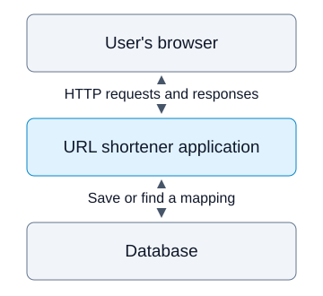

# URL Shortener

A URL shortener is a service that creates a short URL for a long URL.

The user submits a long URL to the service. The service generates a unique short
URL and stores the mapping between the short URL and the original URL in its
database for future lookups.

As an additional feature, the user can provide a custom alias along with the long
URL. For example, the alias `system-design` would create
`https://short.example/system-design`. If the alias is available, the service
saves the mapping. If it is already in use or reserved, the service rejects the
request.

When any user opens the short URL, the service looks up the original URL in its
database and returns an HTTP redirect response. The response includes a
`Location` header set to the original URL, which tells the browser where to
navigate. The service can use `301` for a permanent redirect or `302` for a
temporary redirect, depending on its redirect and caching policy.

## Basic architecture

The application handles requests and the database keeps the mappings. A **key**
is the identifier after the domain, such as `aB7q2X9m` or `system-design`.
Both generated keys and custom aliases use the same lookup.

| Key | Original URL stored in the database |
| --- | --- |
| `aB7q2X9m` | `https://example.org/products/guide` |
| `system-design` | `https://example.org/products/guide` |

The key is not a compressed URL. The service needs the saved mapping to find
the destination. The browser opens the destination directly; the shortener
does not download or host the destination page.

## Features and chosen policies

The design supports creating, opening, expiring, and disabling links. The user
who creates a link is its **owner**.

| Area | Policy used in this design |
| --- | --- |
| Creation and management | The owner must sign in. Anyone can open an active link. |
| Custom aliases | Generated keys and aliases share the same set of names; neither can overwrite an existing key. |
| Destination changes | Create a new mapping rather than changing an existing link's destination. |
| Expiration and disabling | Stop redirecting, but keep the key reserved so another user cannot reuse it. |
| Redirect response | Use `302` with `Cache-Control: no-store` because owners can disable links. |

These are choices for this design, not rules every URL shortener must follow.
Custom domains, previews, analytics, search, and writes in multiple regions are
outside this example.

## What you will learn

After following the core pages, you should be able to:

- Explain how the service creates a link and redirects a browser.
- Find the API input, response, and alias-conflict rules.
- Explain how the database prevents two users from claiming the same alias.
- Explain what disabling a link changes and when a cached copy can still be used.

## Choose the next page

| Reader task | Page |
| --- | --- |
| Follow creation, opening, and disabling; check your understanding | [Request flows & exercise](request-flows.md) |
| Find request examples, errors, database fields, and naming rules | [API & data](api-and-data.md) |
| Study capacity, caching, retries, and failure handling | [Scaling & failures](scaling-and-failures.md) |

**Recommended first pass:** read the request flows, consult the API when needed,
and attempt the conceptual exercise. The exercise includes its assumptions and
completion criteria; no running application is required.

The scaling page is a deeper reading path. You do not need its calculations or
cache implementation details to explain the basic create-and-redirect service.

[Continue: Request flows & exercise](request-flows.md)
