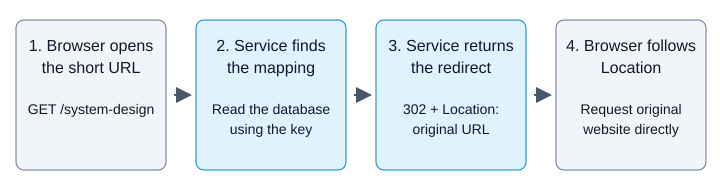

# URL Shortener

## Basic description

A URL shortener creates a short, shareable URL that points to a longer URL.
For example, it can map `https://short.example/aB7q2X9m` to
`https://example.org/products/guide`.

The service saves this mapping in a database. When someone opens the short URL,
the service looks up the original URL and returns an HTTP redirect. The browser
then opens the original website; the shortener does not host that website.

For generated links, the service creates a **Snowflake ID** and encodes that
integer as **Base62**. It does not generate random characters or hash the original
URL. Custom aliases remain a separate user-selected naming option.

## Functional requirements

- **Create a short URL:** Accept a valid long URL, generate a unique key, save
  the mapping, and return the short URL.
- **Support custom aliases:** Let the owner request an alias such as
  `system-design`. Reject aliases that are already used or reserved.
- **Redirect visitors:** Let anyone open an active short URL. Return `302` with
  the original URL in `Location` and `Cache-Control: no-store`.
- **Manage owned links:** Require sign-in to create, inspect, or disable a link.
  Only its owner can inspect its management details or disable it.
- **Support optional expiration:** Let the owner set an expiration time when
  creating a link. Return `410 Gone` when an expired or disabled link is opened.
- **Disable without reassigning:** Let the owner disable a link, but keep its
  key reserved after disabling or expiration so another user cannot claim it.
- **Keep destinations unchanged:** Create a new mapping when a different
  destination is needed instead of changing an existing link's destination.
- **Report invalid or missing links:** Reject invalid URLs and aliases. Return
  `404 Not Found` when a lookup confirms that the key does not exist.

## Non-functional requirements

These are design targets and constraints, not measured production guarantees.

- **Low latency:** Target server-side redirect latency below 100 ms at p95,
  meaning at least 95% of measured redirect requests finish within that time.
- **Read-heavy capacity:** Plan for 100,000 new links and 10 million redirects
  per day, with about 1,200 redirects per second at peak. Validate capacity
  through measurement before choosing the number of application instances.
- **Durability:** Save mappings in durable database storage and acknowledge
  creation only after the save succeeds, so application restarts do not erase
  acknowledged links.
- **Correctness under concurrency:** Enforce uniqueness in the database across
  generated keys and custom aliases. Concurrent requests must not overwrite an
  existing mapping or assign the same key to different destinations.
- **Availability and explicit failures:** Continue redirecting from still-valid
  cached mappings during a database outage. Return `503 Service Unavailable`
  when a required lookup cannot complete rather than inventing a `404`.
- **Bounded revocation:** With the optional cache, allow new lookups to use an
  old mapping for at most 30 seconds after confirmed revocation, subject to the
  [cache deadline rules](#keep-revocation-bounded). Never reuse a cached mapping
  beyond the link's expiration.
- **Security and abuse controls:** Validate destinations, enforce ownership,
  limit creation and key-guessing requests, and keep credentials and sensitive
  destination query values out of logs.
- **Observability:** Measure redirect latency, service failures, cache behavior,
  database fallback load, ID-generator health, key conflicts, and cache-invalidation failures.

## Basic architecture

### Original design board


The original board is preserved unchanged. Use Expand for a full-screen view,
or download the source to edit it in Excalidraw.

### Simplified architecture

<div class="diagram-scroll" role="region" aria-label="Basic architecture diagram; scroll horizontally on small screens" tabindex="0" markdown="1">

[](assets/overview.svg)

</div>

[Open the architecture diagram full size](assets/overview.svg).

The application handles requests and the database keeps the mappings. A **key**
is the identifier after the domain, such as `aB7q2X9m` or `system-design`.
Both generated keys and custom aliases use the same lookup.

Each creating application instance uses a local Snowflake generator with an
exclusively allocated worker ID. A coordinator allocates worker IDs when
instances start; it is not called for each new link. Redirects need neither the
generator nor its coordinator.

| Key | Original URL stored in the database |
| --- | --- |
| `aB7q2X9m` | `https://example.org/products/guide` |
| `system-design` | `https://example.org/products/guide` |

The key is not a compressed URL. The service needs the saved mapping to find
the destination. The browser opens the destination directly; the shortener
does not download or host the destination page.

## Features and chosen policies

The design supports creating, opening, expiring, and disabling links. The user
who creates a link is its **owner**.

| Area | Policy used in this design |
| --- | --- |
| Creation and management | The owner must sign in. Anyone can open an active link. |
| Generated keys | Encode a unique Snowflake ID as Base62; do not truncate or randomly generate the key. |
| Custom aliases | Generated keys and aliases share the same set of names; neither can overwrite an existing key. |
| Destination changes | Create a new mapping rather than changing an existing link's destination. |
| Expiration and disabling | Stop redirecting, but keep the key reserved so another user cannot reuse it. |
| Redirect response | Use `302` with `Cache-Control: no-store` because owners can disable links. |

These are choices for this design, not rules every URL shortener must follow.
Custom domains, previews, analytics, search, and writes in multiple regions are
outside this example.

## Request flows

The user who creates a link is its owner. Other users can open an active link,
but only the owner can manage it.

Start with the application reading and writing the database directly. Caching
is an optional extension, covered after the basic flows.

### Create a short URL

1. The owner sends the original URL and, optionally, a custom alias.
2. The service checks the owner's identity, creation quota, and input.
3. If no alias was provided, the service obtains a Snowflake ID from its local generator and encodes it as Base62.
4. The service asks the database to save the key, generated ID when applicable, destination, and owner.
5. The database checks that the key is not already in use while saving it.
6. After the save succeeds, the service returns `201 Created` and the short URL.

Generated keys and custom aliases retain their shared namespace. A generated
candidate can match an existing custom alias; in that case, consume the ID and
try the next Snowflake ID, up to a configured limit. Never reuse a consumed ID.
A repeated generated ID indicates a generator fault, not an expected random
collision: stop that generator, alert, and fail creation safely.

If a requested alias already exists, return `409 Conflict`. Do not substitute
another alias or overwrite the existing mapping.

Two requests can both check an alias and see that it is available. For that
reason, an earlier availability check is only a convenience. The database
must decide uniqueness when inserting the mapping.

See [API and data](#api-and-data) for request fields and naming rules.

### Generate the short key with Snowflake and Base62

Snowflake generates an integer from time, a worker identifier, and a sequence
number. The following is one chosen layout, not a requirement of every
Snowflake implementation:

```text
64-bit signed integer
| unused sign: 1 | milliseconds since custom epoch: 41 | worker ID: 10 | sequence: 12 |

id = (elapsedMilliseconds << 22) | (workerId << 12) | sequence
```

All instances use the same fixed custom epoch, for example
`2026-01-01T00:00:00Z`. Never change that epoch while using the same ID namespace.

| Field | Purpose |
|---|---|
| 41-bit elapsed time | About 69.7 years of milliseconds from the epoch |
| 10-bit worker ID | Up to 1,024 distinct worker slots across the whole deployment |
| 12-bit sequence | Values 0-4,095 for IDs generated by one worker in one millisecond |

The generator serializes access to its timestamp/sequence state. Within the
same millisecond, increment the sequence; in a later millisecond, reset it.
If the sequence is exhausted, wait for a later millisecond instead of wrapping.

Uniqueness depends on exclusive worker IDs and never repeating a worker's
timestamp/sequence pair. Deployment and restart rules are described under
[Operate the Snowflake generator safely](#operate-the-snowflake-generator-safely).
The database remains the final uniqueness safeguard.

Base62 then represents that integer with this fixed alphabet:

```text
0123456789ABCDEFGHIJKLMNOPQRSTUVWXYZabcdefghijklmnopqrstuvwxyz
```

Repeatedly divide the ID by 62, map each remainder to a character, and reverse
the characters. This changes the representation; it does not create uniqueness.

```text
Original URL -> Snowflake ID -> Base62 key -> database mapping

Illustrative ID: 123456789
Base62 key:     8M0kX
Short URL:      https://short.example/8M0kX
```

This small ID illustrates encoding, not the size of a typical current ID.
Here is a JavaScript encoding example, not a complete Snowflake generator:

```js
const alphabet = '0123456789ABCDEFGHIJKLMNOPQRSTUVWXYZabcdefghijklmnopqrstuvwxyz';

function encodeBase62(id) {
    if (typeof id !== 'bigint' || id < 0n || id >= (1n << 63n)) {
        throw new RangeError('Expected a nonnegative 63-bit BigInt');
    }
    let key = '';
    do {
        key = alphabet[Number(id % 62n)] + key;
        id /= 62n;
    } while (id > 0n);
    return key.padStart(3, '0');
}

encodeBase62(123456789n); // '8M0kX'
```

Use `BigInt`, not JavaScript `Number`, for the ID and bit operations. JSON API
fields containing raw IDs must use decimal strings so clients do not lose
integer precision. The short key is already a string.

Generated keys use one canonical encoding, padded to at least three characters
to match the naming policy. They grow to at most 11 characters for this 63-bit
layout; they are not fixed at eight characters. Do not truncate the encoding or
reduce the ID modulo a shorter key space: either can destroy uniqueness.

The same original URL can receive different IDs on separate creation requests.
Snowflake does not deduplicate URLs or make client retries idempotent.

### Open a short URL

<div class="diagram-scroll" role="region" aria-label="Opening a short URL diagram; scroll horizontally on small screens" tabindex="0" markdown="1">

[](assets/redirect.svg)

</div>

1. The browser sends `GET /system-design` to the service.
2. The service extracts `system-design` and reads its mapping.
3. If the mapping is active, the service returns this response:

```http
HTTP/1.1 302 Found
Location: https://example.org/products/guide
Cache-Control: no-store
```

The browser reads `Location` and sends a new request to the original website.

The response tells the browser where to go; it does not contain the destination
page. If the key does not exist, the service returns `404 Not Found`. If the
link has expired or been disabled, it returns `410 Gone`.

If a required database lookup fails, the service returns `503 Service Unavailable`,
not `404`: failing to read a mapping does not prove that the mapping is absent.

### Disable a short URL

1. The owner sends `DELETE /v1/links/system-design`.
2. The service checks that the caller owns the mapping.
3. The database saves the disable time in `revoked_at`.
4. The service returns `204 No Content` after the save succeeds.

Disabling a link is also called **revocation**. A new database lookup finds
the disabled record and returns `410` instead of a redirect. The service keeps
the key reserved; another user cannot claim it after revocation or expiration.

This does not close a page already opened or recall a redirect already returned.
If the requirement covers requests already being processed, define how those
requests coordinate with revocation before promising immediate enforcement.

### What changes when a cache is added?

A cache keeps temporary copies of mappings. Before reading the database, the
service can use a cached copy whose reuse deadline has not passed.

When the owner disables a link, the service saves the database change and removes
the cached copy. If removal fails, or an earlier read puts an old copy back,
some requests can still receive a redirect until that copy's deadline.

For this example, cached copies may be reused for at most 30 seconds from the
start of their database lookup, and never beyond the link's expiration.
The [revocation section](#keep-revocation-bounded) explains
the conditions needed to maintain that bound.

## API and data

The service uses one creation endpoint for generated keys and
custom aliases. The service stores both in the same table, so the database can
prevent either type from claiming a key already in use.

The examples are HTTP excerpts. Replace the access-token placeholder when
implementing a client; the wiki does not provide a running API.

### Create a link

The client sends the original URL as `destination`. If it omits `alias`, the
service generates the key. `expires_at` is a future UTC timestamp, or `null`
when no expiration is requested.

```http
POST /v1/links HTTP/1.1
Host: short.example
Authorization: Bearer <access-token>
Content-Type: application/json

{
  "destination": "https://example.org/products/guide",
  "expires_at": null
}
```

After saving the mapping, the service returns:

```http
HTTP/1.1 201 Created
Content-Type: application/json

{
  "key": "aB7q2X9m",
  "short_url": "https://short.example/aB7q2X9m"
}
```

To choose an alias, the client sends this body to the same endpoint:

```json
{
  "destination": "https://example.org/products/guide",
  "alias": "system-design",
  "expires_at": null
}
```

If the alias is available, the response contains `"key": "system-design"` and
`"short_url": "https://short.example/system-design"`. If the alias is already
used, the service returns `409 Conflict` rather than choosing another name.

### Open, inspect, or disable a link

| Request | Access | Successful response |
| --- | --- | --- |
| `GET /{key}` | Public | `302` with the original URL in `Location` and `Cache-Control: no-store` |
| `GET /v1/links/{key}` | Owner only | `200` with link details |
| `DELETE /v1/links/{key}` | Owner only | `204` after disabling; repeated deletion of the same owned mapping also returns `204` |

The [request flows](#request-flows) explain what happens before each response.

| Condition | Response |
| --- | --- |
| Invalid URL, invalid alias, or reserved alias | `400 Bad Request` |
| Missing or invalid credentials for creation or management | `401 Unauthorized` |
| Request to manage another owner's link | `404 Not Found`, to avoid disclosing its management details |
| Custom alias already used, including by an expired or disabled link | `409 Conflict` |
| Creation quota or request-rate limit exceeded | `429 Too Many Requests` |
| Public lookup finds no mapping | `404 Not Found` |
| Public lookup finds an expired or disabled mapping | `410 Gone` |
| Public redirect request uses a method other than GET | `405 Method Not Allowed` |
| Required storage operation or safe ID generation cannot complete | `503 Service Unavailable` |

### Store the mapping

This is a conceptual data model, not executable database DDL:

```text
links(
  key PRIMARY KEY, generated_id UNIQUE NULL, owner_id, destination,
  created_at, expires_at NULL, revoked_at NULL
)
```

| Field | What the service saves |
| --- | --- |
| `key` | The generated identifier or custom alias; the database rejects duplicate keys |
| `generated_id` | The exact Snowflake integer for generated links; `NULL` for custom aliases |
| `owner_id` | The user permitted to manage this link |
| `destination` | The original URL; it does not change after creation in this design |
| `created_at` | The creation time |
| `expires_at` | The optional expiration time; `NULL` means none was set |
| `revoked_at` | The disable time; `NULL` means the owner has not disabled the link |

The primary key also provides an index for key lookups. Keep the record after
expiration or revocation so its key cannot point to another user's destination.
Use a nullable unique constraint/index that permits multiple custom-alias rows
with `NULL` generated IDs, according to the chosen database's semantics.

### Validate keys and aliases

The following naming policy is a choice for this example:

- Accept 3-32 characters from `A-Z`, `a-z`, `0-9`, `_`, and `-`.
- Treat `Guide` and `guide` as different keys in both the application and database.
- Reject slashes, ambiguous URL encodings, and characters outside this set.
- Reserve service paths such as `v1`, `health`, `metrics`, `admin`, and `assets`,
  including different capitalizations. A reserved name is not available to a user.

Apply the same rules to every insertion path. Reserve new operational paths
before allowing users to claim them.

Generated keys use the canonical Snowflake-to-Base62 encoding described above.
If a generated candidate is a reserved service name, skip that ID rather than
publishing an unusable route. The database checks uniqueness while saving:

| Insert result | Generated key | Custom alias |
| --- | --- | --- |
| Saved | Return `201`. | Return `201`. |
| Key occupied by a custom alias | Consume the ID and try the next ID, up to a configured limit. | Return `409`; do not rename. |
| Repeated generated ID or key from another generated record | Treat as a generator fault; do not overwrite. Stop the faulty generator, alert, and return `503`. | Return `409` for an occupied key. |
| Safe ID generation unavailable or candidate limit exhausted | Return `503`; do not fall back to random keys. | Does not require ID generation; database availability is still required. |

An earlier availability check cannot reserve an alias. Two callers can both
pass that check; the database must accept at most one conflicting insert.

### Validate destinations and ownership

Use a URL parser to require a complete `http` or `https` URL with a hostname.
Reject embedded credentials, control characters, invalid encodings, and values
above the selected length limit. Build `Location` with an HTTP library so input
cannot introduce extra headers.

This design rejects obvious local hostnames and private or loopback IP addresses.
Those checks cannot prove that a host remains public; hostname resolution can change.
The service does not fetch destination pages. Adding previews would require
separate protection against server-side request forgery, where an attacker
makes the service contact internal resources.

Check ownership for management requests. Neither a generated key nor a custom
alias is an access-control mechanism. Snowflake-derived keys are not secret:
they can expose approximate creation time and can be enumerable. Limit creation, alias claims, and attempts
to guess keys; provide abuse reporting and takedowns. Keep credentials and
sensitive destination query values out of logs.

## Scaling and failures

The basic [request flows](#request-flows) work with an application and database.
This section explains when to add a cache, how that affects disabling links, and
what the service should do when a dependency fails.

### Estimate the workload

Assume users create 100,000 links and open short URLs 10 million times per day.
Both generated keys and custom aliases count toward the same creation total.
Assume peak traffic is ten times the average and each mapping uses 300 bytes.
These are planning inputs, not measured capacity.

| Estimate | Calculation | Result |
| --- | --- | --- |
| Average creations | 100,000 / 86,400 seconds | 1.16/s |
| Average redirects | 10,000,000 / 86,400 | 115.7/s |
| Peak redirects | 115.7 x 10 | About 1,157/s |
| Links after one year | 100,000 x 365 | 36.5 million |
| Raw yearly storage | 36.5 million x 300 bytes | 10.95 GB |

Use decimal GB here. Actual URL sizes, indexes, database copies, and backups
need separate allowances. A popular link can account for much of the traffic,
so test both evenly spread requests and requests concentrated on one key.

For this example, target about 1,200 peak redirects/s and server-side p95 latency
below 100 ms: at least 95% of measured redirect requests should finish within
that time. Check failed requests separately. These targets do not determine a
machine count until the implementation has been measured.

### Cache repeated lookups

The service first checks the cache for an active mapping. If a usable copy is
present, this is a **cache hit**. Otherwise, it reads the database, checks the
mapping, and can save a temporary copy for later requests. This is a **cache miss**.

A cached copy has a **time to live (TTL)**, the period for which it may be kept
before expiry. Its lifetime is different from the link's expiration time.
A link may remain active for months while each copy lasts only seconds.

Cache only active mappings. Never use a copy beyond its reuse deadline or the
link's own expiration, whichever comes first. Do not add a new mapping to the
cache before its database save succeeds.

### Keep revocation bounded

The chosen target allows new lookups to return the old destination for at most
30 seconds after the service confirms revocation. The service saves `revoked_at`
and removes the cached copy, but removal can fail. An earlier database read can
also put an old value back after the removal.

To keep reuse bounded, start a copy's 30-second deadline when its database lookup
begins, not when the copy eventually enters the cache. A lookup taking five
seconds leaves at most 25 seconds of reuse. Skip the fill if its deadline
already passed, and check that deadline on every cache hit.

This bound assumes fresh reads from the primary database, no extension of old
deadlines during copying or retries, and an allowance for clock differences
between servers sharing timestamps. An indefinitely delayed read followed by
a new 30-second TTL would not provide the same guarantee.

If new lookups must stop returning redirects immediately after confirmation,
do not rely on these temporary copies; check authoritative state for each lookup.
Requests already in progress still require an explicit coordination policy.

### Choose the redirect policy

This design uses `302` because owners can disable links. A browser that retains
a permanent `301` redirect may bypass later checks at the shortener.
Send `Cache-Control: no-store` so compliant browsers and intermediate caches
do not store the redirect response.

This HTTP response policy is separate from the service's internal mapping cache.
Neither status can recall a redirect already followed. A different API that
must preserve the caller's HTTP method on a temporary redirect can consider `307`;
the public operation here accepts only GET.

### Handle failures

| Failure | What the service does |
| --- | --- |
| Cache unavailable | Limit database fallback rate, concurrent reads, and waiting time; return `503` for excess work. Choose limits from measured database headroom. |
| Many requests miss the same key | Let one in-progress lookup serve waiting requests for that key. Limit waiters too. Vary TTLs downward to spread expiration without extending deadlines. |
| Database unavailable | Use only still-valid active cached copies; otherwise return `503`, not an invented `404`. |
| Cache invalidation fails | Record and retry the invalidation; retain the original reuse deadlines. |
| Database saved a new link, but the creation response was lost | A retry may create a second generated link or receive `409` for the custom alias. Do not assume the original save failed. |
| Clock moves backward or worker-ID ownership is uncertain | Stop ID generation until safe recovery; fail generated-link creation with `503` if it cannot recover within the request deadline. Existing redirects continue when mappings are available. |
| A generated ID repeats | Database rejects the duplicate; stop and investigate the faulty generator instead of treating it as an ordinary key collision. |

If creation retries must return the original result, extend the API with an
**idempotency key** identifying one request. Save the caller, key, input, and result
in the same database transaction as the mapping. The transaction saves all
these changes together or none of them.

A retry with the same caller, key, and input returns the saved result; changed
input is rejected. Define the retention period and pending-request behavior.
This is an extension to the basic contract, not something a custom alias
automatically provides.

### Operate the Snowflake generator safely

Unlike random keys, valid Snowflake IDs do not rely on collision probabilities.
They rely on operational invariants:

- **Exclusive worker IDs:** Allocate each worker slot to only one active generator. A lease allocator must prevent expired owners from continuing to generate; an expiry in the coordinator alone does not fence a paused or partitioned process.
- **Clock rollback:** If the clock is behind the generator's last timestamp, stop issuing IDs. Wait for time to catch up within a bounded deadline, or fail safely. Do not reset the sequence at an earlier timestamp.
- **Restart and worker reuse:** Persist/recover timestamp high-water state before reusing a worker ID, or quarantine the slot until time is demonstrably beyond every timestamp its previous owner could have issued. Losing an in-memory sequence is not permission to reuse the same millisecond.
- **Sequence exhaustion:** After 4,096 IDs in one millisecond on one worker, wait for the next safe millisecond. Never wrap the sequence.
- **Timestamp exhaustion:** Detect when elapsed milliseconds no longer fit in 41 bits. Plan a namespace/version migration before that horizon; do not wrap.

Use a maintained generator with documented behavior for these cases rather than
implementing only the bit-shift formula. Worker leases need a conservative local
validity check, including after pauses, and safe reassignment rules. A coordinator
outage prevents new allocations; existing workers generate only while they can
prove their ownership remains valid.

The field layout permits a theoretical 4,096 IDs/ms per worker, not a measured
service throughput guarantee. This example averages about 1.16 creations/s, so
Snowflake is chosen for distributed ID allocation, not because this workload
requires its maximum rate. It adds clock and worker-allocation complexity.

No database query is needed before generating each ID. Insert the mapping with
database uniqueness checks. Base62 preserves distinct integers when encoded
canonically, while custom aliases can still occupy a generated candidate's name.

### Observe the targets

Measure redirect latency at p95/p99, service failures, cache hit ratio, and
database fallback rate and concurrency. Count expected `404` and `410` results
separately from service failures.

Monitor clock rollback, worker ownership/renewal failures, sequence waits, and
duplicate generated IDs. Track generated candidates skipped because of aliases
or reserved names separately from generator faults and user alias conflicts.
Monitor invalidation failures and measure how long disabled links still redirect.
Test cache loss and recovery against the measured fallback budget before
claiming that the service can handle an outage.

For background concepts, see [Scaling & Caching](../../04-scaling.md).
For a different retry problem, see [Notifications](../notification-service.md).

## Conceptual exercise

**Required material:** the [request flows](#request-flows) and
[API contract](#api-and-data) above.
You need only a written answer or diagram, not code or a running service.

Use these assumptions:

- Two different owners request the custom alias `system-design` at the same time.
- The winning mapping points to `https://example.org/products/guide`.
- The owner later disables the link. Requests discussed below start after confirmation.
- In the cached version, one old copy has 12 seconds left before its deadline.
  Invalidation fails, but the service checks the deadline on every cache hit.
- Ignore requests already in progress and assume the database is reachable.

**Tasks**

1. State what each creation request receives and explain why only one mapping is saved.
2. Write the active link's redirect response and explain what the browser does next.
3. Explain whether the losing owner can claim the alias after it is disabled.
4. Compare opening the disabled link with no cache and with the old cached copy.

**Completion criteria:** your answer identifies `201` versus `409`, the database
uniqueness check, `302` and `Location`, the no-reuse policy, and the difference
between the direct database result and the remaining 12-second cache window.

??? success "Check your answer"
    The database accepts one insert. That owner receives `201` and the short URL.
    The competing request receives `409`; the service does not overwrite the first row.

    While active, the link returns `302`, `Location: https://example.org/products/guide`,
    and `Cache-Control: no-store`. The browser then requests that destination.

    Revocation does not release the alias. The losing owner still receives `409`
    if they request it again.

    Without a cache, a new authoritative lookup finds the disabled record and
    returns `410`. With the old copy, the service may return redirects for the
    remaining 12 seconds. It must stop using the copy at its deadline and then
    return `410` from the database. A redirect already followed cannot be recalled.
